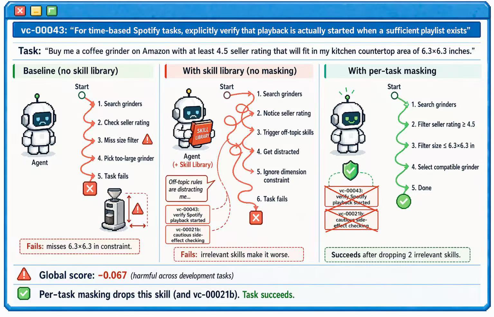
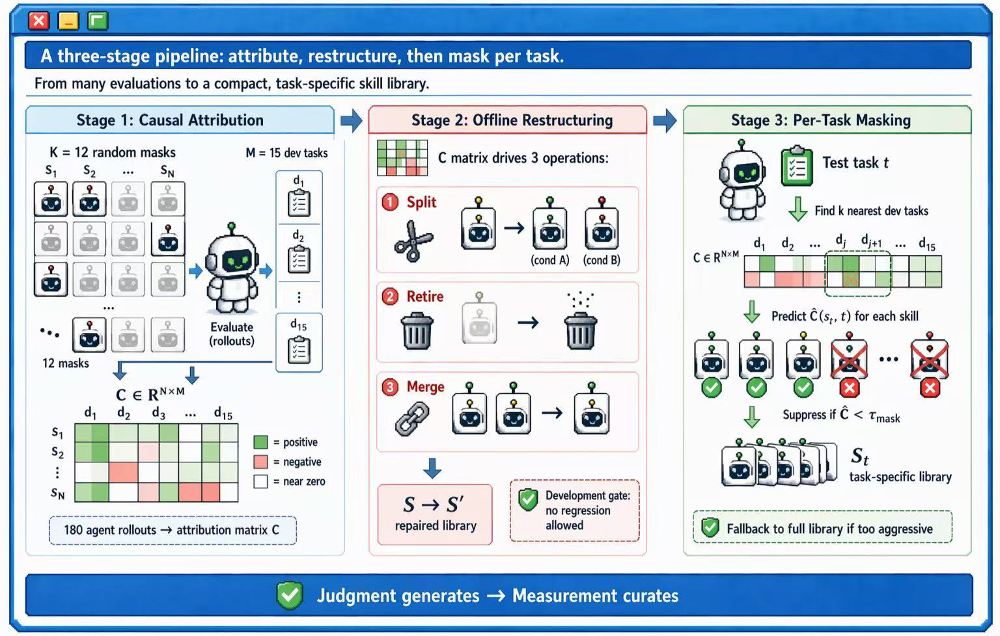
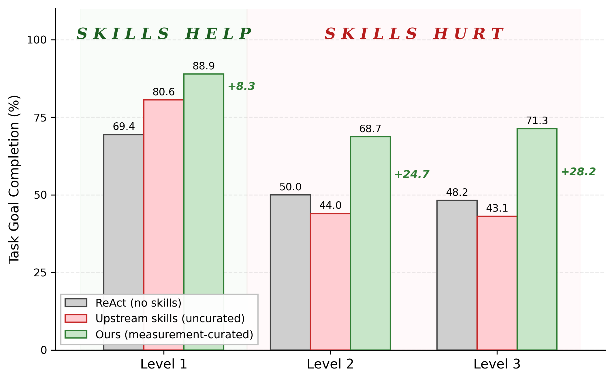
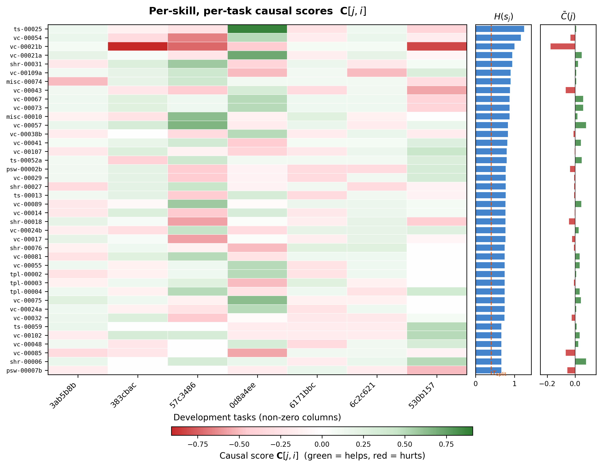
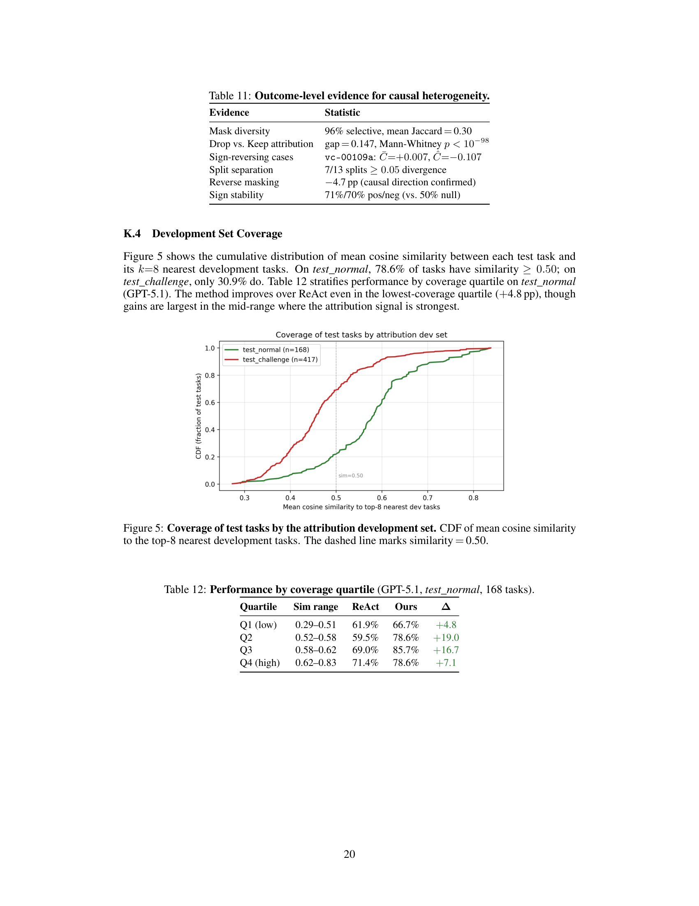

# Not All Skills Help: Measuring and Repairing Agent Knowledge
# 并非所有技能都有帮助：测量与修复智能体知识

> **论文信息**
> - **arXiv**：arXiv:2606.15390v1 [cs.CL]，2026 年 6 月 13 日（预印本）
> - **作者**：Yixuan Wang$^{1*}$、Yiyang Zhou$^{1*}$、Yiming Liang$^2$、Congyu Zhang$^1$、Fuxiao Liu$^3$、Jiawei Zhou$^1$、Huaxiu Yao$^1$（* 同等贡献）
> - **单位**：$^1$UNC Chapel Hill、$^2$Purdue、$^3$NVIDIA
> - **代码**：https://github.com/aiming-lab/assay
> - **框架名**：ASSAY（**A**ttribution-Based **S**kill **S**election **a**nd assembl**Y**，基于归因的技能选择与装配）
> - **关键词**：技能库治理、因果归因、随机掩码、因果异质性、按任务掩码

> **翻译说明**
> - 本文基于 arXiv:2606.15390v1 全文翻译，覆盖摘要、第 1—5 节正文、参考文献，以及附录 A—K 全部内容。
> - 本文与《技能越多，智能体越差？》（arXiv:2605.24050）是同一议题上的**互补**工作：后者诊断「技能库扩大会因**选择失败**而退化」（宏观、概率分解），本文则诊断「**单个技能本身在不同任务上因果效应相反**」（微观、因果归因）。两篇合读才完整。
> - 公式（差分之均值估计量、方差上界、逐任务预测、掩码规则）按原文形态完整保留。
> - 术语处理：`randomized masking` → 「随机掩码」；`causal heterogeneity` → 「因果异质性」；`difference-in-means estimator` → 「差分之均值估计量」；`per-task masking` → 「按任务掩码」；`retire` → 「退休 / 淘汰」；`split` → 「拆分」；`merge` → 「合并」；`oracle` 保留「神谕」（但本文语境下更多用「开发集 / 归因任务」表述，故不滥用）。

---

## 摘要

LLM 智能体可以在**不更新权重**的情况下，通过从经验中累积自然语言技能来提升自己。但当前系统把「保留哪些技能」与「如何使用它们」的**每一个决策都单独托付给 LLM 的判断**。

我们论证，这样做**混淆了两种截然不同的角色**：

- **从经验中生成一个技能**是一种**创造性行为**，判断（judgment）很擅长处理；
- 而**判断该技能是否真的有帮助**需要**跨大量任务的实证证据**。

通过**随机掩码**测量每个技能的**因果贡献**，我们发现技能库普遍存在**因果异质性（causal heterogeneity）**：单个技能经常在**某些任务类型上有帮助，而在另一些上有害**，然而它们的**相反效应在聚合时相互抵消**，使得它们对**全局式治理方法**完全不可见。

我们提出 **ASSAY**，一个把**生成与治理分离**的框架：它在一个小的开发集上计算**逐技能的因果归因**，离线重构技能库，并为每个测试任务**抑制掉预测效应为负的技能**。

在跨越**四家供应商的七个基础模型**和**两个基准**（AppWorld 与 τ-bench）上，ASSAY 一致地优于先前的技能治理方法：

- 在 AppWorld 最难的划分上，**DeepSeek-V3 达到 69.3% 的任务目标完成率（相对提升 47.4%）**，在所有已发表方法（**包括权重微调方法**）中创下新的最好成绩。
- 在 τ-bench retail 上，**GPT-4.1 相对提升 8.7%**，在**不做任何权重修改**的情况下，在公开排行榜上超过 o4-mini、o1 与 GPT-4.5。

消融把主要增益追溯到**按任务掩码**，这证实：**瓶颈在于推理时把技能匹配到任务，而不是全局地移除坏技能。**

代码见 https://github.com/aiming-lab/assay。

---

## 1. 引言

过去两年，**不更新权重也能变强的 LLM 智能体**取得了快速进展。配方很简单：让智能体尝试任务，把成功的轨迹蒸馏成自然语言技能（短规则、启发式、过程模板），并把它们注入未来任务的上下文窗口 [9, 23, 22, 3]。在 AppWorld [11] 这类交互式基准上，基于技能的方法已经产生了**两位数**的提升，可与微调模型权重的方法相抗衡。

一个假设悄悄地贯穿于这些工作：**LLM 判断是整个技能生命周期的充分监督信号。** 生成、保留与检索都被委派给同一个 LLM，而**没有任何环节检查被保留的技能是否真的有帮助**。

我们发现这种**不受检查的累积**有一个系统性的坏处。在七个模型与两个基准上，那些在「它们被学习时的任务」上必不可少的技能，在「它们不适用时的任务」上变成了**纯粹的开销**。在 AppWorld 上，用于多步购买的规则会**耗尽简单单动作任务的步数预算**；在 τ-bench retail [18] 上，来自复杂换货的规则会让**直白的取消**操作脱轨。

> 
>
> **图 1**：为一个领域设计的技能可能损害另一个领域的任务；按任务掩码修复了这一点。任务是在 Amazon 上购买一台适配 6.3×6.3 英寸台面、卖家评分 ≥4.5 的咖啡研磨机。**左**：没有任何技能库时，智能体未能强制执行尺寸约束。**中**：完整的技能库把事情变得更糟——离题的规则，包括一条 Spotify 播放验证规则（vc-00043）与一条副作用检查规则（vc-00021b），把智能体的注意力从尺寸要求上引开。**右**：按任务掩码抑制了这两个技能，智能体成功。vc-00043 的因果效应在开发任务上平均为 **−0.067**（底部），确认其一致的危害。

图 1 端到端追踪了一个实例：一条 Spotify 播放验证规则把智能体从 Amazon 购买任务中的尺寸约束上引开；按任务掩码抑制它，智能体就成功了。当我们在数百个任务上追踪失败时，我们发现**一小撮技能占据了不成比例的回归份额**，而且**同一个技能可以在一种任务类型上有帮助，在另一种上有害**。

为了理解这些失败，我们在留出任务上通过**随机掩码** [2] 测量逐技能的因果效应。得到的归因揭示了**因果异质性**：许多技能在不同任务类型之间**反转符号**，在某些任务上帮助、在另一些上伤害。**任何单任务判断器都无法检测到这一点**，因为这种反转只有在跨大量任务聚合证据时才可见。

因此我们把两种角色分开：**判断生成技能，测量治理技能。** 我们提出 ASSAY——一个在三阶段中操作化这种分离的框架：

1. 通过随机掩码在留出任务上**测量逐技能因果效应**；
2. **离线重构技能库**：拆分异质性技能、淘汰惰性技能；
3. 通过抑制预测影响为负的技能，为每个测试实例**个性化技能库**。

**总结。** 我们的主要贡献是 ASSAY——一个首次对智能体技能库中的因果异质性给出经验刻画、并提供解决它的实用方法的框架。跨七个模型与两个基准，ASSAY 一致地优于先前的治理方法：DeepSeek-V3 在 AppWorld 上取得新的最好成绩（69.3% TGC，相对提升 47.4%），GPT-4.1 在 τ-bench 上不修改权重即超过 o4-mini、o1 和 GPT-4.5。消融把主要增益追溯到按任务掩码，证实瓶颈在于推理时把技能匹配到任务，而非全局移除坏技能。

---

## 2. ASSAY：基于归因的技能选择与装配

从单个任务生成一个有帮助的技能需要**创造力**；判断该技能在大量任务上是否真的有帮助，需要**没有任何单个任务能提供的实证证据**。我们在一个称为 **ASSAY** 的框架中操作化这种分离。

整个框架从**一个对象**流出：一个**逐技能、逐任务的因果归因矩阵** $C \in \mathbb{R}^{N \times M}$，在一个小的留出集上计算一次，所有治理决策都从它导出。我们描述 $C$ 如何被测量（§2.1）、它如何指导离线技能库重构（§2.2），以及它如何在推理时为每个测试任务个性化技能库（§2.3）。图 2 给出概览。

> 
>
> **图 2**：框架概览。**阶段 1**：随机掩码产生一个因果归因矩阵 $C \in \mathbb{R}^{N \times M}$；每个单元格记录一个技能在给定任务上是有帮助（绿）还是有害（红）。**阶段 2**：由 $C$ 驱动的三种操作（拆分、淘汰、合并）在开发闸门的约束下离线重构技能库。**阶段 3**：在推理时，按任务掩码抑制预测因果效应为负的技能，并带有回退到完整技能库的机制。

**预备。** 我们假设可以访问一个由既有治理流水线产出的技能库 $S = \{s_1, \ldots, s_N\}$，以及一个与训练集和测试集都**不相交**的留出开发集 $D = \{d_1, \ldots, d_M\}$。

在上游治理中，我们施加**难度感知排序**：每个训练任务用裸智能体跑两次以估计难度，任务按**最难优先**排序，从而让治理器尽早遇到高信号的失败案例。得到的技能库包含从训练轨迹中**自动蒸馏**出的技能。

除了这些习得技能，我们还追加**五个手写的操作模板**（前缀 `tpl-`），它们捕获常见的过程模式，如分页、数据校验与跨应用身份解析。这些模板源自每个基准的公开文档与训练集失败分析，并被标记为**受保护**：它们豁免于所有后续修改与掩码（全文见附录 B）。

### 2.1 测量因果效应

技能库是一组自然语言指令的集合，它们**共同**塑造智能体的行为。评估任何单个技能的挑战在于：**它的效应取决于哪些其他技能同时在场**——一条验证规则单独使用时可能无害，但与一条已经执行同样检查的分页规则同时存在时就有害。

为了解开这些交互，我们转向因果推断中最简单的工具：**随机实验**。

**随机掩码协议。** 对 $K$ 次独立试验中的每一次，我们通过以概率 $f$ **独立**纳入每个技能（伯努利抽样）来构造一个随机掩码 $m_k \subseteq S$。令 $\mathbb{1}[s_j \in m_k]$ 表示技能 $s_j$ 在掩码 $m_k$ 中的纳入指示子，令 $o_k(d_i) \in \{0, 1\}$ 表示智能体在掩码 $m_k$ 下在开发任务 $d_i$ 上的二元结果。定义**包含**技能 $s_j$ 与**排除**技能 $s_j$ 的掩码集合分别为 $M_j^+ = \{k : s_j \in m_k\}$ 与 $M_j^- = \{k : s_j \notin m_k\}$。

技能 $s_j$ 在任务 $d_i$ 上的**因果得分**是**差分之均值估计量（difference-in-means estimator）**：

$$C[j, i] = \frac{1}{|M_j^+|} \sum_{k \in M_j^+} o_k(d_i) - \frac{1}{|M_j^-|} \sum_{k \in M_j^-} o_k(d_i). \tag{1}$$

在伯努利抽样下，技能被独立纳入，因此 $C[j, i]$ 是「纳入技能 $s_j$ 对任务 $d_i$」的**平均处理效应（ATE）**的无偏估计量，是对**共现技能分布**做了边缘化后的结果。

该估计量的方差上界为

$$\operatorname{Var}\left(C[j, i]\right) \leq \frac{1}{4}\left(\frac{1}{|M_j^+|} + \frac{1}{|M_j^-|}\right), \tag{2}$$

因为 $o_k(d_i) \in \{0, 1\}$ 蕴含 $\operatorname{Var}(o_k(d_i)) \leq \tfrac{1}{4}$。**每个单元格的方差随掩码数增加而下降**；按任务掩码进一步通过对最近的开发任务做平均来降低有效噪声（式 6）。

**所有技能无一例外地参与归因**；基于前缀的保护只在**下游的掩码阶段**（§2.3）适用。具体超参数选择与统计验证报告在 §3。

**行统计量。** 给定完整矩阵 $C$，我们从每一行导出两个汇总统计量，它们驱动所有后续治理决策。

技能 $s_j$ 的**全局因果得分**是行均值：

$$\bar{C}(j) = \frac{1}{M} \sum_{i=1}^{M} C[j, i], \tag{3}$$

它捕获 $s_j$ 跨所有开发任务的平均边际贡献。

技能 $s_j$ 的**因果异质性**是行极差：

$$H(s_j) = \max_i C[j, i] - \min_i C[j, i], \tag{4}$$

它衡量该技能的效应在任务之间变化的程度。

**定义 1（因果异质性技能）。** 若 $H(s_j) \geq \tau$，则技能 $s_j$ 在阈值 $\tau$ 下是**因果异质**的，即其因果效应在开发任务之间发生反转或显著变化。

**一个 $H(s_j)$ 高但 $\bar{C}(j)$ 接近零的技能是最危险的**：它在某些任务上有帮助、在另一些上有害，但其正负效应在聚合时**相互抵消**，使得它对任何**仅按全局得分**评估技能的治理方法**都不可见**。

完整归因对每个基础模型计算一次，因为技能库的因果结构**取决于解释它的模型**。

### 2.2 离线技能库重构

归因矩阵 $C$ 揭示了哪些技能有问题，但**测量本身并不修复技能库**。一个在某些任务上有帮助、在另一些上有害的异质性技能，**不能简单地被删除**——那会丢掉它的有益效应。相反，技能库必须被重构，使得**每个技能的适用条件被显式化**。

行统计量 $\bar{C}(j)$ 与 $H(s_j)$ 把技能划分为三种情形：**一致有益**（$\bar{C}(j)$ 为正，$H(s_j)$ 小）、**可忽略**（$|\bar{C}(j)|$ 小，$H(s_j)$ 小）与**因果异质**（$H(s_j) \geq \tau_{\text{split}}$）。我们依次针对每种情形施加三种操作：**拆分**把异质性技能解析为条件变体，**淘汰**移除可忽略的技能，**合并**对拆分引入的近似相同技能去重。这个顺序的选择是为了**防止信息丢失**。

**步骤 1：拆分（Split）。** 对每个满足 $H(s_j) \geq \tau_{\text{split}}$ 的技能 $s_j$，我们用基础 LLM 把 $s_j$ 重写为**两个条件变体**，每个变体带一个显式**触发条件**，说明它应当在何时适用。重写由因果得分向量 $(C[j, 1], \ldots, C[j, M])$ 指导：一个变体针对技能有帮助的任务，另一个针对技能有害的任务。

每一对重写结果必须通过一个**开发闸门**：重构后的技能库必须在**全部 $M$ 个归因任务**上达到**不低于**原始的通过率。若不满足，则保留原技能。

**拆分必须最先运行**，因为一个因果异质技能的 $\bar{C}(j) \approx 0$（正负效应抵消），如果先运行淘汰，它会被**错误地淘汰**。至多处理 $\tau_{\max\_split}$ 个候选；这是 **LLM 判断重新进入治理流程的唯一一处**，其作用域被限定，并经过经验验证。

**步骤 2：淘汰（Retire）。** 一旦异质性技能被解析完毕，淘汰就针对剩余的低信号技能。任何满足 $|\bar{C}(j)| < \tau_{\text{retire}}$ 的技能都被移除。

**步骤 3：合并（Merge）。** 拆分可能引入近似重复的变体。剩余技能被嵌入；余弦相似度超过 $\tau_{\text{merge}}$ 的配对聚成一簇，每个簇中得分最高（按 $\bar{C}$）的成员被保留。**合并必须最后运行**，正是因为它必须作用于**已经被拆分与淘汰塑造过**的技能库。

### 2.3 按任务因果掩码

离线重构产出一个单一的修复后技能库 $S'$，但**静态技能库无法涵盖测试条件的全部多样性**。既有技能应用方法——无论是注入所有技能，还是按语义相似度检索——的**核心局限**是：它们**无法区分一个有帮助的技能与一个有害的技能**：两者在嵌入空间里看起来一模一样。

我们通过把推理时的技能选择**框定为逐任务风险最小化问题**来解决这一点：对每个测试任务，预测哪些技能会有帮助、哪些会有害，然后**抑制有害的那些**。

**预测因果效应。** 关键思想是把因果证据**从相似的开发任务迁移到新的测试任务**。给定一个测试任务 $t$ 及其指令嵌入 $e_t \in \mathbb{R}^d$，我们通过余弦相似度找出 $k$ 个最近的开发任务 $N(t) \subset D$，并通过温度缩放的 softmax 计算注意力权重：

$$w_i(t) = \frac{\exp\left(\tau \cdot \cos(e_t, e_{d_i})\right)}{\sum_{i' \in N(t)} \exp\left(\tau \cdot \cos(e_t, e_{d_{i'}})\right)}, \quad i \in N(t), \tag{5}$$

其中 $\tau$ 是一个温度参数，把权重集中到最近的邻居上。技能 $s_j$ 在任务 $t$ 上的**预测因果效应**是 $C$ 的第 $j$ 行到该任务的**核加权投影**：

$$\hat{C}(s_j, t) = \sum_{i \in N(t)} w_i(t) \cdot C[j, i] = C[j, :]\, w(t), \tag{6}$$

其中 $w(t) \in \mathbb{R}^M$ 是权重向量（在 $N(t)$ 之外为零）。这可以读作**对归因矩阵的一次软检索**：每个测试任务诱导出 $C$ 的开发任务列的**不同线性组合**，为每个技能产生一个任务专属的因果画像。

**风险最小化掩码规则。** 给定每个技能的预测因果效应，我们抑制被预测为有害的技能，同时保留所有潜在有帮助的技能。在「技能对任务成功的贡献相互独立」这一近似下，为任务 $t$ 纳入技能 $s_j$ 的**期望危害**正比于 $\max(0, -\hat{C}(s_j, t))$。一个**仅做移除**的设计最小化该期望危害：

$$S_t = \left\{s_j \in S' : \hat{C}(s_j, t) \geq \tau_{\text{mask}} \ \text{或}\ s_j \in S_{\text{protected}}\right\}, \tag{7}$$

其中 $S_{\text{protected}}$ 表示带受保护前缀（`tpl-`、`shr-`、`api-`）的技能。如果过滤后的集合太小，则改用完整技能库 $S'$，从而保证**优雅降级**。

式（7）的**不对称性是有意为之**：漏掉一个关键技能（例如一个分页模板）会导致**灾难性失败**，而在众多技能中保留一个轻度有害的技能，其效应是**被稀释的**。算法 1 总结该过程。

**小结。** 三个阶段构成一条连贯的流水线，由单一原则统一：**判断生成候选技能，测量治理它们。** 每个阶段都包含**结构性回退**（离线重构会回滚失败的拆分；当按任务掩码过于激进时会退回完整技能库），因此这条流水线**不可能把性能降到任何阶段前缀之下**。由于该框架完全在推理时运行，且只需一个技能库与一个小的开发集，它可以被叠加在任何既有的技能生成方法之上。

---

## 3. 实验

我们在两个基准、跨越四家供应商的七个基础模型、以及两种智能体架构上评测，全程使用同一条流水线与同一组超参数。我们的实验回答以下问题：

1. 测量驱动的治理能否跨模型与基准泛化？
2. 增益集中在何处，未治理的技能注入在哪里造成危害？
3. 流水线中哪些阶段最重要？

> **算法 1：按任务因果掩码（推理时）**
>
> **要求**：测试任务 $t$、重构后技能库 $S'$、归因矩阵 $C \in \mathbb{R}^{N \times M}$、开发集嵌入 $\{e_{d_i}\}_{i=1}^{M}$、参数 $k, \tau, \tau_{\text{mask}}, \tau_{\min}$
> **保证**：任务专属技能库 $S_t \subseteq S'$
>
> ```
> 1:  // 阶段 A：预测逐技能因果效应
> 2:  计算任务指令的嵌入 e_t
> 3:  N(t) ← 按 cos(e_t, e_di) 取 k 个最近开发任务
> 4:  w(t) ← softmax(τ · [cos(e_t, e_di)]_{i∈N(t)})            ▷ 式 (5)
> 5:  for each skill s_j ∈ S' do
> 6:      Ĉ(s_j, t) ← C[j, :] w(t)                            ▷ 式 (6)
> 7:  end for
> 8:  // 阶段 B：风险最小化过滤
> 9:  S_t ← {s_j ∈ S' : Ĉ(s_j, t) ≥ τ_mask 或 s_j ∈ S_protected}   ▷ 式 (7)
> 10: // 阶段 C：优雅回退
> 11: if |S_t| < τ_min then
> 12:     S_t ← S'                                           ▷ 退回完整技能库
> 13: end if
> 14: return S_t
> ```

### 3.1 实验设置

**基准。** **AppWorld** [11] 在九个消费者应用（邮件、日历、Venmo、Spotify、Amazon 等）中模拟，智能体通过代码 REPL 组合多步 Python API 调用。我们在两个官方测试划分上评测：`test_normal`（168 个任务）与 `test_challenge`（417 个任务），两者都跨越难度等级 1—3。`test_challenge` 中等级 3 任务更集中（47% vs. 37%），因此平均而言**明显更难**。主指标是**任务目标完成率（TGC）**；我们也报告**子目标完成率（SGC）**（附录 J）。智能体是带 40 步预算的 **ReAct 智能体** [17]。

**τ-bench** [18] 通过函数调用工具模拟零售客服。智能体与一个 LLM 模拟的顾客（GPT-4o，温度 0）对话，必须在遵守一份策略文档的同时满足请求。我们在 retail 域（115 个任务）上评测，采用**精确数据库状态匹配**；不给部分分。智能体是基准原生的 `ToolCallingAgent`，预算 30 轮。

在两个基准中，技能库都作为系统提示的一部分被注入，所有智能体调用都使用温度 0。

**模型与数据。** 我们在**标准（非推理）模式**下评测七个模型：GPT-5.4、GPT-5.1、GPT-4.1、GPT-4o（OpenAI）；DeepSeek-V3（DeepSeek，开放权重）；Claude Sonnet 4.5（Anthropic）；Gemini 2.5 Pro（Google）。我们**有意排除推理变体**，以把技能治理的效应与思维链推理隔离开。每个模型独立运行完整流水线；归因矩阵 $C$ 对每个模型重新计算，因为技能库的因果结构取决于解释它的模型（§2.1）。

数据被划分为**严格不相交**的集合：AppWorld 使用 90 个训练、15 个开发（共 57 个中的）、168 + 417 个测试任务；τ-bench 使用 500 个训练、15 个开发（共 20 个中的）、115 个测试。

**基线。** 对 AppWorld 上的每个模型，我们与可得的最好已发表方法对比：GPT-5.1 与 DeepSeek-V3 对比 ACE [22]；GPT-4.1 对比 CUGA [8]；GPT-4o 对比 Gupta et al. [3]。我们额外报告当前 AppWorld 排行榜榜首。在 τ-bench 上，我们对比每个模型**未增强的基线**，因为在同一评测协议下没有先前的基于技能的方法报告过该基准的结果。对 GPT-5.4、Claude Sonnet 4.5 与 Gemini 2.5 Pro，也**没有**先前的基于技能的方法在 AppWorld 上报告过结果，我们对这些模型对比未增强的 ReAct 基线。

**归因参数。** 归因使用 $K = 12$ 个随机掩码，纳入概率 $f = 0.4$，平均每个技能约 5 个掩码，每个单元格标准差至多 **0.29**。按任务掩码在 $k = 8$ 个最近开发任务上平均，把每次决策的有效噪声降为 $\sigma \approx 0.10$。自助分析确认 **97.2%** 的掩码决策在掩码重采样下**方向稳定**（附录 K）。完整归因对每个模型需要 **180 次智能体 rollout**（$K = 12$ 掩码 × $M = 15$ 开发任务）。其余超参数列在附录表 5；**不做任何逐单元格调参**。

### 3.2 主要结果

**AppWorld。** 表 1 给出两个划分上的结果。**每个模型在各自基线的两个划分上都提升了。**

在 `test_normal` 上，GPT-5.1 相对 ACE 提升 **10.1 个点**（67.3 → 77.4），DeepSeek-V3 提升 **5.3 个点**（78.0 → 83.3）——两者**来自同一个上游技能库，改变的只有治理**。GPT-4.1 与 GPT-4o 分别超过 CUGA 与 Gupta et al.，而这两个基线本身已经包含了结构化检索或示范选择。另外三个模型（GPT-5.4、Sonnet 4.5、Gemini 2.5 Pro）确认了跨四家供应商的**普适性**，在两个划分上的增益从 +4.3 到 +8.4 不等，且**没有做任何按供应商的调参**。

在更难的划分上，**DeepSeek-V3 达到 69.3% TGC**——在所有已发表方法（**包括权重微调方法**）中创下新的最好成绩，相对裸 ReAct 提升 **47.4%**。

> **表 1**：AppWorld 结果（TGC，%）。$\Delta$ 相对裸 ReAct 计算。**粗体**：每列中最好的基于提示的方法。**红色**：相对 ReAct 退化（原文以红字标出，此处无法用颜色表达，改用「↓」标注）。SGC 见附录 J。
>
> | 模型 | 方法 | test_normal (168) TGC | Δ | test_challenge (417) TGC | Δ |
> |---|---|---|---|---|---|
> | GPT-5.1 | ReAct | 61.9 | — | 52.5 | — |
> | GPT-5.1 | ACE | 67.3 | +5.4 | 49.9 | **−2.6 ↓** |
> | GPT-5.1 | **Ours** | **77.4** | **+15.5** | **66.4** | **+13.9** |
> | DeepSeek-V3 | ReAct | 69.1 | — | 47.0 | — |
> | DeepSeek-V3 | ACE | 78.0 | +8.9 | 63.1 | +16.1 |
> | DeepSeek-V3 | **Ours** | **83.3** | **+14.2** | **69.3** | **+22.3** |
> | GPT-4.1 | ReAct | 66.7 | — | 50.4 | — |
> | GPT-4.1 | CUGA | 73.2 | +6.5 | 57.6 | +7.2 |
> | GPT-4.1 | **Ours** | **75.6** | **+8.9** | **64.0** | **+13.6** |
> | GPT-4o | ReAct | 48.8 | — | 30.2 | — |
> | GPT-4o | Gupta et al. | 68.5 | +19.7 | 38.9 | +8.7 |
> | GPT-4o | **Ours** | **71.4** | **+22.6** | **41.0** | **+10.8** |
> | GPT-5.4 | ReAct | 82.1 | — | 81.1 | — |
> | GPT-5.4 | **Ours** | **88.7** | **+6.6** | **85.4** | **+4.3** |
> | Sonnet 4.5 | ReAct | 83.9 | — | 70.3 | — |
> | Sonnet 4.5 | **Ours** | **89.3** | **+5.4** | **75.3** | **+5.0** |
> | Gemini 2.5 | ReAct | 72.6 | — | 49.4 | — |
> | Gemini 2.5 | **Ours** | **81.0** | **+8.4** | **54.9** | **+5.5** |
> | 排行榜最好$^*$（Qwen3-14B，权重微调） | — | 86.9 | — | 67.6 | — |
>
> $^*$无配套论文；见 §3 脚注。

**最发人深省的结果不是增益，而是增益之前的那次退化。** 在 `test_challenge` 上，上游技能库把 GPT-5.1 的 TGC **从 52.5% 降到 49.9%**：一个**为了帮助而设计的技能库，让智能体严格变差了**。我们的方法反转了这次退化，并相对裸 ReAct 提升 26.5%。

图 3 揭示了危害**集中在何处**：在等级 2 与等级 3 任务上，未治理的技能库使性能退化，而等级 1 任务本已受益。按任务掩码恢复了被退化的等级，**等级 3 上的增益最大（43.1 → 71.3，相对提升 65.4%）**，确认该方法的价值在**未治理技能库造成最大伤害的地方最大**。

一个**反向掩码对照**（改为抑制得分最正的技能）会使性能退化，确认**是掩码的方向、而非仅仅减少上下文，驱动了改进**。

> 
>
> **图 3**：AppWorld `test_challenge` 上的逐难度分解（GPT-5.1，417 个任务）。未治理的技能库（红）改善了等级 1，但使等级 2 与等级 3 退化。我们的方法（绿）在每个等级上都恢复到并超过基线。

**τ-bench。** 表 2 评估该框架能否迁移到一个**定性不同**的设定：对话式而非代码式、函数调用而非 REPL、并且回路中有一位模拟人类。

> **表 2**：τ-bench retail 在公开排行榜上的位次。带 ↑ 的绿色行表示我们的方法相对裸基线的增益（此处以 ↑ 数值表示）。GPT-4.1 从第 14 位前进到第 8—9 位；GPT-5.4 进入前 5 区间。两个模型（GPT-5.1、Sonnet 4.5）显示零增益（§A.3）。
>
> | 排名 | 方法 | 得分 |
> |---|---|---|
> | 1–5 | Claude 家族 | 80.5–86.2 |
> | — | **Ours (GPT-5.4) ↑7.0** | **80.9** |
> | 6 | GLM-4.5 | 79.7 |
> | 7 | GLM-4.5-Air | 77.9 |
> | 8 | Qwen3-Coder 480B | 77.5 |
> | — | **Ours (GPT-4.1) ↑5.9** | **73.9** |
> | — | **Ours (Gemini 2.5) ↑8.7** | **73.9** |
> | 9 | o4-mini | 71.8 |
> | 10 | o1 | 70.8 |
> | 13 | GPT-4.5 | 68.4 |
> | 14 | GPT-4.1 (raw) | 68.0 |
> | — | Ours (DS-V3) ↑2.2 | 66.1 |
> | — | Ours (GPT-4o) ↑2.2 | 62.6 |
> | — | GPT-4o (raw) | 60.3 |

**该框架成功迁移。** GPT-4.1 相对提升 **8.7%**（68.0% → 73.9%），在排行榜上从第 14 位前进到第 8—9 位区间，**超过 o4-mini、o1 与 GPT-4.5，且未做任何权重修改**。GPT-5.4 相对提升 9.5%（73.9% → 80.9%），Gemini 2.5 Pro 相对提升 13.3%（65.2% → 73.9%）。

**两个模型显示零增益**：GPT-5.1（62.6% → 62.6%）与 Sonnet 4.5（73.0% → 73.0%）；我们在附录 A.3 分析这些**边界条件**，并把它们归因于**基线能力过高，使提示时技能注入的收益饱和**。

增益集中在**多步退货**与**取消**任务上（附录表 4），在这些任务中技能库编码了**未增强智能体否则必须在每个任务上从策略文档重新发现**的过程性知识。

### 3.3 消融研究

表 7（附录 H）通过顺序消融在 GPT-5.1 / AppWorld `test_normal` 上隔离每个分量的贡献：

- **模板**提供 **9.7% 相对提升**，确认领域无关的操作脚手架具有可测量的价值。
- **离线重构**通过解析异质性技能与淘汰惰性技能，再增加 **2.9% 相对增益**。
- **按任务掩码贡献最大的单项增量（10.7% 相对提升）**，与本文的核心发现一致：**瓶颈不在于技能库中有哪些技能，而在于每个任务应当看到哪些技能。**
- 完整流水线相对裸 ReAct 达到 **25.0% 的相对提升**。

### 3.4 单个技能中的因果异质性

上述聚合结果表明治理有帮助；本节通过把因果异质性追踪到单个技能来考察**为什么**。来自 GPT-5.1 在 AppWorld 上归因的两个例子说明了这一现象。

**例 1：联系人校验规则（vc-00054）**
- **技能**：「在创建 Venmo 请求之前，校验备注名到联系人的映射是否无歧义。」
- **全局得分**：$\bar{C} = -0.03$（接近零，**对全局治理不可见**）。
- **有帮助（+0.50）**：在**共享费用对账**任务上，该校验捕获了真实的姓名歧义。
- **有害（−0.67）**：在**单应用**任务上，它迫使智能体交叉引用与任务无关的联系人。

**例 2：响应检查规则（vc-00021a）**
- **技能**：「对重复的、有副作用的 API 调用，捕获并检查每个响应。」
- **全局得分**：$\bar{C} = +0.05$（接近零，**对全局治理不可见**）。
- **有帮助（+0.71）**：在**变更密集**任务上，未检查的 API 调用会导致静默失败。
- **有害（−0.23）**：在**只读**任务上，这些检查是**纯开销**。

**这两个技能都能通过任何全局治理阈值。** 只有逐任务测量才能揭示它们的**条件性**，只有按任务掩码才能**有选择地抑制它们**。这些例子确认因果异质性是**具体且可解释的**：技能编码了关于任务上下文的假设，而**当这些假设被违反时，技能就变成有害的**。更多例子见附录 D。

---

## 4. 相关工作

**技能生成与治理。** 一条不断增长的工作线通过把经验积累到**智能体上下文而非权重**中来提升性能。这些方法在机制上不同：Reflexion [9] 在情节记忆缓冲中维护言语化自我反思；ExpeL [23] 通过比较成功与失败轨迹提取可复用洞见；ACE [22] 通过模块化的「生成—反思—治理」循环增长演化式操作手册；CUGA [8] 采用带上下文增强的分层规划器—执行器架构。更近一些，SkillNet [5] 提供端到端工具，在统一本体中创建、评估与连接技能；CoEvoSkills [20] 在无法访问真值测试的情况下共同演化技能生成器与代理验证器。

这些方法共享一个**结构性属性**：技能生命周期中的**每一个决策**——从生成到保留到应用——都是由 LLM 判断在**单个任务内**做出的。**没有任何方法跨任务聚合证据来验证被保留的技能是否真的有帮助。** 我们的工作把任何此类流水线的输出当作**第二道经验治理阶段的原材料**。

**技能检索与应用。** 同样的「单任务判断」依赖也延伸到测试时技能如何被呈现。检索增强生成 [4] 及其面向智能体的变体 [21] 通过嵌入相似度选择上下文，**隐含地把主题相关等同于有帮助**。Gupta et al. [3] 把 BERTScore-Recall 扩展到集合级的示范选择，用于智能体任务中的上下文学习；Su et al. [10] 研究当智能体技能库增长到数千条目时的规模化技能检索增强。

**我们的因果归因揭示：这种等价可能是精确地错误的**——一个关于「在迭代前验证列表内容」的技能，在语义上接近单条记录查找，却**通过引入不必要的验证步骤**在此类任务上有害。按任务过滤通过**以预测因果效应为条件而非以相似度为条件**来解决这一点。

**超越判断的技能优化。** 若干方法超越了单任务判断来优化技能库。Voyager [12] 构建扩展式技能库但**只增不减**，也从不做条件化。SkillRL [15] 用强化学习通过失败分析递归精炼技能，把技能库当作与智能体策略共同演化的动态组件。EvolveR [14] 闭合一个经验驱动的演化回路，Agentic Memory [19] 用 GRPO 优化记忆管理。SkillClaw [7] 通过跨用户聚合轨迹识别重复出现的行为模式，从而实现集体技能演化；GraSP [16] 把扁平技能集编译为带类型的**有向无环图**，并观察到**给智能体更多技能并不会单调提升性能**。

基于权重的方法如 SAGE [13] 与 FireAct [1] 通过 RL 或轨迹微调把技能内化进模型参数，避免了上下文窗口限制但需要为每个基础模型重训。

我们的方法**与上述所有工作互补**：它在推理时运行，不需要权重更新，并且可以叠加在任何技能生成流水线之上。关键区别在于：我们通过随机掩码测量逐技能因果效应，遵循 Shapley 值归因 [6] 与随机消融 [2] 的逻辑，但**应用于自然语言技能指令而非模型组件**。

---

## 5. 结论

我们提出了 **ASSAY**——一个通过随机掩码测量逐技能因果效应，从而**把技能生成与技能治理分离**的框架。因果归因揭示了技能库中**普遍的异质性**，而按任务掩码解决了它：

- 在 **AppWorld** 上，**全部七个模型跨四家供应商都得到提升**，其中 DeepSeek-V3 取得新的最好成绩（69.3%，相对提升 47.4%）；
- 在 **τ-bench** 上，GPT-4.1 **不修改权重**即超过 o4-mini、o1 与 GPT-4.5。

消融确认瓶颈在**推理时把技能匹配到任务**，而非全局移除坏技能。

**两个零结果**（GPT-5.1、Sonnet 4.5 在 τ-bench 上）凸显了一个**边界**：随着基础模型能力增强，提示时技能注入的收益递减。把该框架扩展到**技能被持续添加的在线设定**，是未来工作的一个有前景方向。

---

## 参考文献

[1] Baian Chen, Chang Shu, Ehsan Shareghi, Nigel Collier, Karthik Narasimhan, and Shunyu Yao. Fireact: Toward language agent fine-tuning. *arXiv preprint arXiv:2310.05915*, 2023.

[2] Ian Covert, Scott Lundberg, and Su-In Lee. Explaining by removing: A unified framework for model explanation. *Journal of Machine Learning Research*, 22(209):1–90, 2021.

[3] Shivanshu Gupta, Sameer Singh, Ashish Sabharwal, Tushar Khot, and Ben Bogin. Leveraging in-context learning for language model agents. *arXiv preprint arXiv:2506.13109*, 2025.

[4] Patrick Lewis, Ethan Perez, Aleksandra Piktus, Fabio Petroni, Vladimir Karpukhin, Naman Goyal, Heinrich Küttler, Mike Lewis, Wen-tau Yih, Tim Rocktäschel, et al. Retrieval-augmented generation for knowledge-intensive nlp tasks. *Advances in neural information processing systems*, 33:9459–9474, 2020.

[5] Yuan Liang, Ruobin Zhong, Haoming Xu, Chen Jiang, Yi Zhong, Runnan Fang, Jia-Chen Gu, Shumin Deng, Yunzhi Yao, Mengru Wang, et al. Skillnet: Create, evaluate, and connect AI skills. *arXiv preprint arXiv:2603.04448*, 2026.

[6] Scott M Lundberg and Su-In Lee. A unified approach to interpreting model predictions. *Advances in neural information processing systems*, 30, 2017.

[7] Ziyu Ma, Shidong Yang, Yuxiang Ji, Xucong Wang, Yong Wang, Yiming Hu, Tongwen Huang, and Xiangxiang Chu. Skillclaw: Let skills evolve collectively with agentic evolver. *arXiv preprint arXiv:2604.08377*, 2026.

[8] Sami Marreed, Alon Oved, Avi Yaeli, Segev Shlomov, Ido Levy, Offer Akrabi, Aviad Sela, Asaf Adi, and Nir Mashkif. Towards enterprise-ready computer using generalist agent. *arXiv preprint arXiv:2503.01861*, 2025.

[9] Noah Shinn, Federico Cassano, Edward Berman, Ashwin Gopinath, Karthik Narasimhan, and Shunyu Yao. Reflexion: Language agents with verbal reinforcement learning. *Advances in neural information processing systems*, 36:8634–8652, 2023.

[10] Weihang Su, Jianming Long, Qingyao Ai, Yichen Tang, Changyue Wang, Yiteng Tu, and Yiqun Liu. Skill retrieval augmentation for agentic AI. *arXiv preprint arXiv:2604.24594*, 2026.

[11] Harsh Trivedi, Tushar Khot, Mareike Hartmann, Ruskin Manku, Vinty Dong, Edward Li, Shashank Gupta, Ashish Sabharwal, and Niranjan Balasubramanian. Appworld: A controllable world of apps and people for benchmarking interactive coding agents. In *Proceedings of the 62nd Annual Meeting of the Association for Computational Linguistics (Volume 1: Long Papers)*, pages 16022–16076, 2024.

[12] Guanzhi Wang, Yuqi Xie, Yunfan Jiang, Ajay Mandlekar, Chaowei Xiao, Yuke Zhu, Linxi Fan, and Anima Anandkumar. Voyager: An open-ended embodied agent with large language models. *Transactions on Machine Learning Research*, 2024.

[13] Jiongxiao Wang, Qiaojing Yan, Yawei Wang, Yijun Tian, Soumya Smruti Mishra, Zhichao Xu, Megha Gandhi, Panpan Xu, and Lin Lee Cheong. Reinforcement learning for self-improving agent with skill library. *arXiv preprint arXiv:2512.17102*, 2025.

[14] Rong Wu, Xiaoman Wang, Jianbiao Mei, Pinlong Cai, Daocheng Fu, Cheng Yang, Licheng Wen, Xuemeng Yang, Yufan Shen, Yuxin Wang, and Botian Shi. EvolveR: Self-evolving LLM agents through an experience-driven lifecycle. *arXiv preprint arXiv:2510.16079*, 2025.

[15] Peng Xia, Jianwen Chen, Hanyang Wang, Jiaqi Liu, Kaide Zeng, Yu Wang, Siwei Han, Yiyang Zhou, Xujiang Zhao, Haifeng Chen, Zeyu Zheng, Cihang Xie, and Huaxiu Yao. Skillrl: Evolving agents via recursive skill-augmented reinforcement learning. *arXiv preprint arXiv:2602.08234*, 2026.

[16] Tianle Xia, Lingxiang Hu, Yiding Sun, Ming Xu, Lan Xu, Siying Wang, Wei Xu, and Jie Jiang. GraSP: Graph-structured skill compositions for LLM agents. *arXiv preprint arXiv:2604.17870*, 2026.

[17] Shunyu Yao, Jeffrey Zhao, Dian Yu, Nan Du, Izhak Shafran, Karthik R Narasimhan, and Yuan Cao. React: Synergizing reasoning and acting in language models. In *The eleventh international conference on learning representations*, 2022.

[18] Shunyu Yao, Noah Shinn, Pedram Razavi, and Karthik Narasimhan. τ-bench: A benchmark for tool-agent-user interaction in real-world domains. *arXiv preprint arXiv:2406.12045*, 2024.

[19] Yi Yu, Liuyi Yao, Yuexiang Xie, Qingquan Tan, Jiaqi Feng, Yaliang Li, and Libing Wu. Agentic memory: Learning unified long-term and short-term memory management for large language model agents. *arXiv preprint arXiv:2601.01885*, 2026.

[20] Hanrong Zhang, Shicheng Fan, Henry Peng Zou, Yankai Chen, Zhenting Wang, Jiayu Zhou, Chengze Li, Wei-Chieh Huang, Yifei Yao, Kening Zheng, Xue Liu, Xiaoxiao Li, and Philip S. Yu. Coevoskills: Self-evolving agent skills via co-evolutionary verification. *arXiv preprint arXiv:2604.01687*, 2026.

[21] Jianguo Zhang, Tian Lan, Rithesh Murthy, Zhiwei Liu, Weiran Yao, Ming Zhu, Juntao Tan, Thai Hoang, Zuxin Liu, Liangwei Yang, et al. Agentohana: Design unified data and training pipeline for effective agent learning. *arXiv preprint arXiv:2402.15506*, 2024.

[22] Qizheng Zhang, Changran Hu, Shubhangi Upasani, Boyuan Ma, Fenglu Hong, Vamsidhar Kamanuru, Jay Rainton, Chen Wu, Mengmeng Ji, Hanchen Li, Urmish Thakker, James Zou, and Kunle Olukotun. Agentic context engineering: Evolving contexts for self-improving language models. *arXiv preprint arXiv:2510.04618*, 2025.

[23] Andrew Zhao, Daniel Huang, Quentin Xu, Matthieu Lin, Yong-Jin Liu, and Gao Huang. Expel: LLM agents are experiential learners. In *Proceedings of the AAAI Conference on Artificial Intelligence*, volume 38, pages 19632–19642, 2024.

---

# 附录

## A 扩展分析与讨论

### A.1 技能效应的全景

因果归因矩阵在 §2.1 中被引入时是一个**计算工具**，它同时也是一面**诊断透镜**，而它揭示的东西，据我们所知，是**此前没有任何技能库工作报告过的发现**。

在 GPT-5.1 的归因上（15 个开发任务、**103 个治理后技能**），**超过 90% 的技能**的逐任务因果极差超过 $\tau_{\text{split}} = 0.40$，意味着技能库中**几乎每一个技能都在某些任务上有帮助、在另一些上有害**。

我们没有只依赖这一描述性统计量，而是对异质性主张施加了更严格的检验：**六条独立的结果层面证据线**，每条都探查「若因果异质性为真则必然成立的不同推论」。为完整起见，附录 K（表 9）报告：在 $M = 12$ 时，逐单元格置换检验**缺乏足够功效**——这正是为什么结果层面验证提供了更严格的基础：

1. **掩码多样性。** 按任务掩码产生真正多样化的技能子集：**96%** 的被丢弃技能是**选择性的**（不是被普遍丢弃），平均成对 Jaccard 相似度仅 **0.30**，排除了「固定剪枝伪影」的解释。
2. **归因对齐。** 被丢弃技能在逐任务归因上显著差于被保留技能（**差距 = 0.147，Mann-Whitney $p < 10^{-98}$**），确认掩码决策跟踪了**被测量的因果信号**。
3. **符号反转案例。** 被恢复的任务一致地表现出「聚合为正、逐任务为负」的技能（例如 vc-00109a：$\bar{C} = +0.007$ vs. $\hat{C} = -0.107$），这是因果异质性的**标志**。
4. **拆分分离度。** 13 次拆分中有 **7 次**产出了系统性得分分歧 ≥ 0.05 的子变体，确认拆分操作捕获了**真实的条件结构**。
5. **反向掩码。** 抑制得分最正的技能（而非最负的）会使性能退化 **4.7 个百分点**，确认**是归因的方向、而非仅仅减少上下文，驱动了增益**。
6. **自助符号稳定性。** 在前 26 个最异质技能中，正/负单元格的符号稳定性平均为 **71%/70%**，远高于 50% 的随机基线。

剩余的约 **9%** 技能全局得分接近零；**具有一致正效应或一致负效应的技能实际上不存在**。这一模式在七个模型上定性相似（技能库规模从 71 到 126）。图 4 直接可视化这一结构：**归因矩阵的几乎每一行都同时包含绿色与红色单元格。**

这一发现**重新框定了治理问题**。传统假设——隐含在全部先前工作中——是技能要么好要么坏，治理者的工作是**把两者分开**。我们的归因揭示了一幅不同的图景：**大多数技能是「条件性地好或坏」，因果取决于任务；真正的挑战是确定每个技能应当在何时激活。**

这正是为什么按任务掩码在消融中压过离线重构（**+7.5 vs. +2.0 个百分点**）：**瓶颈不是从技能库中移除坏技能，而是在推理时把技能匹配到任务。**

> 
>
> **图 4**：GPT-5.1 在 AppWorld 上的因果归因矩阵（按异质性取前 40 个技能，7 个信息量最大的开发任务）。每个单元格显示因果得分 $C[j, i]$：绿表示该技能在该任务上有帮助，红表示有害。**左**：矩阵本身，按异质性 $H(s_j)$ 降序排列。几乎每一行都同时包含正负单元格，结果层面验证（§A.1、附录 K）确认这一模式反映的是**真实的任务依赖效应而非抽样噪声**。**中**：异质性得分 $H(s_j)$；橙色虚线标出拆分阈值 $\tau_{\text{split}} = 0.40$。**右**：全局因果得分 $\bar{C}(j)$。**全局得分接近零但逐任务极差很大的技能最危险**，因为它们对任何**全局**评估技能的治理方法都不可见。

### A.2 掩码行为

全景分析解释了按任务掩码**为什么**有帮助；现在考察它在实践中**如何**运作。在全部 417 个 `test_challenge` 任务（GPT-5.1）上，在掩码激活的 329 个任务中，该方法**平均每个任务抑制 5.5 个技能**（技能库的 5.3%），标准差 2.8。在其余 **88 个任务（21.1%）**上，回退到完整技能库的机制被激活。

被抑制集合有两个值得注意的性质：

- **高度依赖任务**：只有 **2 个技能**在超过 80% 的非回退任务上被抑制，确认掩码为不同任务产生了**真正不同**的技能库，而不是固定剪枝。
- **不是随机的**：被抑制的技能一致地对应于「在最近开发任务上预测因果得分强烈为负」的技能，确认掩码规则是**按被测量的危害**而非表面特征来选择。

一个有代表性的例子把该机制与图 1 联系起来。任务 6474048_2（§1 中的咖啡研磨机）**既在无技能时失败**（错误的尺寸过滤），**也在完整技能库下失败**（离题的 Spotify 与副作用检查规则把智能体引开）。按任务掩码恰好丢弃这两个无关技能，智能体成功——这是更广泛模式的一个缩影：**测量识别干扰，掩码移除干扰。**

### A.3 局限

若干局限值得讨论。

**GPT-5.1 在 τ-bench 上的零结果**（62.6% → 62.6%）凸显了上下文工程的一个**边界**。两个因素叠加：

1. GPT-5.1 在**无任何技能库**时已在只读查询上达到 **100%**，但在多步动作（换货、修改）上落后 GPT-4.1 超过 10 个百分点，这提示它的**内部先验在简单任务上饱和，但在困难任务上对齐不足，无法吸收外部过程性知识**。
2. 技能库是在 **AppWorld**（一个代码生成环境）上治理的，其操作模式只能**部分地**迁移到 τ-bench 的对话式客服设定；GPT-5.1 拥有最强的内部先验，因而对这一**领域鸿沟**最敏感。

这两个假说做出**可区分的预测**。若瓶颈是能力饱和，所有动作类型都应当平台化；但表 4 显示并非如此：GPT-5.1 在只读上达到 100%，而在换货上只有 **56.7%**，表明是**不均衡而非一致的饱和**。若瓶颈是领域迁移，内部先验最强的模型应当**最抗拒**外部技能注入；GPT-5.1 确实是**唯一一个零增益**的模型，与该预测一致。

**Claude Sonnet 4.5 在 τ-bench 上独立确认了这一模式**（73.0% → 73.0%）。它的基线性能（73.0%）与 GPT-4.1 增强后的结果（73.9%）相当，把它置于**高能力区间**，在那里提示时技能注入的收益递减。**两个来自不同供应商的模型表现出同一个零结果，强化了这一解释：边界由模型在目标领域的基线能力决定，而非由供应商特定的怪异之处决定。**

更广泛地说，**提示时技能注入的边际价值似乎随基础模型能力增强而递减**。

**归因矩阵在 $M = 15$ 个开发任务上计算**，并通过最近邻加权外推。在 `test_normal` 上，到 top-8 最近开发任务的**平均余弦相似度为 0.578**，其中 21.4% 的任务低于 0.5；在 `test_challenge` 上这两个数字是 **0.469** 与 **69.1%**（附录 K，图 5）。尽管覆盖有限，该方法即便在 `test_normal` 覆盖率最低的四分位上也增益 **+4.8 个百分点**，这得益于在 21.1% 的任务上激活的结构性回退。

**拆分步骤调用 LLM 判断**来产生条件技能变体，重新引入了我们试图减少的主观性；我们通过限制候选数并用开发闸门验证来约束它，但**一个完全由测量驱动的拆分流程仍然悬而未决**。

最后，**我们的框架假设技能库是固定的**；把它扩展到技能被持续添加的在线设定，将需要**增量式归因更新**。

---

## B 操作模板

下列五个 AppWorld 模板与五个 τ-bench retail 模板被追加到**每个**技能库中，作为一个**受保护的基底层**。它们豁免于所有修改与掩码操作。每个模板实例化五条领域无关的操作原则之一：**在行动前完成数据收集、在继续前校验中间状态、在不可逆动作前确认、从权威来源解析歧义实体、正确地排序依赖操作。** 在代码生成智能体（AppWorld）中，模板采取**可执行代码脚手架**的形式；在对话式智能体（τ-bench）中，它们采取**从基准策略文档导出的过程清单**的形式。

**AppWorld 模板。**

- **[tpl-00001] 分页模板。** 用于任何返回列表的 API。始终用 `while True` 循环遍历 `page_index` 进行分页；**绝不**使用 `range(N)` 或只抓取一页。把结果累积到 `all_items`，并在页为空时 `break`。
- **[tpl-00002] 数据校验模板。** 在基于任何数据行动之前，打印并检查中间结果（条目数、样本键、第一个条目）。只有在确认数据看起来正确之后才继续。
- **[tpl-00003] 安全 complete_task 模板。** 在提交答案之前，把答案连同其派生的源数据点数量一起打印出来。**然后才**调用 `complete_task`。
- **[tpl-00004] 登录 + 访问令牌模板。** 标准登录流程：通过 `supervisor.show_account_passwords` 获取账户口令，按应用名匹配，调用该应用的登录端点，存储访问令牌。
- **[tpl-00005] 跨应用身份解析模板。** 在跨应用解析一个人时，始终从（分页的）电话通讯录开始。按邮箱或电话号码匹配，**绝不仅按姓名匹配**。

**τ-bench Retail 模板。**

- **[tpl-tb-001] 条目修改清单。** 在调用 `modify_pending_order_items` 或 `exchange_delivered_order_items` 之前：(1) 为每个条目调用 `get_product_details`；(2) 呈现选项并确认确切选择；(3) 询问这些是否就是全部条目；(4) 把所有变更收集到一个列表中；(5) 发起**一次**工具调用。这些工具**只能被调用一次**。
- **[tpl-tb-002] 换货条目解析。** 六步流程：获取当前条目 ID；为可用变体抓取产品详情；匹配顾客需求；呈现有歧义的选项；如被要求则比较价格；确认确切的新条目 ID。
- **[tpl-tb-003] 多订单排序。** 对涉及多个订单的请求：获取全部订单 ID；检查每个订单的状态；顺序处理；逐个确认每个动作；跟踪已完成的订单。
- **[tpl-tb-004] 状态门控动作。** 在任何订单动作之前，通过 `get_order_details` 验证状态。取消/修改要求状态为 `pending`；退货/换货要求状态为 `delivered`。若状态不匹配，告知顾客可用的动作。
- **[tpl-tb-005] 确认协议。** 在任何破坏性动作之前，呈现以下内容的摘要：订单 ID、具体条目与变更、退款支付方式、预期结果。在**得到顾客明确确认之前**不要执行。

---

## C 因果归因矩阵

图 4 可视化了 GPT-5.1 在 AppWorld 上的因果归因矩阵，限于**最异质的 40 个技能**与**信息量最大的 7 个开发任务**。每个单元格编码差分之均值因果得分 $C[j, i]$（式 1）：绿表示纳入该技能改善任务表现，红表示有害。**几乎每一行中绿红的普遍共存**确认了本文的核心经验发现（超过 90% 的技能是因果异质的，经 §A.1 与附录 K 的六项结果层面检验验证），并驱动按任务掩码成为主要治理机制。右侧面板显示异质性得分 $H(s_j)$ 与全局因果得分 $\bar{C}(j)$；**异质性高但全局得分接近零的技能最危险**，因为它们规避了任何只按聚合评估技能的治理方法。

---

## D 符号反转技能示例

来自 GPT-5.1 在 AppWorld 上归因的两个例子说明单个技能层面的因果异质性。

**例 1：vc-00054。** 「在创建 Venmo 请求之前，校验备注名到联系人的映射是否无歧义。」**全局因果得分**：$\bar{C} = -0.03$（接近零）。**逐任务极差**：在共享费用对账任务上 **+0.50**（捕获真实的姓名歧义）到在单应用任务上 **−0.67**（迫使进行无关的交叉引用）。**一个基于判断的治理器会保留这个技能**，因为它的全局得分无害；只有逐任务测量才揭示它**一半时间有帮助、另一半时间有害**。

**例 2：vc-00021a。** 「对重复的、有副作用的 API 调用，捕获并检查每个响应。」**全局因果得分**：$\bar{C} = +0.05$（接近零）。**逐任务极差**：在变更密集任务上 **+0.71**（捕获静默的 API 失败）到在只读任务上 **−0.23**（增加纯开销）。

两个例子共享因果异质性的**特征**：**接近零的全局得分、很大的逐任务极差，以及对任何不按任务分解的治理方法不可见。**

---

## E 逐难度分解

表 3 为六个基础模型在两个 AppWorld 测试划分上按难度等级（L1—L3）分解任务目标完成率。

等级 1 任务在各方法之间**大体饱和**，而来自我们流水线的**最显著改善出现在等级 2 与等级 3 任务上**——正是未治理技能库造成最多干扰的多步场景。对 GPT-5.1 在 `test_challenge` 上，上游 ACE 技能库使 L2 与 L3 相对裸 ReAct **退化**（50.0 → 44.0 与 48.2 → 43.1），而我们的方法在每个难度等级上都**恢复并大幅超过**基线。

> **表 3**：逐难度分解（TGC）。增益集中在等级 2 与等级 3 任务上。GPT-4o 的逐等级分解在单次尝试粒度上不可得。
>
> | 模型 | 方法 | test_normal L1 | L2 | L3 | All | test_challenge L1 | L2 | L3 | All |
> |---|---|---|---|---|---|---|---|---|---|
> | GPT-5.1 | ReAct | 86.0 | 68.8 | 44.4 | 61.9 | 69.4 | 50.0 | 48.2 | 52.5 |
> | GPT-5.1 | ACE | 86.0 | 72.9 | 46.0 | 67.3 | 80.6 | 44.0 | 43.1 | 49.9 |
> | GPT-5.1 | **Ours** | 93.0 | **93.8** | **60.3** | **77.4** | **88.9** | **68.7** | **71.3** | **66.4** |
> | DS-V3 | ReAct | 89.5 | 75.0 | 46.0 | 69.1 | 61.1 | 45.3 | 43.1 | 47.0 |
> | DS-V3 | ACE | 93.0 | 85.4 | 58.7 | 78.0 | 77.8 | 61.3 | 59.0 | 63.1 |
> | DS-V3 | **Ours** | 93.0 | **91.7** | **68.3** | **83.3** | **86.1** | **72.7** | **60.5** | **69.3** |
> | GPT-4.1 | ReAct | 84.2 | 79.2 | 41.3 | 66.7 | 79.2 | 43.3 | 45.1 | 50.4 |
> | GPT-4.1 | CUGA | 91.2 | 77.1 | 54.0 | 73.2 | **91.7** | 58.7 | 44.1 | 57.6 |
> | GPT-4.1 | **Ours** | 91.2 | **85.4** | 54.0 | **75.6** | 75.0 | **61.3** | **62.1** | **64.0** |
> | GPT-5.4 | ReAct | 85.7 | 82.1 | 78.6 | 82.1 | 83.5 | 81.3 | 78.4 | 81.1 |
> | GPT-5.4 | **Ours** | **91.1** | **87.5** | **87.5** | **88.7** | **87.1** | **84.2** | **84.9** | **85.4** |
> | Sonnet 4.5 | ReAct | 87.5 | 80.4 | 83.9 | 83.9 | 71.2 | 71.9 | 67.6 | 70.3 |
> | Sonnet 4.5 | **Ours** | **94.6** | **85.7** | **87.5** | **89.3** | **75.5** | **76.3** | **74.1** | **75.3** |
> | Gemini 2.5 | ReAct | 76.8 | 69.6 | 71.4 | 72.6 | 48.2 | 46.8 | 53.2 | 49.4 |
> | Gemini 2.5 | **Ours** | **80.4** | **80.4** | **82.1** | **81.0** | **56.1** | **54.0** | **54.7** | **54.9** |

---

## F τ-bench 的逐动作分解

表 4 报告我们方法下全部七个模型在 τ-bench retail 上的逐动作准确率。五个动作类别——换货、退货、修改、取消、只读——在过程复杂度上差异显著：只读查询不需要状态变更，而换货涉及多步条目解析、价格比较与确认。**所有模型在只读查询上都达到接近完美**（GPT-4o 除外），而基于技能的治理带来的最大增益集中在**更复杂的动作类型（退货与取消）**上，在那里过程模板与治理后技能相对未增强基线提供了最强的边际价值。

> **表 4**：τ-bench 逐动作分解（我们的方法）。括号内为任务数。模型按总体得分排序。
>
> | 模型 | 换货 (30) | 退货 (31) | 修改 (34) | 取消 (11) | 只读 (9) | 全部 |
> |---|---|---|---|---|---|---|
> | GPT-5.4 | 73.3 | 80.6 | 79.4 | 87.5 | 100 | **80.9** |
> | GPT-4.1 | 70.0 | **83.9** | 67.6 | 81.8 | 100 | 73.9 |
> | Gemini 2.5 | **76.7** | 71.0 | 64.7 | **87.5** | 91.7 | 73.9 |
> | Sonnet 4.5 | 66.7 | 71.0 | 70.6 | 87.5 | 91.7 | 73.0 |
> | DS-V3 | 70.0 | 64.5 | 61.8 | 63.6 | 100 | 66.1 |
> | GPT-5.1 | 56.7 | 64.5 | 55.9 | 63.6 | 100 | 62.6 |
> | GPT-4o | 66.7 | 77.4 | 61.8 | 27.3 | 44.4 | 62.6 |

---

## G 可复现性细节

本节提供复现全部实验所需的完整超参数、模型标识符与软件版本。表 5 列出流水线中使用的每个超参数；**所有值在每个（模型, 基准）配置中被固定，不做任何逐单元格调参**。表 6 列出全部模型的确切 API 标识符。

> **表 5**：超参数。所有值在每个（模型, 基准）单元中被固定。
>
> | 阶段 | 参数 | 取值 |
> |---|---|---|
> | 上游治理 | 难度估计 rollout 次数 | 2 |
> | 上游治理 | 任务排序 | 最难优先 |
> | 因果归因 | 开发任务数 $M$ | 15 |
> | 因果归因 | 随机掩码数 $K$ | 12 |
> | 因果归因 | 保留概率 $f$ | 0.4 |
> | 离线重构 | 拆分阈值 $\tau_{\text{split}}$ | 0.40 |
> | 离线重构 | 最大拆分候选数 | 15 |
> | 离线重构 | 淘汰阈值 $\tau_{\text{retire}}$ | 0.10 |
> | 离线重构 | 合并相似度 $\tau_{\text{merge}}$ | 0.85 |
> | 按任务掩码 | 最近邻数 $k$ | 8 |
> | 按任务掩码 | softmax 温度 $\tau$ | 5 |
> | 按任务掩码 | 掩码阈值 $\tau_{\text{mask}}$ | −0.10 |
> | 按任务掩码 | 最少保留技能数 | 30 |
> | 共享 | 嵌入模型 | Qwen3-Emb-0.6B |

**模型标识符。** 所有模型经 API 访问；表 6 列出各供应商返回的确切标识符。

> **表 6**：模型 API 标识符。
>
> | 模型 | API 标识符 | 供应商 |
> |---|---|---|
> | GPT-5.1 | gpt-5.1-2025-11-13 | Azure OpenAI |
> | GPT-5.4 | gpt-5.4-2026-03-05 | Azure OpenAI |
> | GPT-4.1 | gpt-4.1-2025-04-14 | Azure OpenAI |
> | GPT-4o | gpt-4o-2024-11-20† | Azure OpenAI |
> | DeepSeek-V3 | deepseek-chat (V3.2) | DeepSeek direct |
> | Sonnet 4.5 | claude-sonnet-4-5-20250929 | Anthropic direct |
> | Gemini 2.5 Pro | gemini-2.5-pro | Google AI Studio |
> | Embedding | Qwen3-Embedding-0.6B | HuggingFace (local) |
> | τ-bench 用户模拟器 | gpt-4o-2024-11-20 | Azure OpenAI |
>
> † 我们的智能体与 Gupta et al. [3] 基线使用此版本。ReAct 基线（48.8%）来自使用 gpt-4o-2024-05-13 的 AppWorld 排行榜条目。

**基准版本。** AppWorld：`appworld==0.1.4.dev0`（pip，与 ACE 代码库对齐）。τ-bench：`sierra-research/tau-bench` 的 commit `4754e6b`。

**确定性。** 所有智能体调用使用温度 0 与 seed 100。归因掩码用 Python 的 `random.Random(seed)` 生成，除 GPT-5.1 在 AppWorld 上使用 `seed = 45` 外，所有（模型, 基准）单元使用 `seed = 42`。归因配置其余部分统一：$K = 12$ 掩码，$M = 15$ 开发任务，保留概率 $f = 0.4$（伯努利）。

**技能库规模。** 上游治理之后（离线重构之前），在 AppWorld 上技能库含：GPT-5.1 103 个、GPT-4.1 87 个、GPT-4o 126 个、DeepSeek-V3 80 个、GPT-5.4 95 个、Claude Sonnet 4.5 71 个、Gemini 2.5 Pro 88 个技能。在 τ-bench 上，技能库规模分别为 76、72、61、161、81、94、68。

DeepSeek-V3 **明显更大的 τ-bench 技能库**（161，而 OpenAI 模型为 61—76）反映了治理期间更激进的技能生成：DeepSeek-V3 在 500 个训练任务上提出了 **115 次 ADD 动作**，而其他模型在同一治理提示下为 15—30 次。**我们的下游归因与掩码机制与技能库规模无关。** 差异之所以出现，是因为每个模型的治理运行从相同的训练任务中产出了**不同的技能集合**。

---

## H 顺序消融

表 7 通过在 GPT-5.1 / AppWorld `test_normal`（168 个任务）上把各分量依次加入裸 ReAct 基线，隔离每个流水线分量的贡献。这种**累积式设计**确保每一行的 $\Delta$ 反映**新加入分量在所有前置分量之上的边际价值**。结果确认**按任务掩码贡献最大的单项增量（+7.5 个百分点）**，与「主要挑战不是移除全局有害技能，而是为每个单独任务选择正确的技能子集」这一发现一致。

> **表 7**：顺序消融（GPT-5.1，AppWorld `test_normal`，168 个任务）。每一行向前一配置添加一个分量。按任务掩码贡献最大的单项增量（+7.5 pp），与「超过 90% 的技能是因果异质的」这一发现一致（§A.1）。
>
> | 配置 | TGC | Δ |
> |---|---|---|
> | (a) ReAct 基线 | 61.9 | — |
> | (b) + 模板 | 67.9 | +6.0 |
> | (c) + 离线重构 | 69.9 | +2.0 |
> | (d) + 按任务掩码（完整） | **77.4** | **+7.5** |

---

## I 离线重构：拆分示例

为说明离线重构在实践中产出什么，我们展示在 GPT-5.1 AppWorld 技能库上执行的 13 次拆分之一（分叉得分 $H = 1.56$）。

**拆分前（单技能）。** **[psw-00007]**「许多 API 会分页返回条目。请确保通过遍历 `page_index` 跑完所有页。」

这条规则对**需要扫描大量条目**的任务（例如浏览产品、枚举邮件）是必要的，但对**目标明确的购买**——智能体已经知道它想要哪个条目——则**有害**：穷尽式分页会浪费步数预算。

**拆分后（两个条件变体）。**

- **[psw-00007a]**【若任务涉及浏览或比较多个产品选项，或扫描多封邮件/消息】： 「许多 API 会分页返回条目。请确保通过遍历 `page_index` 跑完所有页。」
- **[psw-00007b]**【若任务是对某个已知具体条目的目标明确购买，或限定于此前的卖家】： 「**不要**跑完所有页或遍历 `page_index`；而是只关注该具体条目，或只关注来自此前使用过的卖家的条目，不做穷尽式分页。」

**两个变体都通过了开发闸门**（在 $M = 15$ 个归因任务中的任何一个上都无回归）。触发条件由基础 LLM 从逐任务因果得分向量生成；开发闸门确保它们**不引入回归**。

---

## J 子目标完成率（SGC）

表 8 报告 AppWorld 上的**子目标完成率（SGC）**，这是一个更细粒度的指标，即便整体任务失败，也对完成单个子目标给予**部分分数**。SGC 补充主指标 TGC，揭示改进反映的是**更多任务被完全解决**，还是**在部分解决的任务上取得更深进展**。

模式与 TGC 结果一致：我们的方法在**七个模型中的六个**、在两个划分上都取得最高 SGC，**在 `test_challenge` 上增益最大**——正是未治理技能库造成最多干扰的地方。

> **表 8**：AppWorld SGC 结果（%）。**粗体**：每列中最好的基于提示的方法。**红色**：相对 ReAct 退化（原文用色，此处以「↓」标注）。
>
> | 模型 | 方法 | test_normal (168) | test_challenge (417) |
> |---|---|---|---|
> | GPT-5.1 | ReAct | 46.4 | 30.9 |
> | GPT-5.1 | ACE | 55.4 | 28.8 ↓ |
> | GPT-5.1 | **Ours** | **71.4** | **48.9** |
> | DeepSeek-V3 | ReAct | 48.2 | 25.2 |
> | DeepSeek-V3 | ACE | 66.1 | 43.9 |
> | DeepSeek-V3 | **Ours** | **71.4** | **52.5** |
> | GPT-4.1 | ReAct | 46.4 | 32.4 |
> | GPT-4.1 | CUGA | **62.5** | 48.2 |
> | GPT-4.1 | Ours | 60.7 | 48.2 |
> | GPT-4o | ReAct | 32.1 | 13.0 |
> | GPT-4o | Gupta et al. | 57.1 | 23.0 |
> | GPT-4o | **Ours** | **58.9** | **30.2** |
> | GPT-5.4 | ReAct | 91.9 | 91.7 |
> | GPT-5.4 | **Ours** | **96.7** | **95.4** |
> | Sonnet 4.5 | ReAct | 94.0 | 88.7 |
> | Sonnet 4.5 | **Ours** | **97.2** | **93.5** |
> | Gemini 2.5 | ReAct | 87.8 | 80.5 |
> | Gemini 2.5 | **Ours** | **95.5** | **91.8** |
> | 排行榜最好$^*$（Qwen3-14B，权重微调） | — | 80.4 | 50.4 |
>
> $^*$无配套论文；见 §3 脚注。

---

## K 统计验证

统计验证在 GPT-5.1 上进行；同一归因协议（$K = 12$，$M = 15$，$f = 0.4$）适用于全部七个模型。

### K.1 功效分析

表 9 报告在 $\alpha = 0.05$ 水平上检测真实 ±0.30 因果效应的**逐技能置换检验的统计功效**，作为随机掩码数 $M$ 的函数。

在 $M = 12$（我们的设定）下，逐单元格置换检验**仅达到 38.5% 功效**，而描述性阈值 $H \geq 0.40$ 在单技能层面**无法区分真实异质性与噪声**。这正是我们采用**更高证据标准**的原因：我们没有依赖逐单元格显著性，而是通过**六项独立的结果层面检验**（§A.1）来验证异质性，这些检验对逐单元格噪声水平是稳健的。

该表也显示，把 $M$ 提高到 30—50 个掩码会把逐单元格功效带到 **80—98%**，为未来工作加强逐技能分析提供了一条清晰的路径。

> **表 9**：逐技能异质性检测的功效分析。功效通过 1000 次试验的置换模拟对真实 ±0.30 效应计算。
>
> | 掩码数 $M$ | 逐单元格 $\sigma$ | 功效（±0.30） | 零假设 $H \geq 0.40$ 的 FPR |
> |---|---|---|---|
> | 12（我们的） | 0.290 | 38.5% | ∼100% |
> | 20 | 0.225 | 59.5% | — |
> | 30 | 0.183 | 80.0% | — |
> | 50 | 0.142 | 98.0% | — |

### K.2 自助决策稳定性

为了评估单个治理决策的稳健性，我们对 $K = 12$ 个归因掩码做 1000 次有放回重采样，并重算每个决策。表 10 汇总结果。

在按任务掩码抑制某个技能的 **287 个（技能, 任务）单元格**中（$\hat{C} < -0.10$），**97.2%** 在自助中位数下仍低于阈值，表明**很强的方向稳定性**——该方法对每个任务一致地识别出同样的有害技能。

式 6 中的 $k = 8$ 平均是这种稳定性的关键：它把每次决策的有效噪声从 $\sigma \approx 0.29$（逐单元格）降到 $\sigma \approx 0.10$（每次决策），使掩码阈值的**信噪比接近 1**。在更严格的 95% 置信区间水平上，4.2% 的单元格得到确认，反映了 $M = 12$ 时单元格级置信区间固有的保守性；由于回退机制（§2.3）保证了边界情况下的优雅降级，**方向稳定率才是操作上相关的指标**。

> **表 10**：自助决策稳定性（1000 次重采样）。
>
> | 决策类型 | 总数 | 方向稳定（中位数） | 严格稳定（95% CI） |
> |---|---|---|---|
> | 掩码（$\hat{C} < -0.10$） | 287 个单元格 | 97.2% | 4.2% |
> | 淘汰（$\lvert\bar{C}\rvert < 0.10$） | 100 个技能 | 88.0%（≥80% 自助） | — |

### K.3 结果层面的异质性证据

由于逐单元格显著性检验在 $M = 12$ 时缺乏功效（§K.1），我们通过**六条独立的结果层面证据线**验证异质性主张，汇总在表 11 中。每条证据线检验因果异质性假说的**不同预测**；它们共同提供了**收敛性支持**，表明归因矩阵捕获了真实的任务依赖结构。

> **表 11**：因果异质性的结果层面证据。
>
> | 证据 | 统计量 |
> |---|---|
> | 掩码多样性 | 96% 选择性，平均 Jaccard = 0.30 |
> | 丢弃 vs. 保留的归因 | 差距 = 0.147，Mann-Whitney $p < 10^{-98}$ |
> | 符号反转案例 | vc-00109a：$\bar{C} = +0.007$，$\hat{C} = -0.107$ |
> | 拆分分离度 | 7/13 次拆分 ≥0.05 分歧 |
> | 反向掩码 | −4.7 pp（确认因果方向） |
> | 符号稳定性 | 71%/70% 正/负（vs. 50% 零假设） |

### K.4 开发集覆盖

图 5 显示每个测试任务与其 $k = 8$ 个最近开发任务之间平均余弦相似度的累积分布。在 `test_normal` 上，**78.6%** 的任务相似度 ≥0.50；在 `test_challenge` 上只有 **30.9%**。

表 12 在 `test_normal` 上按覆盖率四分位分层性能（GPT-5.1）。**即便在覆盖率最低的四分位上，该方法也相对 ReAct 提升 +4.8 个百分点**，尽管增益在归因信号最强的中间区间最大。

> 
>
> **图 5**：归因开发集对测试任务的覆盖。到 top-8 最近开发任务的平均余弦相似度的 CDF。虚线标出相似度 = 0.50。

> **表 12**：按覆盖率四分位的性能（GPT-5.1，`test_normal`，168 个任务）。
>
> | 四分位 | 相似度区间 | ReAct | Ours | Δ |
> |---|---|---|---|---|
> | Q1（低） | 0.29–0.51 | 61.9% | 66.7% | **+4.8** |
> | Q2 | 0.52–0.58 | 59.5% | 78.6% | **+19.0** |
> | Q3 | 0.58–0.62 | 69.0% | 85.7% | **+16.7** |
> | Q4（高） | 0.62–0.83 | 71.4% | 78.6% | **+7.1** |

---

## 图片与文件索引

| 图号 | 原图注 | 文件 |
|---|---|---|
| 图 1 | Skills designed for one domain can harm tasks in another; per-task masking fixes this. | `../images/ASSAY/01-figure1-motivation.png` |
| 图 2 | Framework overview. | `../images/ASSAY/02-figure2-framework.png` |
| 图 3 | Per-difficulty breakdown on AppWorld test_challenge (GPT-5.1, 417 tasks). | `../images/ASSAY/03-figure3-heterogeneity.png` |
| 图 4 | Causal attribution matrix for GPT-5.1 on AppWorld. | `../images/ASSAY/04-figure4-permodel.png` |
| 图 5 | Coverage of test tasks by the attribution development set. | `../images/ASSAY/05-figure5-coverage.png`（若未提取到，请参见 PDF 附录 K.4） |
