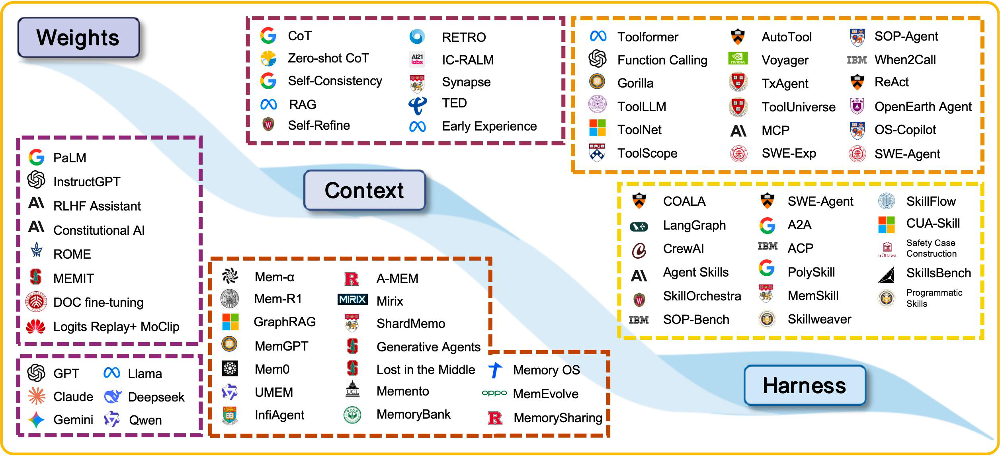
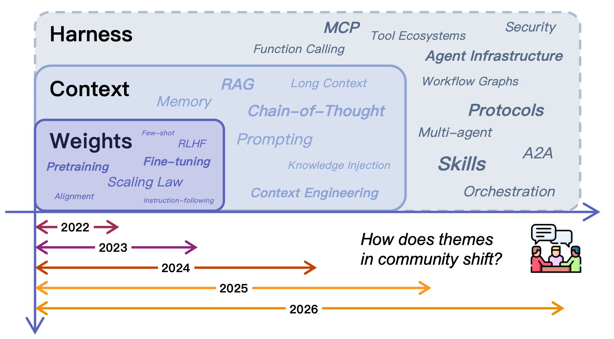
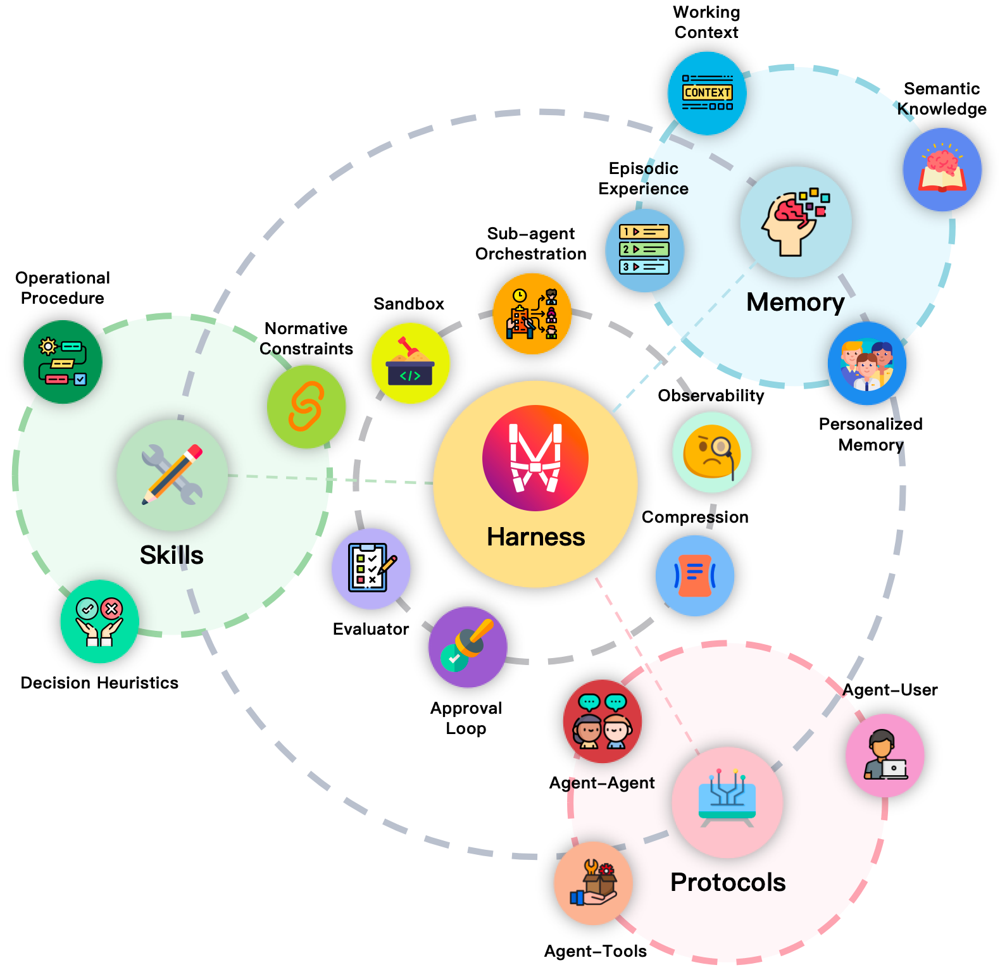
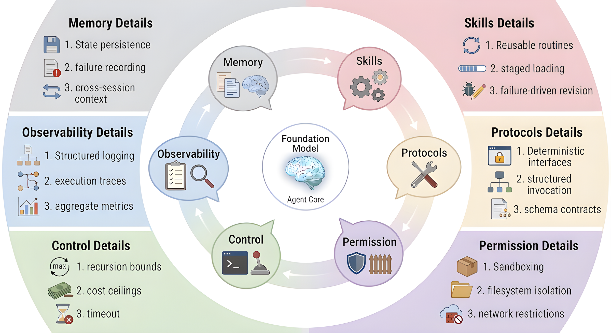

# Externalization in LLM Agents: A Unified Review of Memory, Skills, Protocols and Harness Engineering
## LLM Agent 的外部化：记忆、技能、协议与 Harness 工程统一综述

> **论文元信息**
> - **arXiv**：[2604.08224](https://arxiv.org/abs/2604.08224)（v1，2026-04-09 提交）
> - **分类**：cs.SE（软件工程）
> - **作者**：Chenyu Zhou¹、Huacan Chai¹,\*、Wenteng Chen¹,\*、Zihan Guo²,³,\*、Rong Shan¹,\*、Yuanyi Song¹,\*、Tianyi Xu¹,\*、Yingxuan Yang¹,\*、Aofan Yu¹,\*、Weiming Zhang¹,\*、Congming Zheng¹,\*、Jiachen Zhu¹,\*、Zeyu Zheng⁴、Zhuosheng Zhang¹、Xingyu Lou⁵、Changwang Zhang⁵、Zhihui Fu⁵、Jun Wang⁵,†、Weiwen Liu¹,†、Jianghao Lin¹,†、Weinan Zhang¹,³,†
> - **机构**：¹上海交通大学、²中山大学、³上海创智学院、⁴卡内基梅隆大学、⁵OPPO（\* 同等贡献，† 通讯作者）
> - **通讯邮箱**：wwliu, linjianghao, wnzhang@sjtu.edu.cn；junwang.lu@gmail.com
> - **核心框架**：**外化（externalization）**——记忆外化状态、技能外化程序性专长、协议外化交互结构、harness 工程作为统一层
> - **篇幅**：54 页（正文第 1–9 节 + 参考文献），含图 1–10 与多张体系图表
> - **发表情况**：arXiv 预印本（文中未见会议/期刊接收标注）

> **翻译说明**
> - 本译文基于 arXiv 官方 PDF 全文（`https://arxiv.org/pdf/2604.08224`）逐节翻译，覆盖：**摘要 + 第 1–9 节**（引言 / 从权重到上下文到 harness / 记忆 / 技能 / 协议 / harness 工程 / 交叉分析 / 未来讨论 / 结论）；因原文为 54 页综述，本译文对**第 3、5、7、8、9 节做要点化全译**，对**第 4 节（技能）与第 6 节（harness）做完整逐段翻译**，因为这两节直接对应第 8 篇主题。所有关键论断与数字均取自原文，未做概括性改写。
> - **插图**：共 **8 张**，已下载至 `images/Externalization/`，markdown 使用相对路径 `../images/Externalization/<文件名>` 引用，离线可读；每张图上方保留 `<!-- 原图：URL -->` 注释便于回溯。原始图片由 PDF 内嵌图像提取（`pymupdf`），**非原始矢量图**。
> - 术语首次出现时保留英文原文，之后统一用中文（如 externalization=外化、cognitive artifact=认知制品、harness=harness/执行 harness、progressive disclosure=渐进式披露、execution binding=执行绑定、normative constraint=规范性约束、decision heuristic=决策启发式、operational procedure=操作流程）。

---

## 摘要

大语言模型（LLM）智能体越来越多地**不是通过改变模型权重、而是通过重组模型周围的运行时**来构建。早期系统期望模型在内部自行恢复的能力，如今被**外化（externalized）**到记忆存储、可复用技能、交互协议，以及让这些模块在实践中可靠的周边 **harness** 之中。本文以**外化**为透镜审视这一转变。

借助**认知制品（cognitive artifacts）**的思想，我们主张 agent 基础设施之所以重要，不仅因为它增加了辅助组件，更因为**它把艰难的认知负担转化成模型能更可靠解决的形式**。在这一视角下，**记忆外化跨时间的状态，技能外化程序性专长，协议外化交互结构**，而 **harness 工程则作为统一层**，把它们协调为受治理的执行。我们梳理了从**权重到上下文再到 harness** 的历史进程，把记忆、技能和协议分析为**三种不同但相互耦合的外化形式**，并考察它们如何在更大的 agent 系统内相互作用。我们进一步讨论**参数化能力与外化能力之间的权衡**，识别诸如**自演化 harness** 与**共享 agent 基础设施**这样的新兴方向，并讨论在评估、治理以及模型与外部基础设施长期共同演化方面的开放挑战。其成果是一个**系统级框架**，用以解释为什么实践中的 agent 进展越来越不仅依赖更强的模型，也依赖更好的外部认知基础设施。

<!-- 原图：https://arxiv.org/pdf/2604.08224 （Figure 1） -->

> **图 1（原文 Figure 1）**：Externalization as the organizing principle of LLM agent design. Upper panel: The arc of human cognitive externalization from thought through language, writing, printing, to digital computation. Middle panel: The corresponding externalization arc for LLM agents, from weights through three externalization dimensions—Memory (externalized state), Skills (externalized expertise), and Protocols (externalized interaction)—to the Harness that unifies them. Lower panel: A literature landscape mapping representative works onto three capability layers—Weights, Context, and Harness, illustrating how research threads have progressively migrated outward. The parallel between the two arcs encodes a recursive claim: LLM agents achieve reliable agency by externalizing cognitive burdens along the same representational dimensions that have driven human cognitive history.
> （外化作为 LLM agent 设计的组织原则。上层：人类认知外化的弧线，从思维经由语言、文字、印刷到数字计算。中层：LLM agent 对应的外化弧线，从权重经过三个外化维度——记忆（外化的状态）、技能（外化的专长）、协议（外化的交互）——到统一它们的 harness。下层：文献图景，把代表性工作映射到三个能力层——权重、上下文、harness，说明研究线索如何逐步向外迁移。两条弧线之间的平行关系编码了一个递归命题：LLM agent 通过沿着驱动人类认知史的同一批表征维度外化认知负担，来实现可靠的能动性。）

---

## 1. 引言

> **诺曼（Donald A. Norman）**：认知制品的力量来自它作为**表征**的功能……认知制品不改变人类的能力。它们改变**任务**。

人类文明史也可以被读作一部**认知外化史**。口语把私人思维转变为可共享的符号形式。文字把知识从脆弱的生物记忆搬进持久的物质记录。印刷在社会尺度上机械化了知识的复制。数字计算把算术与符号操作从神经劳动迁移到可编程机器。在这些转变中，关键变化**不是「没有制品人类就变得更无能」**。相反，制品通过**把选定的负担向外转移、把有限的内部分源释放给规划、抽象与创造**，重组了认知系统（Norman, 1993）。同样的**向外委托**模式如今在机器智能的前沿重现，就在 LLM agent 的设计之中。

这一视角在**认知制品**（Norman, 1991, 1993）的思想中有天然的理论锚点。其核心洞见是：外部辅助**不只是放大一项未改变的内在能力；它们常常改变任务本身**。一张购物清单不扩张生物记忆容量，它把一道困难的**回忆**问题变成一道**识别**问题。一张地图不只是让导航「更强」，它把隐藏的空间关系转化为可见的结构。因此制品的力量在于**表征变换**：它重组问题，使 agent 能用**它已具备的能力**更可靠地解决它（Norman, 1991）。

我们主张，同样的逻辑如今支配着基于 LLM 的 agent 中最具后果的设计选择。我们的核心论点是：**外化——把认知负担从模型内部计算逐步迁移到持久、可检查、可复用的外部结构——是统一语言智能体近期在记忆、技能、协议与 harness 工程上进展的过渡逻辑（transition logic）**，即那个解释「每一次架构迁移为何发生、它试图保留何种可靠性」的机制。这不仅仅是一个关于工程便利性的主张。这是一个关于**可靠能动性从何而来**的主张：**它不只来自越来越大的模型，而来自对任务需求的系统性重组，使内部能力与外部基础设施共同覆盖所需能力的全部范围**（Norman, 1991; Sumers et al., 2024）。

图 1 总结了这一论证。上层追溯人类认知外化的熟悉弧线；中层呈现 LLM agent 对应的弧线，从权重经过三个外化维度——记忆、技能、协议——到统一它们的 harness；下层把由此产生的文献图景映射到三个能力层——**权重、上下文、harness**。图 3 用外化 agent 的架构总览补足这一视角，harness 位于中心，三个外化维度及其操作要素环绕它。**记忆外化跨时间的状态，技能外化程序性专长，协议外化交互结构。** 两条弧线之间的平行关系编码了一个递归命题：**LLM agent 本身就是运行在人类最新一次重大外化（数字计算）之内的制品**。共同机制正是诺曼意义上的**表征变换**（Norman, 1991）：**回忆变成识别，即兴生成变成组合，临时协调变成结构化契约。**

这一透镜对理解当前实践尤其有启发性。当代进展常被叙述为一场关于更大模型、更好训练流程或更精细推理轨迹的竞赛。这些因素重要，但**不能完全解释实际系统中观察到的模式**。许多可靠性上的最大增益**根本不来改变基础模型**，而来自改变模型周围的环境：加入持久记忆、组织可复用技能、标准化工具接口、约束执行、给行为加插桩，以及通过显式控制逻辑来路由工作（Sumers et al., 2024; Wang et al., 2024a; Li, 2025; Luo et al., 2025）。在实践中，问题越来越多地不只是「模型有多强？」，还包括「**什么负担已经被外化，使模型不再需要每次都在内部解决它们？**」

一个无辅助的 LLM 仍面临**三个反复出现的错配**，它们直接映射到 harness 的三个维度。它的上下文窗口是有限的，会话记忆薄弱或缺失，造成一个**连续性（continuity）问题**，由**记忆外化**应对。长的多步流程常被**重新推导**而非一致地执行，造成一个**方差（variance）问题**，由**技能外化**应对。与外部工具、服务和协作者的交互若仅靠自由形式的提示词，仍然脆弱，造成一个**协调（coordination）问题**，由**协议外化**应对（Sumers et al., 2024; Packer et al., 2023）。外化之所以重要，是因为它**把每一项负担都变成模型能更可靠处理的形式**。

一个具体例子能固定直觉。考虑一个软件工程 agent，被要求在一个大仓库中实现一个特性、运行测试并开一个 pull request。**没有外化时**，模型必须在一个脆弱的提示词里保持仓库结构、项目约定、工作流状态与工具交互全部活跃。**有外化时**，持久项目记忆提供上下文，可复用技能文档编码约定与工作流，协议化的工具接口强制正确模式，而 harness 排序步骤、验证输出、管理失败。**基础模型可以保持不变；改变的是它所被要求解决的任务的表征。**

这一更广的视角也与**分布式认知与延展认知**背后的直觉一致：一旦记忆、引导行动与协调交互的关键部分被委托给外部结构，**智能就不再只定位于模型之中**（Clark and Chalmers, 1998）。我们援引这一传统是取其核心工程洞见——**「agent」与「环境」之间的边界是一个具有真实性能后果的设计选择**——而非承诺其更强的本体论主张。我们的关注点是务实的：我们把外化视为一条设计原则，其价值由**所得系统的可靠性、可组合性与可治理性**来衡量。

现在我们转向构成 harness 的三个外化维度，每一个都对应图 1 中强调的一项表征变换：

**记忆系统外化跨时间的状态。** 系统不依赖上下文窗口作为历史的唯一载体，而是让累积的知识——用户偏好、先前轨迹、已解决的歧义、领域事实——持久存在于任何单次会话之外，并在相关时被选择性检索。核心变换是**从回忆到识别**：agent 不再需要从潜权重中重新生成过去的知识，而是从一个持久、可搜索的存储中检索它（Lewis et al., 2020; Park et al., 2023; Packer et al., 2023; Chhikara et al., 2025; Xu et al., 2025b）。

**技能系统外化程序性专长。** 系统不依赖模型权重在每次调用时重新生成任务特定 know-how，而是把流程、最佳实践与操作指引打包为可复用制品。核心变换是**从生成到组合**：agent 从**预先验证过的组件**组装行为，而非每一步都从头即兴（OpenAI, 2023a; Schick et al., 2023; Wang et al., 2023a; Anthropic, 2025, 2026; Jiang et al., 2026b）。

**协议外化交互结构。** 系统不依赖与工具、服务和其他 agent 之间临时的提示词级协调，而是为发现、调用、委派与权限管理定义**显式的机器可读契约**。核心变换是**从临时到结构化**：含混、脆弱的通信变成可互操作、可治理的交换（Anthropic, 2024; Google Cloud, 2025a; Ehtesham et al., 2025c）。

**harness 是承载全部三个维度并提供编排逻辑、约束、可观测性与反馈回路的工程层**，使外化的认知在实践中连贯。它**不是与记忆、技能、协议并列的第四种外化**。它是这些外化形式在其中变得可操作、可治理、并最终可改进的**运行时环境**。

---

## 2. 背景：从权重到上下文再到 harness

<!-- 原图：https://arxiv.org/pdf/2604.08224 （Figure 2） -->

> **图 2（原文 Figure 2）**：From Weights to Context to Harness.（从权重到上下文到 harness。）

### 2.1 权重中的能力

第一层把能力定位在**模型参数**中：能力通过预训练、微调与对齐被习得并存放在权重里。这一层的默认假设是：**能力一旦被习得就是内在的**，在推理时可使用而不需要外部辅助。它的局限也由此而来：更新代价高、不可在推理时检查、难以局部修正，而且无法承载那些随时间变化、因用户而异、或依赖环境的信息。

### 2.2 上下文中的能力

第二层把能力**部分迁到推理时的上下文**：在提示词或上下文窗口中提供的信息可以显著改变行为，而无需改动权重。这带来了三个立即可用的杠杆——**指令、示例、检索到的证据**——以及一条贯穿整个领域的重要经验：**上下文长度并不线性地转化为更好的推理**。长上下文会引入噪声、稀释注意力，并使相关证据更难被使用。因此这一层的能力是**易变的、有预算约束的、且依赖排布**的。

### 2.3 通过基础设施获得的能力

第三层把能力迁到**模型周围的基础设施**：持久记忆、可复用技能、协议化接口，以及协调它们的 harness。这一层的价值来自**外化**——**把选定的认知负担搬出模型的内部计算，放进持久、可检查、可复用的结构中**。这一层的可靠性不是来自让模型更聪明，而是来自**让任务更容易被可靠解决**。

### 2.4 外化作为过渡逻辑

上述三层不是相互替代，而是**累积叠加**。每一次迁移都由一个具体的可靠性缺口驱动：**连续性缺口**把状态推向外部的记忆；**方差缺口**把程序性专长推向外部化的技能；**协调缺口**把交互推向显式协议。因此**外化是解释迁移为什么发生的逻辑**，而不只是一个描述性的标签。

<!-- 原图：https://arxiv.org/pdf/2604.08224 （Figure 3） -->

> **图 3（原文 Figure 3）**：Architectural overview of the externalized agent, showing the harness at the center with the three externalization dimensions and their operational elements orbiting it.
> （外化 agent 的架构总览，harness 位于中心，三个外化维度及其操作要素环绕它。）

---

## 3. 外化的状态：记忆

（本节要点化全译。）

### 3.1 被外化的是什么：状态的内容

记忆外化的对象是**跨时间的状态**。论文把这一状态的内容区分为若干类：用户的偏好与约束、先前轨迹与已采取的动作、已解决的歧义与澄清结果、领域事实与环境约束，以及任务进展与未解决的目标。这些内容的共同特征是**它们不能靠重新推导可靠地恢复**：要么是任意的（用户偏好），要么是昂贵的（先前探索的结论），要么是随时间变化的（环境状态）。

### 3.2 如何被外化：记忆架构

论文给出了四类由简到繁的架构：

1. **单体上下文（Monolithic Context）**：把历史全部留在上下文窗口内。简单，但受窗口限制，且随历史增长而退化。
2. **带检索存储的上下文（Context with Retrieval Storage）**：把历史写入外部存储，在需要时检索相关片段注入上下文。这是当前最普遍的做法（Lewis et al., 2020; Park et al., 2023; Packer et al., 2023），但它把问题从「存什么」转移到「检索什么」，并引入检索失败这一新的失效面。
3. **分层记忆与编排（Hierarchical Memory and Orchestration）**：引入工作记忆 / 长期记忆 / 档案等多层结构，并配以在层间搬运信息的编排逻辑。这一层开始把记忆当成**需要治理的系统**而非一个存储。
4. **自适应记忆系统（Adaptive Memory Systems）**：记忆的写入、组织与检索策略本身成为可学习、可演化的对象（Xu et al., 2025b; Li et al., 2026c）。这一层把记忆从静态管道变成**会随经验改进的机制**。

### 3.3 harness 时代的记忆需求

论文主张，随着 harness 成为主要的编排层，对记忆提出了三项新要求：**（i）记忆必须支持跨会话的连续性**，因为 harness 的生命周期长于任何单次会话；**（ii）记忆必须可被 harness 的多个组件共享**，因为同一个状态要同时服务于技能选择、进展验证与协议绑定；**（iii）记忆必须可检查、可治理**，因为 harness 需要对记忆内容做权限、版本与审计层面的控制。

### 3.4 记忆作为认知制品

在诺曼的框架下，记忆系统的价值不是「记住了更多」，而是**把回忆问题转化为识别问题**。它通过**重组任务**来起作用：agent 不再需要从潜权重中重新生成过去的知识，而只需识别并取用一条已被外部化的记录。这一点决定了记忆系统的评估标准不应止于「答对率」，还应包括**它把什么负担搬走了、搬得是否干净、以及搬走之后留下了什么新的失效面**。

---

## 4. 外化的专长：技能

（本节完整逐段翻译。）

### 4.1 被外化的是什么：程序性专长

技能外化关注的是**程序性专长**，而非孤立的动作接口。这里的**专长**指的是**在反复出现的假设与约束下执行任务的一种可重复方式**，而不是「模型『能』做某事」这样一种模糊断言。一个有用的边界由此而来：**工具暴露操作，协议治理这些操作如何被描述与调用，而技能编码一类任务应当如何用它们执行。** 在实践中，这种专长有三个相互耦合的组成部分：**操作流程、决策启发式与规范性约束**。它们共同定义了 harness 可以外化的**可复用 know-how 单元**。

#### 4.1.1 操作流程

**操作流程是任务的骨架**：把一项复杂工作分解为步骤、阶段、依赖关系与停止条件。它应对的是 LLM agent 的一个常见失效模式。**许多错误并不来自动作层面的无能，而来自流程层面的不稳定**，例如跳步、顺序错误或过早终止（Hsiao et al., 2025; Nandi et al., 2026）。**外化流程把那种脆弱的流程知识变成一条显式的操作路径。**

这一转变在 LLM 推理的更广演化中有深厚根源。**思维链**让中间推理变得显式（Wei et al., 2023）；**ReAct** 把推理与行动耦合（Yao et al., 2023a）；后来的提示词链与编排系统把反复出现的模式打包为工程化工作流。**这些方法常常缺少的是持久性。** 流程存在于当前这次运行中，却尚未成为一个**可复用制品**。技能系统通过把工作流结构变成**可存储、可修订、可重新施加**的东西来填补这一缺口（Ye et al., 2025）。

一旦流程被外化，**执行就不再那么即兴**。agent 可以在中断后恢复，把工作跨上下文或协作者交接，并在不从头重建整个工作流的情况下恢复状态。这一点在**长时程、多智能体与生产**环境中最为重要，因为在那里，**流程稳定性往往比一时的流畅更重要**。

#### 4.1.2 决策启发式

如果流程定义了执行的骨架，**决策启发式则治理分支处发生什么**。真实任务很少按固定流水线展开。工具会失败，观测有噪声，若干个局部可行的动作可能相互竞争。在这些条件下，良好的表现取决于**从经验中得来的实用拇指法则**，而非仅靠穷举搜索（Gigerenzer and Gaissmaier, 2011）。

外化这些启发式**改变了推理努力的分布**。系统不必迫使模型在每个岔路口重新发现局部策略，而可以编码**已被证明有用的默认选择、升级规则或优先顺序**。这降低了斟酌成本，也使行为更稳定。因此启发式不是次要的便利。**它们是技能捕捉「专家风格」的主要方式之一**：先试什么、何时退让、什么证据算充分，以及在多条路径都还可行时偏好哪些权衡。

#### 4.1.3 规范性约束

第三个组成部分是**规范性约束**：一个流程在何种条件下才算可接受。一个工作流可能技术有效，却仍然**不合规、不安全或在操作上错误**。在真实部署中，执行受测试要求、范围限制、访问限制、可追溯性期望与领域特定操作规则的约束（Chen et al., 2021; Bai et al., 2022b; Wei et al., 2023; Schick et al., 2023; Madaan et al., 2023）。

一旦被外化，这些约束就**不再是事后评估标准，而成为技能本身的一部分**。它们可以塑造前置条件、阻断不安全分支、要求中间验证，或定义完成之前必须产出的证据。**这正是技能得以不仅编码「如何执行任务」，还编码「如何在组织与安全边界内执行任务」的原因**。在成熟系统中，这使**技能成为治理的载体，而不仅仅是能力的载体**。

把三者合起来看：**操作流程提供结构，决策启发式提供局部策略，规范性约束提供可接受的边界**。一个技能只有在三者都被规定得足够好、足以跨任务、跨上下文、跨运行存活时，才是可复用的。**这就是为什么技能位于动作接口之上、记忆之侧**：它们外化的既不是过去的状态，也不是原始的执行原语，而是**可重复的任务 know-how**。

### 4.2 从执行原语到能力包

技能系统不是孤立出现的，但也不应与工具使用混为一谈。从历史上看，技能是**两个更早发展**的下游产物：**可靠的动作调用**与**大规模动作选择**。这两个阶段扩张了 agent 能做什么，却尚未解决「一类任务应当如何被反复执行」。**只有当程序性组织本身成为一个显式的可复用制品时，技能才出现。**

#### 4.2.1 阶段 1：原子执行原语

第一阶段赋予语言模型**可靠的动作执行**能力，例如通过结构化工具调用与函数调用接口。**Toolformer** 是代表性工作，展示模型可以学会何时调用工具、如何构造参数以及如何纳入结果（Schick et al., 2023）。这一阶段的关键成就是**对原子动作单元的稳定访问**。它没有提供的是**完成更广泛任务类的显式可复用流程**。**单位是动作原语，不是技能。**

#### 4.2.2 阶段 2：大规模原语选择

随着可调用工具数量增长，问题从**调用**转向**选择**。**Gorilla、ToolLLM、ToolNet、ToolScope、AutoTool** 等工作表明模型可以在大规模工具集合中检索、排序并动态选择（Patil et al., 2023; Qin et al., 2023; Liu et al., 2024b, 2025b; Zou et al., 2025）。这是走向可扩展动作选择的一大步，**但单位仍然是工具而非流程**。即便多步行为开始出现，完成一个任务类的 know-how 仍在很大程度上**隐含在提示词或参数中，而非外化为一个有界的可复用制品**。

#### 4.2.3 阶段 3：技能作为打包的专长

第三阶段标志着抽象层面的进一步迁移。**核心问题不再是模型能否调用一个函数或检索到合适的 API，而是完成一类任务所需的 know-how 能否被打包为可复用的能力单元。** 在这一阶段，能力的基本单位不再是孤立的工具调用，而是**以可复用的程序性指引与执行结构为中心的更高层制品**（Wang et al., 2025c; Chen et al., 2026b）。技能不再只是规定「能做什么」，而越来越捕捉**「一类任务应当如何被执行」**（Li et al., 2026c）。

近期工作使这一转变越来越显式。**基于程序的技能归纳**把原语动作编译为更高层的可复用技能，表明 agent 能力可以被表示为**可执行的程序抽象**而非一次性调用（Wang et al., 2025c）。在 web 环境中，交互轨迹可以被蒸馏为可复用的技能库或技能 API，使 agent 能够跨任务积累与精炼可迁移的 know-how（Zheng et al., 2025a）。在计算机使用场景中，技能进一步被组织为**参数化的执行与组合图**，检索、参数实例化与失败恢复都在**技能层面**而非单个接口动作层面运作（Chen et al., 2026b）。关于 SOP 引导 agent 的相关工作同样表明，领域专长可以被外化为**显式的程序性结构**，据此按领域特定流程引导执行（Ye et al., 2025）。

与更早阶段相比，这里的关键转变**是表征性的而非仅仅是操作性的**。能力不再主要被当作「对工具或 API 的访问」，而越来越被当作**可以被加载、复用、跨任务组合的打包程序性知识**（Li et al., 2026c; Xu and Yan, 2026b）。在这个意义上，**阶段 3 不只是让工具使用变得更复杂，它反映了把 agent 能力表示为外化、可复用程序性 know-how 的转变。**

### 4.3 技能如何被外化

**技能外化并不止于把指令写下来。** 在成熟的 agent 系统中，关键问题是**程序性专长能否被表示为一种在运行时可被发现、可加载、可解释、可绑定、可执行的形式**。因此技能外化同时涉及一个**表征层**和一个**运行时层**。前者决定技能如何被描述与界定，后者决定它在任务执行中能否真正作为一个可复用能力发挥作用（Xu and Yan, 2026b）。用 harness 的语言说：**一个技能只有到运行时能够决定何时加载它、以哪份记忆作为条件、以及把它绑定到哪些工具、文件或子 agent 时，它才成为现实。** 这一绑定要求并不使技能等同于工具或协议；它只是意味着**程序性专长最终必须落地在可执行的接口上**。

#### 4.3.1 规范（Specification）

技能的外化始于**规范层**。典型形式包括 **SKILL.md、指令文件、manifest 或其他声明式规范制品**。这些制品描述技能做什么、适用于哪些场景、假定哪些依赖、必须满足哪些约束、以及在什么输入输出条件下运作。**技能规范更像 API 文档而非 API 实现。** 它的价值在于**把程序性专长从一种不透明的内部状态变成一个可检查、可讨论、可修订、可治理的显式对象**（Ling et al., 2026）。

一个良好成形的技能规范理想上至少应覆盖**五类信息**：**能力边界、适用范围、前置条件、执行约束，以及示例与反例**。前两类澄清技能旨在解决哪类问题。接着两类澄明它可以在何时被安全使用、在什么操作假设之下。最后一类帮助把预期使用模式锚定在具体案例中，从而减少模型解释不足带来的偏差。**通过这样的结构化规范，技能从一种非结构化的提示技巧升级为一个有界的能力描述**，进而为发现、加载、版本控制与治理提供了基础。

#### 4.3.2 发现（Discovery）

一旦技能成为显式制品，它们自然引出**注册与发现**问题。在现实环境中，agent 不可能为每个任务不加区分地加载所有可用技能。因此它需要某种形式的**注册表与发现机制**来支持选择性检索。技能可以被发布到本地仓库、组织级注册表或平台级市场，而 agent 依据任务目标、上下文状态与环境条件搜索相关候选（Zheng et al., 2025a）。

这一发现过程可能依赖**语义检索、结构化元数据、任务分解，或这些策略的组合**，视系统设计而定。**关键点在于，系统不只是在问「哪个工具可以被调用」。它在问「哪一单位程序性专长适合当前问题」。** 这使技能发现成为一个**更高层的匹配问题**。它不仅要考虑主题相似性，还要考虑**任务复杂度、环境假设、操作约束与风险条件**。因此一个技能被检索到，**不应仅仅因为它的关键词与任务描述重叠，而应因为它确实与当前任务的语义结构和操作结构兼容**（Ross et al., 2025）。**如果技能只是被存储，技能外化就是不完整的。它还必须在现实的任务条件下可被检索到。**

#### 4.3.3 渐进式披露（Progressive Disclosure）

**发现一个技能并不意味着它的全部内容应立刻被注入活跃上下文。** 由于长上下文并不稳定地转化为更好的表现，详细的指令可能成为**推理噪声的来源而非指引的来源**。因此当前的技能系统常常受益于一种**渐进式披露**策略：先暴露技能的存在，只在需要时才加载更深的细节（Xu and Yan, 2026b）。

在当前的工业实现中，这常常采取**分层形式**。在**最浅的一层**，模型只看到技能名称与一句简短描述，足以表明该能力存在。**更深一层**可能暴露 manifest 类信息，例如适用条件、所需前置条件与主要约束。**只有在最深处**，系统才加载完整指南，包括详细流程、异常处理、示例与支撑文件。这种分阶段加载的**目的不只是压缩文档**。更根本地说，**它把「是否需要更多技能细节」本身变成一项运行时决策**。这样，技能的信息密度就可以与当前任务的复杂度相匹配，而不必从一开始就用不必要的细节饱和上下文。**这一设计在当前技能工业实现中尤为明显，例如 Claude Code 的技能系统**（Anthropic, 2025）。

#### 4.3.4 执行绑定（Execution Binding）

**一个技能在连接到可执行动作之前，始终只是一个认知层面的描述。** 因此实际的任务完成依赖于一个**绑定过程**，它把技能的自然语言或结构化规范翻译成当前环境中的具体操作。**正是在这一点上，技能、工具与协议之间的区别变得清晰。**

**技能通常本身不是动作执行器。** 相反，它必须被绑定到一个更底层的运行时基底，例如工具、文件、API、子 agent、协议端点或其他执行接口。一个技能可以规定 agent 应当搜索相关代码、运行测试并总结产生的 diff，而**动作本身是由搜索工具、文件操作、shell 命令与测试运行器执行的**。因此：**工具提供可执行操作；协议治理这些操作如何被描述与调用；技能提供把它们组合成可重复任务完成的更高层策略。**

这种绑定通常需要一个**中间解释层**，它在当前上下文中确定：应当激活哪些技能步骤、应当绑定哪些原语、哪些条件应触发分支、以及哪些约束应优先。**没有这样的解释与绑定过程，技能很容易停留为一个原则上可读但在实践中不可用的静态制品。** 更一般地说，**MCP**（Anthropic, 2024）这类基于模式的接口通过让能力可被发现、可被调用，支持了这一运行时绑定层，而不必把技能消解为工具或协议本身。

#### 4.3.5 组合（Composition）

**技能系统的价值在技能可以被组合时得到最充分的实现。** 与原子工具不同，技能可以参与**更高阶的结构化协调**，使复杂任务被分解为多个能力包的协作。常见的组合模式包括**串行执行、并行分工、条件路由，以及在更高层技能内递归调用子技能**（Wang et al., 2023a）。

这种可组合性意味着**技能不只是一个供模型消费的文档，而是 agent 架构内一个可调度的运行时单元**。更重要的是，**组合不只是多个程序性片段的拼接。它是程序性专长本身的高层复用。** 例如，一项「产出数据分析报告」的技能不必被实现为一个单体端到端流程。它可以被组织为**数据清洗、统计分析、可视化与叙事综合**这些更小技能的协调组合。这样，系统不仅获得更强的任务表现，还获得更好的**可维护性、可替换性与可审计性**。**因此组合标志着技能成为真正的能力层、而非一堆孤立配方的那个点**（Yu et al., 2025）。

总体而言，**技能外化不应被理解为仅仅发布一个静态指令文件**。它是一个协调过程：程序性专长被**规范化、变得可发现、被选择性披露、被绑定到可执行基底，并被组合进更大的能力结构**。**重要的不仅是一个技能能否被写下来，而是它能否作为一个可用的行动单元可靠地进入 agent 的运行时**，并与被检索到的状态和协议化接口互操作。因此，**技能的外化标志着从非正式提示走向 agent 系统更显式能力层的转变**。

### 4.4 技能的获取与演化

技能系统之所以重要，不仅因为它存储了人工编写的指令，更因为它提供了一条**把成功行为转化为可复用专长**的路径。因此技能获取更适合被理解为一个**演化过程**：程序性知识在其中被**写入、抽取、发现与重新组合**（Xu and Yan, 2026b）。

- **人工编写（Authored）。** 手工编写仍是技能进入当前系统最常见、最稳定的路径。无论形式是 SKILL.md、AGENTS.md、项目级指令文件还是组织 SOP 模板，这些制品都是**人工设计的程序性能力包**的实例。它们的重要性不仅在于提供初始能力，还在于支持**迭代修订**。当 agent 在部署中反复表现出某种失败模式时，工程师可以更新对应技能，使一次被观测到的失败变成一个被澄清的流程或一条被新增的约束。这样，**人工编写的技能文档就不只是描述性的。它同时充当一个实践接口，操作经验通过它逐步转变为可复用的行为结构**（Ling et al., 2026）。
- **蒸馏（Distilled）。** 技能也可以从历史轨迹、练习痕迹或其他已存经验中**归纳**出来。情节记录保留了 agent 先前做了什么、以及一条轨迹为何成功或失败。当某些成功结构在跨任务中反复出现时，系统可以**把这些模式抽象为更稳定的程序性单元**。在这个意义上，**记忆保存经验，而技能归纳抽取其中可复用的结构**。现有证据最直接支持这一点的场合，是把该过程框定为**从交互轨迹归纳**，而不是宽泛地宣称「记忆会自动变成技能」。例如 **Skill Set Optimization** 从有奖励的子轨迹中抽取可迁移技能（Nottingham et al., 2024）。在记忆管理场景中，**MemSkill** 进一步表明某些记忆操作本身可以被重新表述为可学习、可演化的技能（Zhang et al., 2026a）。
- **发现（Discovered）。** 除了人工编写与事后蒸馏，agent 也可以通过**与环境交互自主发现新技能**。**Voyager** 在 Minecraft 场景中提供了一个有影响力的例子：探索、执行反馈、自我验证与课程驱动任务选择共同产出一个**不断增长的可执行代码技能库**（Wang et al., 2023a）。更新的工作表明这一发现过程也可以面向**泛化**。例如 **PolySkill** 通过分离抽象目标与具体实现来改进技能复用（Yu et al., 2025）。**一旦 agent 能识别反复成功的行为模式并把它们提升为显式技能，技能库就不仅是一个存储层，还成为一个能力增长机制。**
- **组合（Composed）。** 最后，技能可以通过组合演化。许多更高层能力不是从零发明的，而是**由既有的低层或中层技能组装而成的**。诸如报告生成或代码修复这样的复杂工作流，可能从更小能力的反复协调中涌现。组合在这里不仅是一种执行策略，也是一种**获取机制**。一旦某个既有技能的组合被反复验证为有效，**这一组合本身就可以被打包为一个新的更高层技能**。这样，组合产生新的可复用单元，并逐步形成**层级化的技能库藏**而非扁平的孤立能力清单（Wang et al., 2025c）。

总体而言，**技能获取不是一次性的设计步骤，而是写入、抽取、发现与重新组合程序性知识的持续过程**。因此一个成熟技能系统的定义，**较少取决于它存储了多少条指令，而更多取决于它把经验转化为可复用外化专长的效率**。在一个有 harness 的 agent 中，这一演化回路本身被系统化：**记忆提供证据，评估器决定什么值得提升，而协议化的执行界面决定一个候选技能能否真正被部署。**

### 4.5 边界条件

技能外化改进了复用与治理，但它**不保证可靠性**。一旦程序性专长被外化为显式制品，其有效性就取决于**该制品与任务、环境及其使用时所处运行时的匹配程度**。在实践中，主要边界条件涉及**语义对齐、可移植性与陈旧化、不安全组合，以及上下文相关的退化**。

- **语义对齐（Semantic alignment）。** 技能规范用自然语言或轻量结构化形式表达意图与指引，而实际执行依赖具体的工具、API 与环境约束。结果是，**模型可能遵循技能的字面措辞，却仍然错过任务的真实目标**。现有证据表明，技能的有效性在很大程度上取决于**任务意图、技能描述与调用决策之间的对齐**。**SkillProbe** 把语义—行为不一致识别为现有技能市场的根本缺陷（Guo et al., 2026）。关于工具使用决策的相关工作同样表明，关键困难常常不仅是**一个外部能力能否被调用**，而是**在当前的任务解释下它是否应该被调用**（Ross et al., 2025）。这表明**外化的技能仍然对描述与使用之间的错配敏感**。
- **可移植性与陈旧化（Portability and staleness）。** 即便一个技能内部自洽，它的**跨环境有效性也不能被假定**。网站、API、依赖、工作流或运行时约定的变化，都可能使一个曾经有效的技能**部分误导或完全过时**。更广泛地说，agent 框架、工具基底与基础模型之间的**异质性**意味着同一个技能在不同设置下可能表现不一致。关于程序化技能的工作已经表明，某些被归纳出的技能可以跨网站迁移，而**不兼容的技能必须被更新以适应环境变化**（Wang et al., 2025c）。**SkillsBench** 进一步表明**技能效用在不同领域与「模型—agent」配置之间差异很大**（Li et al., 2026c）。更广泛的含义是：**技能可移植性最好被当作一个有条件的经验属性，而不是外化的内在特征。**
- **不安全组合（Unsafe composition）。** **组合让技能更强大，但也创造了新风险。** 单独看来无害的技能，在组合时可能产生不安全交互，尤其是当它们捆绑了长篇指令、可执行脚本与外部依赖时。在这些情况下，**问题不局限于单个技能制品，而是从多个制品及其连接接口之间的相互作用中涌现**。这是目前已有直接证据的边界条件之一。对公开技能生态的大规模实证研究报告了相当高的漏洞比例，包括**提示注入、数据外泄、权限提升与供应链风险**（Liu et al., 2026）。面向攻击的研究进一步表明，**技能文件本身可以成为针对当前 agent 的现实提示注入面**（Wang et al., 2026c）。因此，**技能组合应被视为一个安全敏感的过程，而不是一种纯良性的模块化复用**。
- **上下文相关的退化（Context-dependent degradation）。** 进一步的困难是，**技能执行可能在长时间交互中退化**。即便技能文件已被更新，agent 仍可能因为**残留的会话上下文、被缓存的摘要或先前被强化的动作模式**而继续遵循过时的操作逻辑。同时，**当过多局部流程细节被注入上下文时，详细的技能指南会干扰全局任务跟踪**。在这些情况下，模型可能**仔细地执行指令，却失去了对真实成功条件的把握**。针对这些效应的技能特定直接证据仍然有限，但关于多轮漂移、长时程可靠性与长上下文推理的邻近工作强烈提示它们是**现实的边界条件**（Lee, 2026）。因此，**技能加载应不仅被视为一个检索问题，还应被视为一个上下文分配与执行稳定性问题。**

把这些合起来看，这些边界条件表明**技能不是一个写下来之后就保持稳定的自足模块**。它的有效性取决于与**任务、环境、运行时条件和安全约束**的持续对齐。因此**技能不应被当作孤立制品，而应被当作嵌入在更广工程框架中的组件**。这正是技能设计最终指向**制品之外、指向 harness 工程**的原因。

### 4.6 harness 中的技能

上述边界条件表明，**技能不能作为独立制品被评估**。它们的可靠性取决于它们如何被安置在一个运行中的系统里。本节考察技能在嵌入 harness 后如何变得可操作，聚焦于把技能与记忆、协议和运行时治理连接起来的**耦合关系**。

- **以记忆为条件（Conditioning on memory）。** **一个技能是依据被检索到的状态被选择与参数化的。** harness 向记忆查询任务历史、先前结果、用户特定上下文与环境约束，然后用这些证据决定加载哪个技能、实例化哪些参数、偏好哪些分支。**没有这个条件化回路，技能选择就退化为对任务描述的关键词匹配。** 有了它，同一个技能可以根据 agent 先前学到的东西而以不同方式应用。**因此记忆提供了使技能选择成为情境化而非泛化的情境证据。**
- **通过协议绑定（Binding through protocols）。** 一旦被选中，技能必须落地到可执行动作。**这种落地要通过协议化接口**：工具模式、子 agent 委派契约、文件操作与审批工作流。harness 通过解析当前可用的协议端点、检查权限、把技能步骤路由到合适的执行基底来中介这一绑定。**因此技能与协议是互补的：技能规定应当做什么；协议规定由此产生的动作如何被描述、调用与治理。**
- **运行时治理（Runtime governance）。** 在生产环境中，harness 还对技能执行施加治理。这包括**敏感操作前的权限检查、高风险步骤的审批门、记录加载了哪个技能及其产生了哪些动作的审计日志，以及多步流程中途失败时的回滚机制**。这些控制不是技能制品本身的一部分；**它们是技能所运行的 harness 环境的属性**。一个在沙箱化开发环境中安全有效的技能，在生产部署中可能需要额外约束，而 **harness 就是强制这些约束的层**。
- **生命周期反馈（Lifecycle feedback）。** 最后，**harness 闭合了技能执行与技能演化之间的回路**。执行轨迹、成功率、失败模式与用户修正被写回记忆。随着时间推移，这些证据可能触发**技能修订、废弃，或新候选技能的提升**。因此 harness 不只是承载技能；**它提供技能据以改进的反馈基础设施**。这个回路把技能获取（4.4 节）与运行时运作连接起来：人工编写或发现的技能进入 harness，harness 治理它们的执行，而执行结果又反馈进未来技能赖以派生的证据基础。

### 4.7 技能作为认知制品

> 以下解释主要是**理论性的而非直接经验性的**。它借用关于认知制品的经典工作，帮助解释**为什么外化的技能能够改进程序性专长的组织**，而不是主张这些理论原本是为 LLM agent 发展的。

从诺曼的认知制品理论视角看，**技能系统可以被理解为沿着「能力组织」这一维度的一次表征变换**（Norman, 1993）。**没有外化的技能时**，模型必须在任务执行期间从内部参数反复重建程序性知识。**有了技能**，这部分程序性负担被搬进一个**可加载、可检查、可遵循的显式外部表征**。这把任务从**不稳定的潜在程序回忆**转向一个**更稳定的过程：识别适用的指引并在其下行动**。在这个意义上，技能文件的角色与诺曼关于「外部清单如何改变记忆的性质」的分析高度类似。**关键点不只是额外信息被加入了。而是认知任务的形式本身被重组了。** 这种重组很重要，因为它**改变了模型在推理时必须做什么**。在缺少技能的情况下，模型必须从参数中**概率性地恢复**一种合适的推进方式；有了技能，它转为**识别**被外部化的流程并在其下执行。

---

## 5. 外化的交互：协议

（本节要点化全译。）

### 5.1 协议为什么重要

协议外化的是**交互结构**。当 agent 需要调用工具、委派任务、访问数据或与用户协商时，如果仅靠自由形式的提示词，交互的**可靠性、可治理性与可组合性**都无从保证。协议的作用是**把含混、脆弱的通信变成可互操作、可治理的交换**。核心变换是**从临时到结构化**。

### 5.2 Agent 协议综述

论文按交互对象把协议分为四类：

1. **Agent–Tool 协议**：定义工具如何被描述、发现与调用（如 **MCP**，Anthropic 2024）。这是当前最成熟的一类。
2. **Agent–Agent 协议**：定义 agent 之间如何委派任务、交换状态与协调角色（如 **A2A** 等，Ehtesham et al., 2025c）。
3. **Agent–User 协议**：定义与用户之间的澄清、确认、审批与移交。
4. **其他协议**：覆盖跨组织、跨平台与安全/身份相关的交换。

### 5.3 harness 工程中的 agent 协议

论文指出协议在 harness 中承担三项具体职责：

- **意图捕获与规范化（Intent Capture and Normalization）**：把用户的自由形式输入转换为可被工具与技能消费的结构化意图。
- **能力发现与工具描述（Capability Discovery and Tool Description）**：让 harness 能在运行时确定哪些能力可用、其边界是什么。
- **会话与生命周期管理（Session and Lifecycle Management）**：管理会话的建立、状态保持、超时、恢复与终结。

### 5.4 协议作为认知制品

在诺曼框架下，协议的贡献是**把「临时协调」变成「结构化契约」**。它通过**显式化**来降低认知负担：agent 不再需要在每次交互中重新协商格式、权限与语义，而是遵循一个已被外部化的契约。**与记忆（外化状态）和技能（外化专长）不同，协议外化的是「交互本身应当如何进行」**，因此它在三者中最接近**治理**：它决定谁可以做什么、以什么顺序、在什么边界之内。

---

## 6. 统一的外化：harness 工程

（本节完整逐段翻译。）

### 6.1 什么是 harness？

**harness 是把基础模型转变为任务导向执行系统的运行时层。** 它承载三个外化维度——记忆、技能、协议——并提供使它们连贯运作所需的**编排逻辑、约束、可观测性与反馈回路**。关键的界定是：**harness 不是与记忆、技能、协议并列的第四种外化形式，而是它们在其中变得可操作、可治理、并最终可改进的环境。**

<!-- 原图：https://arxiv.org/pdf/2604.08224 （Figure 7） -->

> **图 7（原文 Figure 7）**：Harness engineering overview.（Harness 工程总览。）

### 6.2 harness 设计的分析维度

论文给出**六个分析维度**，构成评估一个 harness 设计时的检查清单：

#### 6.2.1 Agent 循环与控制流（Agent Loop and Control Flow）

harness 决定 agent 的基本执行循环：如何产生动作、如何获得观测、何时继续、何时终止、如何在多个候选动作之间选择。这一维度直接决定了长时程任务的**流程稳定性**，也对应 4.1.1 节所说的「许多错误来自流程层面而非动作层面」。

#### 6.2.2 沙箱化与执行隔离（Sandboxing and Execution Isolation）

harness 决定 agent 的动作在什么隔离边界内执行：文件系统访问范围、网络访问范围、进程边界、资源上限。**这一维度把「agent 能做什么」从模型能力问题变成基础设施许可问题**，是安全性的第一道防线。

#### 6.2.3 人类监督与审批门（Human Oversight and Approval Gates）

harness 决定哪些动作需要人类确认、以什么粒度确认、以及在什么情况下可以批量授权。**这使人的判断成为一个可配置的运行时组件**，而非全部前置或在事后补救。

#### 6.2.4 可观测性与结构化反馈（Observability and Structured Feedback）

harness 决定记录什么、以什么结构记录、以及这些记录如何反馈给后续决策。**这是外化循环能被闭合的前提**：没有结构化记录，失败无法被定位到具体组件，改进只能靠猜测。这一维度与第 8 篇中 Recuris 的「结构化轨迹」直接对应。

#### 6.2.5 配置、权限与策略编码（Configuration, Permissions, and Policy Encoding）

harness 决定权限与策略如何被表达、存储与强制。**把策略外化为显式配置，而不是隐含在提示词里**，是使系统可治理、可审计、可跨部署迁移的关键。

#### 6.2.6 上下文预算管理（Context Budget Management）

harness 决定有多少上下文可用、如何在不同信息源之间分配、以及何时压缩或驱逐。**由于长上下文并不线性地转化为更好表现**，这一维度决定了外化的信息能否真正到达模型并被有效使用，也对应 4.3.3 节的渐进式披露。

### 6.3 harness 实践：当代 agent 系统

论文把当代 agent 系统按上述六个维度做了对照，指出：**大多数系统的编排逻辑、约束与可观测性仍然分散在提示词、代码与人工流程中，而非被显式外化为 harness 状态**。这正是「harness 工程」作为独立议题被提出的原因。

### 6.4 harness 作为认知环境

从认知制品的视角，**harness 不只是承载组件的容器，它是 agent 的认知环境本身**。它决定 agent 能看到什么、能做什么、以及它的行为如何被反馈与修正。因此**harness 设计的质量，直接决定了同样的模型能力能被可靠地兑现多少**。

---

## 7. 交叉分析

（本节要点化全译。）

### 7.1 模块交互图

三个外化维度不是相互独立，而是通过 harness 耦合：**记忆为技能选择提供情境证据**（4.6 节）；**协议为技能执行提供绑定基底**（4.3.4 节）；**技能执行为记忆提供新证据**（4.6 节的「生命周期反馈」）；**协议为记忆访问提供权限边界**（第三篇/第七篇讨论的 audience 授权）。**耦合的方向性是工程的要点：改变其中一处会通过其他两处传导。**

### 7.2 LLM 输入/输出视角

论文从「模型看到什么、产生什么」的角度重述外化：**记忆决定输入中的历史部分，技能决定输入中的流程部分，协议决定输出如何被解释与执行**。这提供了一个实用的诊断视角：当系统行为出问题时，可以按「输入侧 / 输出侧 / 解释层」三步定位。

### 7.3 参数化 vs 外化：权衡空间

这是本节最具工程决策价值的分析。论文给出**参数化能力（parametric）与外化能力（externalized）之间的权衡**：

| 维度 | 参数化（在权重中） | 外化（在基础设施中） |
|---|---|---|
| 更新代价 | 高（需训练） | 低（可编辑、可版本化） |
| 可检查性 | 不可直接检查 | 显式、可读、可审计 |
| 泛化 | 强，但不可局部修正 | 局部，但可精准修补 |
| 时效性 | 冻结于训练时刻 | 可随环境变化更新 |
| 治理 | 难以施加权限与边界 | 可施加权限、审计与回滚 |
| 失效模式 | 难以定位 | 失效面显式，可诊断 |
| 成本 | 一次性训练成本高，推理成本低 | 推理时上下文与延迟成本 |

论文的核心结论是：**外化不是免费的，也不总是更优**。它把一部分成本从「训练」迁移到「运行时上下文与延迟」，把一部分风险从「不可定位」迁移到「显式的失效面」。**因此正确的做法不是「尽可能外化」，而是「把那些不稳定、易变、需治理、需检查的负担外化，把那些稳定、通用、可压缩的负担留在权重里」。** 这也解释了为什么当代 agent 系统的增益常来自环境改造而非模型升级。

---

## 8. 未来讨论

（本节要点化全译。）

### 8.1 扩张中的前沿

外化的内容范围仍在扩张：从状态、专长、交互，向**评估、治理、身份与记忆之间的边界**延伸。论文判断，**下一个外化对象很可能是「判断」（evaluation / judgment）本身**——即什么算成功、什么算可接受，同样可以（且应当）被外化为显式制品，而非留在模型内部。

### 8.2 从数字 agent 到具身外化

**具身场景（embodied externalization）**把外化推向物理世界：状态不再只是文本，还包括物理环境的状态；专长不再只是流程，还包括操作技能；协议不再只是接口，还包括与人类和物理约束的交互。**具身会放大外化的收益，也会放大其失败代价。**

### 8.3 走向自演化 harness

这是与第 8 篇主题最直接相关的方向。**如果 harness 是外化的认知，那么 harness 本身能否被外化地改进？** 论文指出，**自演化 harness** 是自然方向：执行留下的结构化记录为改进提供证据，而 harness 的组件（记忆策略、技能库、路由规则、校验器）成为可被编辑的状态。**但论文同时强调两条约束**：改进必须**有界**（不能自由重写整个 agent 程序），并且必须**有验证门**（不能仅凭一次结果就接纳变更）。这正好是第 8 篇核心论文的共同设计选择。

### 8.4 成本、风险与治理

论文列出外化带来的新风险：**供应链风险**（外部技能与协议的信任）、**权限放大**（外部化能力绕过了模型的安全训练）、**审计困难**（改进发生在模型之外，传统评测覆盖不到）、以及**成本结构迁移**（从训练成本转向运行时上下文与延迟成本）。

### 8.5 从私有脚手架到共享基础设施

外化迄今大多发生在单个系统内部（私有脚手架）。论文指出的下一阶段是**共享 agent 基础设施**：技能、协议与记忆格式的标准化，使外化的能力可以跨系统复用。这带来**互操作性收益**，也带来 4.5 节所讨论的**不安全组合与供应链风险**。

### 8.6 度量外化

论文以一个开放问题收尾：**如何度量外化？** 传统的端到端任务成功率无法区分「模型变强了」与「负担被搬走了」。**需要新的度量，能够刻画「什么负担被外化了、搬得是否干净、以及留下什么新的失效面」**——这与第 10 篇「记忆系统怎么评测」直接呼应。

---

## 9. 结论

如今的许多 agent 记忆系统与人脑记忆相似：**非正式、冗余、难以控制**。要从临时提示词走向可靠的多智能体系统，我们需要更好的**层次结构**、用于缓存共享与记忆访问的**显式协议**，以及能让共享上下文保持连贯的**有原则的一致性模型**。我们相信这一架构视角是下一代 agent 系统的基础研究方向。

更一般地说，本文的核心论断是：**实践中的 agent 进展越来越不仅依赖更强的模型，也依赖更好的外部认知基础设施。** 记忆外化状态，技能外化专长，协议外化交互，而 harness 工程是让三者在实践中连贯的统一层。**当可靠性成为目标时，问题不再是「模型有多强」，而是「哪些负担已经被外化，使模型不必每次都从内部解决它们」。**

---

## 参考文献

> 以下保留原文中反复引用的核心条目（条目标题不译）。

[1] Anthropic. *Model Context Protocol: Introduction.* 2024.
[2] Anthropic. *Agent Skills.* 2025, 2026.
[3] Andy Clark, David Chalmers. *The Extended Mind.* Analysis, 1998.
[4] Donald A. Norman. *Cognitive artifacts.* 1991.
[5] Donald A. Norman. *Things That Make Us Smart: Defending Human Attributes in the Age of the Machine.* 1993.
[6] Theodore Sumers, Shunyu Yao, et al. *Cognitive architectures for language agents.* TMLR 2024.
[7] Charles Packer, Sarah Wooders, et al. *MemGPT: Towards LLMs as Operating Systems.* arXiv:2310.08560, 2023.
[8] Joon Sung Park, Joseph O'Brien, et al. *Generative agents: Interactive simulacra of human behavior.* ACM UIST 2023.
[9] Patrick Lewis, Ethan Perez, et al. *Retrieval-Augmented Generation for Knowledge-Intensive NLP Tasks.* NeurIPS 2020.
[10] Prateek Chhikara, Dev Khant, et al. *Mem0: Building production-ready AI agents with scalable long-term memory.* ECAI 2025.
[11] Timo Schick, Jane Dwivedi-Yu, et al. *Toolformer: Language models can teach themselves to use tools.* NeurIPS 2023.
[12] Guanzhi Wang, Yuqi Xie, et al. *Voyager: An open-ended embodied agent with large language models.* TMLR 2023.
[13] Shishir G Patil, Tianjun Zhang, et al. *Gorilla: Large language model connected with massive APIs.* NeurIPS 2024.
[14] Yujia Qin, Shihao Liang, et al. *ToolLLM: Facilitating large language models to master 16000+ real-world APIs.* ICLR 2024.
[15] Gerd Gigerenzer, Wolfgang Gaissmaier. *Heuristic decision making.* Annual Review of Psychology, 2011.
[16] OpenAI. *Function calling / Agent Skills.* 2023a, 2025.

---

## 图片与文件索引

| 文件 | 内容 |
|---|---|
| `../images/Externalization/01-figure1-externalization-arc.png` | 图 1：外化作为 LLM agent 设计的组织原则（人类弧线 / agent 弧线 / 文献图景） |
| `../images/Externalization/02-figure2-weights-context-harness.png` | 图 2：从权重到上下文到 harness 的能力层迁移 |
| `../images/Externalization/03-figure3-architecture.png` | 图 3：外化 agent 架构总览，harness 居中 |
| `../images/Externalization/04-memory-architectures.png` | 记忆架构谱系（单体上下文 → 检索存储 → 分层编排 → 自适应） |
| `../images/Externalization/05-skill-stages.png` | 技能三阶段：原子执行原语 → 大规模原语选择 → 技能作为能力包 |
| `../images/Externalization/06-protocols.png` | Agent 协议分类（Agent–Tool / Agent–Agent / Agent–User / 其他） |
| `../images/Externalization/07-harness.png` | 图 7：harness 工程总览与模块交互 |
| `../images/Externalization/08-cross-cutting.png` | 图 8：交叉分析——模块交互图与参数化 vs 外化权衡 |
