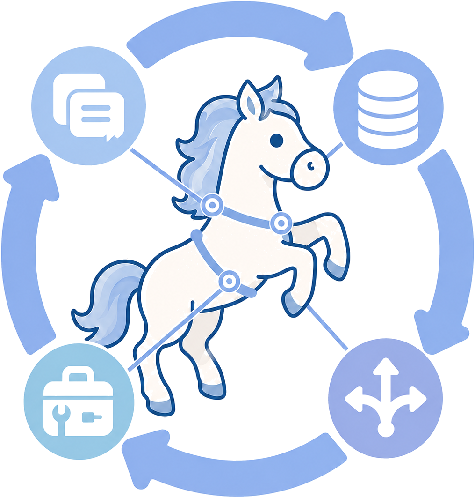
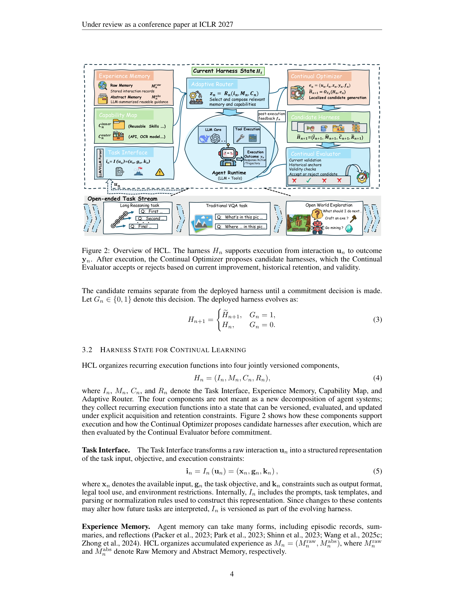
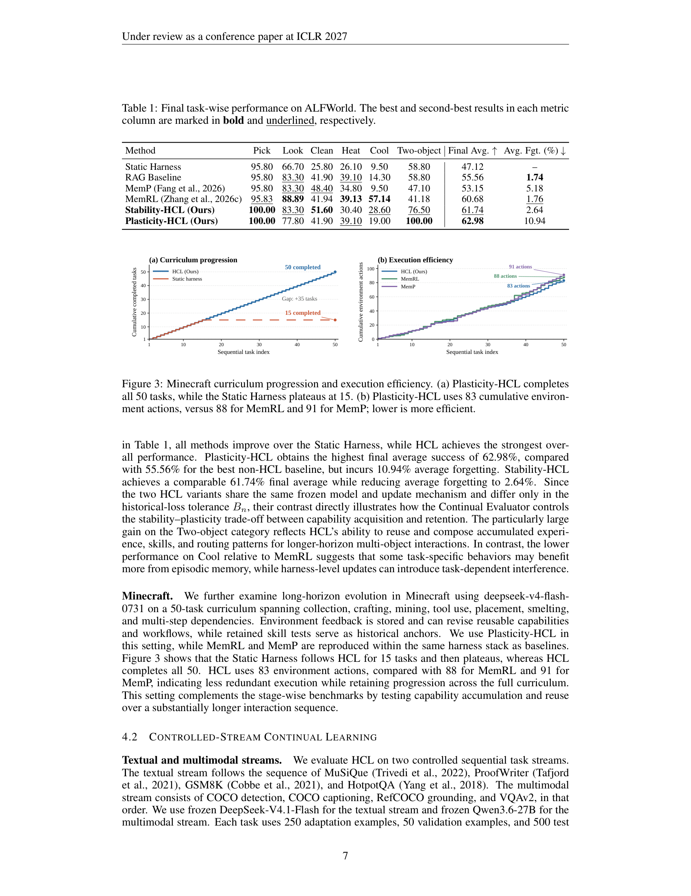
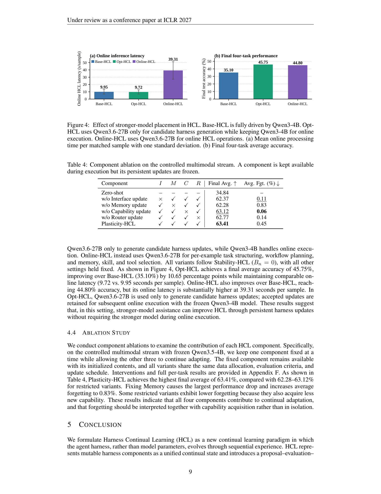

# Harness Continual Learning: Continual Adaptation Beyond Model Parameters
# Harness 持续学习：超越模型参数的持续适应

> **论文信息**
> - **arXiv**：arXiv:2608.19013v2 [cs.LG]，2026 年 9 月 30 日
> - **作者**：Borui Kang$^1$、Jinrui Gu$^1$、Junhan Lv$^1$、Wenbin Li$^{1*}$（通讯）、Lei Wang$^2$、Yang Gao$^1$
> - **单位**：$^1$南京大学计算机软件新技术全国重点实验室、$^2$澳大利亚伍伦贡大学
> - **发表**：投稿 ICLR 2027（Under review）
> - **项目页**：https://boringkey.github.io/Harness-Continual-Learning
> - **关键词**：Harness 持续学习（HCL）、harness 级遗忘、受守卫的 harness 演化、稳定性—可塑性权衡

> **翻译说明**
> - 本文基于 arXiv:2608.19013v2 全文翻译，覆盖摘要、第 1—5 节正文、可复现性声明与参考文献；附录 A—G 的完整设置细节在正文引用处做了归纳。
> - 本文是第 8 篇议题中**最接近「harness 工程作为统一层」这一判断的实证工作**：它把持续学习的**学习对象**从模型参数**整体迁移到 harness 状态**，并为由此产生的退化起了名字——**harness 级遗忘（harness-level forgetting）**。这与 2604.08224 Externalization 的 harness 章节、以及 PowerContext 的「上下文运行层」定位形成直接呼应。
> - 四分量 harness 状态（Task Interface / Experience Memory / Capability Map / Adaptive Router）与「提议—评估—提交」三段机制按原文形态完整保留。
> - 术语处理：`harness` 保留英文（本文明确把它定义为一个可版本化的状态对象，中文「执行载体/运行外层」都不够贴）；`harness-level forgetting` → 「harness 级遗忘」；`guarded harness evolution` → 「受守卫的 harness 演化」；`anchor` → 「锚点」（仅用于评测、不参与执行的历史样例）；`commit` → 「提交」；`stability–plasticity trade-off` → 「稳定性—可塑性权衡」。

---

## 摘要

持续学习在很大程度上一直是**以模型为中心**的，把**模型参数**当作随序列经验变化的状态。而现代智能体也可以**通过一个由提示、记忆、工具、技能与路由规则组成的 harness 来适应**。由于这些内容**共同塑造后续执行**，**一次 harness 更新可以在模型冻结的情况下破坏此前可靠的行为**。

这提出了一个新问题：**一个智能体如何能在模型之外持续改进它的状态，同时保留早先习得的行为？**

我们形式化 **Harness 持续学习（HCL）**——一个新的持续学习范式，其中 **harness 围绕一个冻结的基础模型演化**——并**把由此产生的「早先行为损失」定义为 harness 级遗忘（harness-level forgetting）**。

我们用**四个面向执行的组件**实例化 HCL：**任务接口（Task Interface）、经验记忆（Experience Memory）、能力地图（Capability Map）与自适应路由器（Adaptive Router）**。

我们进一步引入**受守卫的 harness 演化（guarded harness evolution）**，**把「更新的生成」与「状态的提交」分开**：一个**持续优化器（Continual Optimizer）**从执行后反馈中提出候选 harness，而一个**持续评估器（Continual Evaluator）**只有在检查了**当前改进、历史保持与有效性**之后，才提交产生的候选 harness。

在**开放世界能力累积、文本推理与多模态感知**上的实验展示了**能力累积与失败恢复**，在多个设定中相对对应基线达到**超过 10%** 的相对增益。补充实验进一步考察了**通过 harness 演化的知识迁移**。分量消融评估了每个 harness 组件的贡献，而**受控的保持扫描揭示了可测量的 harness 级遗忘，并演示了一个可控的稳定性—可塑性权衡**。

项目：https://boringkey.github.io/Harness-Continual-Learning

---

## 1. 引言

持续学习研究**一个系统如何从序列经验中习得能力，同时保持此前学到的行为** [Delange et al., 2022; Shi et al., 2025; Lu et al., 2026]。既有形式化主要通过**改变模型参数、表示或架构组件**来实现这个过程；我们把这套既有观点称为**以模型为中心的持续学习**。

**智能体 AI 的兴起引入了另一个适应来源：一个决定基础模型如何接收信息、检索经验与行动的外部 harness** [Chen et al., 2025; Jimenez et al., 2024; Li et al., 2026; Meng et al., 2026; Xie et al., 2024; Xu et al., 2025]。

**提示、记忆、工具与技能规范、以及路由策略，即便在基础模型保持冻结的情况下，也可以跨交互持续存在并演化。** 因此，**智能体的适应不再被限制在模型状态之内：harness 状态可以累积经验并重塑未来的行为。** 这**使 harness 成为持续学习研究的一个新对象**，如图 1 所示。

我们把这一设定形式化为 **Harness 持续学习（HCL）**——一个**通过在一个冻结的基础模型周围顺序更新 harness 状态**来习得并保持能力的持续学习范式。

> 
>
> **图 1**：持续学习对象的迁移。
> **① 以模型为中心的持续学习**：在序列任务上更新模型参数，旧任务发生遗忘。方法族包括：基于重放、基于正则化、基于优化、基于表示、基于架构。
> **② 以 harness 为中心的持续学习**：把持续学习从模型迁移到 harness。**存在潜在的 harness 级遗忘**（旧行为、路由、工具使用……）。**冻结的基础模型 + 演化的 harness**；候选 harness 经**验证**后**接受或拒绝**。学习对象发生迁移：**「为什么一个此前解决过的任务现在失败了？」**

**常规的 harness 优化**通常搜索**改进当前目标的提示、函数或工作流** [Zhang et al., 2024; 2025]；**HCL 研究的是「一串被部署的 harness」。**

**因为 harness 组件在执行中是耦合的，所以**：**一次记忆更新会改变为早先查询检索到的证据**；**一次技能修订会改变工具使用**；**一次路由编辑会破坏此前成功的工作流**。因此，**一个帮助近期案例的更新，可以使一个早先正确的答案、有效的工具调用或成功的动作轨迹变成一个失败——而无需改变基础模型**。

我们称这一现象为 **harness 级遗忘（harness-level forgetting）**，**它把经典的稳定性—可塑性问题从模型状态扩展到 harness 状态**。

为研究这一保持要求下的持续适应，我们开发了一个**由两部分组成的 HCL 框架**：

**第一，我们把 Task Interface、Experience Memory、Capability Map 与 Adaptive Router 定义为 HCL 的 harness 状态与学习对象。** 这些组件**被联合版本化**，并**决定智能体如何处理信息、复用经验与能力，以及组织执行**。

**第二，受守卫的 harness 演化通过两个模块治理状态转移**：一个**持续优化器**从执行后反馈中提出候选 harness，一个**持续评估器**判定这些候选能否被提交。**只有当一个候选 harness 在改进当前验证性能的同时满足历史保持预算与有效性约束，它才能被提交为被部署状态。** 这个**提议—评估—提交**过程**使保持成为 harness 适应的一个显式条件**，从而**在控制稳定性—可塑性权衡的同时缓解 harness 级遗忘**。

我们在**文本推理、多模态感知与开放世界交互**上评测 HCL，并进一步研究**保持控制、harness 级蒸馏与组件贡献**。本文的贡献如下：

- **我们提出并形式化了 Harness 持续学习（HCL）**，作为一个新的持续学习范式，**把持续学习对象从模型状态迁移到冻结基础模型周围的 harness 状态**。
- **我们识别出 harness 级遗忘，并引入受守卫的 harness 演化**，它**把当前改进、历史保持与有效性明确为提交一次 harness 更新的条件**。
- **我们展示在推理、多模态与交互流上，harness 演化支持能力累积。** 消融与保持扫描进一步揭示**组件贡献、可测量的遗忘，以及可控的稳定性—可塑性权衡**，并给出**知识迁移的探索性证据**。

---

## 2. 相关工作

### 2.1 Harness 工程

当代智能体系统把一个**运行时 harness** 放在基础模型周围，**把推理转化为面向任务的执行** [He et al., 2026; Li et al., 2026; Meng et al., 2026; Zhou et al., 2026]。**harness 状态通常包括输入接口、记忆、工具与技能注册表，以及路由或工作流控制器** [Chen et al., 2026b; Gu, 2026]。既有系统通过**推理—行动循环、工具协调、持久记忆、反思与可执行技能**来实例化这些功能 [Karpas et al., 2022; Packer et al., 2023; Schick et al., 2023; Shen et al., 2023; Shinn et al., 2023; Wang et al., 2024a; Yao et al., 2023]。

**harness 工程越来越多地从执行反馈中修订这些内容**，包括提示、记忆、技能、工作流与跨组件修复 [Abuzakuk et al., 2026; Chen et al., 2026a; Liu et al., 2026b; Yao et al., 2026; Zhang et al., 2026a;d; Zhong et al., 2026; Zhou et al., 2023]。**然而，这些方法的主要目标通常是某个组件的质量，或者是当前任务或目标分布上的下一个配置。反复的改进本身并不为完整 harness 状态提供一个通用的保持判据** [Lin et al., 2026]。

**HCL 则把可变 harness 当作一个统一的持续学习状态，并跨已提交的更新评估保持性。**

### 2.2 以模型为中心的持续学习

以模型为中心的持续学习**把一个模型适应到非平稳的任务或数据流上，同时寻求保持早先经验中习得的能力**。它的核心挑战是**灾难性遗忘**——**当学习新知识扰乱模型已获得的知识时就会发生** [Delange et al., 2022; Kirkpatrick et al., 2017; Wang et al., 2024b]。

以模型为中心的持续学习通过**重放、正则化、架构隔离、表示学习与约束优化**来应对灾难性遗忘 [Abbes et al., 2026; Bellitto et al., 2024; Kang et al., 2026; Lewandowski et al., 2025; Liu et al., 2026a; Lopez-Paz & Ranzato, 2017; Lu et al., 2024; Shang et al., 2025; Urettini & Carta, 2025; Wang et al., 2022a;b; 2025b; Yue et al., 2025]。

近期工作把这些方法族扩展到 LLM 与更广的知识流，但**演化的状态仍然是模型知识、表示、架构或参数** [Zhao et al., 2026; Zhang et al., 2026b]。**HCL 把同样「习得新能力并保持旧能力」的问题迁移到冻结模型之外的状态上。**

---

## 3. Harness 持续学习

### 3.1 定义与问题设定

考虑一个固定的基础模型 $F_\theta$ 与一个在交互步 $n$ 部署的 harness $H_n$。**模型参数 $\theta$ 保持不变。** 我们把 **Harness 持续学习**定义为：**顺序更新被部署的 harness，以习得新行为、同时保持更新之前可靠的行为**的问题。**这种行为可以是一个正确响应、一次有效工具调用，或者一条满足环境目标的动作轨迹。** 保持要求**这类行为在后续 harness 更新之后、在相同输入与执行条件下被评测时仍然成功**。

在交互步 $n$，$u_n$ 表示**原始交互**，例如一条指令、一次观察，或一个多模态输入。**harness 把 $u_n$ 变换为结构化交互 $i_n$。** 在冻结基础模型的引导下，它随后**把 $i_n$ 与选中的记忆和能力结合，装配出执行上下文 $z_n$**。**模型与外部运行时执行 $z_n$ 以产生结果 $y_n$。** 执行后反馈记为 $f_n$。我们把这些交互级对象收集为

$$e_n = (u_n, i_n, z_n, y_n, f_n). \tag{1}$$

优化器向基础模型 $F_\theta$ 提供**一条更新规则、被部署的 harness，以及可用的交互证据**作为上下文，用以生成一个候选 harness：

$$\tilde{H}_{n+1} = \mathcal{O}_{F_\theta}(H_n, e_n). \tag{2}$$

令 $G_n \in \{0, 1\}$ 表示这个决策。被部署的 harness 按如下方式演化：

$$H_{n+1} = \begin{cases} \tilde{H}_{n+1}, & G_n = 1, \\ H_n, & G_n = 0. \end{cases} \tag{3}$$

> 
>
> **图 2**：HCL 概览。harness $H_n$ 支持从交互 $u_n$ 到结果 $y_n$ 的执行。执行之后，**持续优化器**提出候选 harness，**持续评估器**基于**当前改进、历史保持与有效性**接受或拒绝。**候选在被做出提交决策之前与被部署的 harness 保持分离。**
>
> 图中要素：任务接口 $i_n = \mathcal{I}(u_n) = (x_n, g_n, k_n)$；原始记忆 $M_n^{raw}$ 与抽象记忆 $M_n^{abs}$；内部能力 $C_n^{inner}$ 与外部能力 $C_n^{outer}$；$\tilde{H}_{n+1} = (\tilde{I}_{n+1}, \tilde{M}_{n+1}, \tilde{C}_{n+1}, \tilde{R}_{n+1})$；$z_n = R_n(i_n, M_n, C_n)$；执行结果 $y_n$（响应/动作/轨迹）；执行后反馈 $f_n$；三条门：**当前验证 / 历史锚点 / 有效性检查 → 接受或拒绝候选**。
>
> 覆盖的任务流包括：长推理任务、传统 VQA 任务、开放世界探索。

### 3.2 用于持续学习的 harness 状态

HCL 把**反复出现的执行功能**组织为**四个被联合版本化的组件**：

$$H_n = (I_n, M_n, C_n, R_n), \tag{4}$$

其中 $I_n$、$M_n$、$C_n$、$R_n$ 分别表示 **Task Interface、Experience Memory、Capability Map 与 Adaptive Router**。

**这四个组件并不意图作为智能体系统的一种新分解**；它们**把反复出现的执行功能收集成一个可以被版本化、被评估、并在显式的习得与保持约束下被更新的状态**。图 2 展示这些组件如何支持执行，以及持续优化器如何在执行之后提出候选 harness、再由持续评估器在提交前评估。

**任务接口（Task Interface）。** 任务接口把**原始交互 $u_n$** 变换为**任务输入、目标与执行约束的结构化表示**：

$$i_n = \mathcal{I}_n(u_n) = (x_n, g_n, k_n), \tag{5}$$

其中 $x_n$ 表示**可用输入**，$g_n$ 是**任务目标**，$k_n$ 是**约束**，例如输出格式、合法工具使用与环境限制。在内部，$\mathcal{I}_n$ **包含用于构造这个表示的提示、任务模板，以及解析或规范化规则**。由于**这些内容的改变可能改变未来任务被解释的方式**，$I_n$ **作为演化 harness 的一部分被版本化**。

**经验记忆（Experience Memory）。** 智能体记忆可以有多种形式，包括**情节记录、摘要与反思** [Packer et al., 2023; Park et al., 2023; Shinn et al., 2023; Wang et al., 2025c; Zhong et al., 2024]。HCL 把累积的经验组织为 $M_n = (M_n^{raw}, M_n^{abs})$，分别表示**原始记忆**与**抽象记忆**：

- **原始记忆 $M_n^{raw}$** 存储**任务输入 $u_n$、由此产生的响应或动作轨迹 $y_n$，以及对应的环境或验证器反馈 $f_n$**。为保持存储有界，**它按到达顺序、从每个任务保留固定数量的交互**，**保留成功行为与遭遇失败的证据**。
- **抽象记忆 $M_n^{abs}$** 把原始记忆**总结为可复用的形式**，例如**输出约定、可靠的推理模式，以及要避免的常见错误**。随着新交互累积，**抽象条目可以被添加或更新，以支持跨相关任务的迁移**。

**二者合起来，原始记忆为复用与恢复保留了具体经验，而抽象记忆为跨任务适应提供了可复用的知识。**

**能力地图（Capability Map）。** 能力地图定义**执行期间智能体可用的操作与技能**。我们把它记为 $C_n = (C_n^{outer}, C_n^{inner})$，其中 $C_n^{outer}$ 包含**外部提供的能力**，$C_n^{inner}$ 包含**通过持续交互习得的技能**：

- **外部能力**把冻结模型连接到**外部资源**，例如 API、检索服务、计算器与环境动作。**每个条目规定它的功能、调用接口、适用条件与局限。**
- **内部能力**是**从 $M_n^{abs}$ 抽象出的可复用技能**。LLM **可以把相关的抽象记忆整合为具有显式输入、输出、执行步骤与适用范围的流程**。随着抽象记忆演化，**新的内部技能可以被添加，已有技能可以被修订。**

**与静态能力库不同，$C_n$ 可以通过经验扩张**，使冻结模型智能体能够**跨任务持续习得并复用可执行技能**。

**自适应路由器（Adaptive Router）。** 自适应路由器把任务接口、经验记忆与能力地图连接到任务执行。给定结构化交互 $i_n$，它**从 $M_n$ 检索相关经验、从 $C_n$ 选择能力，并把它们组织为一个执行上下文**：

$$z_n = R_n(i_n, M_n, C_n). \tag{6}$$

**它的路由提示、选择判据与工作流模板可以随记忆与能力的变化而演化。** 详细的存储与更新边界见附录 B。

### 3.3 受守卫的 harness 演化

**持续优化器。** 受守卫的 harness 演化**把候选生成与部署分开**。由 $H_n$ 与 $e_n$，持续优化器**诊断哪些 harness 内容可能解释了观察到的结果**，并**对任务接口、经验记忆、能力地图或自适应路由器状态提出修订**。

**当有多个组件被选中时，我们使用一种顺序的、逐组件的搜索**：组件按预定义顺序被考虑，**在当前组件上生成至多 $K$ 个备选，同时其余状态保持固定**，而**得分最高的可接受备选成为下一个组件的基础**。**如果没有备选通过闸门，该组件保持不变。** **被部署的 $H_n$ 在这次搜索中从不被修改；只有最终候选可以被提交。**

**持续评估器。** 持续评估器 $\mathcal{E}$ 检查**三个互补方面**：

- **当前改进（current improvement）**：衡量候选是否更好地解决了当前任务；
- **历史保持（historical retention）**：检查此前可靠的行为是否被保留；
- **有效性（validity）**：确保更新后的 harness 及其输出仍然可用。

令 $V_n$ 为当前任务验证用例，$P(H, V_n)$ 为对应性能。**当前改进**为

$$\Delta_n = P(\tilde{H}_{n+1}, V_n) - P(H_n, V_n). \tag{7}$$

对**历史保持**，持续评估器维护一个**仅供评测使用的锚点集 $A_n$**。**锚点保留此前被观察到样例的原始输入与任务专属成功判据，由一个基于 LLM 的选择器挑出**（附录 B.1）。**它们对执行与候选生成不可用，只作为保持性检验。** 对每个锚点 $a$，定义

$$q(H, a) \in \{0, 1\}, \tag{8}$$

其中成功是**任务专属**的。**历史损失**统计**被当前 harness 解决、但在候选下失败的锚点**：

$$D_n = \sum_{a \in A_n} \mathbb{1}\left[\,q(H_n, a) = 1 \;\wedge\; q(\tilde{H}_{n+1}, a) = 0\,\right]. \tag{9}$$

**历史损失通过测量在抽样历史锚点上的性能回归，充当遗忘的经验代理。** 任务专属成功判据列在附录 G。

令 $v_n(\tilde{H}) \in \{0, 1\}$ 表示**候选是否满足适用的语法、输出模式、工具使用、任务与环境约束**。候选 $k$ 是**可接受的**当且仅当

$$G_n^{(k)} = \mathbb{1}\left[\,\Delta_n^{(k)} \geq \delta_n \;\wedge\; D_n^{(k)} \leq B_n \;\wedge\; v_n(\tilde{H}_n^{(k)}) = 1\,\right]. \tag{10}$$

**这个闸门把局部的提议生成与持久的状态改变分开。** 在式（10）下，**一个候选只有在它 (i) 把当前任务性能提升至少 $\delta_n$、(ii) 把抽样锚点上的历史回归保持在 $B_n$ 以内、(iii) 满足任务专属有效性要求时才是可接受的**。

**若有多个候选可接受**，持续评估器选择**当前任务性能最高**的那个，**以较小的基于锚点的历史回归作为打破平局的标准**。**若没有候选可接受，当前被部署的 harness 保持不变。**

### 3.4 与以模型为中心的持续学习的联系

HCL 与以模型为中心的持续学习中的若干原则相关，**但它通过 harness 演化而非参数更新来实现它们** [Delange et al., 2022; Wang et al., 2024b]：

| HCL 组件 | 以模型为中心持续学习中的对应物 |
|---|---|
| **经验记忆** | **重放**：保留过去的交互 |
| **能力地图** | **基于表示的方法**：把累积经验抽象为可复用技能 |
| **自适应路由器** | **基于架构的方法**：动态选择并组合能力为工作流 |
| **持续优化器 + 持续评估器** | **优化 + 正则化**：候选 harness 变更从当前反馈提出，只有在改进当前性能且不违反历史保持与有效性约束时才被提交 |

**关键区别在于：HCL 把持续学习移到了模型参数本身之外。** 不是把**重放、表示、架构与更新控制**当作适应模型的**分离策略** [Kang et al., 2025; Liu et al., 2026c]，**HCL 把它们的功�能整合进一个在「习得—保持」同一目标下演化的 harness**。这提供了一个持续学习的**系统级视角**：其中**不只是模型，周围的智能体基础设施也成为持续习得能力的持久载体**。

---

## 4. 实验

我们在 **ALFWorld** [Shridhar et al., 2021] 与 **Minecraft** [Wang et al., 2024a] 上评测 HCL，以研究**长程能力累积与复用**；并在**文本与多模态任务流**上评测，以**通过重复评测早先任务来测量 harness 级遗忘**。

我们在交互与多模态实验中使用**冻结的 Qwen 家族模型**，在主文本流中使用**冻结的 DeepSeek 家族模型**。进一步分析考察**稳定性—可塑性控制、更强模型对 harness 演化的辅助，以及各个组件的贡献**。

**验证用例与历史锚点只用于候选选择**，而**不相交的测试集留作报告**。**锚点集在每个任务之后更新，并在下一个任务的候选生成与评估期间保持固定。** **Stability-HCL（$B_n = 0$）** 与 **Plasticity-HCL（$B_n = \infty$）** **只在历史损失预算上不同**，当前改进与有效性要求完全相同。

对分阶段基准，我们遵循标准持续学习协议报告**最终平均性能（Final Avg.）**与**平均遗忘（Avg. Fgt.）** [Delange et al., 2022; Wang et al., 2025a]。**遗忘衡量每个早先任务从它被观察到的最佳性能到最终性能的平均下降。**

### 4.1 开放世界能力累积

**ALFWorld。** 我们使用冻结的 Qwen3.5-9B 在**六个顺序 ALFWorld 任务类别**上评测 HCL，每个类别 10 个训练回合、共 134 个评测回合。我们对比 **Static Harness、RAG、MemP** [Fang et al., 2026] 与 **MemRL** [Zhang et al., 2026c]，**基于记忆的基线在同一执行框架下重新实现以保证公平比较**。

> **表 1**：ALFWorld 上的最终逐任务性能。每个指标列中最好与次好的结果分别用**粗体**与下划线标出。
>
> | 方法 | Pick | Look | Clean | Heat | Cool | Two-object | Final Avg. ↑ | Avg. Fgt. (%) ↓ |
> |---|---|---|---|---|---|---|---|---|
> | Static Harness | 95.80 | 66.70 | 25.80 | 26.10 | 9.50 | 58.80 | 47.12 | – |
> | RAG Baseline | 95.80 | 83.30 | 41.90 | 39.10 | 14.30 | 58.80 | 55.56 | 1.74 |
> | MemP [Fang et al., 2026] | 95.80 | 83.30 | 48.40 | 34.80 | 9.50 | 47.10 | 53.15 | 5.18 |
> | MemRL [Zhang et al., 2026c] | 95.83 | 88.89 | 41.94 | 39.13 | **57.14** | 41.18 | 60.68 | 1.76 |
> | **Stability-HCL（我们）** | **100.00** | 83.30 | **51.60** | 30.40 | 28.60 | 76.50 | 61.74 | 2.64 |
> | **Plasticity-HCL（我们）** | **100.00** | 77.80 | 41.90 | **39.10** | 19.00 | **100.00** | **62.98** | 10.94 |

如表 1 所示，**所有方法都优于 Static Harness**，而 **HCL 取得最强的总体性能**。

- **Plasticity-HCL** 取得最高的最终平均成功率 **62.98%**，相对最好的非 HCL 基线（55.56%）有明显优势，但**招致 10.94% 的平均遗忘**。
- **Stability-HCL** 取得可比的 **61.74%** 最终平均，同时**把平均遗忘降到 2.64%**。

**由于两个 HCL 变体共享同一个冻结模型与同一个更新机制、只在历史损失容忍度 $B_n$ 上不同，它们的对比直接说明持续评估器如何控制能力习得与保持之间的稳定性—可塑性权衡。**

**在 Two-object 类别上特别大的增益反映了 HCL 为更长程的多物体交互复用并组合累积经验、技能与路由模式的能力。** 相反地，**Cool 上相对 MemRL 的较低性能提示：某些任务专属行为可能更多受益于情节记忆，而 harness 级更新可能引入任务相关的干扰。**

**Minecraft。** 我们进一步用 **deepseek-v4-flash-0731** 在一个跨越**采集、合成、挖矿、工具使用、放置、熔炼与多步依赖**的 **50 任务课程**上考察长程演化。**环境反馈被存储，并可以修订可复用的能力与工作流**，而**保留的技能测试充当历史锚点**。我们在这个设定中使用 **Plasticity-HCL**，而 MemRL 与 MemP 在同一 harness 栈内被复现作为基线。

图 3 显示 **Static Harness 跟随 HCL 走了 15 个任务后平台化，而 HCL 完成了全部 50 个**。**HCL 使用 83 次环境动作**，对比 **MemRL 的 88 次**与 **MemP 的 91 次**，表明**在完整课程上都保持推进的同时，执行更少冗余**。这一设定通过对**实质上更长的交互序列**测试能力累积与复用，补充了分阶段基准。

> 
>
> **图 3**：Minecraft 课程推进与执行效率。**(a) 课程推进**：Plasticity-HCL **完成全部 50 个任务**，而 Static Harness **在 15 个处平台化**（差距 +35 个任务）。**(b) 执行效率**：Plasticity-HCL 使用 **83 次累计环境动作**，对比 MemRL 的 88 次与 MemP 的 91 次；**越低越高效**。

### 4.2 受控流的持续学习

**文本与多模态流。** 我们在两个受控的顺序任务流上评测 HCL。

- **文本流**依次为 **MuSiQue** [Trivedi et al., 2022] → **ProofWriter** [Tafjord et al., 2021] → **GSM8K** [Cobbe et al., 2021] → **HotpotQA** [Yang et al., 2018]。
- **多模态流**依次为 **COCO 检测 → COCO 描述 → RefCOCO 定位 → VQAv2**。

文本流使用冻结的 **DeepSeek-V4.1-Flash**，多模态流使用冻结的 **Qwen3.6-27B**。**每个任务使用 250 个适应样例、50 个验证样例与 500 个测试样例。**

> **表 2**：文本与多模态流上的最终逐任务性能。
>
> **文本推理：MuSiQue → ProofWriter → GSM8K → HotpotQA**
>
> | 方法 | MuSiQue | ProofWriter | GSM8K | HotpotQA | Final Avg. ↑ | Avg. Fgt. (%) ↓ |
> |---|---|---|---|---|---|---|
> | DeepSeek-V4.1-Flash Zero-shot | 48.00 | 79.20 | 65.20 | 62.20 | 63.65 | – |
> | MemP [Fang et al., 2026] | 51.40 | 78.80 | 70.80 | 60.80 | 65.45 | 0.47 |
> | MemRL [Zhang et al., 2026c] | 53.80 | 80.00 | 77.40 | 64.20 | 68.85 | 0.07 |
> | **Plasticity-HCL（我们）** | **58.60** | **85.60** | **96.00** | **64.20** | **76.10** | 0.40 |
> | **Stability-HCL（我们）** | 53.60 | 82.80 | 82.60 | 63.60 | 70.65 | 0.27 |
>
> **多模态感知：Detection → Caption → Grounding → VQAv2**
>
> | 方法 | Detection | Caption | Grounding | VQAv2 | Final Mean ↑ | Avg. Fgt. (%) ↓ |
> |---|---|---|---|---|---|---|
> | Qwen3.6-27B Zero-shot | 37.52 | 21.10 | 43.00 | 85.47 | 46.77 | – |
> | MemP [Fang et al., 2026] | 58.67 | 31.89 | 90.80 | 79.27 | 65.16 | 0.00 |
> | MemRL [Zhang et al., 2026c] | 59.33 | 30.66 | 91.40 | 77.60 | 64.75 | 0.00 |
> | **Plasticity-HCL（我们）** | 64.14 | 37.31 | 90.60 | 79.80 | 67.96 | 0.81 |
> | **Stability-HCL（我们）** | **65.34** | **39.41** | **91.60** | 79.33 | **68.92** | 0.22 |

如表 2 所示，**HCL 在两个流上都改善了最终平均性能**，而 Stability-HCL 与 Plasticity-HCL 表现出**不同的能力习得与保持模式**。

- **在文本流上**，Plasticity-HCL 取得最高的最终平均 **76.10%**、平均遗忘 **0.40%**，而 Stability-HCL 以 70.65% 排第二。这些结果表明 **HCL 在文本流上取得最强的总体性能。**
- **在多模态流上，HCL 也取得最终性能与保持之间最强的总体平衡**：Stability-HCL 取得最好的最终均值 **68.92**、平均遗忘仅 **0.22%**，而 Plasticity-HCL 达到 67.96、遗忘 0.81%。

这些结果表明 **HCL 能跨异构任务流累积能力**，而**历史保持约束控制着适应与保持之间的稳定性—可塑性权衡**。

### 4.3 HCL 中的 harness 演化

**稳定性—可塑性控制。** 为考察历史保持约束的效应，我们使用冻结的 DeepSeek-V4-Flash 让历史损失预算 $B_n \equiv b$ 在 $b \in \{0, 1, 3, \infty\}$ 上变化，同时**保持当前改进与有效性判据固定**。**每个先前的任务贡献 80 个历史锚点。** 对每个候选更新，$b$ 限制**「被部署 harness 解决、但在候选下失败」的锚点总数**。因此，**$b = 0$ 要求所有当前已解决的锚点保持成功**，而 **$b = \infty$ 移除这一约束**。

> **表 3**：历史损失容忍度 $b$ 对最终性能与遗忘的影响。
>
> | $b$ | MuSiQue | ProofWriter | GSM8K | HotpotQA | Final Avg. ↑ | Avg. Fgt. (%) ↓ |
> |---|---|---|---|---|---|---|
> | 0 | 27.83 | 73.33 | 84.33 | 59.50 | 61.25 | **0.39** |
> | 1 | 24.83 | 77.50 | 92.33 | 59.17 | **63.46** | 1.22 |
> | 3 | 26.83 | 79.83 | 83.00 | 58.50 | 62.04 | 2.00 |
> | ∞ | 28.33 | 71.00 | 82.00 | 59.17 | 60.13 | 3.45 |

如表 3 所示：

- **$b = 0$ 产生最低的平均遗忘 0.39%**；
- 而 **$b = 1$ 取得最高的最终平均准确率 63.46%**，相对 $b = 0$ **提升 2.21 个百分点**，平均遗忘 1.22%；
- **把 $b$ 提高到 3 与 $\infty$ 会把最终平均准确率降到 62.04% 与 60.13%**，同时**平均遗忘分别升到 2.00% 与 3.45%**。

这些结果表明：**对这个设定而言，对历史回归的*有限*容忍能提升最终平均准确率，但进一步放宽会同时降低最终准确率与保持性。**

**该预算约束的是抽样锚点上的回归，而不是全部历史测试用例，所以 $b = 0$ 不保证测试集遗忘为零。**

**外部模型辅助。** 我们进一步考察**一个更强的外部模型能否在不替换冻结模型的情况下改善 HCL**：

- **Base-HCL** 全程使用 Qwen3-4B；
- **Opt-HCL** 只用 Qwen3.6-27B 生成候选 harness 更新，而 **Qwen3-4B 负责在线执行**；
- **Online-HCL** 则**用 Qwen3.6-27B 做逐样例的任务结构化、工作流规划，以及记忆、技能与工具选择**。

**所有变体都遵循 Stability-HCL（$B_n = 0$）**，其他设置保持固定。

> 
>
> **图 4**：更强模型在 HCL 中的放置位置的影响。**(a) 在线推理延迟**：Base-HCL 9.95 s/样例、Opt-HCL 9.72 s/样例、Online-HCL 39.31 s/样例。**(b) 最终四任务性能**：Base-HCL 35.10%、Opt-HCL 45.75%、Online-HCL 44.80%。

如图 4 所示：

- **Opt-HCL 取得 45.75% 的最终平均准确率，相对 Base-HCL（35.10%）提升 10.65 个百分点，同时保持可比的在线延迟（9.72 vs. 9.95 秒/样例）。**
- **Online-HCL 也比 Base-HCL 有改善，达到 44.80% 准确率，但它的在线延迟显著更高，为 39.31 秒/样例。**

**在 Opt-HCL 中，Qwen3.6-27B 只被用于生成候选 harness 更新；被接受的更新被保留下来、供后续用冻结的 Qwen3-4B 模型在线执行。** 这些结果提示：**在这个设定中，更强模型辅助可以通过持久的 harness 更新改善 HCL，而不需要在线执行时使用那个更强模型。**

### 4.4 消融研究

我们做分量消融以考察每个 HCL 组件的贡献。具体地，在**冻结 Qwen3.5-4B** 的受控多模态流上，我们**一次固定一个组件、让其余三个继续适应**。**被固定的组件仍以其初始化内容可用**，而所有变体共享相同的数据分配、评测判据与更新调度。

> **表 4**：受控多模态流上的分量消融。一个组件在执行期间保持可用，但**它的持久更新被冻结**。
>
> | 组件 | I | M | C | R | Final Avg. ↑ | Avg. Fgt. (%) ↓ |
> |---|---|---|---|---|---|---|
> | Zero-shot | – | – | – | – | 34.84 | – |
> | 无 Interface 更新 | × | ✓ | ✓ | ✓ | 62.37 | 0.11 |
> | 无 Memory 更新 | ✓ | × | ✓ | ✓ | 62.28 | 0.83 |
> | 无 Capability 更新 | ✓ | ✓ | × | ✓ | 63.12 | 0.06 |
> | 无 Router 更新 | ✓ | ✓ | ✓ | × | 62.77 | 0.14 |
> | **Plasticity-HCL** | ✓ | ✓ | ✓ | ✓ | **63.41** | 0.45 |

如表 4 所示，**Plasticity-HCL 取得最高的最终平均 63.41%**，对比受限变体的 **62.28—63.12%**。

- **固定 Memory 造成最大的性能下降，并把平均遗忘提高到 0.83%。**
- **某些受限变体表现出更低的遗忘，是因为它们习得的新能力也更少。**

这些结果表明**四个组件都对持续适应有贡献**，并且**遗忘应当与能力习得一起解释，而不是孤立地看**。

---

## 5. 结论

我们把 **Harness 持续学习（HCL）** 形式化为一个新的持续学习范式：其中**演化的是智能体 harness，而不是模型参数**，并且是**通过序列经验**演化。**HCL 把可变的 harness 组件表示为一个统一的持续状态**，并引入**一个「提议—评估—提交」机制**来平衡能力习得与历史保持。

跨**开放世界交互、文本推理与多模态感知**的实验显示：**冻结模型可以通过所提出的 harness 演化持续习得并保持能力。** 进一步分析揭示了 **harness 适应的稳定性—可塑性权衡**，并表明**更强的模型在被用于候选生成而不是持续在线执行时，提供的是一种更高效的策略**。

这些结果**把持续学习从参数适应扩展到智能体级基础设施的演化**，**确立 harness 演化作为持续学习的一个互补维度**。

---

## 可复现性声明

分阶段实验的详细模型、数据、评估器与报告设置见附录 C。**harness 状态边界与候选生成流程**在附录 B 中规定，而**任务专属锚点判据**在附录 G 中给出。稳定性分析、外部能力扩展与分量消融的补充设置见对应附录。

## AI 使用声明

生成式 AI 工具被用于辅助语言编辑。**所有技术内容、实验结果、分析与主张都由作者审查与核实，作者对论文的最终内容负责。**

---

## 参考文献（节选）

Istabrak Abbes, Gopeshh Subbaraj, Matthew Riemer, Nizar Islah, Tsuguchika Tabaru, Hiroaki Kingetsu, Sarath Chandar, and Irina Rish. Revisiting replay and gradient alignment for continual pre-training of large language models. In *Proceedings of the 4th Conference on Lifelong Learning Agents*, pp. 465–486, 2026.

Sami Abuzakuk, Anne-Marie Kermarrec, Rishi Sharma, Rasmus Moorits Veski, and Martijn de Vos. Optimizing Agentic Workflows using Meta-tools, 2026.

Giovanni Bellitto, Federica Proietto Salanitri, Matteo Pennisi, Matteo Boschini, Lorenzo Bonicelli, Angelo Porrello, Simone Calderara, Simone Palazzo, and Concetto Spampinato. Saliency-driven Experience Replay for Continual Learning. In *Advances in Neural Information Processing Systems*, volume 37, 2024.

Jiayi Chen, Junyi Ye, and Guiling Wang. From Standalone LLMs to Integrated Intelligence: A Survey of Compound AI Systems, 2025.

Mengzhuo Chen, Junjie Wang, Zhe Liu, Yawen Wang, and Qing Wang. From Failed Trajectories to Reliable LLM Agents: Diagnosing and Repairing Harness Flaws, 2026a.

Tingyang Chen, Shuo Lu, Kang Zhao, Weicheng Meng, Hanlin Teng, Tianhao Li, Chao Li, Xule Liu, Jian Liang, Zhizhong Zhang, Yuan Xie, Heng Qu, Kun Shao, and Jian Luan. HarnessX: A Composable, Adaptive, and Evolvable Agent Harness Foundry, 2026b.

Karl Cobbe, Vineet Kosaraju, Mohammad Bavarian, Mark Chen, Heewoo Jun, Lukasz Kaiser, Matthias Plappert, Jerry Tworek, Jacob Hilton, Reiichiro Nakano, Christopher Hesse, and John Schulman. Training Verifiers to Solve Math Word Problems, 2021.

Matthias Delange, Rahaf Aljundi, Marc Masana, Sarah Parisot, Xu Jia, Ales Leonardis, Greg Slabaugh, and Tinne Tuytelaars. A Continual Learning Survey: Defying Forgetting in Classification Tasks. *IEEE Transactions on Pattern Analysis and Machine Intelligence*, 44(7):3366–3385, 2022.

Runnan Fang, Yuan Liang, Xiaobin Wang, Jialong Wu, Shuofei Qiao, Pengjun Xie, Fei Huang, Huajun Chen, and Ningyu Zhang. MemP: Exploring Agent Procedural Memory. In *Findings of the Association for Computational Linguistics: ACL 2026*, pp. 17490–17502, 2026.

Shangding Gu. From Model Scaling to System Scaling: Scaling the Harness in Agentic AI, 2026.

Chaoyue He, Xin Zhou, Di Wang, Hong Xu, Wei Liu, and Chunyan Miao. Harness Engineering for Language Agents: The Harness Layer as Control, Agency, and Runtime. *Preprints*, 2026.

Carlos E. Jimenez, John Yang, Alexander Wettig, Shunyu Yao, Kexin Pei, Ofir Press, and Karthik Narasimhan. SWE-bench: Can Language Models Resolve Real-World GitHub Issues?, 2024.

Borui Kang, Lei Wang, Zhiping Wu, Tao Feng, Yawen Li, Yang Gao, and Wenbin Li. Dynamic multi-layer null space projection for vision-language continual learning. In *2025 IEEE/CVF International Conference on Computer Vision (ICCV)*, pp. 2077–2086. IEEE, 2025.

Borui Kang, Jinrui Gu, Tao Feng, Qi Fan, Yinghuan Shi, Lei Wang, Wenbin Li, and Yang Gao. Don't forget why you started: Tackling dual forgetting in vision-language continual learning. In *Forty-third International Conference on Machine Learning*, 2026.

Ehud Karpas, Omri Abend, Yonatan Belinkov, Barak Lenz, Opher Lieber, Nir Ratner, Yoav Shoham, Hofit Bata, Yoav Levine, Kevin Leyton-Brown, Dor Muhlgay, Noam Rozen, Erez Schwartz, Gal Shachaf, Shai Shalev-Shwartz, Amnon Shashua, and Moshe Tenenholtz. MRKL Systems: A modular, neuro-symbolic architecture that combines large language models, external knowledge sources and discrete reasoning, 2022.

James Kirkpatrick, Razvan Pascanu, Neil Rabinowitz, Joel Veness, Guillaume Desjardins, Andrei A Rusu, Kieran Milan, John Quan, Tiago Ramalho, Agnieszka Grabska-Barwinska, et al. Overcoming catastrophic forgetting in neural networks. *Proceedings of the national academy of sciences*, 114(13):3521–3526, 2017.

Alex Lewandowski, Michał Bortkiewicz, Saurabh Kumar, András György, Dale Schuurmans, Mateusz Ostaszewski, and Marlos C. Machado. Learning Continually by Spectral Regularization. In *The Thirteenth International Conference on Learning Representations*, 2025.

Junjie Li, Xi Xiao, Yunbei Zhang, Chen Liu, Lin Zhao, Xiaoying Liao, Yingrui Ji, Janet Wang, Jianyang Gu, Yingqiang Ge, Weijie Xu, Xi Fang, Xiang Xu, Tianchen Zhao, Youngeun Kim, Tianyang Wang, Jihun Hamm, Smita Krishnaswamy, Jun Huan, and Chandan Reddy. Agent Harness Engineering: A Survey, 2026. Withdrawn TMLR submission.

Minhua Lin, Juncheng Wu, Zijun Wang, Zhan Shi, Yisi Sang, Bing He, Zewen Liu, Tianxin Wei, Zongyu Wu, Zhiwei Zhang, Dakuo Wang, Xiang Zhang, Benoit Dumoulin, Cihang Xie, Yuyin Zhou, Suhang Wang, and Hanqing Lu. Harness Updating Is Not Harness Benefit: Disentangling Evolution Capabilities in Self-Evolving LLM Agents, 2026.

Yang Liu, Toan Nguyen, and Flora D Salim. CP-MoE: Consistency-preserving mixture-of-experts for continual learning. *arXiv preprint arXiv:2605.20247*, 2026a.

Zewen Liu, Zhan Shi, Yisi Sang, Bing He, Minhua Lin, Tianxin Wei, Dakuo Wang, Benoit Dumoulin, Wei Jin, and Hanqing Lu. Adaptive Auto-Harness: Sustained Self-Improvement for Agentic System Deployment on Open-Ended Task Streams, 2026b.

Ziwei Liu, Borui Kang, Wei Li, Hangjie Yuan, Yanbing Yang, Wenbin Li, Yifan Zhu, Tao Feng, and Jun Luo. Branch, or layer? Zeroth-order optimization for continual learning of vision-language models. In *Proceedings of the AAAI Conference on Artificial Intelligence*, pp. 24026–24034, 2026c.

David Lopez-Paz and Marc' Aurelio Ranzato. Gradient Episodic Memory for Continual Learning. In *Advances in Neural Information Processing Systems*, volume 30, 2017.

Aojun Lu, Tao Feng, Hangjie Yuan, Xiaotian Song, and Yanan Sun. Revisiting Neural Networks for Continual Learning: An Architectural Perspective, 2024.

Haodong Lu, Chongyang Zhao, Jason Xue, Lina Yao, Kristen Moore, and Dong Gong. Little by little: Continual learning via incremental mixture of rank-1 associative memory experts. In *Forty-third International Conference on Machine Learning*, 2026.

Qianyu Meng, Yanan Wang, Liyi Chen, Yihang Li, Wei Wu, Wenyuan Jiang, Qimeng Wang, Chengqiang Lu, Yan Gao, Yi Wu, and Yao Hu. Agent Harness for Large Language Model Agents: A Survey. *Preprints*, 2026.

Charles Packer, Sarah Wooders, Kevin Lin, Vivian Fang, Shishir G. Patil, Ion Stoica, and Joseph E. Gonzalez. MemGPT: Towards LLMs as Operating Systems, 2023.

Joon Sung Park, Joseph C. O'Brien, Carrie J. Cai, Meredith Ringel Morris, Percy Liang, and Michael S. Bernstein. Generative Agents: Interactive Simulacra of Human Behavior, 2023.

Timo Schick, Jane Dwivedi-Yu, Roberto Dessì, Roberta Raileanu, Maria Lomeli, Eric Hambro, Luke Zettlemoyer, Nicola Cancedda, and Thomas Scialom. Toolformer: Language Models Can Teach Themselves to Use Tools, 2023.

Jin Shang, Simone Shao, Tian Tong, Fan Yang, Yetian Chen, Yang Jiao, Jia Liu, and Yan Gao. Divide and Orthogonalize: Efficient Continual Learning with Local Model Space Projection. In *Proceedings of the Forty-First Conference on Uncertainty in Artificial Intelligence*, 2025.

Yongliang Shen, Kaitao Song, Xu Tan, Dongsheng Li, Weiming Lu, and Yueting Zhuang. HuggingGPT: Solving AI Tasks with ChatGPT and its Friends in Hugging Face, 2023.

Haizhou Shi, Zihao Xu, Hengyi Wang, Weiyi Qin, Wenyuan Wang, Yibin Wang, Zifeng Wang, Sayna Ebrahimi, and Hao Wang. Continual Learning of Large Language Models: A Comprehensive Survey, 2025.

Noah Shinn, Federico Cassano, Ashwin Gopinath, Karthik Narasimhan, and Shunyu Yao. Reflexion: Language Agents with Verbal Reinforcement Learning. In *Advances in Neural Information Processing Systems*, volume 36, pp. 8634–8652, 2023.

Mohit Shridhar, Xingdi Yuan, Marc-Alexandre Côté, Yonatan Bisk, Adam Trischler, and Matthew Hausknecht. ALFWorld: Aligning Text and Embodied Environments for Interactive Learning. *International Conference on Learning Representations*, 2021.

Oyvind Tafjord, Bhavana Dalvi, and Peter Clark. ProofWriter: Generating Implications, Proofs, and Abductive Statements over Natural Language. In *Findings of the Association for Computational Linguistics: ACL-IJCNLP 2021*, pp. 3621–3634, 2021.

Harsh Trivedi, Niranjan Balasubramanian, Tushar Khot, and Ashish Sabharwal. MuSiQue: Multi-hop Questions via Single-hop Question Composition. *Transactions of the Association for Computational Linguistics*, 10:539–554, 2022.

Edoardo Urettini and Antonio Carta. Online curvature-aware replay: Leveraging second-order information for online continual learning. In *Proceedings of the 42nd International Conference on Machine Learning*, pp. 60590–60609, 2025.

Guanzhi Wang, Yuqi Xie, Yunfan Jiang, Ajay Mandlekar, Chaowei Xiao, Yuke Zhu, Linxi Fan, and Anima Anandkumar. Voyager: An Open-Ended Embodied Agent with Large Language Models. *Transactions on Machine Learning Research*, 2024a.

Huiyi Wang, Haodong Lu, Lina Yao, and Dong Gong. Self-expansion of pre-trained models with mixture of adapters for continual learning. In *2025 IEEE/CVF Conference on Computer Vision and Pattern Recognition (CVPR)*, pp. 10087–10098, 2025a.

Liyuan Wang, Xingxing Zhang, Hang Su, and Jun Zhu. A comprehensive survey of continual learning: Theory, method and application. *IEEE transactions on pattern analysis and machine intelligence*, 46(8):5362–5383, 2024b.

Xinrui Wang, Shao-Yuan Li, Jiaqiang Zhang, and Songcan Chen. Cut out and replay: A simple yet versatile strategy for multi-label online continual learning. In *Proceedings of the 42nd International Conference on Machine Learning*, pp. 63530–63548, 2025b.

Zifeng Wang, Zizhao Zhang, Sayna Ebrahimi, Ruoxi Sun, Han Zhang, Chen-Yu Lee, Xiaoqi Ren, Guolong Su, Vincent Perot, Jennifer Dy, and Tomas Pfister. DualPrompt: Complementary Prompting for Rehearsal-free Continual Learning, 2022a.

Zifeng Wang, Zizhao Zhang, Chen-Yu Lee, Han Zhang, Ruoxi Sun, Xiaoqi Ren, Guolong Su, Vincent Perot, Jennifer Dy, and Tomas Pfister. Learning to prompt for continual learning. In *CVPR*, pp. 139–149, 2022b.

Zora Zhiruo Wang, Jiayuan Mao, Daniel Fried, and Graham Neubig. Agent Workflow Memory, 2025c.

Tianbao Xie, Danyang Zhang, Jixuan Chen, Xiaochuan Li, Siheng Zhao, Ruisheng Cao, Toh Jing Hua, Zhoujun Cheng, Dongchan Shin, Fangyu Lei, Yitao Liu, Yiheng Xu, Shuyan Zhou, Silvio Savarese, Caiming Xiong, Victor Zhong, and Tao Yu. OSWorld: Benchmarking Multimodal Agents for Open-Ended Tasks in Real Computer Environments, 2024.

Frank F. Xu, Yufan Song, Boxuan Li, Yuxuan Tang, Kritanjali Jain, Mengxue Bao, Zora Z. Wang, Xuhui Zhou, Zhitong Guo, Murong Cao, Mingyang Yang, Hao Yang Lu, Amaad Martin, Zhe Su, Leander Maben, Raj Mehta, Wayne Chi, Lawrence Jang, Yiqing Xie, Shuyan Zhou, and Graham Neubig. TheAgentCompany: Benchmarking LLM Agents on Consequential Real World Tasks, 2025.

Zhilin Yang, Peng Qi, Saizheng Zhang, Yoshua Bengio, William Cohen, Ruslan Salakhutdinov, and Christopher D. Manning. HotpotQA: A Dataset for Diverse, Explainable Multi-hop Question Answering. In *EMNLP 2018*, pp. 2369–2380, 2018.

Shunyu Yao, Jeffrey Zhao, Dian Yu, Nan Du, Izhak Shafran, Karthik Narasimhan, and Yuan Cao. ReAct: Synergizing Reasoning and Acting in Language Models. *ICLR*, 2023.

Yifan Zhang, et al. Self-evolving LLM agent frameworks and harness updates, 2026a.

Yifan Zhang, et al. Model-centric continual learning for large language models, 2026b.

Xiangyu Zhang, et al. MemRL: Memory-based reinforcement learning for agents, 2026c.

---

## 图片与文件索引

| 图号 | 原图注 | 文件 |
|---|---|---|
| 图 1 | The shift in the object of continual learning. | `../images/HarnessCL/01-figure1-object-shift.png` |
| 图 2 | Overview of HCL. | `../images/HarnessCL/02-figure2-overview.png` |
| 图 3 | Minecraft curriculum progression and execution efficiency. | `../images/HarnessCL/03-figure3-minecraft.png` |
| 图 4 | Effect of stronger-model placement in HCL. | `../images/HarnessCL/04-figure4-model-placement.png` |
