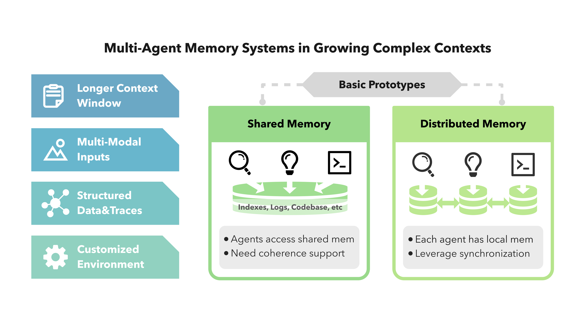

# Multi-Agent Memory from a Computer Architecture Perspective: Visions and Challenges Ahead
# 从计算机体系结构视角看多智能体记忆：愿景与挑战

> **论文信息**
> - **arXiv**：arXiv:2603.10062v1 [cs.AR]，2026 年 3 月 9 日
> - **作者**：Zhongming Yu、Naicheng Yu、Hejia Zhang、Wentao Ni、Mingrui Yin、Jiaying Yang、Yujie Zhao、Jishen Zhao
> - **单位**：加州大学圣地亚哥分校（UCSD）、佐治亚理工学院（Georgia Tech）
> - **发表**：Architecture 2.0 '26，2026 年 3 月 23 日，美国宾州匹兹堡
> - **类型**：position paper（立场文），3 页正文
> - **关键词**：多智能体记忆、记忆层次、缓存共享协议、记忆访问协议、记忆一致性

> **翻译说明**
> - 本文基于 arXiv:2603.10062v1 全文翻译，覆盖摘要、第 1—7 节全部正文与参考文献。
> - 这是一篇 3 页立场文，篇幅短、密度高：作者不提供实验，只提出框架、术语与开放问题。译文保持了原文的「论断式」语体，未补入原文没有的证据。
> - 原文的两张架构图（图 1、图 2）已从 PDF 中提取并按原位置引用；图 3 在原文中以文字框图形式跨栏排版，PDF 提取后版式散乱，译文按其语义重绘为表格形式，并在图注中标明原始标题。
> - 术语处理：`harness` 在本文语境中按「运行时载体 / 执行环境」理解；`cache`、`coherence`、`consistency` 按体系结构领域惯例分别译作「缓存」「缓存一致性」「（内存）一致性」，并在必要处保留英文原词以避免歧义；`protocol` 统一译作「协议」。

---

## 摘要

随着 LLM 智能体演进为协作式多智能体系统，它们的记忆需求在复杂度上迅速增长。本篇立场文把多智能体记忆**框定为一个计算机体系结构问题**。我们区分了**共享内存**与**分布式内存**两种范式，提出一个**三层记忆层次结构**（I/O 层、缓存层、内存层），并识别出两个关键的**协议缺口**：跨智能体的缓存共享，以及结构化的记忆访问控制。我们论证，**最紧迫的开放挑战是多智能体记忆一致性**。我们的体系结构式框定为构建可靠、可扩展的多智能体系统提供了基础。

## 1. 引言

大语言模型（LLM）智能体 [1, 2] 正在迅速从「单智能体」工具 [3] 走向多智能体系统 [4, 5]：工具使用型智能体 [6]、规划器—编排器栈 [7]、辩论团队 [8, 9]，以及协作解决任务的专用子智能体 [10, 11]。与此同时，这些智能体所处的上下文正变得更复杂：更长的历史、多种模态、结构化轨迹，以及定制化环境。这一组合制造出一个对计算机体系结构研究者而言**惊人地熟悉**的瓶颈：**内存**。

在计算机系统中，性能与可扩展性常常不是被计算限制，而是被内存层次、带宽与一致性限制。多智能体系统正走向同一堵墙——只不过它们的「内存」不是原始字节，而是**用于推理的语义上下文**。本篇立场文把多智能体记忆框定为一个计算机体系结构问题，并指出关键的协议与一致性缺口。

## 2. 为什么记忆重要：上下文正在发生变化

LLM 评测显示，「真正的」上下文能力远不止简单检索；它要求在上下文长度扩展时进行**多跳追溯、聚合与持续推理**。多模态基准加入了图像、图表与视频。结构化任务引入了可执行轨迹与模式（schema）。交互式环境使**环境状态 + 执行过程**成为记忆问题的一部分。结果不再是一个静态提示词，而是一个**动态的、多格式的、部分持久的记忆系统**。

- **更长的上下文窗口**：RULER [12] 这类评测套件强调的是**在长历史上推理**，而不只是检索。
- **多模态输入**：MMMU [13] 与 VideoMME [14] 这类基准要求对图像与视频做联合推理。
- **结构化数据与轨迹**：Spider [15] 与 BIRD [16] 这类 Text-to-SQL 数据集显示，智能体越来越多地在**结构化的、可执行的轨迹**上操作。
- **定制化环境**：SWE-bench [17] 与 OSWorld [18] 这类评测强调的是**长程状态跟踪**与**有根基的动作**。

因此，上下文不再是静态提示词；它是一个带有**带宽、缓存与一致性约束**的动态记忆系统。

> 
>
> **图 1**：管理日益增长的上下文复杂度的两种基础多智能体记忆架构：共享内存与分布式内存。

## 3. 共享式 vs. 分布式智能体记忆

这里我们给出两个镜像经典内存系统的基本原型。在**共享内存**中，所有智能体访问同一个共享池（例如共享向量库或文档数据库）。在**分布式内存**中，每个智能体拥有本地记忆，并有选择地同步。

**共享内存**让知识复用变得容易，但需要**一致性支持**；缺少协调时，智能体会互相覆写、读到过期信息，或依赖于同一共享事实的不一致版本。**分布式内存**提升了隔离性与可扩展性，但需要**显式同步**；除非被仔细管理，状态分叉会变得常见。大多数真实系统位于这两个极端之间：**本地工作记忆 + 有选择地共享的制品（artifact）**。

## 4. 一个受体系结构启发的记忆层次

计算机体系结构教会我们一个实用经验：系统不是围绕「一个内存」来设计的。相反，它们被构造成**记忆层次结构**，各层分别针对延迟、带宽、容量与持久性做优化。对智能体而言，一个有用的映射如下：

- **智能体 I/O 层**：摄入与发出信息的接口（音频、文本文档、图像、网络调用）。
- **智能体缓存层**：用于即时推理的快速、有限容量内存（压缩上下文、近期工具调用、短期潜存储——如 KV 缓存与嵌入）。
- **智能体内存层**：为大容量、较慢的内存，针对检索与持久性优化（完整对话历史、向量数据库、图数据库、文档存储）。

这一框定强调了一条关键原则：**智能体性能是一个端到端的数据搬运问题**。如果相关信息被困在错误的层（或从未被加载），推理准确率与效率都会退化。正如硬件中那样，**缓存不是可选项**。

> 
>
> **图 2**（原图注）：智能体记忆层次与协议框定。含两个子图——
> **(a) 受计算机体系结构启发的智能体记忆**：智能体 I/O 层（用户输入：音频、文本、图像；网络）→ 智能体缓存层（压缩上下文、近期轨迹与工具调用、短期潜存储）→ 智能体内存层（完整对话历史、外部知识数据库、长期潜存储）；数据流为「直接检索/存储 → 填充 → 返回 → 持久化 → 查找」。与计算机内存层次类似，智能体记忆同样受益于 I/O 层与缓存层，以提升效率与可扩展性。
> **(b) 面向多智能体场景的协议扩展**：Agent Context IO（MCP、JSON-RPC）——通过 MCP 注册的智能体可以连接与通信，但智能体间带宽仍受上下文限制；Agent Cache Sharing（如 Agent-RDMA、Cache Reuse、Cache Protocol）——允许一个智能体的缓存制品被转换并被其他智能体复用；Agent Memory Access——定义智能体如何读/写其他智能体的记忆，包括权限、作用域与访问粒度。

## 5. 面向多智能体场景的协议扩展

体系结构的层次需要**协议**。许多系统依赖连通性协议，但智能体间带宽仍受消息传递限制。这一层最好被看作**智能体上下文 I/O**，例如 MCP [19]。这是必要的——但并不充分。两个缺失的部件格外突出。

**缺失部件 1：智能体缓存共享协议。** 近期工作探索了 KV 缓存共享 [20–22]，但我们缺少一个用于**跨智能体共享缓存制品**的原则性协议。其目标是让一个智能体的缓存结果能够被转换并被另一个智能体复用，类似于多处理器中的缓存传输。

**缺失部件 2：智能体记忆访问协议。** 智能体记忆框架 [23–26] 提出了许多维护与优化 LLM 智能体记忆的策略。然而即便某些框架支持共享状态，其**标准访问协议（权限、作用域、粒度）仍然处于欠规范状态**。关键问题包括：一个智能体可以读另一个智能体的长期记忆吗？访问是只读还是读写的？访问单元是什么——一个文档、一个分块、一条键值记录，还是一段轨迹片段？

> **图 3**（原图注）：从传统内存体系结构到多智能体记忆的一致性模型比较。原文为跨栏文字框图，此处按语义整理为下表。
>
> | 层次 | 核心对象 | 关键特征 | 目标 |
> |---|---|---|---|
> | **体系结构内存一致性** | 内存地址 → 共享信息 | 硬件级保证；定义良好的模型（Sequential、TSO 等）；原子性关切；同步原语；重排序约束 | 读写顺序 |
> | **智能体记忆一致性** | 语义上下文 | 时间一致；与上下文相关的检索；对新信息的更新 / 对旧信息的删除；冲突解决；个性化 | 维持连贯的上下文 |
> | **多智能体记忆一致性** | 共享信息 | 共享内存 / 分布式内存；一致性模型支持；智能体间通信；冲突解决 | 协调共享信息 |

## 6. 下一个前沿：多智能体一致性

最大的概念缺口是**一致性**。在计算机体系结构中，一致性模型 [27] 规定了哪些更新对一次读可见、以及并发更新可以按什么顺序被观察到。我们论证，智能体记忆系统需要一个**类似的概念**。对于单个 LLM 智能体，一致性要求其记忆保持**时间连贯** [28]——新信息必须被整合进来而不与既有事实矛盾，且检索必须反映最新状态。在这里，一致性是持久、演化中的知识的一种**有状态属性**。当我们走向多智能体场景时，问题叠加：多个智能体现在并发地读写共享记忆，从而带出了可见性、顺序与冲突解决这些经典挑战。

对智能体记忆系统而言，**多智能体记忆一致性**可分解为两项要求：

1. **迭代修订下的读时冲突处理**：记录跨版本演化，而过期制品可能仍然可见；
2. **更新时的可见性与顺序**：它决定一个智能体的写入何时对其他智能体变得可观察，以及并发写入可以按何种允许的顺序被观察到。

这比经典场景更难，因为**记忆制品是异构的**（证据、工具轨迹、计划），且**冲突常常是语义性的、与环境状态耦合**。一个实用的方向是：让**版本化、可见性与冲突解决规则显式化**，从而智能体对「读什么」「更新何时生效」达成一致。

## 7. 结论

今天许多智能体记忆系统像人类记忆：**非正式的、冗余的、难以控制的**。要从临时拼凑的提示词走向可靠的多智能体系统，我们需要更好的层次结构、显式的缓存共享与记忆访问协议，以及能让共享上下文保持连贯的原则性一致性模型。我们相信，这一体系结构式框定是下一代智能体系统的基础性研究方向。

## 参考文献

[1] Shunyu Yao, Jeffrey Zhao, Dian Yu, Nan Du, Izhak Shafran, Karthik R Narasimhan, and Yuan Cao. 2022. React: Synergizing reasoning and acting in language models. In *The eleventh international conference on learning representations*.

[2] Noah Shinn, Federico Cassano, Ashwin Gopinath, Karthik Narasimhan, and Shunyu Yao. 2023. Reflexion: Language agents with verbal reinforcement learning. *Advances in Neural Information Processing Systems* 36 (2023), 8634–8652.

[3] Timo Schick, Jane Dwivedi-Yu, Roberto Dessì, Roberta Raileanu, Maria Lomeli, Eric Hambro, Luke Zettlemoyer, Nicola Cancedda, and Thomas Scialom. 2023. Toolformer: Language models can teach themselves to use tools. *Advances in Neural Information Processing Systems* 36 (2023), 68539–68551.

[4] Taicheng Guo, Xiuying Chen, Yaqi Wang, Ruidi Chang, Shichao Pei, Nitesh V Chawla, Olaf Wiest, and Xiangliang Zhang. 2024. Large language model based multi-agents: A survey of progress and challenges. *arXiv preprint arXiv:2402.01680* (2024).

[5] Sirui Hong, Mingchen Zhuge, Jonathan Chen, Xiawu Zheng, Yuheng Cheng, Jinlin Wang, Ceyao Zhang, Zili Wang, Steven Ka Shing Yau, Zijuan Lin, et al. 2023. MetaGPT: Meta programming for a multi-agent collaborative framework. In *The twelfth international conference on learning representations*.

[6] Qingyun Wu, Gagan Bansal, Jieyu Zhang, Yiran Wu, Beibin Li, Erkang Zhu, Li Jiang, Xiaoyun Zhang, Shaokun Zhang, Jiale Liu, et al. 2024. Autogen: Enabling next-gen LLM applications via multi-agent conversations. In *First Conference on Language Modeling*.

[7] LangChain Inc. 2026. LangGraph overview. https://docs.langchain.com/oss/python/langgraph/overview. Accessed: 2026-02-11.

[8] Microsoft. 2026. Multi-Agent Debate. https://microsoft.github.io/autogen/stable/user-guide/core-user-guide/design-patterns/multi-agent-debate.html. Accessed: 2026-02-11.

[9] Chi-Min Chan, Weize Chen, Yusheng Su, Jianxuan Yu, Wei Xue, Shanghang Zhang, Jie Fu, and Zhiyuan Liu. 2023. Chateval: Towards better llm-based evaluators through multi-agent debate. *arXiv preprint arXiv:2308.07201* (2023).

[10] LangChain. 2026. Subagents. https://docs.langchain.com/oss/python/langchain/multi-agent/subagents. Accessed: 2026-02-11.

[11] Samuel Schmidgall, Yusheng Su, Ze Wang, Ximeng Sun, Jialian Wu, Xiaodong Yu, Jiang Liu, Michael Moor, Zicheng Liu, and Emad Barsoum. 2025. Agent laboratory: Using llm agents as research assistants. *Findings of the Association for Computational Linguistics: EMNLP 2025* (2025), 5977–6043.

[12] Cheng-Ping Hsieh, Simeng Sun, Samuel Kriman, Shantanu Acharya, Dima Rekesh, Fei Jia, Yang Zhang, and Boris Ginsburg. 2024. RULER: What's the Real Context Size of Your Long-Context Language Models? *arXiv preprint arXiv:2404.06654* (2024).

[13] Xiang Yue, Yuansheng Ni, Kai Zhang, Tianyu Zheng, Ruoqi Liu, Ge Zhang, Samuel Stevens, Dongfu Jiang, Weiming Ren, Yuxuan Sun, et al. 2024. Mmmu: A massive multi-discipline multimodal understanding and reasoning benchmark for expert agi. In *Proceedings of the IEEE/CVF Conference on Computer Vision and Pattern Recognition*. 9556–9567.

[14] Chaoyou Fu, Yuhan Dai, Yongdong Luo, Lei Li, Shuhuai Ren, Renrui Zhang, Zihan Wang, Chenyu Zhou, Yunhang Shen, Mengdan Zhang, et al. 2025. Video-mme: The first-ever comprehensive evaluation benchmark of multi-modal llms in video analysis. In *Proceedings of the Computer Vision and Pattern Recognition Conference*. 24108–24118.

[15] Tao Yu, Rui Zhang, Kai Yang, Michihiro Yasunaga, Dongxu Wang, Zifan Li, James Ma, Irene Li, Qingning Yao, Shanelle Roman, et al. 2018. Spider: A large-scale human-labeled dataset for complex and cross-domain semantic parsing and text-to-sql task. *arXiv preprint arXiv:1809.08887* (2018).

[16] Jinyang Li, Binyuan Hui, Ge Qu, Jiaxi Yang, Binhua Li, Bowen Li, Bailin Wang, Bowen Qin, Ruiying Geng, Nan Huo, et al. 2023. Can llm already serve as a database interface? a big bench for large-scale database grounded text-to-sqls. *Advances in Neural Information Processing Systems* 36 (2023), 42330–42357.

[17] Carlos E Jimenez, John Yang, Alexander Wettig, Shunyu Yao, Kexin Pei, Ofir Press, and Karthik Narasimhan. 2023. Swe-bench: Can language models resolve real-world github issues? *arXiv preprint arXiv:2310.06770* (2023).

[18] Tianbao Xie, Danyang Zhang, Jixuan Chen, Xiaochuan Li, Siheng Zhao, Ruisheng Cao, Toh J Hua, Zhoujun Cheng, Dongchan Shin, Fangyu Lei, et al. 2024. Os-world: Benchmarking multimodal agents for open-ended tasks in real computer environments. *Advances in Neural Information Processing Systems* 37 (2024), 52040–52094.

[19] Anthropic. 2025. Model Context Protocol: Introduction. https://modelcontextprotocol.io/docs/getting-started/intro

[20] Yuhan Liu, Yuyang Huang, Jiayi Yao, Shaoting Feng, Zhuohan Gu, Kuntai Du, Hanchen Li, Yihua Cheng, Junchen Jiang, Shan Lu, et al. 2024. DroidSpeak: KV Cache Sharing for Cross-LLM Communication and Multi-LLM Serving. *arXiv preprint arXiv:2411.02820* (2024).

[21] Tianyu Fu, Zihan Min, Hanling Zhang, Jichao Yan, Guohao Dai, Wanli Ouyang, and Yu Wang. 2025. Cache-to-cache: Direct semantic communication between large language models. *arXiv preprint arXiv:2510.03215* (2025).

[22] Hancheng Ye, Zhengqi Gao, Mingyuan Ma, Qinsi Wang, Yuzhe Fu, Ming-Yu Chung, Yueqian Lin, Zhijian Liu, Jianyi Zhang, Danyang Zhuo, et al. 2025. Kv-comm: Online cross-context kv-cache communication for efficient llm-based multi-agent systems. *arXiv preprint arXiv:2510.12872* (2025).

[23] Charles Packer, Sarah Wooders, Kevin Lin, Vivian Fang, Shishir G. Patil, Ion Stoica, and Joseph E. Gonzalez. 2023. MemGPT: Towards LLMs as Operating Systems. *arXiv preprint arXiv:2310.08560* (2023).

[24] Wujiang Xu, Kai Mei, Hang Gao, Juntao Tan, Zujie Liang, and Yongfeng Zhang. 2025. A-mem: Agentic memory for llm agents. *arXiv preprint arXiv:2502.12110* (2025).

[25] Prateek Chhikara, Dev Khant, Saket Aryan, Taranjeet Singh, and Deshraj Yadav. 2025. Mem0: Building production-ready ai agents with scalable long-term memory. *arXiv preprint arXiv:2504.19413* (2025).

[26] Hongjin Qian, Peitian Zhang, Zheng Liu, Kelong Mao, and Zhicheng Dou. 2024. Memorag: Moving towards next-gen rag via memory-inspired knowledge discovery. *arXiv preprint arXiv:2409.05591* 1 (2024).

[27] Daniel Sorin, Mark Hill, and David Wood. 2011. *A primer on memory consistency and cache coherence*. Morgan & Claypool Publishers.

[28] Joon Sung Park, Joseph O'Brien, Carrie Jun Cai, Meredith Ringel Morris, Percy Liang, and Michael S Bernstein. 2023. Generative agents: Interactive simulacra of human behavior. In *Proceedings of the 36th annual acm symposium on user interface software and technology*. 1–22.

---

## 图片与文件索引

| 图号 | 原图注 | 文件 |
|---|---|---|
| 图 1 | Two fundamental multi-agent memory architectures for managing growing context complexity: shared memory and distributed memory. | `../images/MA-Memory/01-figure1-shared-vs-distributed.png` |
| 图 3（原文编号） | Consistency model comparison from traditional memory architecture to multi-agent memory. | `../images/MA-Memory/02-figure3-consistency.png` |

> 注：原文图 2（Agent memory hierarchy and protocol framing）为跨栏双栏图，PDF 文本提取后元素散落，已按语义并入第 5 节的表格式重绘；如需原图版式请参见 PDF 第 2 页。
