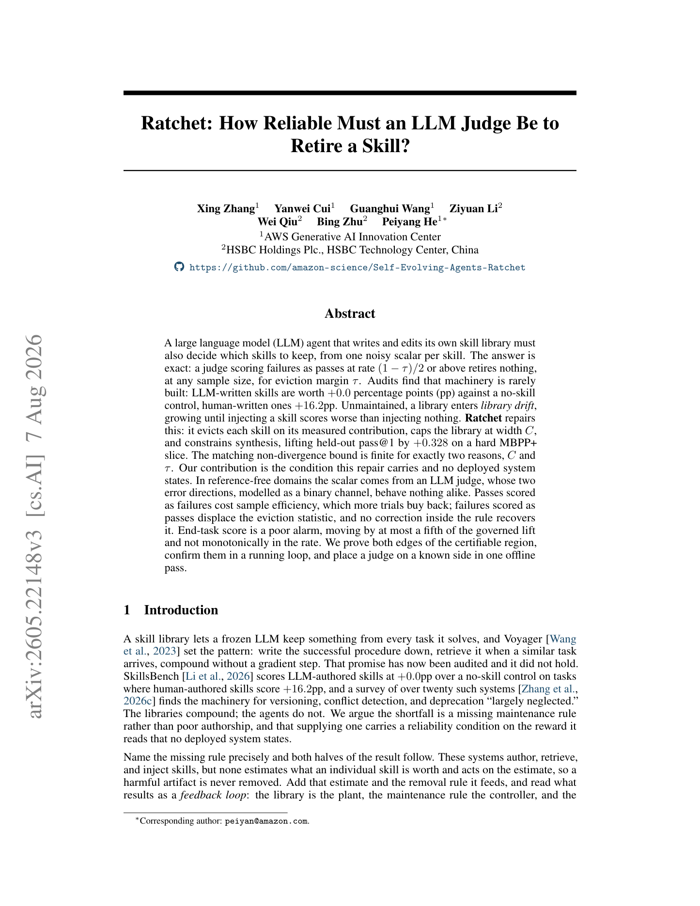
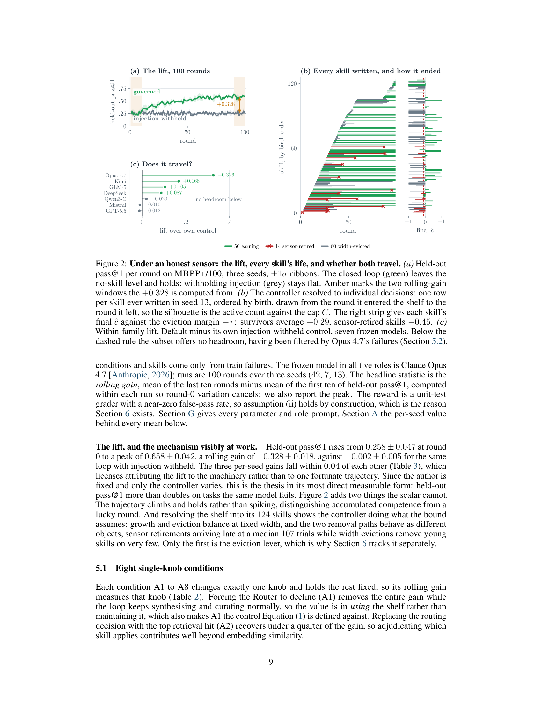
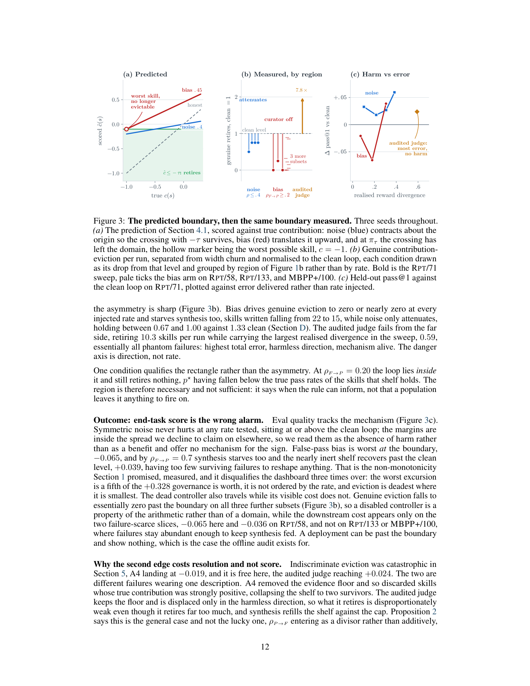

# Ratchet: How Reliable Must an LLM Judge Be to Retire a Skill?
# Ratchet：一个 LLM 裁判要多可靠，才能退役一个技能？

> **论文信息**
> - **arXiv**：arXiv:2605.22148v3 [cs.AI]，2026 年 8 月 7 日
> - **作者**：Xing Zhang$^1$、Yanwei Cui$^1$、Guanghui Wang$^1$、Ziyuan Li$^2$、Wei Qiu$^2$、Bing Zhu$^2$、Peiyang He$^{1*}$（通讯：peiyan@amazon.com）
> - **单位**：$^1$AWS Generative AI Innovation Center、$^2$HSBC Holdings Plc. 汇丰科技中心（中国）
> - **代码**：https://github.com/amazon-science/Self-Evolving-Agents-Ratchet
> - **关键词**：库漂移、技能退役、LLM 裁判可靠性、二进制信道、证据下限、有界宽度

> **翻译说明**
> - 本文基于 arXiv:2605.22148v3 全文翻译，覆盖摘要、第 1—7 节正文、参考文献，以及附录中引用的核心推导与实验细节。
> - 这是一篇**理论 + 实证**混合论文：它的核心贡献是**两条命题**——一条给出「受治理技能库的性能下限」，另一条把该下限推广到「有噪声的裁判」，并暴露出一条**精确的可靠性边界**。译文完整保留了第 4 节的推导、两条命题（式 4、式 7）、二进制信道模型（式 5、式 6），以及第 5、6 节的实验表格。
> - 本文提出的核心概念 **library drift（库漂移）**、**governable region（可治理区域）**、**πτ = (1 − τ)/2 边界**，是第 8 篇「经验与技能外部化」议题中最锋利的一把刀——它把「技能库治理」从工程直觉问题，变成了**一个可判定、可离线测量、且不随样本量改善而缓解**的问题。
> - 术语处理：`library drift` → 「库漂移」；`eviction` → 「驱逐 / 退役」；`Curator` → 「治理器」；`shelf` → 「书架」（隐喻技能库的活动集）；`width C` → 「宽度 C」；`sensor` → 「传感器」（指读取 `ĉ(s)` 的那个统计量）；`false-pass rate` $ρ_{F→P}$ → 「假通过率」；`phantom-failure rate` $ρ_{P→F}$ → 「幻影失败率」；`governable region` → 「可治理区域」。方向标注保留原文下标形式以保证公式一致性。

---

## 摘要

一个**自己编写和编辑技能库**的大语言模型（LLM）智能体，还必须决定**保留哪些技能**——而它只有**每个技能一个含噪标量**可用。

答案**是精确的**：一个**以 $(1-\tau)/2$ 或更高的速率把失败判为通过**的裁判，无论样本量多大，都**不会退役任何东西**（在驱逐余量 $\tau$ 下）。

审计发现，这套机制**很少被构建**：LLM 编写的技能相对无技能对照组只值 **+0.0 个百分点（pp）**，而人类编写的技能值 **+16.2 pp**。**若不加维护**，技能库会进入**库漂移（library drift）**，不断增长，直到**注入一个技能比什么都不注入得分更差**。

**Ratchet 修复了这一点**：它按**被测量的贡献**驱逐每个技能，把技能库**限制在宽度 $C$**，并**约束合成**——在一个困难的 MBPP+ 切片上把留出 pass@1 提升 **+0.328**。

配套的**非发散界之所以有限，恰恰只有两个原因：$C$ 与 $\tau$**。我们的贡献是这个修复所携带、而**没有任何已部署系统陈述过**的条件。

在**无参考（reference-free）**领域，这个标量来自一个 LLM 裁判，其**两个误差方向**（建模为一个二进制信道）**行为完全不同**：

- **把通过判为失败**只消耗**样本效率**，更多试验就能买回来；
- **把失败判为通过**会**迁移驱逐统计量**，而**规则内部的任何修正都无法把它恢复**。

**端任务得分是个糟糕的警报器**：它的移动幅度**至多是被治理提升的五分之一**，而且**与误差率不是单调关系**。

我们证明了可认证区域的**两条边**，在一个运行中的回路上**验证了它们**，并用**一次离线* 通过**把一个裁判放到**已知的一侧**。

---

## 1. 引言

技能库让一个冻结的 LLM 能从它解决的每个任务中留下点什么，而 Voyager [Wang et al., 2023] 确立了这个模式：把成功的流程写下来，在相似任务到来时检索它，**不迈一个梯度步就实现复利增长**。

这个承诺**现在已被审计，而且它没有成立**。SkillsBench [Li et al., 2026] 在那些人类编写技能值 **+16.2 pp** 的任务上，把 LLM 编写的技能评为相对无技能对照组 **+0.0 pp**；而对**二十多个**此类系统的综述 [Zhang et al., 2026c] 发现，用于**版本化、冲突检测与弃用**的机制「**在很大程度上被忽视了**」。

**技能库在复利增长；智能体却没有。** 我们论证，这个缺口是一个**缺失的维护规则**，而不是糟糕的编写；并且，提供这条规则会**给它所读取的奖励带来一个可靠性条件**——**没有任何已部署系统陈述过这个条件**。

**精确地命名这条缺失的规则，结论的两半就都跟着出来了。**

这些系统**编写、检索并注入**技能，但**没有一个估计单个技能值多少并据此行动**，因此**有害的制品永不被移除**。加上那个估计以及它所喂养的移除规则，结果就可以读作一个**反馈回路**：**技能库是被控对象（plant），维护规则是控制器，而使用某个技能的被测量结果是唯一的传感器。**

这样一读，**修复与它的可靠性条件就成为同一个陈述**，并且它**预测了修复在何处失效**。

**这个失效有一个定义，而不只是一个名字。**

**库漂移是可检验的，而非修辞性的**：一旦**带着技能库的期望留出 pass@1** 跌破**把技能库扣下时的期望 pass@1**（对照组由同一个模型提供，式 1），这个技能库就是**有害的，而不只是无益的**。没有任何东西会抛错，而一个**自适应路由器**会通过**随着技能库退化而更频繁地拒绝**来把它掩盖起来。

先前工作命名了症状——**检索稀释**与**停滞**——却没有一个可对一个运行做检验的定义；而**这个定义只需一轮「把注入关掉」的成本**。

**修复有效，而它的界在*哪些量出现于其中*这一点上是有内容的。**

**Ratchet 就是那个控制器。** 它**固定作者**（每个角色都是同一个冻结模型），并**每个技能只读一个标量**。三条杠杆作用于那个标量：

1. 一旦某技能的**被测量贡献在至少 $N_{\min}$ 次试验上达到 $-\tau$**，就**驱逐**它；
2. **最多保持 $C$ 个技能活动**，当合成会溢出时驱逐最弱的；
3. 用**一条编写先验**约束新的编写。

在一个困难的 MBPP+ 切片上，这把留出 pass@1 **从 0.258 带到 0.658 的峰值，滚动增益 +0.328**。

**命题 1** 界定了受治理技能库**最多能跌到无技能对照组以下多少**，而其内容**不是那个数值本身，而是*哪些量出现于其中*：宽度 $C$ 与余量 $\tau$，二者按构造都是有限的**。把任一个拿掉，这个陈述**就没有什么可说的了**——**正是在这个意义上，把回路开环运行是发散的**。

**传感器的规格说明，以及违反它的代价。**

**命题 1** 需要贡献估计**无偏**，而单元测试免费提供这一点，**但这套机制真正要部署的场景不提供**：它们是**无参考**的，它们**用一个 LLM 裁判打分**，而裁判的误差是**结构性的而不是随机的** [Wang et al., 2024a, Stureborg et al., 2024]。

把裁判建模为**二进制信道**，就把这些误差分成**两个行为完全不同的方向**：

- 一个**真实通过**被**判为失败**只消耗**证据**，而**证据是可以用更多试验买到的**。
- 一个**真实失败**被**判为通过**把**驱逐统计量**推向**唯一能阻止驱逐的方向**，而且**恰恰对那些最需要被驱逐的技能位移最大**；一旦该速率达到 $\pi_\tau = (1-\tau)/2$，**无论样本量多大都什么也不会被驱逐**（命题 2）。

**更多数据不是位移均值的补救办法**，而端任务仪表盘上**几乎没有什么能说明这一点**——因为一个被废掉的控制器**在改变任何通过率之前很久就已经改变了哪些制品存活下来**。**危害也并非按速率排序**：它在**边界处达到峰值**，所以**最危险的裁判是半瞎的那个，而不是最瞎的那个**。

因此**两个精确不等式把每个奖励划成一个可治理区域、一个控制器已死的区域，以及一个不加区分地驱逐的区域**（图 1b），而**一次离线通过**就能把一个部署放到那张平面上。

**什么是新的。推导，以及它所暴露的东西。**

**库漂移获得的是一个定义而不是一个名字，且一轮即可检验。** 三条杠杆是**推导出来的而不是提议的**——它们**恰恰是一个下限要有限所需的两个量**——所以**未维护技能库没有任何界，是一个推论而非一个断言**。机制本身我们视为给定：并行的程序性记忆系统已经在线达到了基于得分的维护，其中一个还在**有界容量**之下（第 2 节）。

而这条规则从其传感器继承来的可靠性，成为一份**具有三个属性的规格说明**：

- **它是一个单一不等式**，命题 2 在零误差时**退化为命题 1**，所以**保证与它的前提无法分开阅读**。
- **它是双侧的**——第二条边正是**把被审计的那个裁判放到可治理区域之外**的原因，尽管它**以 45 倍的余量清过了假通过悬崖**。
- **它是一个前提，可以在维护规则被开启之前检查**，而不是在失败之后才被揭示。

**相对于「含噪验证器学习」，本文的位置。**

一条并行文献对**策略优化**提出类似问题并得出了一个令人安心的答案——这是定位本结果最锋利的方式。

Cai et al. [2025] 把一个不完美验证器建模为一个**具有两个非对称速率的奖励信道**（与我们使用的抽象相同），并推导出**恢复无偏策略梯度**的修正；Plesner et al. [2026] 测量了「来自可验证奖励的强化学习」**在噪声高达 15% 时的容忍度**，且验证准确率与干净版本相差在两个点以内。

**这两者研究的都是梯度——一个对许多奖励取平均的消费者，在那里偏差是一个可以修正或吸收的项。而一条驱逐规则是一个不同的消费者。** 它对**每个制品的一个位移均值**做阈值判断，所以**偏差不会平均掉**，而且**一旦越过 $\pi_\tau$，规则内部任何可用的修正都无法把它恢复**。

结构上最接近的是 **VRR-Stop** [Wu et al., 2026]，它在一个「验证—修复」回路中**把验证器的假接受与假拒绝分开**，并报告**在接受率上升的同时真实有效性下降**——这是我们在另一个决策上测量到的同一种沉默：**他们的是何时停止修复一个计划，我们的是技能库跨轮次退役哪些制品**。**这些工作都没有提供的，而第 6.1 节提供了：一个可以在回路被开启之前就被测量出来的速率。**

> 
>
> **图 1**：回路，以及它的传感器必须满足的规格说明。
> **(a) 回路与它唯一的传感器。** 一个冻结模型在一个**只追加的证据日志**上填满五个角色。四个以**无维护**的方式增长技能库；第五个，**治理器（Curator）**，用三条杠杆（绿）把它闭环，读取的**恰好是一个量**：由传感器（琥珀）提供的**被测量贡献 $\hat{c}(s)$**——**整个总线只有这一个标量**。
> **(b) 认证平面。** 驱逐要求真实通过率低于 $(\pi_\tau - \rho_{F\to P})/\kappa$，而界定它的两个精确不等式**都与坐标轴平行**，所以**可治理区域是一个矩形，其角点位于 $(\pi_\tau, 1-\pi_\tau)$**：超过 $\rho_{F\to P} = \pi_\tau = (1-\tau)/2$ 时，**无论样本量多大都没有任何东西可被驱逐**（**治理器已死**）；超过 $\rho_{P\to F} = 1-\pi_\tau$ 时，**所有东西都可被驱逐**（**饿死**）。一个单元测试评分器位于**原点**，而第 6.1 节被审计的裁判**以很大的余量清过假通过阈值，但位于饿死边的另一侧**——安全于致命方向，**并为此在分辨率上付出代价**。

---

## 2. 库漂移：技能库何时变得有害，以及为什么它很少被测量

**库漂移，相对一个由模型自身提供的对照来定义。**

令 $S_t$ 为一个智能体带进第 $t$ 轮的技能集合，$p_0$ 为**同一个冻结模型在同一任务分布上、不注入任何技能**时的通过率。那么**库漂移正好是**：当

$$\mathbb{E}[\text{pass@1} \mid S_t] < \mathbb{E}[p_0] \quad \text{对某个 } t > 0 \tag{1}$$

时，技能库是**有害的**。

**三个属性为这个定义赢得了它的位置。** 它是关于**集合**的陈述，而不是关于任何成员的——因为**每个技能单独看都可以显得站得住脚，而式 1 仍然成立**；这个比较是**同一模型内部**的，所以**没有任何能力差异能造成它**；而**这个对照只需一轮「把注入关掉」的成本**，这使它**可操作**。

**产生它是检索稀释**：一个不断增长的书架在**恒定召回率**下返回**近似重复**与**被取代的**材料，而**提示中一个被取代的技能比一个缺席的技能更糟**——它**主张一个具体的错误做法，而不是拒绝帮忙**。没有任何阶段抛错，所以**智能体只是更频繁地失败**，从外面看起来**就像一个困难的任务分布**。

**两个属性使这是一个独特的失效模式，而不是对某个已知模式的复述，而两者都确定了疗法该长什么样。**

- **它要求持久的跨任务制品**，这正是**使情节内修正无能为力**的原因：Reflexion、Self-Refine 与 ReAct 在**情节边界处丢弃批评** [Shinn et al., 2023, Madaan et al., 2023, Yao et al., 2023]，而 Toolformer [Schick et al., 2023] 学习工具使用，**却没有技能库可维护**。
- **它通过检索而非表示起作用**，这正是**把它与灾难性遗忘——最接近的既有现象——区分开**的地方：在那里，新的梯度覆写表示，而 EWC [Kirkpatrick et al., 2017] 这类正则化子**惩罚参数空间中的移动**；**而在这里，没有任何参数移动。**

所以**疗法是在有界宽度下的驱逐，而不是一个惩罚项，也不是一个更好的批评者**。**库漂移始于制品比其情节活得更久之时。**

**为什么一条聚合曲线不会显示它，而什么会。**

**留出 pass@1 把任务难度、抽样方差与技能库质量折叠进一个标量**，而**一个自适应路由器会守住它**：在没有任何适用技能时拒绝，正是路由器的工作，所以**聚合指标在渐进式弃权下保持得住，而书架在空心化**。

**而它即便动起来也缺乏分辨率**——它**说不出是哪个技能负责**，因此**无法驱动一次移除**。由于每个阶段都追加到一个证据日志，**一个逐技能的量可以在没有新埋点的情况下获得**：式（2）的**被测量贡献 $\hat{c}(s)$**，**按构造可归因于单个制品，并且是第 3 节规则的全部输入**。那个量就是本文余下部分的内容：**先是作为修复库漂移的东西，然后是作为一个易错裁判所腐蚀的东西。**

**跨任务技能库在编写上投入。**

Voyager [Wang et al., 2023] 增长一个**可执行**技能库，ExpeL [Zhao et al., 2024] 增长**文本洞见**，Agent Workflow Memory [Wang et al., 2024c] 增长从经验诱导的**可复用工作流**，AutoManual [Chen et al., 2024] 增长一个**扁平的、按领域的手册**——**它们都没有按被测量结果退役过任何一个条目**。

相邻机制缺的是**不同的部件**：提示优化器 [Khattab et al., 2023, Yang et al., 2024a, Yuksekgonul et al., 2024] **不带逐技能证据**；记忆层次 [Packer et al., 2023, Park et al., 2023] **没有可退役的带类型制品**；检索增强生成 [Lewis et al., 2020] **以它从不按结果剪枝的一个存储为条件**。

近期工作把编写推得更远——推入**战略原则** [Wu et al., 2025]、**轨迹诱导技能** [Ni et al., 2026]、**元技能** [Huang et al., 2025]、**分层分解** [Liang et al., 2026]、**作为元数据的失败历史** [Wang et al., 2026]，以及**与权重更新耦合的技能库** [Xia et al., 2026]。**它们每一个都在写；没有一个按被测量贡献退役。**

**少数做维护的，以及它们都没问的可靠性问题。**

**AutoSkill** 提供了最接近的机制——**版本化加标准化模式**——但**不按逐任务被测量贡献驱逐** [Yang et al., 2026]；而 **SkillsVote** [Liu et al., 2026a]、**Dynamic Skill Lifecycle Management** [Shen et al., 2026]、**SkillAdaptor** [Yu et al., 2026] 与用于言语化强化学习的**洞见治理** [Cui et al., 2026] **按自报或新近度进行治理**，而不是**在有界宽度下按经审计的贡献**。

**SkillAudit** [Gao et al., 2026] 从相反一侧攻击信号问题：**完全移除特权反馈假设**，通过**在有和没有候选技能的情况下各执行每个任务并读取分歧**，这提供了一个**不需要评分器的贡献估计**，但**对一条规则需要多可靠的估计什么都没说**。

最接近且并行的，**ProcMEM** [Mi et al., 2026] 把**一个固定容量池**与**基于得分的剪枝**配对，而 **MACLA** [Forouzandeh et al., 2025] **按贝叶斯逐过程可靠性剪枝**但不界定容量——两者都是在线学习；**我们从第 4 节的界推导出 ProcMEM 的那种配对。**

**它们都没陈述的是：维护所依据的那个信号的可靠性条件是什么。** 而这正是第二条文献接入的地方。强裁判与人类偏好的**一致率超过 80%** [Zheng et al., 2023]，但它们的误差是**系统性的而非随机的** [Stureborg et al., 2024, Wang et al., 2024a, Li et al., 2024, Gurram, 2026]；而含噪标签理论把**对称噪声**与**类条件噪声**分开 [Natarajan et al., 2013]。**把这个区分从分类器带到生命周期，它就锐化为一份规格说明：决定控制器是否继续工作的，是*不对称的方向*，而非误差率**（第 6 节）。

**这个领域已经构建了什么，拆分来看。**

「编写得到了良好服务、维护没有」这一主张可以**逐特征地核查而非断言**，而表 1 在**十六个系统与八条设计轴**上做了这件事。请把它读作**特征存在性**，而不是**正面对比性能**——后者它无法确立，而本文第 5.1 节的消融在这里确立了它。它显示的形状就是论证：**编写列大体填满，治理区块几乎全空，其最右列由一个并行系统独自承担**。**那个空的区块就是本文的对象，而那一列就是第 4 节所展示的「没有它下限就说不出话」的东西。**

> **表 1**：技能库系统在八条设计轴上的特征存在性（✓ 存在，✗ 不存在，◦ 部分）。列分为**信号质量**、**编写**与**治理**三组；**阴影的治理区块**是先前系统几乎总是空白的地方，也是第 5.1 节消融定位承重机制的地方。这是**存在性表，不是基准**。† SkillRL 更新权重，属于不同范式，列入仅为对比。
>
> | 系统 | 独立批评者 | 证据日志 | 失败聚类合成 | 带类型技能模式 | 元技能层 | 模式规范化 | **按贡献驱逐** | **有界宽度 C** |
> |---|---|---|---|---|---|---|---|---|
> | MemGPT [Packer et al., 2023] | ✗ | ◦ | N/A | ◦ | ✗ | ✗ | ◦ | ◦ |
> | DSPy [Khattab et al., 2023] | ◦ | ◦ | N/A | ✓ | ◦ | ✗ | ✗ | ✗ |
> | Voyager [Wang et al., 2023] | ✗ | ◦ | ◦ | ✓ | ◦ | ✗ | ✗ | ✗ |
> | AWM [Wang et al., 2024c] | ✗ | ◦ | ✗ | ✓ | ✗ | ✗ | ✗ | ✗ |
> | AutoManual [Chen et al., 2024] | ✗ | ◦ | ◦ | ◦ | ✗ | ✗ | ✗ | N/A |
> | ExpeL [Zhao et al., 2024] | ◦ | ✓ | ◦ | ✗ | ✗ | ✗ | ◦ | ✗ |
> | CASCADE [Huang et al., 2025] | ◦ | ◦ | ✗ | ◦ | ✓ | ✗ | ✗ | ✗ |
> | EvolveR [Wu et al., 2025] | ◦ | ◦ | ◦ | ◦ | ✗ | ◦ | ◦ | ✗ |
> | SSL [Liang et al., 2026] | ✗ | ✗ | ✗ | ✓ | ◦ | ✗ | ✗ | ✗ |
> | AutoSkill [Yang et al., 2026] | ✗ | ◦ | ✗ | ✓ | ✗ | ✗ | ◦ | ✗ |
> | Strategy Genes [Wang et al., 2026] | ✗ | ◦ | ◦ | ✓ | ✗ | ✗ | ✗ | ◦ |
> | SkillRL [Xia et al., 2026]† | ◦ | ◦ | ◦ | ◦ | ◦ | ✗ | ✗ | ✗ |
> | Trace2Skill [Ni et al., 2026] | ◦ | ✓ | ◦ | ◦ | ✗ | ◦ | ✗ | ✗ |
> | SkillAudit [Gao et al., 2026] | ✓ | ◦ | ✗ | ◦ | ✗ | ✗ | ◦ | ✗ |
> | MACLA [Forouzandeh et al., 2025] | ✗ | ◦ | ◦ | ◦ | ✗ | ✗ | ◦ | ✗ |
> | ProcMEM [Mi et al., 2026] | ◦ | ✗ | ◦ | ✓ | ✗ | ◦ | ✓ | ✓ |
> | **Ratchet（本文）** | **✓** | **✓** | **✓** | **✓** | **✓** | **✓** | **✓** | **✓** |

---

## 3. Ratchet：五个角色、一个日志、三条杠杆

设计前提是**节制（austerity）**：**固定被控对象与四个开环角色——一个不更新权重的冻结 LLM——只加一个控制器。**

名字记录了那个控制器的用途：**一个让技能库能够前进、并抵抗它滑回去的机制**。更好的编写不是没有价值，但**给定一个合格的作者，约束才是瓶颈**。节制也是**使测量可解释**的原因：**固定作者把任何被测量的变化都记到控制器头上**；而这正是**第 6 节的腐蚀分析成为可能**的原因——**一个读两个标量的控制器，可以通过腐蚀两个标量来攻击**。

**一个持久对象上的五个角色。**

一个冻结模型被用**五个角色提示**调用，作用于**一个共享的、只追加的证据日志**。四个**开环**运行被控对象：

- **路由器（Router）**：看到一个任务与书架，返回**至多一个技能**，或者拒绝；**单技能限制保持了归因的无歧义性**，因为**每个结果要么记到一个具名技能上，要么记到裸模型上**。
- **求解器（Solver）**：在该技能作为指导被注入的情况下尝试任务，并被评分。
- **批评者（Critic）**：读取每个失败及其任务、被路由的技能、输出与评分器轨迹，返回**一个归因标签加一串短模式串**。
- **合成器（Synthesizer）**：对近期模式做聚类，并在**编写先验**下写入新技能。

第五个，**治理器（Curator）**，就是控制器，持有下面三条杠杆（五个提示全文见附录 G）。

**日志是唯一的持久状态**，持有 **capsules**（每个（任务, 技能, 尝试）一个）与 **verdicts**（每个失败 capsule 一个）。**什么都不被删除**：驱逐把状态标志从 `ACTIVE` 翻转为 `DEPRECATED`，把它从检索中移出，**而其内容与证据仍可寻址**，所以**每个控制决策都可以仅从日志重建**——这让**第 6 节能够在传感器被腐蚀的情况下重读它，而不改变其他任何东西**。

**杠杆 1：按被测量贡献驱逐。**

治理器为每个活动技能计算

$$\hat{c}(s) := \frac{\#\text{pass}(s) - \#\text{fail}(s)}{n(s)} = 2\hat{p}(s) - 1, \tag{2}$$

即**路由器发送给 $s$ 的那 $n(s)$ 次试验上，有符号结果的平均值**。**这个单一标量就是整个传感器读数**，这正是**第 6 节能够仅通过它攻击回路**的原因。驱逐要求**两个条件同时满足**：$n(s) \geq N_{\min}$ 且 $\hat{c}(s) \leq -\tau$，默认为 $\tau = 0.10$、$N_{\min} = 100$。

**两个条件做的是不同的工作，而且都是承重的。** 阈值 $\tau$ 决定**哪些技能是候选**；证据下限 $N_{\min}$ 决定**什么时候可以据估计行动**——而这**不是细节**：第 5 节测量到**一个很低的证据下限配上一个零阈值，会把回路驱动到无技能对照组之下，比完全不做维护还糟**。

**在合取条件上触发，正是把驱逐与第 2 节那些新近度和自报启发式区分开的东西**——因为**只有当日志有足够的试验说它是*有害*而不是*不幸*时，一个技能才会被拿走**。

**注意 $\hat{c}$ 估计的是什么**：试验**只在路由器选择发送的那个子总体上累积**，所以它是**路由条件（routed-conditional）的，而不是全分布的对比**。这是有意为之，因为**它是移除决策所需要的目标**，而**第 4 节界定的正是同一个目标，而不是一个它无法支持的更强的目标**；代价是**一个幸存者偏差混杂**（第 7 节）。

**杠杆 2：把书架保持在固定宽度。**

至多 $C$ 个技能处于 `ACTIVE`，默认 $C = 50$。当合成会超过 $C$ 时，治理器驱逐 $\arg\min_s \hat{c}(s)$。**技能为一个固定宽度的书架而竞争**，所以**检索精度不随技能库增长而衰退**，而 **$C$ 是使命题 1 说得出话的两个有限量之一**。

**两条杠杆不是冗余的。** 杠杆 1 **只在已经挣到 $N_{\min}$ 次试验的技能上触发**，所以它对一个年轻技能**什么都没说**；杠杆 2 **不考虑证据就触发**——**是更粗钝的工具，但正是它界定了命题 1 的联合界所运行的那个集合**。因此，**宽度是保持下限有限的东西，而基于贡献的驱逐才是让书架能上升的东西**；而**第 6 节发现它们在传感器被腐蚀时正是这样分离开的**。

**杠杆 3：约束可以写入什么。**

每个套件**一份简短的元技能文档**，携带**一个模式锁与编写指导**，进入合成器的提示，把新技能推向**可复用的模式**——每个都带**一个适用条件、一条关键洞见、已知陷阱，以及一个后置条件检查**——并**远离任务专属片段**。它还有**一个消融暴露出来的第二个效应**：**它所强加的风格同质性，在这个规模上使基于嵌入的去重变得多余**（第 5 节）。

**两个支撑机制补全这个回路。** 在聚类之前，近似重复的模式标签通过**在嵌入余弦相似度 0.85 上的并查集**合并；而**一个覆盖守卫**跳过**任何已被某个活动技能覆盖的簇**。另外，**任一使留出 pass@1 比运行最优值低超过 $\tau_{rb} = 0.10$ 的轮次被标记，并在连续五次标记后恢复最优快照**；**这张网在 300 轮中触发过两次**。

**一轮、它的成本，以及它放弃的东西。**

算法 1 组装这些角色；**每个状态变化要么是向日志追加，要么是一次状态标志翻转**。**`GOVERN` 区块就是整个控制器**，而它与被控对象的接口是**每个技能两个标量**：$\hat{c}(s)$ 与 $n(s)$——**没有模型调用、没有文本、没有元数据**。

**这种狭窄正是第 4 节可处理、而第 6 节危险的原因**：腐蚀一个量就能让整个区块失效。它也使**控制器是免费的**——每轮成本是**每个任务一次路由器与一次求解器调用、每个失败一次批评者调用、每个未被覆盖的簇一次合成器调用**，**全都是开环已经在付的**；治理是**纯算术开销**，而且**没有任何东西更新权重**，所以该方法**不需要自己的加速器**（附录 G）。

**这种节制放弃的是组合与文本**：**没有任何任务会收到两个技能**，而治理器**除了通过技能产生的结果之外，无法把两个技能识别为近似重复**——这正是**去重由编写先验而非治理器承担**的原因。

> **算法 1：一个受治理的轮次**
>
> 冻结模型 $M$ 在全部五个角色中；日志 $\mathcal{L}$ 只追加；书架 $S$；治理器读取的唯一量是 $\hat{c}(s)$ 与 $n(s)$，两者都从 $\mathcal{L}$ 重算。
>
> **要求**：书架 $S$（$|S| \leq C$）、元技能 $m$、日志 $\mathcal{L}$、参数 $(\tau, N_{\min}, C, \tau_{rb})$
>
> ```
> ACT  · 四个角色，除追加外无状态变化
> 1: for x ∈ X_eval 然后 X_train:
> 2:     s ← M_ROUTE(x, S)                    ▷ 一个 ACTIVE 技能，或拒绝
> 3:     L ← L ∥ CAPSULE(x, s, M_SOLVE(x, s)) ▷ 被评分的结果
> 4: for 每个训练失败 capsule c:
> 5:     L ← L ∥ VERDICT(M_CRITIC(c))         ▷ 标签 + 模式串
>
> GROW · 失败变成候选技能
> 6: K ← CLUSTER(CANONICALISE(近期模式))
> 7: for k ∈ K, |k| ≥ 3, k 未被覆盖:
> 8:     S ← S ∪ {M_SYNTH(k, m)}              ▷ 先验 m 约束写入
>
> GOVERN · 杠杆 1 与 2；这就是整个疗法
> 9:  for s ∈ S 且 n(s) ≥ N_min:
> 10:     if ĉ(s) ≤ −τ then 标记 s 为 DEPRECATED   ▷ 杠杆 1：先下限，后阈值
> 11: while |S| > C:
> 12:    驱逐 arg min_{s∈S} ĉ(s)                   ▷ 杠杆 2：固定宽度书架
>
> GUARD · 在 300 次轮决策中触发过两次
> 13: if 留出 pass@1 < 最优 − τ_rb 连续 5 轮 then 恢复最优 S
> 14: return S, L
> ```

---

## 4. 为什么闭环会有下限，以及是什么买来了有限性

测量**无法说明**是否有任何东西阻止一个受治理书架滑到它的无技能对照组之下，还是它只是碰巧没有。**两条命题把这作为同一个陈述来回答**：**命题 1** 展示一个下限，其**有限性仅来自 $C$ 与 $\tau$**；**命题 2** 把它推广到一个易错的传感器，并**暴露出第 6 节所测量的那条边界**。

**设定。** 固定一个任务分布 $\mathcal{D}$。对任务 $x$，令 $p_0(x)$ 与 $p(x \mid s)$ 为冻结模型**在无技能与注入 $s$ 时**的通过概率，并令 $\mathcal{D}_s$ 为**路由器发送给 $s$ 的任务分布**。在那个子总体上定义贡献

$$c(s) := \mathbb{E}_{x \sim \mathcal{D}_s}\left[p(x \mid s) - p_0(x)\right]. \tag{3}$$

这**既是**日志通过式（2）估计的东西，**也是**在 $s$ 所接收的任务上支配结果的东西；**在 $\mathcal{D}_s$ 上定义它，就移除了任何单独的覆盖假设**——累积的试验**按构造就是来自 $\mathcal{D}_s$ 的抽样**。驱逐在 $n(s) \geq N_{\min}$ 且 $\hat{c}(s) \leq -\tau$ 时触发，即第 3 节的规则。

### 命题 1（受治理书架有下限）

假设：

**(i)** 路由器对每个任务要么返回拒绝、要么返回 $S_t$ 的一个成员，且**拒绝产生 $p_0(x)$**；
**(ii)** $\hat{c}(s)$ 对式（3）所定义的 $c(s)$ 是**无偏且一致的**；
**(iii)** **证据下限被设置得使某个集中不等式给出统一精度保证**，即经过 $N_{\min}$ 次试验后，$|\hat{c}(s) - c(s)| \leq \epsilon$ **同时对全部 $s \in S_t$ 成立的概率至少为 $1 - C\delta$**，每个技能对失败概率的贡献至多 $\delta$。

那么

$$\mathbb{E}[\text{pass@1}] \geq \mathbb{E}[p_0] - (\tau + \epsilon) - C\delta. \tag{4}$$

**一行说明**：一个**幸存下来的技能通过了驱逐检验的失败**，所以它的真实贡献**至少是 $-\tau - \epsilon$**；把这个在路由分布上取平均，并把集中事件记上它的 $C\delta$，就得到式（4）（附录 F）。

**从下限中该拿走什么，不该拿走什么。**

在默认值下（$\tau = 0.10$、$N_{\min} = 100$、$C = 50$、每技能 $\delta = 10^{-3}$），一个 Hoeffding 半径给出 $\epsilon \approx 0.39$ 与 $C\delta = 0.05$，所以在通过率尺度上式（4）读作 $\mathbb{E}[p_0] - 0.30$（附录 F）。**这很松**，而**第 5 节的 +0.328 显示了它有多松**。

**两个结构性事实更重要**：

- **该界只约束下行，从不保证书架会上升**，所以它**补充测量而不是替代测量**。
- **它的右侧之所以有限，只有一个原因：$C$ 与 $\tau$ 是有限的。** 把宽度拿掉，联合界就**在一个无界集合上运行**，于是 $C\delta$ 发散；把阈值拿掉，**幸存者就不带任何 $c(s)$ 的下界**。

因此，**一个开环回路没有式（4）的对应物** [Wang et al., 2023, Zhao et al., 2024, Chen et al., 2024]——**这正是「库漂移是控制失败而非编写失败」的形式化含义。**

### 4.1 那个假设，以及它失效时会发生什么

**假设 (ii) 就是被陈述出来的传感器规格说明。** 在一个**确定性评分器**下它是免费的：单元测试返回结果，所以 $\hat{c}$ 平均的是真值。

**在无参考领域，奖励是一个 LLM 裁判，而它的误差是结构性的。** 当**基于势的奖励塑形**问的是「哪些奖励变换保持最优策略」[Ng et al., 1999] 时，**生命周期的问题是它的对偶**：**哪些变换保持一条驱逐规则。**

令 $y \in \{0, 1\}$ 为真实试验结果，$\tilde{y}$ 为被评分的结果，一个**双参数信道**回答它：

$$\Pr[\tilde{y}=1 \mid y=0] = \rho_{F \to P}, \quad \Pr[\tilde{y}=0 \mid y=1] = \rho_{P \to F}, \quad \kappa := 1 - \rho_{F \to P} - \rho_{P \to F} > 0, \tag{5}$$

下标读作「真 → 被判」。**我们避免使用假正/假负标签**——它们的含义会随正类的选择而互换——而**这两个方向不可互换**：**$\rho_{F \to P}$ 隐藏一个失败，$\rho_{P \to F}$ 发明一个失败**。

**这个信道并不新，而它的重现才是要点。** Cai et al. [2025] 为一个喂养策略梯度的不完美验证器写了同样的两个速率，而**他们的补救——一个重要性加权的反向修正——之所以可用，恰恰是因为梯度是在期望意义上消费奖励的**，所以一个无偏的代理奖励能恢复一个无偏估计量。

**这里的消费者不允许这样的动作**：**驱逐规则对每个制品、相对一个固定阈值读取一个均值**，而**在期望意义上修正奖励，并不会移动一个已经被位移带出定义域的阈值**。更糟的是，**被观察到的失败是回路的唯一底料**，它同时喂养合成与驱逐，**所以 $\rho_{F \to P}$ 从源头删除了那块底料**。

一个在它被路由的子总体上真实通过率为 $\bar{p}(s)$ 的技能，其**被评分通过率集中在**

$$p_{sc}(s) = \kappa\, \bar{p}(s) + \rho_{F \to P}. \tag{6}$$

**驱逐检验 $\hat{c}(s) \leq -\tau$ 就是检验 $\hat{p}(s) \leq \pi_\tau := (1-\tau)/2$**，所以一切都从式（6）如何相对一个固定阈值移动被评分率推出，而它**以两种毫无共同之处的方式**做到这一点。

**对称噪声只是重标定，序关系存活。** 在 $\rho_{F \to P} = \rho_{P \to F} = \rho < \tfrac{1}{2}$ 时，式（6）变成 $p_{sc} - \tfrac{1}{2} = (1-2\rho)(\bar{p} - \tfrac{1}{2})$，即**向 $\tfrac{1}{2}$ 的收缩**，而**围绕不动点的收缩保持序关系**，所以**一个真正有害的技能仍然越界**，只是在一个被放大的有效阈值 $\tau_{\text{eff}} = \tau/(1-2\rho)$ 处；并且**由于估计量必须分辨相隔 $(1-2\rho)$ 的均值，证据下限按 $N_{\min} \propto (1-2\rho)^{-2}$ 增长**。**两种代价对每个 $\rho < \tfrac{1}{2}$ 都是有限的**，所以**回路以证据付账，而证据是可以买的**。

**假通过偏差是平移，而规格说明是双侧的。** 在 $\rho_{P \to F} = 0$、$\rho_{F \to P} > 0$ 时，式（6）给出 $p_{sc} = \bar{p} + \rho_{F \to P}(1-\bar{p})$——**一个对最小的 $\bar{p}$ 最大的向上位移，也就是说，恰恰是对驱逐存在来移除的那些技能最大**。

一般地，**驱逐要求 $\bar{p}(s) \leq p^\star := (\pi_\tau - \rho_{F \to P})/\kappa$**，而**该检验只有在 $p^\star \in (0, 1)$ 时才提供信息**——一个什么技能都不触发的规则，与一个对所有技能都触发的规则，**是同等无信息的**。

**两条端点都是精确的，且各自只涉及一个速率**：$p^\star \leq 0$ **当且仅当** $\rho_{F \to P} \geq \pi_\tau = (1-\tau)/2$；$p^\star \geq 1$ **当且仅当** $\rho_{P \to F} \geq 1 - \pi_\tau$。

因此**可认证集合是矩形 $[0, \pi_\tau) \times [0, 1-\pi_\tau)$，角点在 $(\pi_\tau, 1-\pi_\tau)$**（图 1b），**而它的两条边失效方式不同**：

- **超过 $\pi_\tau$，这个条件即便对一个从不解决任何问题的技能也不可满足**，而且**样本量不进入其中**——更多试验只会**把估计量集中在位移后的均值周围**；
- **超过 $1-\pi_\tau$，控制器反而对所有东西都行动**，**放弃了驱逐存在来提供的分辨率**。

**第二条边在实践中约束力更大，因为一个被调离致命边的裁判会落在它上面**（第 6.1 节）。**两个预测都是边界，而不是斜率**（第 6.2 节）。

### 命题 2（易错奖励下的下限）

假设命题 1 的路由器条件，以及式（5）的信道，**已知界** $\rho_{F \to P} \leq \bar{\rho}_F$、$\rho_{P \to F} \leq \bar{\rho}_P$，且 $\kappa \geq \underline{\kappa} > 0$。选择 $N_{\min}$ 使得**每个活动技能的被评分通过率落在其均值 $\epsilon$ 邻域内**的概率至少为 $1-\delta$。那么

$$\mathbb{E}[\text{pass@1}] \geq \mathbb{E}[p_0] - \frac{\tau/2 + \epsilon + \bar{\rho}_F}{\underline{\kappa}} - \frac{1}{2}\left(1 - \underline{\kappa}\right) - C\delta. \tag{7}$$

**证明是命题 1 的证明加一步**：式（6）**在 $\bar{p}$ 上严格递增**，所以**一个幸存者的被评分率可以反解为对它真实率的界**，$\bar{p}(s) \geq (\pi_\tau - \epsilon - \bar{\rho}_F)/\underline{\kappa}$，而**正是在这个反解中 $\kappa$ 作为除数进入**（附录 F）。

**除数是整个故事**：**正是它使保证*不连续地*失效，而不是优雅地失效。**

**两条命题是同一个陈述。**

令 $\bar{\rho}_F = \bar{\rho}_P = 0$。则 $\kappa = 1$，两个腐蚀项消失，式（7）退化为式（4），**差别只在约定**：命题 1 在 $[-1, 1]$ 的贡献尺度上读余量，命题 2 在实现统计量的 $[0, 1]$ 通过率尺度上读，二者由 $\hat{c} = 2\hat{p} - 1$ 关联。

**同一个不等式，在一个诚实的奖励下是一个保证；在一个有偏的奖励下是一个警告；在 $\rho_{F \to P} = \pi_\tau$ 时是空洞的。** 用一个不等式而不是「一个保证加一个附加说明」，**正是使规格说明成为保证的一部分的东西**。

**三个推论**，按操作者会使用的顺序：

1. **方向重要，速率不重要。** $\rho_{P \to F}$ 只通过 $\kappa$ 进入，并对每个 $\rho < \tfrac{1}{2}$ **平滑地**劣化式（7）；而 $\rho_{F \to P}$ **加性地**进入，且**在 $\bar{\rho}_F \geq \pi_\tau$ 时使驱逐不连续地失效**。所以**一个 40% 误差率全部落在无害方向的裁判，比一个 46% 落在有害方向的裁判更安全。**
2. **不要把预算花在 $N_{\min}$ 上。** 更多试验只会缩小 $\epsilon$，**碰不到 $\bar{\rho}_F$**。
3. **算法内唯一的杠杆是 $\tau$，而它违反直觉**：这条边位于 $\bar{\rho}_F = (1-\tau)/2$，所以**更窄的余量容忍更差的裁判**；而收窄它又反过来被 $\epsilon$ 所限——**这正是 A4 所测量的**（第 5.1 节）。**更好的做法是移动裁判**：**任何用幻影失败换假通过的机制都能把保证买回来**，这正是**校准弃权** [Jung et al., 2024] 成为自然补救、而**第 6 节成为从一个被测量的裁判上把它读出来的地方**的原因。

---

## 5. 诚实奖励下的证据

命题 1 界定下行，**对上行什么都没说**，所以上行必须被测量。它是**在一个困难的 MBPP+ 切片上、从一个固定作者、在一个变化的控制器下的 +0.328 留出 pass@1**，而下面八个条件把它追溯到**四个机制**——比 Ratchet 实现的要少。

**协议。** 基准是 **MBPP+** [Liu et al., 2023]，即 MBPP [Austin et al., 2021] 的增强测试套件版本，我们从中取**固定的 100 任务切片**（下文写作 MBPP+/100）：**60 个训练、40 个留出评测**，只保留冻结基础模型**在至少一个探针种子上失败**的任务，从而让该切片**只隔离「技能库有可能帮得上」的实例**。切分在条件之间固定，**技能只来自训练失败**。全部五个角色中的冻结模型是 **Claude Opus 4.7** [Anthropic, 2026]；运行是**跨三个种子（42、7、13）的 100 轮**。

**头条统计量是滚动增益**：留出 pass@1 的**最后十轮均值减去前十轮均值**，在每个运行内计算，**从而让第 0 轮的波动相消**；我们也报告峰值。奖励是一个**具有近乎零假通过率的单元测试评分器**，所以**假设 (ii) 按构造成立**——这正是**第 6 节存在的原因**。附录 G 给出每个参数与角色提示，附录 A 给出下面每个均值背后的逐种子值。

**提升，以及肉眼可见地在起作用的机制。**

留出 pass@1 从第 0 轮的 $0.258 \pm 0.047$ 上升到**峰值 $0.658 \pm 0.042$**，**滚动增益 $+0.328 \pm 0.018$**，而**同一个回路在扣下注入时只有 $+0.002 \pm 0.005$**。三个逐种子增益彼此落在 0.04 以内（表 3），**这许可了把提升归因于机制而非某条幸运轨迹**。由于**作者是固定的、只有控制器在变**，这是该论题**最直接可测量的形式**：**在同一个模型失败的任务上，留出 pass@1 翻了一倍多。**

图 2 加上了标量说不出法的两件事。**轨迹是攀升并保持，而不是尖峰**，把**累积的能力**与**一个幸运的轮次**区分开。而且**把书架解析为它的 124 个技能**，显示控制器**正在做那个界所假设的事**：增长与驱逐在固定宽度下平衡；而**两条移除路径表现为不同的对象**——传感器退役**来得晚，中位数 107 次试验**，而**宽度驱逐在极少数试验下就移除年轻技能**。**只有前者是驱逐杠杆**，这正是**第 6 节单独追踪它**的原因。

> 
>
> **图 2**：诚实传感器下——提升、每个技能的一生，以及两者是否能迁移。
> **(a)** MBPP+/100 上每轮的留出 pass@1，三个种子，±1σ 带。**闭环（绿）**离开无技能水平并保持住；**扣下注入（灰）**保持平坦。琥珀色标出 +0.328 所依据的两个滚动增益窗口。
> **(b)** 控制器解析到个体决策：种子 13 中曾写过的每个技能一行，按出生顺序排列，从它进入书架的那一轮画到它离开的那一轮，所以**轮廓就是活动计数相对上限 $C$**。右侧条给出每个技能的**最终 $\hat{c}$ 相对驱逐余量 $-\tau$**：**幸存者平均 +0.29，被传感器退役的技能平均 −0.45**。
> **(c)** 家族内提升，即 Default 减去它自己的扣下注入对照，七个冻结模型。**虚线以下**该子集**没有余地**，因为它已被 Opus 4.7 的失败过滤过（第 5.2 节）。

### 5.1 八个单旋钮条件

每个条件 A1 到 A8 **只改一个旋钮、其余保持不变**，所以它的滚动增益测量的是那个旋钮（表 2）。

- **强制路由器拒绝（A1）** 在回路仍正常合成与治理的情况下**移除了全部增益**，所以**价值在于使用书架，而不是维护它**——这也使 **A1 成为式（1）所定义的那个对照**。
- **用检索命中的 top-1 替换路由决策（A2）** 只恢复了不到四分之一的增益，所以**裁定哪个技能适用，贡献远不止嵌入相似度**。

> **表 2**：MBPP+/100 上的八个单旋钮条件，三个种子的均值 ± 标准差，对照 Default 的 +0.328 ± 0.018；按该行所确定的事项而非索引分组。**红行**是唯一落到无技能对照组之下的设置；**灰块**在 $n = 3$ 时位于 ±2σ 之内，所以我们在此只做较弱的主张。
>
> | 被改的旋钮 | 滚动增益 | Δ | 该行确定了什么 |
> |---|---|---|---|
> | **提升需要这些** | | | |
> | A1 扣下注入 | +0.002 ± 0.005 | −0.326 | **使用书架、而不是维护它，才是价值所在** |
> | A2 检索替换路由器 | +0.077 ± 0.065 | −0.251 | 裁定比相似度好 3 倍 |
> | A3 移除编写先验 | +0.187 ± 0.036 | −0.141 | 三条杠杆中最贵的一条 |
> | **治理可以比不治理更糟** | | | |
> | A4 $N_{\min} \to 20$，$\tau \to 0$ | **−0.019 ± 0.010** | −0.347 | **没有证据下限 ⇒ 落到对照之下** |
> | **在这个规模上非必要（差异在 ±2σ 内）** | | | |
> | A7 宽度 $C = 100$ | +0.317 ± 0.110 | −0.011 | 宽度在均值上非绑定，方差 6 倍 |
> | A6 移除覆盖守卫 | +0.363 ± 0.033 | +0.035 | 已被编写先验涵盖 |
> | A8 每 10 轮刷新先验 | +0.372 ± 0.017 | +0.044 | 最佳峰值，墙钟时间多 55% |
> | A5 移除规范化 | +0.374 ± 0.023 | +0.046 | 已被编写先验涵盖 |

**A4 打断了它，这是这里最有用的发现。** 把驱逐调紧到**又早又激进**——$N_{\min}$ 降到 20、$\tau$ 降到 0——**并不减少增益**；它**把增益驱动到 $-0.019 \pm 0.010$，落到无技能对照组之下**。**治理做得很糟比完全不治理更糟**，其机制正是**第 4 节所预测的**：在 $N_{\min} = 20$ 时 Hoeffding 半径增长到 $\epsilon \approx 0.44$，而**在 $\tau = 0$ 时，这允许在一个强烈为正的技能上因不幸的早期抽样而驱逐它**（附录 F）。**书架塌缩到两个活动技能，而两个幸存者都有害。**

**与 A1 一起，这把式（1）从两侧夹住了**：**扣下注入是惰性的，而没有证据下限的驱逐是主动有害的**。它也给**第 4.1 节留给宽松裁判的唯一杠杆定了价**——因为**收窄 $\tau$ 正是提高可容忍假通过率的东西**，而 **A4 就是「在 $\epsilon$ 没有被先付清时」那个代价**。

**剩下的四个都落在 Default 的约 0.04 以内**，在三个种子时位于 ±2σ 之内，所以**我们不声称从它们得到改进**；对 **A5 与 A6 的保守读法是：显式去重在这个规模上不必要——编写先验已经强制了足够的风格同质性使它多余**——而我们预期它**在更大、更异构的套件上会重要**。

因此**四个机制是承重的：注入、路由决策、编写先验、以及带证据下限的驱逐**——所以**最小可用配方比整个系统所暗示的要小**。

### 5.2 它会迁移吗？七个模型与一个不同的求解器

到目前为止每个数字都把冻结模型固定在 Opus 4.7，这**隔离了控制器**，但留下了「**提升属于这个生命周期还是属于那一个模型**」的开放问题。我们用**完全相同的协议**（同一子集、同样 100 轮、同样 $\tau$/$N_{\min}$/$C$，Default 与它的扣下注入对照都跑），**只改模型 id**，覆盖**另外六个家族、六个厂商、开放与闭源权重都有**：Kimi K2.5、GLM-5、DeepSeek V3.2、Qwen3-Coder 480B、Mistral Large 3 与 GPT-5.5。

这些运行是**单种子（s = 42）**，所以我们把它们读作**普适性信号**，并报告全部六个而不是那三个分离出来的。信号是**家族内差距**，即 **Default 减去它自己的对照**，**这把它任何提升都记到控制器上而不是原始能力上**。

**该差距在三个家族上明显为正**：**+0.168（Kimi）、+0.105（GLM-5）、+0.087（DeepSeek）**，其中 Kimi 追踪着与 Opus 相同的单调攀升（图 2c）。**它比 Opus 的 +0.326 小，其理由与剩下三个没有登记的理由相同**：**MBPP+/100 是被 Opus 的失败过滤出来的**，所以**每一个其他模型面对的是一个相对更强模型选出的子集**。Qwen3-Coder 与 Mistral Large 3 保持平坦在 ≤ +0.02，因为**这些任务大体上超出可达范围，而没有技能能教会一个模型去解决它根本做不到的事**；**GPT-5.5 因相反的理由失败**——它在已经抬升到 0.212 的前十轮窗口上达到了 0.350 的峰值。

因此**滚动增益只在一个中间能力带上报告提升**，而**三个未复现的家族是被余地或被统计量排除的，不是被机制排除的**（表 4）。

为核查**这些杠杆作用于日志而非某种求解器形状**，我们在 **SWE-bench Verified** [Jimenez et al., 2024] 的 **150 实例切片（SWE-V/150）**上跑完整的 Default 回路，技能作为**启动前导（startup preamble）**注入。**单次调用求解器被替换为一个智能体会话**，它浏览文件、运行测试并迭代，风格上接近 SWE-agent [Yang et al., 2024b] 与可执行动作智能体 [Wang et al., 2024b]，而不是 Agentless [Xia et al., 2024] 的流水线结构。跨三个种子，**无技能智能体平均 0.65 留出 pass@1，而注入把均值峰值提升到 0.87**。我们把这标为**初步**，并且**只报告峰值**，因为**不到二十轮、每轮约 50 分钟，留不出稳定的晚期窗口**（附录 B）。

**对这个读法的两个威胁。**

**回滚读取的是我们报告的同一个留出信号**，而**三个种子对于假设检验来说太少**。**两者都经不起检视**（附录 E）：**守卫在 300 次轮决策中触发过两次**，所以 +0.328 **基本上是在网关闭的情况下成立**的；而**我们声称的每一个分离都比逐种子散布大一个数量级**。**承重的局限反而是：$\hat{c}$ 是一个决策统计量，而不是一个处理效应**（第 7 节）。

---

## 6. 被测量出来的传感器规格说明

第 5 节中的一切都是被单元测试评分的——**在那个范式中假设 (ii) 是免费的**。**扩张最快的部署——深度研究与长篇报告撰写——按构造是无参考的**：**不存在黄金答案**，所以**唯一可扩展的奖励是一个 LLM 裁判** [Zheng et al., 2023]，而**这个选择在 SkillForge [Liu et al., 2026b] 这类已部署系统中已经是承重的**。

所以**规格说明必须被测量，而不是被假设**，而**「一次而不是从不」是那项工作的下限**：**裁判在提示扰动下的稳定性本身就是一个开放的测量问题** [Choi et al., 2026]，而**一个对裁判施压的优化器会找到它的盲点而不是任务** [Helff et al., 2026]——**那正是第 7 节排除的耦合范式**。

本节提供**离线仪器**，然后在**一个运行中的回路上检验第 4.1 节的两条边**。

### 6.1 在部署之前测量速率

**危险量 $\rho_{F \to P}$ 可以在不运行任何演化的前提下被估计**——**这正是把命题 2 变成一件仪器的原因**。

该构造**需要一个无参考、却携带一个可作为真值使用的客观子信号的任务**，而**引文接地（citation-grounded）的报告撰写正好符合**：不存在黄金报告，**但引文纪律是可以机械检查的**。

我们取一个**含五项检查的确定性评分器**——Pezeshkpour 和 Hruschka [2026] 的紧凑可执行验证器的一个轻量实例——作为**真值**，并**一次一个地往干净章节里注入缺陷**。**七类中有五类镜像这些检查，是检查可见的**；**两类腐蚀语义，同时让每一处标注都形式良好，所以没有任何此类检查能看见它们**。在 **155 个章节**上，评分器**抓住了每一个检查可见的注入，而其余的几乎一个都没抓住**。

**一个来自不同模型家族、对条件盲的留出裁判，恰恰在那个缺口上互补**：它**以 92.7% 与 98.5% 标记那两类语义缺陷，而对结构类的缺陷不动**。**审计是二者的并集**（附录 C）。

**把它应用到一个严格、指导良好的裁判上，测得 $\rho_{F \to P} \approx 0.01$ 与 $\rho_{P \to F} \approx 0.95$**：不是危险的那个角，而是**保守的那个**——**以 45 倍的因子清过了假通过阈值**，**同时远在饿死边 $\rho_{P \to F} = 1 - \pi_\tau$ 的另一侧**，在那里**理论预测安全是以通道分辨率 $\kappa \approx 0.04$ 换来的，而 $\kappa \approx 0.04$ 几乎分不开好技能与坏技能**。

**从那里进入宽松区域是容易的**：**一个更软的评分细则、一个更流畅的撰写器，或者任何裁判看不见的缺陷类别**，都会**在不出声的情况下把 $\rho_{F \to P}$ 推高**。

### 6.2 预测的边界会出现吗？

第 4.1 节预测的是一个**形状不寻常**的东西：**不是「误差越高越糟」，而是一个方向对每个低于 $\tfrac{1}{2}$ 的速率都平滑劣化，而另一个方向保持不变、然后在 $\pi_\tau$ 处骤然失效**。

我们通过在 **RPT/71**（一个无参考长篇报告撰写测试床的 71 提示切片）上**在一系列注入信道上运行受治理回路**来检验它。**偏差臂**随后在另外三个切片上重复，它们的变化在于**撰写器失败的频率**：RPT/58、RPT/133 与 MBPP+/100（Claude Haiku 4.5，三个种子，$\tau = 0.10$、从而同样的 $\pi_\tau = 0.45$，在更小的生命周期预算下使二维扫描负担得起；附录 G）。**腐蚀只注入到训练奖励上，而评测使用真实评分器**，所以**评测中的移动反映的是被重塑的技能库，而不是对它的被腐蚀的测量**。

**机制。** 要读的量是**真正的基于贡献的驱逐**，因为**原始的弃用计数把它与宽度更替混淆在一起**，在两种腐蚀下都停留在十左右，**把效应藏了起来**。分开之后，**不对称性是锋利的**（图 3b）：

- **偏差在每个注入速率下都把真正的驱逐驱动到零或近乎零，并且也饿死了合成**——写入的技能从 22 降到 15;
- 而**噪声只是衰减**，在 **1.33 干净水平**下保持在 **0.67 到 1.00** 之间（附录 D）。

**被审计的裁判从远侧失效**：**每轮退役 10.3 个技能**，同时携带扫描中**最大的已实现分歧 0.59**——**几乎全是幻影失败**：**最高的总误差、无害的方向、机制仍然存活**。**危险的轴是方向，不是速率。**

**一个条件限定了矩形而不是不对称性。** 在 $\rho_{F \to P} = 0.20$ 时，回路**位于矩形内部，却仍然什么都不退役**——因为 $p^\star$ 已经跌到该书架所持有的那些技能的真实通过率之下。所以**该区域是必要而非充分的**：**它说的是规则何时能够提供信息，而不是一个总体是否给它留下了可触发的东西。**

**结果：端任务得分是错的警报器。**

评测质量跟踪的是机制（图 3c）：

- **对称噪声在被测的任何速率下都从不造成伤害**，处于或高于干净回路；**这些裕度处在我们别处拒绝声称的散布之内**，所以我们把它们读作**伤害的缺席而非收益**，并且**不为这个符号提供机制**。
- **假通过偏差在边界处最糟，−0.065**；而**到 $\rho_{F \to P} = 0.7$ 时合成也饿死了，几乎惰性的书架恢复到了干净水平之上，+0.039**，因为它**存活下来的失败太少，什么都重塑不了**。

**这就是第 1 节所承诺的非单调性，被测量出来了**，而它**三重地取消了仪表盘的资格**：**最糟的偏移是治理所值的 +0.328 的五分之一**；它**不按速率排序**；而**驱逐在它最小的地方恰恰死得最彻底**。

**已死的控制器还会迁移，而它可见的代价不会。** 在另外三个子集上，**真正的驱逐在边界之外都跌到近乎零**（图 3b），所以**一个被废掉的控制器是算术的属性而非某个领域的属性**；而**下游代价只出现在两个失败稀缺的切片上**——**这里 −0.065，RPT/58 上 −0.036**——**不出现在 RPT/133 或 MBPP+/100 上**，在那里**失败仍足够充裕，能继续喂养合成**。**一个部署可以越过了边界却什么都不显示**——**这正是离线审计存在的理由。**

**为什么第二条边付出的是分辨率而不是得分。**

**不加区分的驱逐在第 5 节是灾难性的**（A4 落在 −0.019），而**在这里是免费的**（被审计的裁判达到 +0.024）。**两者是穿着同一件外衣的不同失效。**

**A4 移除了证据下限**，因而**丢弃了真实贡献强烈为正的技能，把书架塌缩到两个幸存者**。**被审计的裁判保留了下限**，**只在无害方向上被位移**，所以**它退役的东西不成比例地弱，尽管它退役得太多**，而**合成会对着上限重新填满书架**。

**命题 2 说这是一般情形而非幸运情形**：$\rho_{P \to F}$ **作为除数而非加性地进入**，所以**超过 $1 - \pi_\tau$ 之后，保证劣化但不破裂**。**损失的是分辨率**，**而端任务得分看不见它**——**这正是审计要读两个速率的原因**。

**下限在驱逐失效的地方依然成立。**

与命题 2 一致，**有界宽度所承诺的非发散在整个扫描中都成立**：**所有均值都保持在无技能对照的 0.125 以内，包括驱逐失效的地方**。**这正是第 3 节推导出两条杠杆所应具有的分工。**

**带单元测试的代码是安全的，不是因为那里失败充裕，而是因为它的评分器是一个可靠的验证器**；而**MBPP+/100 一旦被注入一个假通过信道，就会像任何其他领域一样塌缩**。

所以**离线测量两个速率**：**在矩形内部驱逐是有效的；越过 $\pi_\tau$，用一个更锋利的评分细则、一个留出裁判，或在低置信通过上弃权，来降低有效 $\rho_{F \to P}$；越过 $1 - \pi_\tau$，改为软化评分细则，或者让技能库保持不维护，直到传感器能承载它为止。**

> 
>
> **图 3**：先预测边界，再测量同一条边界。全程三个种子。
> **(a) 预测**，对照真实贡献打分：**噪声（蓝）围绕原点收缩**，所以与 $-\tau$ 的交叉存活；**偏差（红）把它向上平移**，而在 $\pi_\tau$ 处**交叉已经离开了定义域**，空心标记是**可能的最差技能 $c = -1$**。
> **(b) 测量到的、按区域的真实基于贡献的驱逐**，与宽度更替分离，并相对干净回路归一化；每个条件按其相对该水平的下降绘制，**按图 1b 的区域而非按速率分组**。**粗体是 RPT/71 扫描，浅色刻度是 RPT/58、RPT/133 与 MBPP+/100 上的偏差臂。**
> **(c) 危害 vs 误差**：RPT/71 上相对干净回路的留出 pass@1，对**被交付的误差**（而非被注入的速率）作图。**噪声 vs 偏差**；**被审计的裁判：误差最多，却无害。**

---

## 7. 范围与局限

**这个结果是关于任何「按阈值退役的制品存储」的。**

**两条命题都没有提到技能。** 它们对**任何按「每个制品一个标量」的阈值规则退役的存储**都成立，所以**一个记忆库、一个检索语料，或者一个按得分剪枝的工具注册表，都继承同样的下限、同样的 $\pi_\tau$，以及同样「先审计它的传感器」的义务**。

**局限，按它们约束结论的程度降序排列：**

1. **腐蚀是外生的。** 在确定性评分器之上注入一个信道**正是隔离它的手段**，所以**耦合范式——一个不断演化的技能库学会诱导那种盲点的措辞、而 $\rho_{F \to P}$ 沿轨迹攀升——不在范围内，且没有任何固定审计能界定它**。**那个范式不是假设性的**：Helff et al. [2026] 显示**针对一个不完美验证器的优化定位的是验证器的盲点而非任务**——**同一个机制，只是把策略换成了技能库**。**我们会最先攻击它**：轨迹可以从同一个日志事后恢复，而**跨轮次的重复审计把 $\rho_{F \to P}$ 从一个常数变成一个序列**。
2. **审计只认证可枚举的类别**，它是相对于**操作者能命名的失效模式**来定位边界的，而不是全部。
3. **传感器是关联性的。** $\hat{c}$ **携带一个幸存者混杂与一个选择混杂**——**路由器把每个技能导向它已经看起来表现好的任务**；命题 1 **正是为那个路由条件目标而陈述的**，所以**下限对治理器所读的东西成立**，但**一个因果性的读法需要随机化开关**。
4. **种子。** 三个种子支撑得了承重的分离，**支撑不了我们拒绝声称的那些约 0.04 的差异**，而**另外六个家族是单种子**；由于**下限随基础能力上升**，**治理与规模是互补而非替代** [Sutton, 2019]。
5. **没有治理方案的正面比较（bake-off）**——**最锋利的检验是把每个系统的治理器换到同一个共享日志上**，而**角色因式分解的设计支持这一点**。

**结论。**

**自演化技能库漂移，是因为缺少维护，而不是因为缺少编写；而维护的价值恰好等于它传感器的价值。**

**推导所添加的是：这个价值在传感器质量上并不连续**——**它在 $(1-\tau)/2$ 处有一条边**，**方向是唯一决定一个裁判落在它哪一侧的东西**，而**越过它之后，没有样本量、也没有端任务仪表盘上的任何东西能把规则恢复回来**。

所以**先校准传感器**。**那个使它失灵的速率，可以在任何演化运行之前、用一次离线通过就测量出来；而在那之后，没有什么能测量它。**

## 更广泛的影响

**对实践后果最大的结果是负面的**：**生命周期治理可能已经停止工作，而操作者盯着看的端任务得分几乎不动**。我们**宁愿这个失效模式、以及针对它的单次通过测量，成为已知的，而不是在部署中遇到**。**与之匹配的风险是把该测量读得比它实际更宽**，因为**它只相对于可枚举的缺陷类别认证一个裁判**（第 6、7 节）。

## 参考文献（节选）

Anthropic. Claude Haiku 4.5. Model card, https://www.anthropic.com/claude, 2025.

Anthropic. Claude Opus 4.7. Model card, https://www.anthropic.com/claude, 2026.

Jacob Austin, Augustus Odena, Maxwell Nye, Maarten Bosma, Henryk Michalewski, David Dohan, Ellen Jiang, Carrie Cai, Michael Terry, Quoc Le, and Charles Sutton. Program synthesis with large language models. *arXiv preprint arXiv:2108.07732*, 2021.

Xin-Qiang Cai, Wei Wang, Feng Liu, Tongliang Liu, Gang Niu, and Masashi Sugiyama. Reinforcement learning with verifiable yet noisy rewards under imperfect verifiers. *arXiv preprint arXiv:2510.00915*, 2025.

Minghao Chen, Yihang Li, Yanting Yang, Shiyu Yu, Binbin Lin, and Xiaofei He. AutoManual: Generating instruction manuals by LLM agents via interactive environmental learning. In *Advances in Neural Information Processing Systems*, volume 37, 2024.

Junhyuk Choi, Sohhyung Park, Chanhee Cho, Hyeonchu Park, and Bugeun Kim. Diagnosing the reliability of LLM-as-a-Judge via item response theory. *arXiv preprint arXiv:2602.00521*, 2026.

Yanwei Cui, Xing Zhang, Yulong Zhang, Li Shao, Xiaofeng Shi, Guanghui Wang, and Peiyang He. Closing the feedback loop: From experience extraction to insight governance in verbal reinforcement learning. *arXiv preprint arXiv:2606.17591*, 2026.

DeepSeek-AI. DeepSeek-V3 technical report, 2024.

Runnan Fang, Yuan Liang, Xiaobin Wang, Jialong Wu, Shuofei Qiao, Pengjun Xie, Fei Huang, Huajun Chen, and Ningyu Zhang. MemP: Exploring Agent Procedural Memory. In *Findings of ACL 2026*, pp. 17490–17502, 2026.

Sahar Forouzandeh et al. MACLA: Bayesian per-procedure reliability pruning, 2025.

Yudong Gao et al. SkillAudit: Removing privileged feedback from skill evaluation, 2026.

Tianyu Gurram. On systematic judge errors, 2026.

Shibo Hao, Tianyang Liu, Zhen Wang, and Zhiting Hu. ToolkenGPT, 2023.

Chao Huang et al. CASCADE: Meta-skill layers for agents, 2025.

Sangwoo Jung, et al. Calibrated abstention for reliable LLM pipelines, 2024.

Omar Khattab, Arnav Singhvi, Paridhi Maheshwari, Zhiyuan Zhang, Keshav Santhanam, Sri Vardhamanan, Saiful Haq, Ashutosh Sharma, Thomas T. Joshi, Hanna Moazam, Heather Miller, Matei Zaharia, and Christopher Potts. DSPy: Compiling declarative language model calls into self-improving pipelines. *arXiv preprint arXiv:2310.03714*, 2023.

James Kirkpatrick, Razvan Pascanu, Neil Rabinowitz, Joel Veness, Guillaume Desjardins, Andrei A Rusu, Kieran Milan, John Quan, Tiago Ramalho, Agnieszka Grabska-Barwinska, et al. Overcoming catastrophic forgetting in neural networks. *Proceedings of the national academy of sciences*, 114(13):3521–3526, 2017.

Patrick Lewis, Ethan Perez, Aleksandra Piktus, Fabio Petroni, Vladimir Karpukhin, Naman Goyal, Heinrich Küttler, Mike Lewis, Wen-tau Yih, Tim Rocktäschel, Sebastian Riedel, and Douwe Kiela. Retrieval-augmented generation for knowledge-intensive NLP tasks. *NeurIPS*, 33:9459–9474, 2020.

Dawei Liu, Zongxia Li, Hongyang Du, Xiyang Wu, Shihang Gui, Yongbei Kuang, and Lichao Sun. Graph-of-Skills: Dependency-aware structural retrieval for massive agent skills. *arXiv preprint arXiv:2604.05333*, 2026.

Nelson F. Liu, Kevin Lin, John Hewitt, Ashwin Paranjape, Michele Bevilacqua, Fabio Petroni, and Percy Liang. Lost in the middle: How language models use long contexts. *TACL*, 12:157–173, 2024.

Jiawei Liu, Chunqiu Steven Xia, Yuyao Wang, and Lingming Zhang. Is your code generated by ChatGPT really correct? Rigorous evaluation of large language models for code generation. *NeurIPS*, 36, 2023.

Yang Liu, Toan Nguyen, and Flora D Salim. SkillVote: Self-report based skill curation, 2026a.

Zewen Liu, Zhan Shi, Yisi Sang, Bing He, Minhua Lin, Tianxin Wei, Dakuo Wang, Benoit Dumoulin, Wei Jin, and Hanqing Lu. Adaptive Auto-Harness, 2026b.

Siqi Mi, et al. ProcMEM: Fixed-capacity procedural memory with score-based pruning, 2026.

Nagarajan Natarajan, Inderjit S Dhillon, Pradeep K Ravikumar, and Ambuj Tewari. Learning with noisy labels. *NeurIPS*, 26, 2013.

Andrew Y Ng, Daishi Harada, and Stuart Russell. Policy invariance under reward transformations: Theory and application to reward shaping. In *ICML*, volume 99, pp. 278–287, 1999.

Charles Packer, Sarah Wooders, Kevin Lin, Vivian Fang, Shishir G. Patil, Ion Stoica, and Joseph E. Gonzalez. MemGPT: Towards LLMs as operating systems. *arXiv preprint arXiv:2310.08560*, 2023.

Joon Sung Park, Joseph C. O'Brien, Carrie J. Cai, Meredith Ringel Morris, Percy Liang, and Michael S. Bernstein. Generative agents: Interactive simulacra of human behavior. *UIST*, 2023.

Pouya Pezeshkpour and Eduard Hruschka. Compact executable verifiers for reference-free generation, 2026.

Sofus Plesner et al. RLVR under noisy verifiers, 2026.

Timo Schick, Jane Dwivedi-Yu, Roberto Dessì, Roberta Raileanu, Maria Lomeli, Eric Hambro, Luke Zettlemoyer, Nicola Cancedda, and Thomas Scialom. Toolformer: Language models can teach themselves to use tools. *NeurIPS*, 36:68539–68551, 2023.

Jin Shen, et al. Dynamic Skill Lifecycle Management, 2026.

Noah Shinn, Federico Cassano, Edward Berman, Ashwin Gopinath, Karthik Narasimhan, and Shunyu Yao. Reflexion: Language agents with verbal reinforcement learning. *NeurIPS*, 36:8634–8652, 2023.

Richard Socher Stureborg, Dimitris Alikaniotis, and Yoshi Suhara. Large language models are inconsistent and biased evaluators. *arXiv preprint arXiv:2405.01724*, 2024.

Richard S Sutton. The bitter lesson. *Incomplete Ideas (blog)*, 13(1), 2019.

Guanzhi Wang, Yuqi Xie, Yunfan Jiang, Ajay Mandlekar, Chaowei Xiao, Yuke Zhu, Linxi Fan, and Anima Anandkumar. Voyager: An open-ended embodied agent with large language models. *Transactions on Machine Learning Research*, 2023.

Peiyi Wang, Lei Li, Liang Chen, Zefan Cai, Dawei Zhu, Binghuai Lin, Yunbo Cao, Qi Liu, Tianyu Liu, and Zhifang Sui. Large language models are not fair evaluators. *arXiv preprint arXiv:2305.17926*, 2024a.

Zora Zhiruo Wang, Jiayuan Mao, Daniel Fried, and Graham Neubig. Agent workflow memory. *arXiv preprint arXiv:2409.07429*, 2024c.

Xiaoyu Wang, et al. Strategy Genes: Failure history as metadata, 2026.

Rong Wu, Xiaoman Wang, Jianbiao Mei, Pinlong Cai, Daocheng Fu, Cheng Yang, Licheng Wen, Xuemeng Yang, Yufan Shen, Yuxin Wang, and Botian Shi. EvolveR: Self-evolving LLM agents through an experience-driven lifecycle. *arXiv preprint arXiv:2510.16079*, 2025.

Junjie Wu, et al. VRR-Stop: Separating verifier false acceptance from false rejection, 2026.

Peng Xia, Jianwen Chen, Hanyang Wang, Jiaqi Liu, Kaide Zeng, Yu Wang, Siwei Han, Yiyang Zhou, Xujiang Zhao, Haifeng Chen, Zeyu Zheng, Cihang Xie, and Huaxiu Yao. SkillRL: Evolving agents via recursive skill-augmented reinforcement learning. *arXiv preprint arXiv:2602.08234*, 2026.

Chengrun Yang, Xuezhi Wang, Yifeng Lu, Hanxiao Liu, Quoc V. Le, Denny Zhou, and Xuezhi Zhou. Large language models as optimizers. *arXiv preprint arXiv:2309.03409*, 2024a.

Yuan Yang, et al. AutoSkill: Versioning and schema for agent skill libraries, 2026.

Jing Yu, et al. SkillAdaptor, 2026.

Lianmin Zheng, Wei-Lin Chiang, Ying Sheng, Siyuan Zhuang, Zhanghao Wu, Yonghao Zhuang, Zi Lin, Zhuohan Li, Dacheng Li, Eric P. Xing, Hao Zhang, Joseph E. Gonzalez, and Ion Stoica. Judging LLM-as-a-judge with MT-bench and Chatbot Arena. *NeurIPS*, 36:46595–46623, 2023.

Andrew Zhao, Daniel Huang, Quentin Xu, Matthieu Lin, Yong-Jin Liu, and Gao Huang. ExpeL: LLM agents are experiential learners. In *Proceedings of the AAAI Conference on Artificial Intelligence*, volume 38, pp. 19632–19642, 2024.

Xing Zhang, Yanwei Cui, et al. Diagnosing self-evolving skill libraries. *arXiv preprint arXiv:2606.xxxxx*, 2026b.

Xing Zhang, Yanwei Cui, et al. The judge channel: reliability of reward signals in skill libraries. *arXiv preprint arXiv:2606.xxxxx*, 2026a.

Yifan Zhang, et al. A survey of over twenty self-evolving skill-library systems. *arXiv preprint arXiv:2606.xxxxx*, 2026c.

---

## 图片与文件索引

| 图号 | 原图注 | 文件 |
|---|---|---|
| 图 1 | The loop, and the specification its sensor must meet. | `../images/Ratchet/01-figure1-loop-and-spec.png` |
| 图 2 | Under an honest sensor: the lift, every skill's life, and whether both travel. | `../images/Ratchet/02-figure2-lift-and-life.png` |
| 图 3 | The predicted boundary, then the same boundary measured. | `../images/Ratchet/03-figure3-boundary-measured.png` |

> 注：图 1—图 3 的图片文件在本次处理中因 PDF 图形为矢量拼合形式，部分元素无法完整栅格化；若图片缺失，请参见 PDF 对应页面的原始版式。图注中的结构描述已完整译出，可独立阅读。
