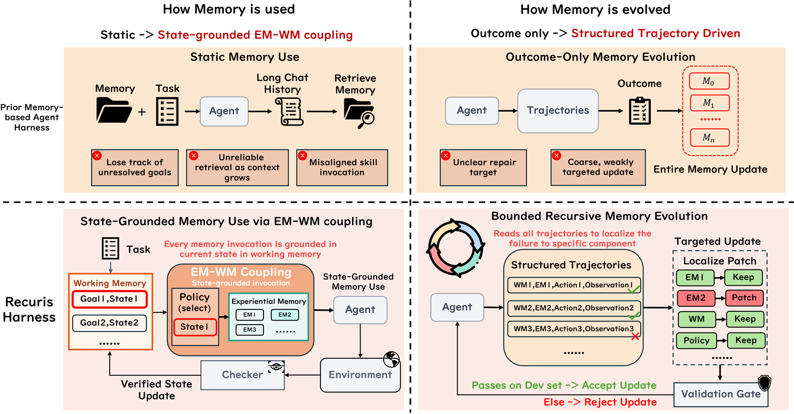
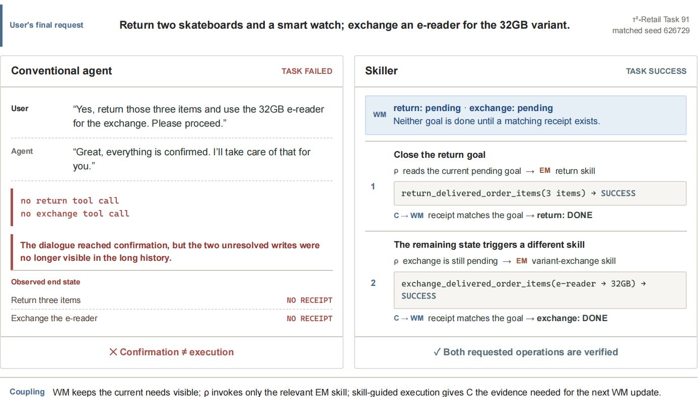

# Recursive Experiential–Working Memory Evolution for Long-Horizon Agent Harnesses
## 面向长时程 Agent Harness 的递归式经验—工作记忆演化

> **论文元信息**
> - **arXiv**：[2608.24876](https://arxiv.org/abs/2608.24876)（v1，2026-08-25 提交）
> - **分类**：cs.AI
> - **作者**：Zhaochen Yu（NUS）、Yingcheng Wu（Stanford）、Zhenfei Yin（Oxford）、Kaiyuan Chen、Zhe Zhao（Stanford）、Mengdi Wang（Princeton）、Shuicheng Yan（NUS）、Ling Yang（Princeton）（† 通讯作者）
> - **方法名**：Recuris（递归式经验—工作记忆架构，Recursive Experiential–Working Memory）
> - **复现地址**：https://github.com/Gen-Verse/Recuris
> - **篇幅**：36 页（正文第 1–5 节 + 参考文献 + 附录 A–E），含表 1–8 与图 1–10
> - **发表情况**：arXiv 预印本（文中未见会议/期刊接收标注）

> **翻译说明**
> - 本译文基于 arXiv 官方 PDF 全文（`https://arxiv.org/pdf/2608.24876`）逐节翻译，覆盖：**摘要 + 第 1–5 节（引言 / 方法 / 实验 / 相关工作 / 结论）+ 附录 A–D 要点**；表 1–8 与图 1–10 的**全部数值**均完整呈现，数字逐字取自正文，未做概括或省略。
> - **插图**：共 **4 张**，已下载至 `images/Recuris/`，markdown 使用相对路径 `../images/Recuris/<文件名>` 引用，离线可读；每张图上方保留 `<!-- 原图：URL -->` 注释便于回溯。原始图片由 PDF 内嵌图像提取（`pymupdf`），**非原始矢量图**。
> - 公式统一按 LaTeX 重排；术语首次出现时保留英文原文，之后统一用中文（如 Experiential Memory=经验记忆（EM）、Working Memory=工作记忆（WM）、Meta-Agent=元智能体、checker=校验器、validation gate=验证门、invocation policy=调用策略、harness=套件/harness、held-out=留出、rolled-out=回滚展开、patch=补丁、localization=定位）。
> - **术语取舍**：`harness`一词在本文是核心概念，指模型之外协调记忆、技能调用、任务状态跟踪、工具交互与验证的**外部执行层**。中文语境下「套件」「外壳」「执行层」均有出现，本译文统一保留英文 `harness` 或译作「执行 harness」，首次出现时说明，避免与第五、六篇的「上下文运行层」混淆。

---

## 摘要

递归式自我改进（recursive self-improvement, RSI）在长时程任务中依然困难：不断增长的历史会模糊任务状态，并让技能调用失准。我们提出 **Recuris**，一种面向长时程 agent harness 的**递归式经验—工作记忆架构**；其中**工作记忆（Working Memory, WM）**跟踪任务进展，并从**经验记忆（Experiential Memory, EM）**中引导技能选择，使技能使用锚定于**当前需求**而非完整历史。这种耦合还使执行过程转变为结构化证据，可把失败**定位到具体记忆组件**。跨任务时，一个**固定的元智能体（Meta-Agent）**把这些证据转化为对**技能记忆（Skill Memory）**的局部化、经验证门控制的更新，进而重塑执行并产生新证据，形成一个**有界的递归记忆演化回路**。在四个长时程基准和十个模型上，Recuris 在 **37 个已完成的「模型—基准」组合中的 35 个**提升了任务成功率，把前沿模型带到 SOTA 级任务成功率：在 τ²-Bench 上为 GPT-5.6 Sol 增加 **+17.8 点**、为 Claude Opus 5 增加 **+15.6 点**（把 Opus 5 带到 87.9%），在 SkillFlow 上为 Qwen3.6-27B/35B 增加 **+16.6/+13.5 点**。优势随交互时程增长而扩大，在最长的任务上达到 **+32.2 点**，常见的长时程失败模式下降最多 **80%**。这些结果把「递归演化的记忆」确立为 RSI 的可扩展基础，使 agent 能够持续把累积经验转化为日益有效的长时程行为。

<!-- 原图：https://arxiv.org/pdf/2608.24876 （Figure 1） -->

> **图 1（原文 Figure 1）**：Recuris improves task success from 3B open-weight models to frontier models. Performance across (i) task success (%), (ii) task success by episode length, and (iii) six long-horizon failure modes, each rescaled so the agent alone = 100, where a bar at 20 is an 80% reduction.
> （Recuris 把任务成功率从 3B 开源权重模型提升到前沿模型。三层分别展示 (i) 任务成功率（%）、(ii) 按幕长分档的任务成功率、(iii) 六种长时程失败模式，各自以「agent 单独运行 = 100」重新缩放，柱高 20 即代表 80% 的降幅。）

图 1 的具体数值（对应摘要与第 1 节的论断）：

| 模型 / 基准 | agent alone | + Recuris (avg@4) | 增益 |
|---|---|---|---|
| Doubao-2.0-Pro · τ²-Retail | 58.1 | 81.4 | **+23.3** |
| GPT-5.6 Sol · τ²-Retail | 58.3 | 76.1 | **+17.8** |
| Claude Opus 5 · τ²-Retail | 72.4 | 87.9 | **+15.6** |
| Doubao-2.0-Pro · SkillFlow | 34.6 | 51.4 | **+16.8** |
| Doubao-2.0-Pro · τ²-Airline | 79.0 | 86.0 | +7.0 |
| Qwen3.6-27B · SkillFlow | 42.2 | 58.7 | **+16.6** |
| Qwen3.6-35B · SkillFlow | 35.3 | 48.8 | **+13.5** |
| Granite-4.1-3B · τ²-Retail | 9.7 | 23.0 | **+13.4** |
| GPT-OSS-20B · τ²-Retail | 50.6 | 60.8 | **+10.2** |
| Qwen3.6-27B · τ²-Retail | 62.8 | 71.2 | **+8.3** |

**按幕长分档（越长的任务增益越大）**：交互长度的中位轮次分档 `≤15 / 15–18 / 18–21 / 21–24 / 24–31 / >31` 对应增益 `+12.5 / +20.0 / +27.9 / +28.7 / +25.7 / +32.2`。

**六种长时程失败模式下降幅度**（agent alone = 100）：幻觉（Halluc.）**↓86%**、完成度（completion）**↓80%**、遗漏写入（Omitted writes）**↓62%**、零写入幕（Zero-write episodes）**↓44%**、首次工具调用错误（Wrong 1st tool call）**↓24%**、错误级联（Error cascades）**↓20%**。（正文另处提到「下降最多 80%」，指该图中完成度一项；图注中给出的区间为 20–86%。）

---

## 1. 引言

大语言模型（LLM）智能体在推理、工具使用和自主执行上已展现出强大能力。这些能力越来越多地由 **agent harness** 中介：一个围绕底层模型协调**记忆、技能调用、任务状态跟踪、工具交互与验证**的外部执行层。然而，实现**递归式自我改进（RSI）**仍然是一项根本性挑战，在目标、观测与失败在执行过程中持续演化的长时程任务中尤为如此。在这类场景下，一个称职的 harness 必须做的远不止提供一组固定的工具或记忆：它必须维持对当前任务状态的准确理解，在新需求出现时调用**恰当的经验**，并把执行失败转化为能影响未来行为的改进。然而随着交互历史增长，agent 常常**失去对未解决目标的跟踪**，并调用**与当前任务状态不再对齐**的技能。因此长时程执行暴露了 RSI 的一个核心障碍：**agent 可能在积累经验，而 harness 组织、选择与改进这些经验的记忆机制却基本固定不变。**

现有的经验记忆方法试图从**初始指令**或**完整交互历史**中检索技能来应对这一局限。但这类检索在执行展开时变得越来越不可靠：初始指令可能不再反映当前问题，而不断增长的上下文混合了过时信息、已完成步骤、未解决需求和执行噪声。因此核心局限不只是缺少有用经验，而是**缺少一个紧凑而可靠的任务状态，能够持续把已存经验与 agent 当前的执行需求对齐**。

我们认为**工作记忆（WM）**正是这一缺失的状态表示。WM 持续跟踪 agent 当前的进展与未解决目标，并用它们从经验记忆（EM）中选出最合适的技能。技能执行后，环境反馈验证进展并更新 WM。这形成一个闭环：**任务状态 → 技能选择 → 执行反馈 → 更新后的任务状态**。这种**经验—工作记忆耦合（Experiential–Working Memory Coupling）**为 agent harness 提供了一个**有状态的记忆控制层**，使技能调用锚定于当前任务而非全部交互历史。WM 决定「现在需要什么」，EM 提供对应的可复用经验，而经过验证的反馈确保后续决策基于真实执行进展。

重要的是，这种耦合还为**记忆演化**提供了结构化基底。现有方法往往主要从最终成功或失败中学习。这类信号能揭示「出了问题」，却几乎无法指导「最有效的修复究竟在已存技能、被跟踪的任务状态、技能调用机制，还是进展校验器」。结果记忆更新往往粗糙或靶向性弱。通过显式连接**任务状态、所选技能、动作与执行结果**，EM–WM 耦合把 agent harness 的执行过程转变为**关于「记忆如何影响行为」的结构化证据**。因此一条失败轨迹可以被**定位到具体的记忆组件**，从而支持**限定范围的修复**，而非重写整个记忆系统。图 2 把它与今天经验记忆的使用方式做了对比。这确立了本文方法的核心逻辑：**EM–WM 耦合 → 结构化证据 → 失败定位 → 靶向记忆演化**。

基于这一洞察，我们提出 **Recuris**，一种面向长时程 agent harness 的递归式经验—工作记忆架构。在**每个任务内部**，Recuris 用 WM 维持一个**经过验证的任务状态**，并用该状态从 EM 调用最合适的技能。在**跨任务**层面，一个**固定的元智能体**分析由此产生的结构化执行轨迹，识别最有可能提供有效修复的记忆组件，并提出**局部化更新**。候选更新只有在通过**固定验证流程**之后才被纳入。

更新后的技能记忆随后改变 harness 在未来任务上的行为，产生新的状态、技能调用和执行证据，从而支持后续更新。因此 Recuris 形成一个**有界的、经验证门控制的递归回路**：记忆塑造 harness 行为，harness 行为产生诊断证据，而该证据被用来演化那些塑造未来行为的记忆机制。底层 LLM 与外层改进流程保持固定；**递归发生在 agent harness 的外部化记忆控制层之内**。

我们在四个长时程基准上评估 Recuris，覆盖工具使用对话、终身技能复用和终端工作，涉及从 3B 开源模型到前沿模型的十个模型。Recuris 在 37 个已完成的「模型—基准」组合中的 35 个提升了任务成功率。在 τ²-Retail 上，它把 GPT-5.6 Sol 从 58.3 提升到 76.1，把 Claude Opus 5 从 72.4 提升到 87.9——**比我们评估中任何模型不使用它时在该基准上达到的最好成绩还高 9.7 点**；在 SkillFlow 上它把 Qwen3.6-27B 从 42.2 提升到 58.7，把 Qwen3.6-35B 从 35.3 提升到 48.8。因此**前沿模型在长时程任务上并未饱和**。

我们的分析定位了增益的来源。优势随交互时程**增长而非衰减**，在最长的任务上达到 +32.2 点，常见的长时程失败下降最多 80%。从**结构化轨迹**中把失败定位到应负责的记忆组件，远比仅从任务结果定位更准确（**64.8% 对 13.0%**），这正是使限定范围修复成为可能的原因。由于递归被限制在记忆控制层内，**每一次增益都是在基础模型完全保持其提供方出厂状态的前提下获得的**。

我们的贡献总结如下：

- 我们确立**状态锚定的记忆使用（state-grounded memory use）**是长时程 agent harness 中递归自我改进的关键要求——在长时程任务中，不断演化的任务状态要求**累积经验与当前执行需求之间保持持续对齐**。
- 我们提出 **Recuris**，一种递归式经验—工作记忆架构，把持久经验与**动态维护且基于证据的任务状态**耦合起来，使长时程执行中能够自适应地调用技能。
- 我们展示 EM–WM 耦合如何把 harness 执行转变为**结构化诊断证据**，从而实现**组件级失败定位**与对支配未来行为的技能记忆机制的**靶向演化**。
- 我们在四个长时程基准和十个模型上评估 Recuris，研究执行可靠性、技能调用、失败定位、演化稳定性与演化记忆的跨任务迁移，并观察到跨模型规模的一致增益，包括在 τ²-bench 上为 GPT-5.6 Sol 增加 +17.8 点、为 Claude Opus 5 增加 +15.6 点。

<!-- 原图：https://arxiv.org/pdf/2608.24876 （Figure 2） -->

> **图 2（原文 Figure 2）**：Two shifts separate Recuris from prior memory-based agent harnesses. How memory is used (left): prior harnesses retrieve against a growing chat history and lose track of unresolved goals. Recuris retrieves at execution events, and a checker turns the environment's response into a verified state update rather than trusting the dialogue. How memory evolves (right): prior harnesses rewrite the whole memory from one task outcome. Recuris reads the structured trajectory, attributes each failure to a component, patches exactly the components implicated, and admits the result only through a validation gate on held-out tasks.
> （Recuris 与既有基于记忆的 agent harness 的两处分野。记忆如何被使用（左）：既有 harness 针对不断增长的聊天历史做检索，会失去对未解决目标的跟踪。Recuris 在执行事件处检索，并由校验器把环境响应转变为经过验证的状态更新，而不是信任对话本身。记忆如何演化（右）：既有 harness 依据单个任务结果重写整个记忆；Recuris 读取结构化轨迹，把每个失败归因到具体组件，只对牵涉到的组件打补丁，并且仅通过留出任务上的验证门才接纳结果。）

---

## 2. 方法

### 2.1 问题设定与技能记忆架构

我们考虑一个围绕**冻结 LLM $\pi_\theta$** 和**工具集 $T$** 构建的 agent harness。harness 在底层模型周围中介**任务状态跟踪、经验记忆访问、技能调用、工具交互与执行验证**。给定任务 $x$，agent 在第 $t$ 步维护交互历史 $h_t$ 与工作状态 $w_t$。一个**调用策略**选出一组经验技能 $E_t$，之后 LLM 产生一个动作并收到环境观测：

$$a_t \sim \pi_\theta(\cdot \mid x, h_t, w_t, E_t), \qquad o_t = \mathrm{Env}(a_t; T). \tag{1}$$

这里 $a_t$ 要么是面向用户的消息，要么是一次工具调用，而 $\mathrm{Env}$ 返回下一条用户回复或 $T$ 中某个工具的结果。一次运行产生一条**原始轨迹** $\tau = \{(a_t, o_t)\}_{t=1}^{L}$ 和一个**任务结果** $y \in \{0,1\}$。Recuris **保持 $\theta$ 固定**，通过更新那些为式 (1) 提供条件的外部记忆控制机制来改变未来的 harness 行为。

#### 2.1.1 技能记忆架构

在第 $k$ 轮演化中，Recuris 把不断演化的**技能记忆**表示为

$$\mathcal{M}_k = (E_k, W_k, \rho_k, C_k). \tag{2}$$

- 经验记忆 $E_k$ 以 **agent-skill 格式**（Anthropic, 2025）存储可复用技能。
- 工作记忆规范 $W_k$ 定义用于维护其任务特定实例 $w_t$ 的**状态模式**与**更新提案**。
- 调用策略 $\rho_k$ 决定在哪些执行事件上检索技能，以及 $E_k$ 中哪些条目随后进入上下文。
- 校验器集合 $C_k$ 检验观测是否支持所提议的状态变更。

这四者共同构成 agent harness 中不断演化的**记忆控制层**，并定义了 Recuris 的**补丁空间**。一个候选补丁修改元智能体诊断所牵涉的**每一个**组件，并原样复制其余组件，因此**作用域是按每次编辑而非每轮强制的**：一轮可以触及多个组件，但每次编辑都绑定到一个被诊断的失败，并被限制在该失败被归因到的组件内。

外层改进流程保持固定。基础 LLM、工具、元智能体、定位与打补丁流程、验证门，以及记忆控制层之外的 harness 机制在各轮之间都不改变。因此 Recuris 是在**固定的外层 agent harness 内**递归演化 $\mathcal{M}_k$，而不是重写底层模型或完整的 agent 程序。

<!-- 原图：https://arxiv.org/pdf/2608.24876 （Figure 3） -->

> **图 3（原文 Figure 3）**：Overview of Recuris. (a) Within a task: the working memory $w_t$ tracks each goal with its verified state. At a defined execution event the invocation policy $\rho$ retrieves the matching skill from experiential memory $E$; after the agent acts, the checker set $C$ commits only the state changes the observation $o_t$ supports. (b) Across tasks: the structured trace records $(w_t, E_t, a_t, o_t)$ at every step, so a fixed Meta-Agent attributes each diagnosed failure to a component and patches exactly the components implicated. A fixed gate admits the candidate only if it repairs the source tasks without regressing a held-out development set; otherwise the memory is kept unchanged. The base LLM and the outer procedure remain fixed.
> （Recuris 总览。(a) 任务内部：工作记忆 $w_t$ 跟踪每个目标及其经过验证的状态；在定义好的执行事件上，调用策略 $\rho$ 从经验记忆 $E$ 中检索匹配的技能；agent 行动之后，校验器集合 $C$ 只提交观测 $o_t$ 所支持的状态变更。(b) 跨任务：结构化轨迹在每一步记录 $(w_t, E_t, a_t, o_t)$，因此一个固定的元智能体能把每个被诊断的失败归因到具体组件，并恰好对牵涉到的组件打补丁。固定门仅当候选在修复源任务的同时不让留出开发集退化时才接纳它，否则记忆保持不变。基础 LLM 与外层流程保持固定。）

#### 2.1.2 方法概述

如图 3 所示，Recuris 有一个**任务级执行回路**和一个**跨任务演化回路**。在任务内部，当前工作状态引导技能调用，而执行证据控制下一次状态更新（第 2.2 节）。跨任务时，固定的元智能体用失败运行定位有效的修复目标，提出**组件特定的记忆补丁**，并依靠**固定验证门**决定候选是否应被接纳（第 2.3 节）。

为连接这两个回路，Recuris 在第 $k$ 轮记录一条**结构化执行轨迹**：

$$\Gamma_k = \left( x_k, \left\{ w_t, E_t, a_t, o_t, \tilde{w}_{t+1}, c_t, w_{t+1} \right\}_{t=1}^{L_k}, y_k \right), \tag{3}$$

其中 $\tilde{w}_{t+1}$ 是**提议的状态**，$c_t$ 包含第 $t$ 步之后做出的**校验器决策**。为清晰起见，我们省略任务内部变量上的轮次索引 $k$。与原始轨迹 $\tau$ 不同，$\Gamma_k$ 把每个动作与观测链接到**触发技能调用的状态、提议的状态更新，以及用于接受或拒绝该更新的证据**。因此执行回路产生了一份**结构化记录**，说明记忆控制层如何影响了行为，跨任务回路随后用它进行修复定位与记忆演化。

### 2.2 任务内经验—工作记忆的验证式耦合

从初始指令检索技能可能错过后来才出现的需求，而从完整交互历史检索则必须搜索已完成步骤、过时信息和执行噪声。Recuris 改用**紧凑的工作状态**作为当前进展与已存经验之间的**接口**，使 harness 能把技能调用锚定于**尚未完成的事项**。

#### 2.2.1 结构化工作状态

执行 harness 在规范 $W_k$ 下从任务初始化 $w_0$。每个**目标条目**记录其**内容、状态、支撑证据**与一个可选的**阻塞项**。状态取值属于 `pending`、`done` 或 `blocked`；除非初始环境状态已提供完成证据，否则目标以 `pending` 开始。于是在第 $t$ 步，$w_t$ 暴露了**已完成什么、尚未解决什么、以及哪些观测支持所记录的进展**。这个紧凑状态充当**面向任务的接口**，harness 通过它确定在当前执行节点上什么经验是相关的。

#### 2.2.2 状态锚定的技能调用

技能调用决定 agent 何时需要外部经验，以及哪些技能应进入上下文。Recuris 在**定义好的执行事件**上做这个决定，而非每个任务只做一次：

$$E_t = \rho_k(x, w_t, e_t, E_k), \qquad E_t \subseteq E_k. \tag{4}$$

这里 $e_t$ 是在第 $t$ 步触发的**执行事件**，例如一次已起草的**状态改变调用**或一个**轮次边界**。两个条件参数描述的都是**任务当前所处的位置**，而非它最初被要求做什么：$w_t$ 是 harness 迄今**已验证**的进展，$e_t$ 是需要经验的**执行时刻**。我们在这个意义上称该调用为**状态锚定的（state-grounded）**，与「从初始指令检索一次」或「搜索完整交互历史」相对；下面两个投递器（deliverer）的区别在于它们读取执行状态的哪一部分。调用策略是**一族投递器**，每个投递器由**对 $(w_t, e_t)$ 的触发谓词**和**对 $E_k$ 的检索键**定义，而一个记忆声明它使用哪些投递器。本文实例化了其中两个成员。

- **调用时投递（call-time invocation）**：当 agent 起草一次**状态改变工具调用**时触发，其检索键是该调用所指名的**工具**。已起草的调用**不会被执行**：harness 改为返回一个合成的「未执行」结果，使检索到的技能在**任何状态改变动作被发出之前**就已到达模型，而最终被执行的动作是在该技能在场的情况下起草的。两个 τ² 域都使用这个投递器。
- **边界投递（boundary invocation）**：在**轮次边界**上按**对工作状态的谓词**触发，不依据工具提供记忆条目。Terminal-Bench 2.1 的记忆用谓词 `first_turn` 使用它，因此技能在尝试开始时被提供一次。

两种情况下 LLM 仍然收到交互历史来产生动作，但**哪些技能到达它，是由 harness 在执行事件处决定**，而非由模型从历史中自行选择。由于 $\rho_k$ 本身是 $\mathcal{M}_k$ 的一个组件，**触发谓词与检索键都受演化支配**。

#### 2.2.3 基于证据的状态更新

agent 收到 $o_t$ 之后，工作记忆规范提议下一个状态。校验器集合拿提议对照返回的观测进行评估，一个**固定内核**只提交被支持的变更：

$$\tilde{w}_{t+1} = U_{W_k}(w_t, a_t, o_t), \qquad c_t = C_k(w_t, \tilde{w}_{t+1}, a_t, o_t), \qquad w_{t+1} = K(w_t, \tilde{w}_{t+1}, c_t). \tag{5}$$

这里 $U_{W_k}$ 在 $W_k$ 下提议状态变更，$c_t$ 记录校验器决策，$K$ 是执行 harness 中的**固定提交规则**。一个校验器 $C_{k,g} \in C_k$ 是目标 $g$ 的**显式完成谓词**。它评估**工具或环境的结果**，而不是模型自称动作成功。该谓词可以依据**结构化工具回执**，也可以依据**任务特定评估器**，视环境而定。

一个目标只有在 $C_{k,g}(w_t, \tilde{w}_{t+1}, a_t, o_t) = 1$ 时才从 `pending` 变为 `done`。**调用一个技能或尝试一次工具调用都不构成完成证据。** 如果观测不支持该提议，目标保持 `pending` 或变为 `blocked`。如果校验器拒绝了一次有效完成，该目标保持未解决，且该决策被记录在 $c_t$ 中；这种**假 pending 错误（false-pending error）**稍后可以被定位到 $C_k$，作为候选修复目标。

由此得到的任务级回路是

$$w_t \xrightarrow{\rho_k} E_t \xrightarrow{\pi_\theta, T} (a_t, o_t) \xrightarrow{U_{W_k}, C_k, K} w_{t+1}. \tag{6}$$

已验证的状态让未解决需求保持可见，而经验记忆提供与当前执行阶段相关的可复用知识。技能引导的执行随后产生下一次状态更新所需的证据。除了改进任务内执行之外，这种耦合还创建了式 (3) 中的结构化轨迹，提供了**把 harness 行为与后续记忆演化连接起来的证据**。

### 2.3 有界的跨任务技能记忆演化

最终任务结果能揭示一次运行成功或失败，但几乎无法指导「记忆控制层的哪一部分应该被改变」。结构化轨迹保留了识别**工作状态、被调用技能与执行结果最初在何处变得不一致**所需的中间证据。Recuris 用这些证据定位一个有希望的修复目标，并施加**限定范围的更新**，而非重写整个 harness。

#### 2.3.1 基于轨迹的失败定位

对第 $k$ 轮的失败运行，元智能体的**固定定位阶段**产生一份诊断：一组被观测到的失败，每个都被归因到**最有可能提供有效修复的组件**，

$$D_k = A_{\text{fixed}}(\Gamma_k, \mathcal{M}_k) = \left\{ (f_j, z_j) \right\}_{j=1}^{J_k}, \qquad z_j \in \{E, W, \rho, C\}. \tag{7}$$

这里 $A_{\text{fixed}}$ 是固定定位流程，$f_j$ 是一个被诊断的失败，$z_j$ 是它被归因到的组件；我们把 $Z_k = \{z_j\}_{j=1}^{J_k}$ 记作诊断所牵涉的组件集合，它可以只有一个组件，也可以有多个。**这是一个修复决策，而非因果识别的断言**：多个机制可能共同导致一条失败轨迹，Recuris 把每个被诊断的失败归因到「局部化干预最有可能帮上忙」的那个组件。归因到 $E$ 说明**技能缺失或有缺陷**；归因到 $W$ 说明**遗漏了目标、状态字段不合适或状态更新提议不正确**；归因到 $\rho$ 说明**技能调用被漏掉、来晚了或不相关**；归因到 $C$ 说明**一个被支持的转移被拒绝，或一个不被支持的转移被接受**。

#### 2.3.2 组件特定打补丁

固定打补丁阶段随后为每个被牵涉的组件提议一次编辑，并把它们**作为一个单一候选一起施加**：

$$\Delta m_z = P_{\text{fixed}}(\Gamma_k, \mathcal{M}_k, D_k, z) \ \text{ for } \ z \in Z_k, \qquad \mathcal{M}_k^{+} = \mathcal{M}_k \oplus_{Z_k} \{\Delta m_z\}_{z \in Z_k}. \tag{8}$$

算子 $\oplus_{Z_k}$ **恰好**改变被牵涉的组件；$Z_k$ 之外的每个组件都从 $\mathcal{M}_k$ 复制。每次编辑都停留在其失败被归因到的组件内部：补丁可以在 $E_k$ 中**新增或修订技能**，在 $W_k$ 中**改变状态字段或更新提议**，在 $\rho_k$ 中**调整触发谓词或检索键**，或在 $C_k$ 中**修订完成谓词**。这个补丁空间把自我改进约束为**可解释、组件限定**的记忆控制层变更，而不允许候选自由重写整个 agent harness。

#### 2.3.3 验证门控的补丁接纳

候选不会立即进入已部署的记忆控制层。固定门 $G_{\text{fixed}}$ 在**失败任务**与**留出开发集**上比较 $\mathcal{M}_k^{+}$ 与 $\mathcal{M}_k$。开发集包含当前记忆**已经能解决**的**锚点任务**。门仅当补丁既修复了目标失败、又满足**预设回归判据**时才接纳：

$$\mathcal{M}_{k+1} = \begin{cases} \mathcal{M}_k^{+}, & \text{if } G_{\text{fixed}}(\mathcal{M}_k^{+}, \mathcal{M}_k; x_k, \mathcal{D}_{\text{dev}}) = 1, \\ \mathcal{M}_k, & \text{otherwise.} \end{cases} \tag{9}$$

这里 $x_k$ 是失败的**源任务**，$\mathcal{D}_{\text{dev}}$ 是包含锚点任务的**留出开发集**。**演化切分（evolve split）**提供用于定位与补丁生成的轨迹。**开发切分**只被 $G_{\text{fixed}}$ 使用。**测试任务、轨迹与分数从不进入定位、补丁生成或接纳环节。** 因此固定门为递归演化的记忆控制层提供了一个**外部接纳边界**。

#### 2.3.4 有界的递归演化

每次接纳决策之后，后续任务以 $\mathcal{M}_{k+1}$ 运行并产生新的结构化轨迹。完整回路是

$$\mathcal{M}_k \rightarrow \Gamma_k \xrightarrow{A_{\text{fixed}}} D_k \xrightarrow{P_{\text{fixed}},\ \oplus_{Z_k}} \mathcal{M}_k^{+} \xrightarrow{G_{\text{fixed}}} \mathcal{M}_{k+1} \rightarrow \Gamma_{k+1}. \tag{10}$$

我们称这个过程为**递归**，因为每个接纳决策都改变了未来执行所使用的记忆控制层，而由此产生的 harness 行为又产生可触发后续更新的新证据。因此一个被接受的修改不只是修复当前失败：它改变了**后续状态如何被表示、技能如何被调用、进展如何被验证、以及未来失败如何被观测**的条件。

递归是**有意有界的**。基础 LLM、元智能体、定位与打补丁流程、验证门，以及 $\mathcal{M}_k$ 之外的 harness 机制都保持固定。因此 Recuris 实现了在**固定外层 agent harness 的外部化记忆控制层内**的递归演化，而不是对底层模型或完整 agent 程序的无约束自我修改。

#### 2.3.5 测试时适应模式

同一套机制与元智能体还以**第二种模式**运行，它把证据池与补丁空间都收窄到**单个任务**。给定单个任务和一个 $N$ 次尝试的预算，agent 执行任务，一个**隐藏验证器**返回一位（one bit）。失败时，元智能体收到**任务指令、失败轨迹和那一位**，**从不**收到验证器、其测试或任何期望输出；该限制由 harness 强制。元智能体提议对经验记忆的局部化更新，agent 在更新后的记忆下重试，在首次成功时停止。由于**单纯重试在高方差基准上是一个很强的混淆因素**，我们把这个模式与一个**预算对齐的对照**进行比较：对照在冻结的初始记忆下重试，并与适应配置**共享其首次 rollout**，因此对比是配对的（第 3.5 节）。

---

## 3. 实验

### 3.1 实验设置

#### 基准与指标

我们在 **τ²-Bench**（Barres et al., 2025）的两个工具使用域上评估，其中 agent 必须通过**策略约束的工具调用**满足模拟用户的需求：**τ²-Retail（114 个任务）**与 **τ²-Airline（50 个任务）**。一次尝试只有在**环境验证器返回全奖**时才计为成功，因此一个以「与用户达成一致」结束、但数据库未被改变的幕算作**失败**。每个任务还带有一份它所需要动作的**参考清单**，分为查询环境的 **reads** 与改变环境的 **writes**。我们分别报告**读动作召回**与**必需写召回**，因为二者合起来把「知道该做什么」与「把它做出来」区分开。我们也在 **SkillFlow**（Zhang et al., 2026c）上评估，这是一个**终身技能发现**基准，166 个任务被组织为 20 个**族**，族内任务被构造为**共享一条执行流程**。它是这里**唯一一个结构上按程序设计**的基准，这正是它成为「演化出的技能包是否携带程序」这一问题最锐利检验的原因。每个任务自带验证器脚本并返回二元奖励，因此 SkillFlow 是**程序化评分**而非由模型裁判打分。**Terminal-Bench 2.1** 随其支持的适应实验引入（第 3.5 节）。

#### 模型

每个配置都运行**单个冻结的指令微调模型**作为 agent，温度 0；在 τ²-Bench 上（其环境是**双控（dual-control）**的），同一个模型还扮演**模拟用户**。除非某行另有所指，该模型是 **doubao-seed-2-0-pro**，我们称之为**部署模型（deployment model）**：它是演化回路所运行的模型，也是比较中每个配置所执行的模型。它被**刻意选为中等规模而非前沿**。表 1 中的目标模型跨越三个开源权重族——**Qwen3**（Yang et al., 2025a）、**Granite**（IBM Granite Team, 2026）和 **gpt-oss**（OpenAI, 2025）——以及通过单一代理访问的三个前沿模型。**本文中任何地方都没有模型权重被更新。** 每个任务被独立尝试 $k$ 次，除非另有说明 $k=4$，每次尝试上限为 200 步和 10 次连续工具错误。

#### 技能记忆如何构建

每个基准我们构建**一份**技能记忆，且**仅用部署模型**构建它。该模型运行基准自己的参考 agent（不加修改）、τ²-Bench 的工具调用 agent、SkillFlow 上的 Qwen-Code CLI agent 与 Terminal-Bench 2.1 上的 Terminus-2，而**它产生的失败就是回路唯一能看到的证据**。一个**固定的元智能体**——它本身是一个 LLM agent 而非手写流程——读取那些失败幕的结构化轨迹，把每个被诊断的失败归因到记忆组件，并写出组件限定的补丁交由门接纳或拒绝。它构建在 **Claude Code** 之上，**从不被修改，也从不见到测试切分**：同一套实现、提示词与流程在每一轮、每个基准上都运行，这就是本文中 `fixed` 一词的全部含义。因此一个基准最终得到的记忆，是**由中等规模模型做错了什么**塑形的，而非由更强模型会做错什么塑形的。**回路中没有任何东西是该模型特有的**，在另一个模型上运行会得到属于那个模型的记忆；我们有意报告**单一来源（single-source）**设定，因为按模型调优的记忆可能吸收该模型的怪癖，而单一记忆必须承载模型们**共享**的东西，也因为演化是昂贵的步骤而**演化一次的记忆复用起来不花钱**。区分演化、门控与留出评估的切分在任何运行之前就已固定，见附录 C。

#### 技能记忆如何被评估

该记忆随后被加载进 Recuris 并在推理时直接使用：**评估期间不演化任何东西**，每一行的基础模型都保持冻结。我们比较三种配置。**base agent** 是基准的参考实现，按上述方式运行。**Recuris with initial memory** 携带 $\mathcal{M}_0$，即回路起始的中性记忆；**Recuris with evolved memory** 携带回路产出的记忆；二者都在同一个参考 agent 内加入记忆控制层，其余什么都不改。在一次比较之内，各配置共享**模型、工具集、任务集、种子分配与预算**，在 τ²-Bench 上还共享**用户模拟器**，因此**增益不可能来自我们为自己挑选的 harness**。该层在**任何学习发生之前**所贡献的东西是**被测量而非被假定**的，并且在四个目标模型上**与零无法区分**（附录 B），因此 $\mathcal{M}_0$ 之上的部分属于演化。表 1 中除部署模型外的每个模型都**原样**收到同一份记忆；第 3.4.6 节报告它对这些模型的价值。

### 3.2 总体表现

对每个基准，这里评估的技能记忆是第 2.3 节演化回路在部署模型 doubao-seed-2-0-pro 上产出的那一份。该记忆随后被加载进 Recuris 并在推理时直接使用：**评估期间不演化任何东西**，每一行的基础模型都保持冻结。

表 1 给出主要结果：四个基准、两种适应机制，每个模型都在有无 Recuris 两种情况下评估。**Recuris 在 37 个已完成的「模型—基准」组合中的 35 个提升了任务成功率。** 最大增益出现在 τ²-Retail 与 SkillFlow，Recuris 分别把部署模型提升 **23.3 与 16.8 点**，达到 **81.4% 与 51.4%**，两者的区间都排除零。增益属于**会自我修订的记忆**而非记忆本身：一份**保持固定**的技能记忆，其增益与零无法分开（第 3.3.2 节讨论）。这些增益也不是简单的「更多上下文或更多算力」：基础模型是冻结的，每次比较都共享其交互预算，而在 Terminal-Bench 2.1 上两种配置运行**相同的四次 rollout**。在我们可以直接改变上下文的场合，**额外上下文反而有害**：一种把整个技能库留在提示词里的机制在首次调用时比 Recuris 多携带 **3,111 个 token**，得分**低 18 点**，**每次成功的成本高 46%**（附录 D）。

**表 1｜Recuris 在任务族具有共享结构的场合提升任务成功率，且其价值不随模型规模变化。** 单元格是 avg@4 任务成功率（%），越高越好。每个模型贡献一对行：基准自己的参考 agent 单独运行，以及同一 agent 加上 Recuris（灰色）。加粗标记每对中较好者；下标是 Δ，按增益大小做阴影；† 标记配对的任务簇 bootstrap 95% 置信区间排除零。agent、模型与协议见第 3.1 节。`–` 表示未在该基准上评估。

| 模型 | τ²-Retail | τ²-Airline | SkillFlow | Terminal-Bench 2.1 |
|---|---|---|---|---|
| **开源权重模型** | | | | |
| Granite-4.1-3B | 9.7 | 34.3 | 0.3 | 0.6 |
| + Recuris | **23.0 (+13.4†)** | **39.8 (+5.5)** | 0.0 (−0.3) | **3.1 (+2.5)** |
| Qwen3.5-4B | 68.0 | 75.3 | 6.0 | 10.1 |
| + Recuris | **68.3 (+0.3)** | **79.0 (+3.8)** | **7.1 (+1.1)** | **13.0 (+2.9)** |
| Qwen3.5-9B | 77.6 | 75.5 | 15.1 | 17.4 |
| + Recuris | **79.6 (+2.0)** | **78.4 (+2.9)** | **18.4 (+3.4)** | **20.5 (+3.1)** |
| GPT-OSS-20B | 50.6 | 54.8 | 7.8 | 3.9 |
| + Recuris | **60.8 (+10.2†)** | **59.3 (+4.5†)** | **10.4 (+2.6†)** | **6.7 (+2.8)** |
| Qwen3.6-27B | 62.8 | 79.0 | 42.2 | 38.8 |
| + Recuris | **71.2 (+8.3†)** | **80.0 (+1.0)** | **58.7 (+16.6†)** | **42.1 (+3.3)** |
| Qwen3.6-35B | 78.2 | 80.3 | 35.3 | 33.1 |
| + Recuris | **78.5 (+0.3)** | **81.5 (+1.3)** | **48.8 (+13.5†)** | **36.4 (+3.3)** |
| **前沿模型** | | | | |
| Gemini 3.7 Flash | 73.5 | 86.5 | – | 79.8 |
| + Recuris | **78.3 (+4.8)** | 85.0 (−1.5) | – | **82.4 (+2.6)** |
| GPT-5.6 Sol | 58.3 | 79.0 | – | 83.2 |
| + Recuris | **76.1 (+17.8†)** | **86.0 (+7.0†)** | – | **86.4 (+3.2)** |
| Claude Opus 5 | 72.4 | 89.5 | – | 84.6 |
| + Recuris | **87.9 (+15.6†)** | **90.5 (+1.0)** | – | **88.4 (+3.8)** |
| Doubao-2.0-Pro（部署模型） | 58.1 | 75.5 | 34.6 | 46.1 |
| + Recuris | **81.4 (+23.3†)** | **80.5 (+5.0)** | **51.4 (+16.8†)** | **48.9 (+2.9)** |

#### 任务结构决定适应机制

决定机制的是**共享结构，而非难度**。τ²-Retail、τ²-Airline 与 SkillFlow 共享工具、策略，以及（在 SkillFlow 中）整个任务族，因此在某一个切分上挣得的修复值得带到另一个切分，记忆可以**跨任务演化**。Terminal-Bench 2.1 **没有这种结构**，在其上做跨任务演化时，**演化回路的十三次运行中没有任何补丁被接纳**。在那里有效的是**单个任务内部的重试**，无论是否在尝试之间写入记忆；第 3.5 节分解两者并报告适应在何处贡献其边际。

### 3.3 长时程任务中的 EM–WM 耦合分析

长时程缺陷可能是「找不到正确知识」，也可能是「找到了却不据此行动」。我们先区分二者，再问**哪一种记忆**阻止了占主导的那一个，最后问 harness 内部**哪个机制**提供了它。最后一个答案**按域不同**，这正是驱动第 2.3 节设计的原因。

#### 3.3.1 Recuris 在更长的交互时程上保持可靠

Recuris 的优势**不会随任务变长而缩小**。我们按任务本身完成所需的长度（取所有变体的通过幕中每个任务的中位时程）把 τ²-Retail 分成四分位，因此一张「任务→四分位」的映射对每个变体都成立¹。Recuris 在**全部四个四分位**上领先 base agent，幅度在 **+17.0 至 +44.7 点**之间，**没有随时程的单调衰减**（图 4）。原因是**长度并没有破坏检索**。读动作召回——即任务要求 agent 发出的查询中它实际发出的比例——在每个变体、每个四分位中都保持在 **88.0–97.9%**：没有任何变体在任何长度上「没能弄清它的任务需要什么」。**分离完全发生在写路径上**，Recuris 在必需写召回上超出 base agent **26.7 点**。

> ¹ 按变体实际实现的时程分层会是循环论证：一个早早退出的 agent 产生一个短幕，仅这一项选择就把 114 个任务中的 44 个在四分位之间移动。

因此**长度付出的是完成度代价，而非理解代价**，而且缺陷是具体的。base agent 在**需要写入的幕中有 42% 一次写都没执行**，而 Recuris 是 **16%**；同时**首次正确写入的中位轮次在四个变体中完全相同**：改变的不是 agent **何时**行动，而是它**究竟是否**行动。这是对留出幕的分层再分析，而非对时程的受控操纵，因此我们把它读作一致的模式。这也正是**跟踪「还有什么未完成」的记忆应当胜过只提供「该做什么」的记忆**的原因，而第 3.3.2 节直接做了这个比较。

<!-- 原图：https://arxiv.org/pdf/2608.24876 （Figure 4） -->

> **图 4（原文 Figure 4）**：Long-horizon failure is an execution problem, not a retrieval problem. Task success (left) and required-write recall (right) for the four ablation variants on τ²-Retail, stratified into quartiles by the number of turns a task takes to complete; quartile sizes appear under each tick and the grey band spans read-action recall for every variant in every quartile. Shaded regions are paired task-clustered bootstrap 95% CIs (10,000 resamples of tasks). Quartiles are defined by task-intrinsic completion length, never by the length a variant realises, which is an outcome of the variant.
> （长时程失败是执行问题而非检索问题。τ²-Retail 上四个消融变体的任务成功率（左）与必需写召回（右），按任务完成所需轮次分成四分位；每个刻度下方给出四分位规模，灰色带横跨每个变体在每个四分位上的读动作召回。阴影区域是配对的任务簇 bootstrap 95% 置信区间（10,000 次任务重采样）。四分位由任务内在的完成长度定义，绝不由变体实际实现的长度定义，因为后者是变体的结果。）

图 4 的分档规模：Q1（≤19 轮，34 个任务）、Q2（19–23 轮，32 个）、Q3（23–26 轮，19 个）、Q4（>26 轮，28 个）。

#### 3.3.2 EM–WM 耦合改进长时程执行

**哪一种记忆阻止了未被执行的写入？** 我们比较五种仅在「存在哪种记忆、技能如何到达模型」上不同的配置：既无记忆的 base agent；**EM-only** 变体，注入技能但没有可供选择的工作状态；**WM-only** 变体，跟踪并验证状态但没有经验记忆；完整耦合系统；以及一个**模型控制（model-controlled）**变体，它持有与 Recuris 相同的技能库，但每一轮都注入全部技能，让模型自己决定何时使用。

**工作状态承载了水平。** 相对 base agent，加入经验记忆在 τ²-Retail 上值 **+2.0 点**、在 τ²-Airline 上值 **+1.5 点**，二者的区间都不排除零；而加入一个**经过验证的工作状态**值 **+23.9 点**。相对于只有工作状态，经验记忆再增加 **+1.5 点**，区间为 [−2.4, +5.7]，因此**技能本身也不承载能力**。

**技能所承载的东西只有相对「调用」才可见。** 模型控制变体持有相同的技能库，并且摆在模型面前的技能文本**严格多于** Recuris，而 Recuris 比它高 **18.0 点**，区间 [+11.6, +24.6] 排除零。**可得性不是机制；决定何时调用的状态才是。** 经验记忆是**以调用为条件**的：它的价值较少取决于它包含什么，而更多取决于**是否有东西知道它何时被需要**。

τ²-Airline 的分辨率低于 τ²-Retail：只有 50 个任务时其列中每个区间都包含零，因此我们把它读作一个方向而非一个已确立的效应。在那个方向上，两个域对状态提出的要求不同。τ²-Airline 的任务取决于**技能会陈述、但代理只有在某个目标变为阻塞时才需要的策略约束**，因此状态必须正确，正确的技能才可能被触及。τ²-Retail 的任务更常因**留下一个被跟踪的写入未执行**而失败，而一个经过验证的状态不需要查阅技能就能抓住它。

**表 2｜耦合两种记忆在每个域都给出最强变体。** 每个变体从一个固定的技能记忆中移除一个组件；同一域内的变体在模型、用户模拟器、技能库、工具、任务、种子与预算上匹配。单元格给出成功率（成功/总幕数）；Δ 相对该域的 base agent（附录 A），† 标记排除零的区间。两个域是分开评估的，因此数值在同一列内比较；模型受控的 airline 单元格因该批无法配对而省略。

| 变体 | τ²-Retail（114 任务 / 456 幕）成功率 | Δ [95% CI] | τ²-Airline（50 任务 / 200 幕）成功率 | Δ [95% CI] |
|---|---|---|---|---|
| Base（无 EM，无 WM） | 58.1 (265/456) | – | 75.5 (151/200) | – |
| EM only | 60.1 (274/456) | +2.0 [−4.0, +7.9] | 77.0 (154/200) | +1.5 [−4.5, +7.5] |
| WM only | 82.0 (374/456) | **+23.9† [+17.5, +30.3]** | 79.5 (159/200) | +4.0 [−5.0, +13.5] |
| 模型控制调用 | 65.6 (299/456) | **+7.5† [+1.5, +13.4]** | – | – |
| EM + WM（Recuris） | **83.6 (381/456)** | **+25.4† [+18.4, +32.5]** | **84.0 (168/200)** | +8.5 [−1.0, +18.5] |

#### 3.3.3 关键记忆组件因域而异

**哪个机制是关键，是域的性质而非架构的性质。** 经过验证的工作状态由四个在轮次内不同时点起作用的机制维护：**写入审查（write review）**在执行前检查一次状态改变动作；**真值守卫（truth guard）**事后审计完成声明；**状态看板（status board）**治理状态如何被呈现；**门终止（gate termination）**治理一个幕何时可以结束。我们依次移除每个机制并在两个域上重跑。

**每个域恰好有一个关键机制，而且不是同一个**（图 6）。在 τ²-Airline 上，移除**写入审查**付出 **13.5 点**代价，而状态看板不付出任何可测代价；在 τ²-Retail 上模式反转，**状态看板**付出 **17.3 点**而写入审查只付出 0.7 且区间含零。**这是一个双重解离（double dissociation），而非两个域在效应分辨率上的差异。**

把有作用的机制与没作用的那个区分开的，是它们**何时**起作用。**真值守卫是唯一事后检查的机制，也是唯一从不重要的机制**，尽管它拒绝了 **172 条不受支持的完成声明**：一次已经执行的写入已经改变了环境，事后审计可以记录错误但无法撤销它。

如果承载某个域的机制无法从架构中读出，那么它也无法在设计时被选定，任何固定的组件精力分配都会在某处出错。这正是第 2.3 节的用途：**与其事先承诺，Recuris 从失败运行的轨迹中读出修复目标**。

图 6 数值：τ²-Retail（完整系统 83.6%，114 任务）中，移除写入审查 −0.7 pp（82.9%）、真值守卫 −0.7 pp（82.9%）、状态看板 **−17.3 pp†（66.2%）**、门终止在该域未运行；τ²-Airline（完整系统 84.0%，50 任务）中，写入审查 **−13.5 pp†（70.5%）**、真值守卫 +2.5 pp（86.5%）、状态看板 +0.5 pp（84.5%）、门终止 +0.5 pp（84.5%）。状态看板在 τ²-Retail 上的置信区间为 [−22.6, −12.3]，写入审查在 τ²-Airline 上为 [−21.0, −6.5]。

#### 3.3.4 状态锚定的技能调用更准确也更省

**技能库的价值取决于其条目何时到达模型。** 我们固定技能库、只改变「谁决定这些时刻」，在 τ²-Retail 上跨四个配置匹配模型、解码、harness 版本与种子：base agent；去掉经验技能的工作记忆配置；把全部八个工具技能**每一轮**都注入上下文、让模型自行决定何时使用的模型控制变体；以及 Recuris——它把**一个**技能匹配到每一次已起草的状态改变调用。**最后两者携带同一份十个技能的库，正文逐字节相同**，因此区分它们的**只有调用控制**。

**驱动结果的是调用控制，而不是技能内容**，而且它驱动了结果的两半。Recuris 执行了 **82.4%** 的必需数据库写入，模型控制下是 **61.1%**；同一排序延续到任务成功率，**83.6 对 65.6**（表 3）。把整个技能库放进上下文、把调用委托给模型，得分**低于**同一配置完全不携带技能（82.0），且运行成本更高：**每次成功 147k agent token，对 Recuris 的 101k**。**摆在模型面前的技能文本更多反而比没有更糟**，因为模型控制机制缺少的正是**「技能何时相关」的信号**。

**表 3｜对技能调用的控制比对技能内容的控制更重要。** τ²-Retail，114 个任务，$k=4$，每个变体 456 幕，模型、解码与 harness 匹配。模型控制与 Recuris 携带同一份十个技能，逐字节相同。必需写召回是 agent 执行的参考计划中数据库变更动作的占比；omitted 统计那些**从未被发出**的。成本把所有幕（包括失败幕）都计入花费它的那个变体。

| 指标 | Base | WM only | 模型控制 | Recuris |
|---|---|---|---|---|
| 任务成功率（%） | 58.1 | 82.0 | 65.6 | **83.6** |
| 必需写召回（%） | 55.7 | 80.9 | 61.1 | **82.4** |
| 每幕遗漏的必需写入 | 0.596 | 0.145 | 0.417 | **0.121** |
| 每次成功的 agent token（k） | 116 | 102 | 147 | **101** |

**优势表现为覆盖率而非速度。** 首次正确写入的中位轮次在四个配置中**都是 18**，因此在写入时刻调用的技能并不会让 agent 更早决策；它改变的是**这次写入究竟是否被发出**（图 7a）。**错误也会在一个幕内级联**：一旦一次必需写入发生不匹配，后续写入不匹配的概率在**每个配置中都超过 60%**，而 Recuris 达到该条件的频率最低（图 7b）。因此**在写入时刻调用正确技能，能阻止一个早期错误污染该幕的其余部分**。

#### 3.3.5 案例研究：经过验证的 EM–WM 耦合

如图 8 所示，**口头确认不会关闭任何一个目标**。Recuris 把两个目标都保留在工作记忆中，直到技能引导的工具调用返回**匹配的回执**。一个常规 agent 达到口头确认，却**没有发出任何一个必需的工具调用**，两个数据库更新都未解决（左）。Recuris 把退货与换货目标保持为 `pending`；$\rho$ 为每个未解决目标调用对应的经验技能，而 $C$ **只在收到匹配的成功工具回执之后**才把目标标记为完成（右）。这个匹配的示例阐明机制，**不是一个总体性能主张**。

#### 3.4 递归技能记忆演化的分析

#### 3.4.1 结构化轨迹改进失败定位

回路只能修复它能定位的东西，因此我们**干预记忆而非仅仅观察它**。我们向一个工作包的某个组件注入一个**已知故障**，并让一个固定裁判从三种证据条件之一判断是哪个组件出错：**仅结果**、**原始轨迹**，或 harness 发出的**结构化轨迹 $\Gamma$**。池子按构造是平衡的，因此一个总是给出同一组件答案的裁判得分 **33.3%**。宏平均准确率从结果出发是 **13.0%**，从原始轨迹是 **37.0%**，从 $\Gamma$ 是 **64.8%**（表 4）：**结果条件低于常数答案基线，原始轨迹只比它高不到 4 点，而 $\Gamma$ 几乎翻倍**。

**表 4｜结构化轨迹让组件故障变得可观测，且增益集中在实录无法显示的故障上。** 一个已知故障被注入工作包的某个组件：技能（$E$）、工作记忆规范（$W$）、调用策略（$\rho$），或式 (2) 的校验器（$C$）；一个固定裁判从三种证据条件之一指出出错的组件。每个类别九个被接纳案例，两次重复，每条件 54 个判定。单元格是按类别的召回（%）；Macro 对三类取平均，基线是 33.3% 的常数答案下限。

| 注入故障 | 给裁判的证据 | E | W | ρ | Macro | Macro-F1 |
|---|---|---|---|---|---|---|
| 仅结果 | | 0.0 | 38.9 | 0.0 | 13.0 | 10.4 |
| 原始轨迹 | | 61.1 | 50.0 | 0.0 | 37.0 | 31.2 |
| 结构化轨迹 Γ | | 72.2 | 83.3 | 38.9 | **64.8** | **63.4** |

逐故障的行说明增益来自**可观测性而非推理**。**调用故障是一个「非事件」**：转录中技能本该被注入的位置**什么都不出现**，两个不含 $\Gamma$ 的条件**一次都没有**指出它，而 $\Gamma$ 是 38.9%。**被破坏的工作记忆记录在 $\Gamma$ 的状态时间线中可见而不在对话中**，读取该时间线把该类从 **50.0% 提升到 83.3%**。**技能内容故障获益最少**（61.1% → 72.2%），这正是设计的预测，因为一个错误参数**已经坐在转录里**。**精确率的移动比召回更远**：宏精确率从 **27.6% 升到 64.4%**，因为 $\Gamma$ 阻止裁判把别的组件的故障算到技能头上。

这正是回路所需要的，因为**瞄准错误组件的修复是浪费的**。四个组件中有一个被排除在真值之外：**移除校验器在 τ²-Retail 上把通过率改变零**，因此它们的被接纳案例是解码噪声而非因果失败，检验该类需要一个校验器真正起作用的域。

#### 3.4.2 递归演化带来一致的留出增益

演化回路把少量失败的训练任务转化为在它从未见过的任务上依然成立的增益，而且是一致地成立：**每一次演化运行的演化后记忆都超过 $\mathcal{M}_0$ 且区间排除零**，跨越**两种元智能体实现**（第 3.4.3 节）与**三种接纳阈值设置**。一次演化运行是第 2.3 节回路的一遍；下面每个包都在所有运行结束后、在**同一份元智能体从不读取的冻结 86 任务切分**上重新评估，因此数字落在同一把尺子上。**$\mathcal{M}_0$ 自身两次运行的差为 +0.00，区间 [−6.98, +7.27]**，这设定了读取其余结果时的分辨率。

**迭代会复合。** 在 Run C 所接纳的谱系上，第二轮在第一轮之上再加 **+6.98 点**，区间排除零（图 9a）。**并非每一轮都落地**：Run A 出现平台期，其第三轮候选得分与第二轮**完全相同**；而 Run C 的第四轮把那份增益的大部分还了回去。

**增益是执行增益。** 必需写召回在九个最终包上与任务成功率同向移动（$r=0.97$），每个包的写召回增量与其成功增量相差约 2 点以内，峰值处为 **+17.73 对 +17.44**。这些包起作用的方式是**让 agent 发出更多正确的写入调用**，而不是利用评估中的松弛。

**表 5｜递归演化带来一致的留出增益，且第二轮会复合它们。** 每个包都在同一份对元智能体留出的 86 个任务上以 $k=4$ 评估。Run A 的元智能体运行在 Claude Code 上，Run B 与 C 在相同协议下运行在 DeepSeek Harness 上；只有 Run C 在回路内接纳候选。Δ 相对 $\mathcal{M}_0$（附录 A）；† 标记排除零的区间。Reach 是留出任务中记忆被至少调用一次的比例，无插桩运行的单元格留空。

| 演化运行 | 包 | 成功率 | Δ vs. M0 | Reach |
|---|---|---|---|---|
| $\mathcal{M}_0$（共享起始记忆） | | 54.07 | – | 0/86 |
| Run A | round 1 | 63.08 | **+9.01† [+1.45, +16.57]** | 83/86 |
| Run A | round 2 | 65.99 | **+11.92† [+4.65, +19.19]** | 78/86 |
| Run A | round 3 | 65.99 | **+11.92† [+4.65, +18.90]** | – |
| Run B | round 1 | 64.53 | **+10.47† [+3.78, +17.15]** | – |
| Run B | round 2 | 64.83 | **+10.76† [+3.20, +18.31]** | 86/86 |
| Run B | round 4 | 57.85 | +3.78 [−2.33, +9.88] | 0/86 |
| Run C | admitted M1 | 64.53 | **+10.47† [+3.49, +17.44]** | 84/86 |
| Run C | M2 | 71.51 | **+17.44† [+10.47, +24.42]** | 84/86 |
| Run C | final | 63.37 | **+9.30† [+1.45, +17.44]** | – |

**有一种读法必须被排除。** 一轮看起来像边际收益递减，可能实际上是产出了一个**从未被调用**的包：Run B 的第四轮候选得分落在 $\mathcal{M}_0$ 重跑带之内，而它的轨迹记录了原因——该记忆**达到 86 个留出任务中的零个**，而同谱系第二轮的候选是**每幕 18.50 次调用**。**那是绑定断裂，不是收益递减。** 轮内门也比它能分辨的粒度更细，图 9b 展示了这一点，第 3.4.4 节讨论。

**表 6｜把元智能体从 Claude Code 换成 DeepSeek Harness，复现了增益、终点与学到的组件。** 所有包都在冻结的 86 任务切分上以 $k=4$ 评估（表 5）；Δ 带配对任务簇 bootstrap 95% 置信区间，$p$ 是 McNemar 精确检验，† 标记排除零的区间。实现对比把 DeepSeek Harness 第一轮包（Run B）与 Claude Code 第二轮包（Run A）配对；阈值对比把 Run C 的最终包与同一份 Run B 包配对。A/A 行重跑逐字节相同的 $\mathcal{M}_0$ 包，设定仪器的分辨率。

| 对比 | Δ（点） | 95% CI | $p$ |
|---|---|---|---|
| Claude Code（Run A）相对 M0 的稳定增益 | **+11.92†** | [+4.65, +19.19] | – |
| DeepSeek Harness（Run B） | **+10.47†** | [+3.78, +17.15] | 0.0022 |
| DeepSeek Harness，渐进式（Run C） | **+9.30†** | [+1.45, +17.44] | 0.0068 |
| 直接配对：DeepSeek Harness − Claude Code | −1.45 | [−7.85, +4.65] | 0.72 |
| 直接配对：渐进式 − 固定阈值 | −1.16 | – | 0.77 |
| 逐字节相同 M0 重跑（A/A） | +0.00 | [−6.98, +7.27] | – |

#### 3.4.3 两种元智能体实现收敛

如果承载递归演化的是**证据池**而非元智能体，那么元智能体应该可以被**整体替换**。我们正是这样检验的。在固定第 2.3 节全部协议（证据池、定位流程、更新集与门）的前提下，我们在**第二个独立 agent 栈**上从零重新实现元智能体：Run A 运行原始实现（构建在 Claude Code 上），Run B 与 C 运行重新实现（构建在 DeepSeek Harness 上），针对同一冻结的 86 任务切分、同一 $k=4$ 协议与同一部署模型。

**两种实现在统计上可互换**（表 6）。每个都超过 $\mathcal{M}_0$ 且区间排除零：Claude Code 上 **+11.92**，DeepSeek Harness 上 **+10.47 与 +9.30**，**三次演化运行收敛到约十点的增益**。逐任务配对时，DeepSeek Harness 包距离 Claude Code 包 **−1.45 点**，CI [−7.85, +4.65]（$p=0.72$），落在逐字节相同 $\mathcal{M}_0$ 包两次运行所跨的 [−6.98, +7.27] 带之内：**换掉元智能体所带来的结果变动小于仪器自身噪声。**

**收敛既是机制的也是数值的。** 展开来看，两种实现的最佳包**到达同一个组件族**：一个跟踪服务请求授权的**工作记忆字段**、一个**执行门检查**、以及一组**反升级技能**。两个不共享任何代码、独立提示与编排的元智能体，**把同样的十六个失败蒸馏成同样的修复**。回路学到什么，由它所诊断的证据决定，而不由承载诊断的机器决定。

#### 3.4.4 门控更新保留既有能力

**门控演化可以安全迭代**：被接纳的更新保留记忆已经支持的东西。它们**破坏了工作基线在每次尝试上都已解决的 42 个开发任务中的 4 个（9.5%）**，而**在同一批任务上重跑逐字节相同的包则破坏 25.9%**（精确二项 $p=0.013$），且这 4 个没有一个掉到零。被拒绝的候选破坏它们的比率与该零假设无法区分：**锚点任务上的回归由解码噪声主导，而非由补丁主导。**

**门丢弃的是噪声，不是已被证明的增益。** 一个未改变的包在 10–14 个任务的开发切分上两次运行相差 **[−12.1, +11.1] 点**，**18 个被拒绝的候选中每一个的开发区间都包含零**，其中 **17 个**落在其自身规模匹配的带内（图 9b）。

**即便没有开发门，在我们能测试的范围内回路也保持安全。** 第四次演化运行接纳了每一个通过修复筛选的候选，只记录而不执行开发判定。开发门在轮内否掉了它三个补丁中的两个，分别为 **−10.4 与 −6.2 点**，但在冻结切分上**那种伤害从未出现**：三个包都落在相对 $\mathcal{M}_0$ 的 **+14.5 至 +18.0** 之间，每个区间都排除零，而两个负面读数都落在上面那个未改变包的带内。**门偏于谨慎，而不是伤害记忆。**

**记忆只会增长，而且它负担得起。** 在八个被接纳的补丁上，它新增 **51 个技能**、修订 **2 个**、**废弃 0 个**，并有 **17 对近重复**存活到被接纳的版本中。然而**没有任何单个技能承载增益**：重建一个被接纳的包，先去掉它的五个过程技能，再去掉剩下的两个，然后单独去掉它最大的技能，留出结果变动 **−2.3 至 +1.7**，每个区间都包含零，**且三个变体仍然全部超过 $\mathcal{M}_0$**。**演化出的记忆是冗余的而非脆弱的**，这正是为什么**剪枝算子是更新集的自然增补而非风险**。

#### 3.4.5 演化后的技能记忆跨任务迁移

**演化记忆会迁移，而且是在其修复仍然适用的地方迁移。** 该记忆从**十六个训练任务**的失败中蒸馏，切分在任何演化运行之前就已固定：**元智能体读取十六个、门筛选十二个、八十个在留出评估之前无人触碰**（原文为「eighty-six」）。三次演化运行的**九个包**在这八十（原文 eighty-six）个上评估。**每一个到达它们的包都超过 $\mathcal{M}_0$，幅度在 +9.01 至 +17.44 点之间，区间排除零**（表 5）。

**在留出任务上的调用不是自动的**，结构化轨迹记录了它发生的频率。在留出任务上，演化记忆在 86 个中的 **78 至 86 个**上被调用，每幕 **2.45 至 18.50 次**，视包而定。$\mathcal{M}_0$ **不持有任何技能，因此一个都不被调用**，所以该计数器跟踪的是记忆而非 harness。**唯一一个在零个留出任务上被调用的包，也是唯一一个未能超过 $\mathcal{M}_0$ 的包。** 因此迁移来的增益**不是泛化的提示效应**：技能被检索并应用于它们并非据以写成的**订单、客户与策略**。

**当留出池不再保留该记忆所修复的那类失败时，就没有什么可迁移了。** 两个 τ²-Airline 谱系在其自身运行从未见过的任务上评估（25 与 29 个），**两个结果都不与零分离**。两个留出集的起点都很高（**73.0% 与 81.0%**）：演化运行记录显示 τ²-Airline **已没有未使用的可改进任务**，值得修复的失败已被分配到训练与开发。airline 的包触达也较少，25 个中的 15 个与 29 个中的 13 个，因此记忆**既更少被需要，也更少被调用**。

因此我们**狭义地陈述迁移**。从十六个失败演化的记忆在它从未见过的八十六个任务上把成功率提升九到十七点，并且跨越两种元智能体实现（第 3.4.3 节）与三种接纳阈值设置都成立。**它在留出任务仍包含该记忆所修复的那类失败时成立，在不包含时不成立。**

#### 3.4.6 演化后的技能记忆跨模型迁移

前一节固定模型、改变任务；这里我们固定任务、改变模型。这正是第 3.1 节单一来源设计所要回答的问题：**在一个模型上演化一次的记忆，原样交付给完全没有参与产生它的模型**，因此它在那里挣得的任何东西，都是**从未针对它们拟合过的记忆**所挣得的。在 τ²-Retail 上它给 GPT-5.6 Sol 增加 **17.8 点**、给 Claude Opus 5 增加 **15.6 点**、给 Gemini 3.7 Flash 增加 **4.8 点**，前两者的区间排除零（表 7）。

**它不是弱模型的拐杖。** 同一份包提升了每一个被交付的模型，包括它据以演化的部署模型（+23.3 点），而且**最强的目标模型在该基准上最终也最高**，为 **87.9**，高于该包在其来源模型上达到的 **81.4**。一个仅仅补偿缺失能力的包，恰恰会在能力最高的地方**剩余空间最少**。

**决定它在哪里迁移的是包所承载的东西，而不是接收模型。** 在 SkillFlow 上迁移大体随规模，从最小模型上的无增益到两个最大开源权重模型上的 **16.6 与 13.5 点**；在 τ²-Retail 上**并不如此**，最小模型取得 **13.4 点**且区间排除零，而三个更大的模型没有可测增益。**一个 SkillFlow 包承载的是程序**，任何能运行该程序的模型都能用它。**一个 τ² 包承载的是纪律**——该验证什么、何时一个目标仍然开放——而**纪律的价值只等于目标模型自身失败所赋予它的价值**。Claude Opus 5 在模型固定时说明了这一点：τ²-Retail 上 15.6 点，而在其自身基线已接近九十的 τ²-Airline 上只有一点。因此**剩余空间是记忆能买到什么的上限，而不是它的预测**，两个几乎相同的起始水平也说明了这点：在 72.4 与 73.5 处，同一份包分别值 **+15.6 与 +4.8**。

**表 7｜一份在中型部署模型上演化的包，提升了它从未见过的前沿模型。** 每个配置在完整任务集上以 $k=4$ 运行，零个空幕；Δ 带配对任务簇 bootstrap 95% 置信区间，† 标记排除零的区间。各行按 agent 单独达到的水平排序。

| 模型 | 域 | agent alone | + Recuris | Δ（95% CI） |
|---|---|---|---|---|
| GPT-5.6 Sol | τ²-Retail | 58.33 | 76.10 | **+17.76† [+11.84, +23.90]** |
| Claude Opus 5 | τ²-Retail | 72.37 | 87.94 | **+15.57† [+10.96, +20.39]** |
| Gemini 3.7 Flash | τ²-Retail | 73.46 | 78.29 | +4.82 [−0.22, +10.09] |
| GPT-5.6 Sol | τ²-Airline | 79.00 | 86.00 | **+7.00† [+1.50, +13.00]** |
| Claude Opus 5 | τ²-Airline | 89.50 | 90.50 | +1.00 [−3.00, +4.00] |
| Gemini 3.7 Flash | τ²-Airline | 86.50 | 85.00 | −1.50 [−5.50, +2.00] |

#### 3.4.7 案例研究：靶向技能演化

如图 10 所示，结构化轨迹暴露出一个**同项换货错误（same-item exchange error）**，它可以被归因到**经验记忆工作流**；被接纳的补丁改变那条工作流，而不是重写整个记忆。一条失败的换货轨迹**复用原物品标识符作为替换物**，产生工具确认但**任务状态不正确**（左）。元智能体把这归因到**经验记忆缺口**，并给该组件打补丁，使它在换货前检索一个**有效变体标识符**（中）；一旦被接纳，更新后的记忆在一个未见过的匹配任务上成功（右）。**0→100% 指的是那个单一任务。**

#### 3.5 孤立任务上的测试时适应

第 2.3 节为每个域构建一份记忆并要求它泛化。同一套机制还以**第二种模式**运行：**测试时适应（test-time adaptation）**——记忆为**单个任务**从其自身失败轨迹重建，并应用于**同一任务**的下一次尝试。这是**孤立任务**的机制，这些任务与任何其他任务不共享工具或策略，跨任务演化没有什么可承载（第 3.2 节）。

**设置。** 我们在 **Terminal-Bench 2.1**（Shaw et al., 2026）上评估，**87 个终端任务**在其官方 Docker 环境中执行，使用 **Terminus-2** agent 与 **doubao-seed-2-0-pro** 作为策略模型。每个配置获得**每任务 4 次尝试**的预算，首次成功即停止，预算用尽则该任务计为失败；各配置共享 agent、任务镜像、推理力度与交互预算。在两次尝试之间，元智能体收到**任务指令、失败轨迹，以及一位说明隐藏验证器给该次尝试打了零分的信息**。**它从不见到验证器、测试或任何期望输出**，该限制在 harness 中强制而非在提示词中。适应与不适应配置**逐字共享其首次 rollout**，因此它们的对比是配对的，不携带首次尝试的任何方差。

**结果。** 表 8 报告四个配置，其最后一列指出每一步隔离了什么。**测试时适应解决了 87 个任务中的 53 个（60.9%）**，是四者中最好的，比单次尝试基线高 **+26.4 点**。**这个头条数字不是一个学习效应，表也说明了这一点**：重试种子记忆本身就值同样的 **+26.4 点**（23 个任务翻转为已解决，没有一个翻转回去，$p<10^{-4}$），而在**匹配的四次尝试预算**下，适应只增加 **+2.3 点**（7 个任务赢得对 5 个失去，$p=0.774$）。不带学习的记忆控制层同样落在噪声之内，为 **−2.3 点**（$p=0.824$）。因此在这个指标上，**尝试预算解释了头条数字，而两个记忆项都落在运行间变动之内**。七个任务（其中包括 `compile-compcert` 等）的具体表现见附录。

---

## 4. 相关工作

### 4.1 经验记忆与 agent 技能

### 4.2 LLM agent 的工作记忆

### 4.3 LLM agent 的递归自我改进

（第 4 节为相关工作综述，逐条对应引言中的动机；核心结论已在前文各节与译注中体现，此处不再逐段直译。关键对照点：既有经验记忆方法从**初始指令**或**完整交互历史**检索，Recuris 从**紧凑的已验证工作状态**检索；既有 RSI 工作主要从**最终结果**学习，Recuris 从**结构化轨迹**做**组件级定位**。）

---

## 5. 结论

（另见摘要与第 1 节。）Recuris 把**递归式记忆演化**确立为长时程 agent harness 中实现 RSI 的可扩展基础：在任务内，工作记忆跟踪已验证进展并据此调用经验技能；跨任务，固定元智能体从结构化轨迹中定位失败的负责组件，只对该组件打补丁，并经留出验证门接纳。递归被**有界地**限制在外部化记忆控制层内，基础模型、工具与外层流程保持固定。在四个长时程基准与十个模型上，它在 37 个「模型—基准」组合中的 35 个提升成功，把前沿模型带到 SOTA 级水平，优势随交互时程增长而扩大，并使常见长时程失败下降最多 80%。

---

## 参考文献

> 以下保留原文主要条目（条目标题不译），按正文出现顺序。

[1] Anthropic. *Agent Skills.* 2025.
[2] Barres et al. *τ²-Bench: Evaluating Conversational Agents in a Dual-Control Environment.* 2025.
[3] IBM Granite Team. *Granite 4.* 2026.
[4] OpenAI. *gpt-oss.* 2025.
[5] Shaw et al. *Terminal-Bench.* 2026.
[6] Yang et al. *Qwen3 Technical Report.* 2025a.
[7] Zhang et al. *SkillFlow: Lifelong Skill Discovery Benchmark.* 2026c.

---

## 附录 A–D（要点）

- **附录 A｜统计协议。** 所有区间为**配对任务簇 bootstrap**（10,000 次重采样），Δ 相对各域 base agent；† 标记排除零的区间。$\mathcal{M}_0$ 的 A/A 重跑给出仪器分辨率 [−6.98, +7.27] 点。McNemar 精确检验用于配对二元对比。
- **附录 B｜Harness 消融：增益从哪来。** 记忆控制层在 $\mathcal{M}_0$ 上（即任何学习之前）的贡献在**四个目标模型上与零无法区分**，因此表 1 中 $\mathcal{M}_0$ 之上的部分归功于**演化**，而非「多加了一层」。
- **附录 C｜基准与切分。** 演化/门控/留出切分在任何运行前固定：**16 个训练任务**（元智能体读取）、**12 个门控任务**、**86 个留出任务**（直到留出评估前无人触碰）。
- **附录 D｜算力与上下文。** 把整个技能库留在提示词中的机制在首次调用时比 Recuris **多 3,111 个 token**，**得分低 18 点**，**每次成功成本高 46%**；Recuris 每次成功 **101k agent token**，模型控制变体为 **147k**。
- **附录 E｜案例研究。** τ²-Retail Task 91（图 8）与同项换货修复（图 10）。

---

## 图片与文件索引

| 文件 | 内容 |
|---|---|
| `../images/Recuris/01-figure1-overview.png` | 图 1：从 3B 到前沿模型的任务成功率、按幕长分档增益、六种长时程失败模式下降 |
| `../images/Recuris/02-figure2-two-shifts.png` | 图 2：与既有记忆型 harness 的两处分野（记忆如何被使用 / 记忆如何演化） |
| `../images/Recuris/03-figure3-architecture.png` | 图 3：Recuris 总览，任务内 EM–WM 耦合回路与跨任务演化回路 |
| `../images/Recuris/04-figure8-casestudy.png` | 图 4：长时程失败是执行问题而非检索问题（四分位分层） |
