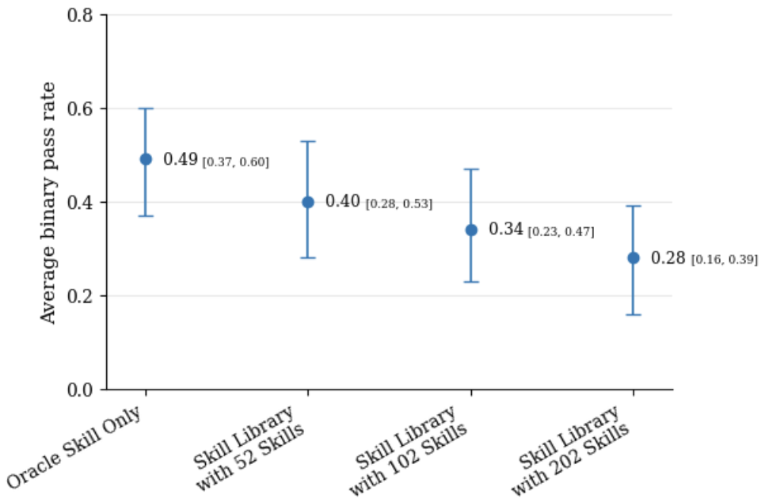

# More Skills, Worse Agents? Skill Shadowing Degrades Performance When Expanding Skill Libraries
# 技能越多，智能体越差？——技能遮蔽在技能库扩容时导致性能退化

> **论文信息**
> - **arXiv**：arXiv:2605.24050v2 [cs.SE]，2026 年 6 月 23 日（v1 于 2026 年 5 月发布）
> - **作者**：Hongwen Song、Song (Vinson) Wei（通讯）
> - **单位**：Databricks Inc.
> - **关键词**：Agent 技能、智能体退化、技能库、技能选择、技能遮蔽、上下文开销
> - **篇幅**：正文 11 页 + 附录 7 页

> **翻译说明**
> - 本文基于 arXiv:2605.24050v2 全文翻译，覆盖摘要、第 1—5 节正文、致谢、参考文献，以及附录 A、B 全部内容。
> - 这是一篇**方法论文章**：它的核心贡献不是新系统，而是把一个笼统的「技能库变大导致性能下降」拆解成两个**可分离、可估计、可给出上界**的因果机制。译文完整保留了第 3 节的推导（式 1—14）与第 4 节的两张核心结果表。
> - 公式中的希腊字母与算子按原文形态保留（如 $\Delta_{\text{ctx}}$、$\Delta_{\text{shd}}$、$\rho$、$\pi$）；下标 $n/m/o$ 对应原文的三类调用事件，为避免译名歧义，译文在首次出现处同时给出中文与英文符号。
> - 术语处理：`skill shadowing` → 「技能遮蔽」（原文明确类比编程语言的 variable shadowing）；`context overhead` → 「上下文开销」；`oracle skill` → 「神谕技能」（指经实测确认对当前任务有正增益的技能）；`distractor skill` → 「干扰技能」；`pass rate` → 「通过率」。

---

## 摘要

技能库让 LLM 智能体能够按需加载任务专属指令，从而让非专家用户**在不了解存在哪些技能、也不知道技能如何工作**的情况下，仅通过自然语言解决领域专属任务。然而，随着技能库规模增长，性能会退化——当从一个「已知有帮助的小技能集」扩展到 **202 个技能的技能库**时，退化幅度可达 **21%**。

在本工作中，我们把这种性能退化形式化为：**只加载已知有帮助技能时的通过率**与**加载完整技能库时的通过率**之间的差值。

此外，我们提出按**技能调用情况**（即智能体在一段轨迹中选择了哪些技能）来条件分解这一通过率下降，将其拆为两个效应：

- **技能遮蔽（skill shadowing）**：随着技能库扩容，智能体**更频繁地选错技能**；
- **上下文开销（context overhead）**：即便选择正确，**被扩大的上下文本身也会降低执行质量**。

我们为这两个效应分别推导了**上界**，以刻画它们对通过率下降的影响量级。我们对效应本身及其上界的经验估计都显示：**技能遮蔽效应随技能库规模增长而增长，并且显著贡献于性能退化；而上下文开销效应始终很小，与零不可区分。** 这一观察到的**不对称性**确立了一个结论：**在扩展技能库时，主要瓶颈是技能选择失败，而不是被扩大的上下文。**

**关键词**：Agent 技能、智能体退化、技能库、技能选择、技能遮蔽、上下文开销。

---

## 1. 引言

LLM 智能体正在越来越多地不只是在加工具调用，而是在**加载技能**——技能是自包含的指令、脚本与参考文档包，把领域专长注入智能体的上下文 [Xu and Yan, 2026]。这一抽象已迅速成为行业标准：Anthropic 为 Claude 发布了 Agent Skills 并把规范开放为开放格式，Atlassian、Stripe、Figma 的伙伴技能进入了精选目录 [Zhang et al., 2025]；OpenAI 随后也为 Codex 采用了同样的 `SKILL.md` 约定 [OpenAI, 2025]。

其吸引力在于**可组合性**：从业者把几十个技能装配进单个智能体，而基础性系统已经证明能力库可以通过基于语言的接口大规模组合与选择——Voyager [Wang et al., 2023] 增量构建技能库并通过嵌入相似度检索，HuggingGPT [Shen et al., 2023] 则用自然语言描述在数千个专家模型中做选择。

其**前提**是：用户可以用平实语言描述任务（「查一下这个客户的集群为什么慢」），然后智能体自主选择正确的技能，而用户既不需要知道存在哪些技能，也不需要知道它们如何工作。

**在我们的实验中，一个 202 技能的技能库让这个前提崩了：在两个模型上平均，通过率下降 21%。**

然而，大多数既有工作都是**逐个**评估技能的：如何编写一个技能、如何检索一个技能，或者衡量某个技能相对于无技能基线的边际贡献 [Qin et al., 2024b, Patil et al., 2024, Hao et al., 2023]。来自更成熟的工具使用文献的证据表明，这种「单技能视角」危险地不完整：工具选择准确率会从候选数少于 30 个时的 90% 以上，掉到 11,100 个候选时的 **13.6%** [Gan and Sun, 2025]；在选项众多时，上下文内选择「可能完全失败」[Hao et al., 2023]。

**技能会放大这些失效模式**：技能依赖自然语言描述，其**作用域比强类型的工具模式更宽、重叠更多**；而一个错误的技能会把**看似合理但实际错误的推理**注入智能体上下文，并在其中**被当作权威** [Xu and Yan, 2026]——相比之下，一次错误的工具调用更可能因为其结构化模式而产生**可检测的错误**（类型不匹配、缺少参数、API 错误码）。

**研究动机。** 尽管业界认知在增长——近期工作记录了在逐步更真实的技能设定下的退化 [Liu et al., 2026]，并显示压缩技能内容可以产生「少即是多」效应 [Gao et al., 2026]——如图 1 所示，我们在 SkillsBench [Li et al., 2026] 上评测并观察到：与只加载已知有帮助的技能（即**神谕技能**，oracle skills）相比，加载逐步扩大的技能库会导致**单调的通过率下降**。

我们的首要假设是：**技能库中的某些技能遮蔽了神谕技能。** 例如：

> 在 `mario-coin-counting` 任务中，技能库包含一个名为 `video-frame-extraction` 的技能，它的描述在**表面上**比任务提供的有用技能更匹配查询。结果，智能体在**全部 26 条轨迹中**都调用了这个错误的技能。

然而，此前没有任何工作**形式化**这种技能库导致的退化，也没有人尝试通过**受控实验**把它分解为可分离的因果机制。挑战在于：智能体的一条轨迹——从接收任务查询、经过技能选择与调用、到产生最终输出——在很大程度上是一个**黑箱**：我们能观察到任务结果，但观察不到产生该结果的中间决策。若不观察完整的中间状态，就无法把退化归因到具体的失效机制。

> 
>
> **图 1**：从神谕技能扩展到更大的技能库时的通过率下降，跨 38 个（任务, 模型）对平均，误差条为 95% 百分位自助法置信区间。

**贡献。** 我们提出使用**技能调用**作为这样一类可观察的中间状态。我们形式化了轨迹结构以定义**调用模式**，从而把技能库导致的退化**精确分解**为两个可分离的效应——**技能遮蔽**与**上下文开销**——并为每个单独效应推导了**上界**（§3）。

我们的实验显示，**技能遮蔽占主导**，解释最多 **68%** 的退化，且是**唯一统计显著**的效应；而上下文开销给出一致的、看似合理但**不显著**的点估计，与噪声不可区分（§4）。

---

## 2. 形式化

我们研究**技能增强型智能体（skill-augmented agents）**——从共享技能库中选择并加载任务专属指令集的 LLM 智能体。与工具增强型智能体 [Qin et al., 2024a, Schick et al., 2023] 不同——在那里调用工具会执行代码并返回计算结果——**调用一个技能是把指令性文本注入智能体的上下文窗口**；随后智能体在注入指令的引导下，自己用基础工具驱动任务执行。

### 2.1 技能增强型智能体

**定义 1（技能）。** 一个技能是一个三元组 $S_i = (n_i, d_i, b_i)$，由一个**名称** $n_i$、一段**自然语言描述** $d_i$ 与一个**主体** $b_i$（引导任务执行的完整指令与示例）组成。二元组 $(n_i, d_i)$ 是技能的**接口**——这是选择时刻智能体唯一可见的信息。主体 $b_i$ 在技能被调用之前是**不可见**的。

**定义 2（技能库）。** 技能库是一个有限集合 $S = \{S_1, \ldots, S_\ell\}$。

我们的形式化改编自 Jiang et al. [2026] 的智能体技能元组——他们把技能定义为其适用条件、策略、终止条件与可调用接口。**上下文注入型技能**把执行完全委派给宿主智能体，因此适用条件、策略与终止条件退化为**智能体**的属性而非**技能**的属性；剩下的就是可调用接口（我们的 $(n_i, d_i)$）与指令载荷（我们的 $b_i$）。

**定义 3（智能体）。** 一个智能体 $A_\theta$ 是一个参数为 $\theta$ 的大语言模型，它在每一轮以当前观察、先前的交互历史、任务 $q$ 以及技能描述 $\{(n_i, d_i)\}_{i=1}^{\ell}$ 为条件选择一个动作。动作是以下之一：一次**技能调用** $\text{Skill}(n_i)$、一次**基础工具调用**（例如文件读取、shell 命令），或一个**终止信号**。

**定义 4（智能体上下文）。** 智能体上下文是智能体在行动之前接收到的完整输入：

$$C(q, S) = \left(q,\ D(S)\right), \qquad D(S) = \{(n_i, d_i)\}_{i=1}^{\ell}. \tag{1}$$

智能体上下文**完全由任务与技能库决定**，并且是实验中唯一发生变化的输入（§4）。

这改编自 Qin et al. [2024a] 的控制器形式化——他们把 LLM 的决策分解为在感知器输出 $x_t$、历史 $H_t$ 与查询 $q$ 上的 $p_\theta(a_t \mid x_t, H_t, q)$。在我们的设定中，感知器输出被替换为技能描述 $D(S)$，而历史 $H_t$ 是**不可观测**的——我们把轨迹当作一个黑箱，仅记录其**调用集合** $I$ 与**最终输出**。

### 2.2 轨迹的形式化

**定义 5（任务）。** 一个任务是一个三元组 $T = (q, r, v)$，由**查询** $q$（对目标的自然语言描述）、**参考答案** $r$（展示任务可解性的、已知正确的实现）与**验证器** $v$（由可独立评估的子任务组成的确定性测试套件）组成。

这沿用 Li et al. [2026] 的任务结构，并通过把环境折叠进 $v$ 做了简化。智能体**只观察 $q$**；$r$ 与 $v$ 都被隐藏。由于每个任务由其查询唯一标识，全文为简洁起见以 $q$ 索引。

给定 $T = (q, r, v)$ 与 $S$，一段轨迹按三个阶段推进：

**阶段 1：上下文加载。** 智能体接收 $q$ 与 $D(S)$。技能主体保持隐藏。

**阶段 2：调用技能以完成任务查询。** 智能体在有限的轮数（或时间）内行动。在每一轮，它发出一个动作：
- **2-(1)** 若动作是 $\text{Skill}(n_i)$，则主体 $b_i$ 被追加进智能体上下文（即**技能调用**）；
- **2-(2)** 若动作是一次基础工具调用，系统执行它并返回结果。

智能体在单条轨迹中**可以调用多个技能**。令 $I \subseteq S$ 表示该轨迹中被调用的**不同技能的集合**。阶段 2 中累积的中间动作、观察与内部上下文难以观察。我们只能观察到智能体上下文 $C(q, S)$、调用集合 $I$，以及由 $v$ 评估的最终输出。

**阶段 3：输出。** 当智能体发出完成信号或达到轮数（或时间）上限时，轨迹终止。智能体产生一个最终制品（例如修改后的文件、生成的代码），轨迹结束。

### 2.3 输出验证

验证器 $v$ 位于智能体轨迹**之外**，评估最终环境状态；智能体**不能观察也不能与 $v$ 交互**。我们定义任务完成随机变量

$$T_q = \frac{\#\{\text{由 } v \text{ 验证通过的子任务}\}}{m} \in \left\{0, \tfrac{1}{m}, \ldots, 1\right\}. \tag{2}$$

**二元通过率**是全部子任务通过的概率：

$$p(q, A_\theta, S) = \Pr[T_q = 1 \mid q, A_\theta, S]. \tag{3}$$

**分数通过率**为：

$$\bar{p}(q, A_\theta, S) = \mathbb{E}[T_q \mid q, A_\theta, S]. \tag{4}$$

当 $m = 1$ 时 $T_q \in \{0, 1\}$，两个指标重合。由于在我们的实验中智能体 $A_\theta$ 是固定的，为简洁我们写作 $p(q, S)$。

---

## 3. 技能库导致的退化：分解与上界

我们形式化本文研究的两个退化机制。

**技能遮蔽**发生在干扰技能在选择过程中**挤掉了神谕技能**，从而降低了智能体调用到正确技能的概率——尽管正确技能是可得的。

**上下文开销**发生在**被扩大的智能体上下文在智能体选择正确的情况下仍然降低了执行质量**。

我们定义神谕技能与干扰技能、按调用模式对轨迹分类，并推导出把通过率下降精确分解为这两个效应的公式。

**定义 6（神谕技能集）。** 对任务 $q$ 与技能增量阈值 $\tau > 0$，神谕技能集是其相对于无技能基线的边际贡献达到或超过 $\tau$ 的技能子集：

$$S^{\star}(q) = \{S_i \in S \mid p(q, \{S_i\}) - p(q, \varnothing) \geq \tau\}. \tag{5}$$

神谕集是**经验确定**的：每个技能都在 $q$ 上单独测试，只有那些相对无技能基线的通过率提升达到阈值的技能才被纳入。该集合可以包含多个技能（当若干技能独立地提升 $q$ 上的性能时），也可以为空（当没有任何单个技能提供足够收益时）。$\tau$ 的取值与经验神谕集规模在 §4 报告。

**定义 7（干扰技能）。** 对任务 $q$，所有非神谕技能 $S \setminus S^{\star}(q)$ 都是干扰技能。干扰技能**不是对抗性构造的**；它们只是技能库中未达到 $q$ 的神谕阈值的技能。

**定义 8（调用事件）。** 对满足 $S^{\star}(q) \neq \varnothing$ 的任务 $q$，回顾一条轨迹会产生一个调用集合 $I$。每条轨迹落入三个互斥事件之一：

- **n. 未调用任何技能**（$I = \varnothing$）。智能体仅用基础工具尝试任务，或者未能行动。
- **m. 混合调用**（$I \neq \varnothing$ 且 $I \not\subseteq S^{\star}(q)$）。智能体调用了至少一个技能，但并非**只**调用神谕技能——要么完全没有调用神谕技能，要么神谕技能与干扰技能同时被调用。
- **o. 仅神谕调用**（$\varnothing \neq I \subseteq S^{\star}(q)$）。智能体调用的每个技能都是神谕技能。

**技能库导致的通过率下降。** 为了量化技能库扩容的成本，我们把**只有神谕技能集可用时**（此时选择是平凡的）的通过率与**完整技能库下**的通过率做对比：

**定义 9（技能库导致的通过率下降）。** 对满足 $S^{\star}(q) \neq \varnothing$ 的任务 $q$，技能库导致的通过率下降为：

$$\Delta(q, S) = p(q, S^{\star}(q)) - p(q, S). \tag{6}$$

**按调用事件分解。** 对 $S^{\star}(q) \neq \varnothing$ 的任务，三个调用事件（定义 8）划分了轨迹空间。由全概率公式：

$$p(q, S) = \pi_n \rho_n + \pi_m \rho_m + \pi_o \rho_o, \tag{7}$$

其中 $\pi_n, \pi_m, \pi_o$ 是在给定 $(q, S)$ 下事件 n、m、o 的概率，$\rho_n, \rho_m, \rho_o$ 是对应的条件通过率。三个事件的概率之和为 1，即 $\pi_n + \pi_m + \pi_o = 1$。

当技能库**只包含神谕技能**时（即 $S = S^{\star}(q)$），同样的分解也适用。由于不存在干扰技能，事件 m 不可能发生，只剩下 n 与 o。我们用星号标记 $S = S^{\star}(q)$ 下的事件概率与条件通过率：

$$p(q, S^{\star}) = \pi^{\star}_n \rho^{\star}_n + \pi^{\star}_o \rho^{\star}_o, \tag{8}$$

其中 $\pi^{\star}_n + \pi^{\star}_o = 1$。把式 7 与式 8 代入式 6：

$$\Delta(q, S) = \left(\pi^{\star}_n \rho^{\star}_n + \pi^{\star}_o \rho^{\star}_o\right) - \left(\pi_n \rho_n + \pi_m \rho_m + \pi_o \rho_o\right). \tag{9}$$

加上并减去 $\pi^{\star}_n \rho_n + \pi^{\star}_o \rho_o$ 得：

$$\Delta(q, S) = \underbrace{\pi^{\star}_n \left(\rho^{\star}_n - \rho_n\right) + \pi^{\star}_o \left(\rho^{\star}_o - \rho_o\right)}_{\Delta_{\text{ctx}}} + \underbrace{\left(\pi^{\star}_n - \pi_n\right)\rho_n + \left(\pi^{\star}_o - \pi_o\right)\rho_o - \pi_m \rho_m}_{\Delta_{\text{shd}}}. \tag{10}$$

**上下文开销效应（$\Delta_{\text{ctx}}$）。** 事件概率被**固定在它们的 $S^{\star}$ 取值上**；只有条件通过率发生变化。$\rho^{\star}_o - \rho_o > 0$ 表明：完整技能库的上下文即便在智能体选择相同技能时也降低了执行质量。两种条件之间唯一的差别就是智能体上下文（定义 4）：$D(S^{\star})$ 含 $|S^{\star}(q)|$ 个条目，而 $D(S)$ 含 $\ell$ 个。

**技能遮蔽效应（$\Delta_{\text{shd}}$）。** 类比编程语言中的变量遮蔽（variable shadowing），描述与神谕技能重叠的干扰技能可以**隐藏正确选项**，把智能体引向错误技能或没有技能。条件通过率被**固定在它们的完整技能库取值上**；只有事件概率发生变化。在完整技能库下，概率质量从事件 o 转移到事件 m 与 n，从而降低性能。由于 $\pi^{\star}_n + \pi^{\star}_o = 1 = \pi_n + \pi_m + \pi_o$，我们有 $\pi_m = (\pi^{\star}_n - \pi_n) + (\pi^{\star}_o - \pi_o)$，技能遮蔽效应简化为：

$$\Delta_{\text{shd}} = \left(\pi^{\star}_n - \pi_n\right)\left(\rho_n - \rho_m\right) + \left(\pi^{\star}_o - \pi_o\right)\left(\rho_o - \rho_m\right). \tag{11}$$

**假设 1。** 对每个调用事件 $E \in \{n, o\}$，$S = S^{\star}(q)$ 下的条件通过率**至少不低于**完整技能库下的：

$$\rho^{\star}_E \geq \rho_E. \tag{12}$$

**引理 1（上下文开销的上界）。** 在假设 1 下，$\Delta_{\text{ctx}} \geq 0$ 且

$$\Delta_{\text{ctx}} \leq \max\left(\rho^{\star}_n - \rho_n,\ \rho^{\star}_o - \rho_o\right). \tag{13}$$

**证明。** 由假设 1，$\Delta_{\text{ctx}}$ 中的两项都非负。由于 $\pi^{\star}_n + \pi^{\star}_o = 1$，$\Delta_{\text{ctx}}$ 是一个凸组合，被其各项的最大值界定。∎

**引理 2（技能遮蔽的上界）。** 技能遮蔽效应满足

$$|\Delta_{\text{shd}}| \leq \left(|\pi^{\star}_n - \pi_n| + |\pi^{\star}_o - \pi_o|\right) \cdot \max\left(|\rho_n - \rho_m|,\ |\rho_o - \rho_m|\right) \leq |\pi^{\star}_n - \pi_n| + |\pi^{\star}_o - \pi_o|. \tag{14}$$

**证明。** 对式 11 应用三角不等式，并提取出最大绝对条件通过率差。第二个不等式成立是因为 $|\rho_E - \rho_m| \leq 1$。∎

**解读。** 这两个上界充当**结构性诊断**：如果完整技能库的上下文在每个调用事件内部几乎不改变执行质量，那么该上界——从而 $\Delta_{\text{ctx}}$ 本身——必然很小，**无论样本量多大**。所以一个小的上界能把「因噪声而检测不到」与「确实很小」区分开。

遮蔽上界分解为两个可解释的组成部分：**选择不稳定性**（在完整技能库下调用事件分布偏移了多少）与**选择赌注**（通过率在不同事件之间差多少）。**只有当两个因子都大时遮蔽才可能大**：智能体的选择必须发生偏移，并且该偏移必须把质量推向表现更低的事件。我们在附录 B.2 中对这些上界做了数值评估。

---

## 4. 实验

我们设计受控实验来回答剩下的问题：**是什么驱动了技能库导致的退化？**

**数据集。** 我们在 SkillsBench [Li et al., 2026] 上评测——这是一个含 88 个任务的基准，覆盖文档处理、金融、科学计算、数据分析等领域。每个任务都有一个可能有所帮助的对应技能。我们只纳入那些其对应技能相对无技能基线带来至少 **4%** 通过率提升的任务，从而得到 **38 个（任务, 模型）对**（其中 21 个任务来自 Haiku 4.5，17 个来自 Sonnet 4.6）具有神谕技能。对每个对，我们评测一个**基线条件**（技能库只含神谕技能，$S = S^{\star}$）与三个**扩展技能库**（总规模 $|S| \in \{52, 102, 202\}$）。最终数据集包含 **2,545 条轨迹**。任务选择、完整轨迹计数、技能库构造与自助法等细节见附录 A。

**通过率下降的分解与缩放。** 对每个技能库规模，我们把轨迹分类到三个调用事件（定义 8），并在表 1 中报告 $\Delta_{\text{ctx}}$、$\Delta_{\text{shd}}$ 与 $\Delta$（式 10）：$\Delta_{\text{ctx}}$ 与 $\Delta_{\text{shd}}$ **都随技能库规模增长**，而 $\Delta_{\text{shd}}$ 在 $\Delta$ 中的占比不断上升。

这一缩放背后的**行为偏移**在表 2 中可见，它报告了四种调用模式各自的轨迹占比——「仅神谕」（事件 o）、「混合—调用了神谕」与「混合—未调用神谕」（事件 m 的两个子情况），以及「未调用技能」（事件 n）。随着技能库扩大，事件 o 的占比**塌缩**，质量迁移进事件 n 与 m。两种互补的失效模式可见：**放弃**（质量流入事件 n）与**选错**（质量流入事件 m）。更多遮蔽示例见附录 A.4，调用模式偏移的经验研究见附录 B.4。

> **表 1**：通过式 10 把 $\Delta$（定义 9）分解为 $\Delta_{\text{ctx}}$ 与 $\Delta_{\text{shd}}$，跨两个模型平均，含 95% 两阶段聚类自助法置信区间。$\Delta_{\text{ctx}} + \Delta_{\text{shd}} = \Delta$ **精确成立**。**粗体**表示置信区间不包含零。
>
> | $\lvert S \rvert$ | $\Delta_{\text{ctx}}$ | $\Delta_{\text{shd}}$ | $\Delta$ |
> |---|---|---|---|
> | 52 | .06 [−.11, .22] | **.03 [−.01, .07]** | **.08 [.02, .15]** |
> | 102 | .06 [−.11, .23] | **.08 [.02, .15]** | **.14 [.09, .19]** |
> | 202 | .07 [−.13, .25] | **.14 [.06, .26]** | **.21 [.15, .27]** |

**哪个效应主导了下降？** $\Delta_{\text{shd}}$ 是**唯一置信区间不包含零**的分量，并且在最大技能库下占 $\Delta$ 的多数。$\Delta_{\text{ctx}}$ 在任何技能库规模下都未与零分离，尽管其点估计始终为正。

在事件 o 内部——即智能体**选择正确**的那部分——二元通过率仍随技能库增长而下降（见附录 B.3 表 7 与表 8），这提示上下文开销**是真实的，但我们的样本量太小无法确证**。基于经验观察，我们得出结论：**遮蔽是下降的主导效应，而上下文开销的点估计只能视作提示性的。**

引理 1 与引理 2 的理论上界印证了这一结论：上下文开销上界**始终很小、与零不可区分**，而遮蔽上界**急剧增长且全程显著为正**；完整细节见附录 B.2。

> **表 2**：四种调用模式（定义 8 划分的细化；详见附录 B.3）的轨迹占比分布。
>
> | $S$ 条件 | 仅神谕 | 混合—调用了神谕 | 混合—未调用神谕 | 未调用技能 | $n$ |
> |---|---|---|---|---|---|
> | $S = S^{\star}$ | 88.0% | 0.0% | 0.0% | 12.0% | 552 |
> | $\lvert S \rvert = 52$ | 80.3% | 0.9% | 2.8% | 16.1% | 542 |
> | $\lvert S \rvert = 102$ | 64.4% | 1.4% | 5.9% | 28.3% | 988 |
> | $\lvert S \rvert = 202$ | 52.6% | 1.6% | 7.3% | 38.5% | 494 |

---

## 5. 讨论

我们的结果指向：**技能遮蔽是扩展技能库时的主要瓶颈**——一旦语义相似的技能开始争夺选择权，无论底层模型如何，准确率都会退化。

一个自然的下一步是通过**基于检索的预过滤** [Gan and Sun, 2025, Wang et al., 2025]、**描述消歧** [Gao et al., 2026]、**学习式路由** [Jia and Li, 2026] 或其他技术来直接攻克这一瓶颈。

此外，我们的研究覆盖了两个来自**同一家供应商**的模型上的 202 个技能，在这个规模下上下文开销仍然不大。当技能库扩容一个数量级或跨越不同架构家族时，这些模式——以及上述缓解手段——是否仍然成立，仍是一个开放问题。

## 致谢

我们感谢 Zubair Anwar、Juanyan Li 与 Martin Valdez-Vivas 在本工作全程提供的宝贵反馈与讨论。我们也十分感谢 Data Science Leaders Sam Shah、Feng Pan、Zubair Anwar 与 Divy Menghani 的支持。

## 参考文献

Tiantian Gan and Qiyao Sun. RAG-MCP: Mitigating prompt bloat in LLM tool selection via retrieval-augmented generation. *arXiv preprint arXiv:2505.03275*, 2025.

Yudong Gao, Zongjie Li, Zimo Ji, Pingchuan Ma, Shuai Wang, et al. SkillReducer: Optimizing LLM agent skills for token efficiency. *arXiv preprint arXiv:2603.29919*, 2026.

Shibo Hao, Tianyang Liu, Zhen Wang, and Zhiting Hu. ToolkenGPT: Augmenting frozen language models with massive tools via tool embeddings. *Advances in neural information processing systems*, 36:45870–45894, 2023.

Jingyi Jia and Qinbin Li. AutoTool: Efficient tool selection for large language model agents. In *Proceedings of the AAAI Conference on Artificial Intelligence*, volume 40, pages 31265–31273, 2026.

Yanna Jiang, Delong Li, Haiyu Deng, Baihe Ma, Xu Wang, Qin Wang, and Guangsheng Yu. SoK: Agentic skills—beyond tool use in LLM agents. *arXiv preprint arXiv:2602.20867*, 2026.

Xiangyi Li, Wenbo Chen, Yimin Liu, Shenghan Zheng, Xiaokun Chen, Yifeng He, Yubo Li, Bingran You, Haotian Shen, Jiankai Sun, et al. SkillsBench: Benchmarking how well agent skills work across diverse tasks. *arXiv preprint arXiv:2602.12670*, 2026.

Yujian Liu, Jiabao Ji, Li An, Tommi Jaakkola, Yang Zhang, and Shiyu Chang. How well do agentic skills work in the wild: Benchmarking LLM skill usage in realistic settings. *arXiv preprint arXiv:2604.04323*, 2026.

OpenAI. Agent skills – Codex. https://developers.openai.com/codex/skills, 2025. OpenAI adopted the same SKILL.md format; skills available in Codex CLI, IDE extension, and Codex app.

Shishir G Patil, Tianjun Zhang, Xin Wang, and Joseph E Gonzalez. Gorilla: Large language model connected with massive apis. *Advances in Neural Information Processing Systems*, 37:126544–126565, 2024.

Yujia Qin, Shengding Hu, Yankai Lin, Weize Chen, Ning Ding, Ganqu Cui, Zheni Zeng, Xuanhe Zhou, Yufei Huang, Chaojun Xiao, et al. Tool learning with foundation models. *ACM Computing Surveys*, 57(4):1–40, 2024a.

Yujia Qin, Shihao Liang, Yining Ye, Kunlun Zhu, Lan Yan, Yaxi Lu, Yankai Lin, Xin Cong, Xiangru Tang, Bill Qian, et al. ToolLLM: Facilitating large language models to master 16000+ real-world APIs. In *The Twelfth International Conference on Learning Representations*, 2024b.

Timo Schick, Jane Dwivedi-Yu, Roberto Dessì, Roberta Raileanu, Maria Lomeli, Eric Hambro, Luke Zettlemoyer, Nicola Cancedda, and Thomas Scialom. Toolformer: Language models can teach themselves to use tools. *Advances in neural information processing systems*, 36:68539–68551, 2023.

Yongliang Shen, Kaitao Song, Xu Tan, Dongsheng Li, Weiming Lu, and Yueting Zhuang. HuggingGPT: Solving AI tasks with ChatGPT and its friends in Hugging Face. *Advances in Neural Information Processing Systems*, 36:38154–38180, 2023.

Guanzhi Wang, Yuqi Xie, Yunfan Jiang, Ajay Mandlekar, Chaowei Xiao, Yuke Zhu, Linxi Fan, and Anima Anandkumar. Voyager: An open-ended embodied agent with large language models. *Transactions on Machine Learning Research*, 2023.

Renxi Wang, Xudong Han, Lei Ji, Shu Wang, Timothy Baldwin, and Haonan Li. ToolGen: Unified tool retrieval and calling via generation. In *The Thirteenth International Conference on Learning Representations*, 2025.

Renjun Xu and Yang Yan. Agent skills for large language models: Architecture, acquisition, security, and the path forward. *arXiv preprint arXiv:2602.12430*, 2026.

Barry Zhang, Keith Lazuka, and Mahesh Murag. Equipping agents for the real world with agent skills. *Anthropic Engineering Blog*, 2025.

---

# 附录

## 附录目录

- A 实验配置
  - A.1 本实验纳入的任务
  - A.2 技能库构造
  - A.3 自助法
  - A.4 技能遮蔽效应示例
- B 补充实验
  - B.1 分模型通过率下降
  - B.2 理论上界
  - B.3 不同调用事件的通过率
  - B.4 调用事件分布

---

## A 实验配置

定义 6 在**单个技能层面**定义神谕集，但在实践中技能常常是**打包**的：多个技能可以联合充当某个任务的神谕集。在表 3 中，`trend-anomaly-causal-inference` 就是一个好例子。

在 SkillsBench [Li et al., 2026] 中，我们有由任务创建者编写的**技能包**（简称为 bundle）——它们是任务作者认为对解决给定任务有帮助的**手工构造**技能集。我们称这个集合为该任务的**作者主技能包**，简称为**作者技能包**。技能包规模从 1 到 7 个技能不等（中位数 2，均值 2.7）；它们由基准提供，而非由本工作提供。

### A.1 本实验纳入的任务

只有当作者技能包中的**每一个**单个技能都通过了我们按定义 6 设定的经验阈值 $\tau = 0.04$ 时，我们才把该（任务, 模型）对纳入实验，这样我们才能「**打破包结构**」并确保每个单个技能都有助于解决任务。理由很简单：**如果技能没有帮助，那么即便技能库中有更多技能，也很可能观察不到性能退化。** 这一筛选留下 **38 个（任务, 模型）对**：21 个 Haiku、17 个 Sonnet。

自此以后，作者技能包即充当神谕技能集 $S^{\star}(q)$，下文我们交替使用「神谕技能集」与「神谕包」。我们的实验包含 **2,545 条轨迹**：在 $S = S^{\star}$ 与 $|S| \in \{52, 102, 202\}$ 条件下，Haiku 分别为 303/297/544/273 条，Sonnet 分别为 233/233/441/221 条。

> **表 3**：在 $|S| = 202$ 时的高频遮蔽配对（跨 38 个匹配的（任务, 模型）对共 494 条轨迹）。**#shd traj** 是智能体**首选**该干扰技能的轨迹条数。
>
> | 主任务 | 神谕包 | 干扰技能 | 干扰技能的来源任务 | #shd traj |
> |---|---|---|---|---|
> | mario-coin-counting | ffmpeg, image_editing, object_counter | video-frame-extraction | jpg-ocr-stat, pedestrian-traffic-counting | **51** |
> | trend-anomaly-causal-inference | data_cleaning, did_causal_analysis, feature_engineering, time_series_anomaly_detection | senior-data-scientist | powerlifting-coef-calc | **37** |
> | manufacturing-fjsp-optimization | fjsp-baseline-repair-with-downtime-and-policy | reflow_machine_maintenance_guidance | manufacturing-equipment-maintenance | **14** |
> | econ-detrending-correlation | timeseries-detrending | csv-processing | adaptive-cruise-control | **4** |
> | energy-market-pricing | dc-power-flow, economic-dispatch, locational-marginal-prices, power-flow-data | casadi-ipopt-nlp | energy-ac-optimal-power-flow | **3** |

### A.2 技能库构造

最大技能库（$|S| = 202$）是全部 88 个作者技能包的并集，经过**字节完全相同去重**，并对同名但主体不同的技能做**数字后缀消歧**。

### A.3 自助法

置信区间来自自助分布的 **95% 百分位**。对分解（式 10）：在每次自助试验中，我们先有放回地重采样（任务, 模型）对，再在每个被抽中的对内重采样轨迹。

### A.4 技能遮蔽效应示例

表 3 列出了在 $|S| = 202$ 时最频繁出现的技能遮蔽效应实例，按干扰技能被智能体**首选**的轨迹数排序。第一行即引言 §1 中的 `mario-coin-counting` 例子。

---

## B 补充实验

### B.1 分模型通过率下降

表 4 给出总体通过率下降并附分模型细分，可以看到**两个模型都随技能库增长而退化**。Haiku 的下降在 $|S| = 52$ 时即已与零分离；Sonnet 只在 $|S| = 202$ 时分离。

> **表 4**：按模型与技能库规模划分的技能库导致通过率下降 $\Delta$（定义 9），含 95% 百分位自助法置信区间。**粗体**表示置信区间不含零。
>
> | $\lvert S \rvert$ | Haiku 4.5 | Sonnet 4.6 |
> |---|---|---|
> | 52 | **.10 [.03, .18]** | .06 [−.03, .15] |
> | 102 | **.22 [.16, .29]** | .05 [−.03, .13] |
> | 202 | **.26 [.20, .33]** | **.15 [.06, .24]** |

> **表 5**：$\Delta$（定义 9）到 $\Delta_{\text{ctx}}$ 与 $\Delta_{\text{shd}}$ 的分模型分解（式 10），含 95% 联合两阶段聚类自助法置信区间（2,000 次试验，随机种子 42）。在每个点估计上 $\Delta_{\text{ctx}} + \Delta_{\text{shd}} = \Delta$。**粗体**表示置信区间不含零。汇总估计见表 1。
>
> | 视角 | $\lvert S \rvert$ | $\Delta_{\text{ctx}}$ | $\Delta_{\text{shd}}$ | $\Delta$ |
> |---|---|---|---|---|
> | Haiku 4.5 | 52 | .09 [−.10, .27] | .02 [−.04, .07] | .10 [−.08, .28] |
> | Haiku 4.5 | 102 | .15 [−.04, .34] | **.07 [.00, .16]** | **.22 [.05, .39]** |
> | Haiku 4.5 | 202 | .09 [−.18, .36] | **.17 [.02, .37]** | **.26 [.09, .43]** |
> | Sonnet 4.6 | 52 | .05 [−.22, .33] | .01 [−.07, .10] | .06 [−.21, .33] |
> | Sonnet 4.6 | 102 | .03 [−.23, .30] | .02 [−.06, .10] | .05 [−.21, .31] |
> | Sonnet 4.6 | 202 | .11 [−.16, .40] | .04 [−.04, .15] | .15 [−.11, .41] |

表 5 给出两个效应的分模型估计：对 **Haiku**，$\Delta_{\text{shd}}$ 占主导，其置信区间在最大技能库下不含零；而对 **Sonnet**，$\Delta_{\text{ctx}}$ 在每个规模下都**等于或超过** $\Delta_{\text{shd}}$，但我们没有必要的统计功效去把它与零区分开。

### B.2 理论上界

我们把从分解中得到的经验值 $(\pi^{\star}_E, \rho^{\star}_E, \pi_E, \rho_E)$ 代入引理 1（式 13）与引理 2（式 14 的更紧形式）的右侧。置信区间通过在每个自助试验上重新计算每个上界并取相应百分位得到。

> **表 6**：来自引理 1 与引理 2（更紧形式）的上界 $\Delta^{\sup}_{\text{ctx}}$ 与 $\Delta^{\sup}_{\text{shd}}$，含与表 5 同一批迭代（2,000 次试验，随机种子 42）的 95% 联合两阶段聚类自助法置信区间。**粗体**表示置信区间不含零。
>
> | $\lvert S \rvert$ | Haiku $\Delta^{\sup}_{\text{ctx}}$ | Haiku $\Delta^{\sup}_{\text{shd}}$ | Sonnet $\Delta^{\sup}_{\text{ctx}}$ | Sonnet $\Delta^{\sup}_{\text{shd}}$ | Pooled $\Delta^{\sup}_{\text{ctx}}$ | Pooled $\Delta^{\sup}_{\text{shd}}$ |
> |---|---|---|---|---|---|---|
> | 52 | .10 [−.06, .36] | **.04 [.01, .19]** | .06 [−.20, .33] | **.16 [.00, .44]** | .08 [−.08, .29] | **.06 [.01, .18]** |
> | 102 | **.17 [.00, .41]** | **.09 [.02, .32]** | .04 [−.21, .30] | **.17 [.01, .43]** | .07 [−.08, .31] | **.14 [.04, .29]** |
> | 202 | .10 [−.04, .43] | **.35 [.08, .74]** | .12 [−.14, .41] | **.15 [.01, .37]** | .07 [−.06, .34] | **.24 [.09, .46]** |

表 6 报告两个上界，其中 $\Delta^{\sup}_{\text{ctx}} = \max(\rho^{\star}_n - \rho_n,\ \rho^{\star}_o - \rho_o)$，$\Delta^{\sup}_{\text{shd}} = |\pi^{\star}_n - \pi_n| + |\pi^{\star}_o - \pi_o|$。

我们观察到 $\Delta^{\sup}_{\text{ctx}}$ 在**所有条件下都保持很小**，且没有任何置信区间与零分离，印证了我们「上下文开销与噪声不可区分」的发现。$\Delta^{\sup}_{\text{shd}}$ 则随技能库规模**急剧增长**，并在几乎所有场景下都不含零。

### B.3 不同调用事件的通过率

**对调用事件的更细划分。** 定义 8 中的混合事件 m 允许两类情况：智能体在调用干扰技能的同时也调用了至少一个神谕技能，或者它只调用了干扰技能。与 n 和 o 结合，得到四路划分：

- 「**仅神谕**」（o）；
- 「**混合 — 调用了神谕**」；
- 「**混合 — 未调用神谕**」；
- 「**未调用技能**」（n）。

我们在表 7 中报告四类调用事件的**二元通过率**，在表 8 中报告**分数通过率**。置信区间：二元用 Wilson 95%，分数用 95% 百分位自助法。

> **表 7**：不同调用事件与技能库规模下的二元通过率，含 Wilson 95% 置信区间。有效轨迹少于 5 条的单元格记为「—」。
>
> | 调用模式 | 视角 | $p(S^{\star})$ | $p(\lvert S\rvert{=}52)$ | $p(\lvert S\rvert{=}102)$ | $p(\lvert S\rvert{=}202)$ |
> |---|---|---|---|---|---|
> | 仅神谕 | Haiku 4.5 | .43 [.37, .50] | .33 [.28, .40] | .26 [.21, .32] | .34 [.24, .45] |
> | 仅神谕 | Sonnet 4.6 | .62 [.56, .68] | .57 [.50, .63] | .58 [.53, .63] | .51 [.43, .58] |
> | 仅神谕 | **汇总** | .52 [.48, .57] | .44 [.40, .49] | .45 [.41, .49] | .45 [.39, .52] |
> | 混合—调用了神谕 | Haiku 4.5 | — | — | .33 [.12, .65] | — |
> | 混合—调用了神谕 | Sonnet 4.6 | — | .00 [.00, .43] | .20 [.04, .62] | .13 [.02, .47] |
> | 混合—调用了神谕 | **汇总** | — | .00 [.00, .43] | .29 [.12, .55] | .13 [.02, .47] |
> | 混合—未调用神谕 | Haiku 4.5 | — | .00 [.00, .35] | .05 [.01, .22] | .00 [.00, .23] |
> | 混合—未调用神谕 | Sonnet 4.6 | — | .00 [.00, .32] | .14 [.06, .29] | .13 [.05, .32] |
> | 混合—未调用神谕 | **汇总** | — | .00 [.00, .20] | .10 [.05, .21] | .08 [.03, .22] |
> | 未调用技能 | Haiku 4.5 | .12 [.06, .24] | .11 [.06, .22] | .07 [.04, .11] | .03 [.02, .07] |
> | 未调用技能 | Sonnet 4.6 | — | 1.00 [.77, 1.00] | 1.00 [.87, 1.00] | .80 [.49, .94] |
> | 未调用技能 | **汇总** | .12 [.06, .24] | .27 [.18, .38] | .16 [.12, .20] | .07 [.04, .12] |

- **上下文开销在「仅神谕」桶内可见。** 对「仅神谕」（事件 o）——即智能体只调用神谕技能的轨迹——二元通过率在**两个模型上都随技能库规模单调下降**。这正是上下文开销的经验特征：**相同的调用模式，在更大的上下文内技能库下产生更低的通过率。**

> **表 8**：按调用事件类型与技能库规模划分的分数通过率，含 95% 百分位自助法置信区间。有效轨迹少于 5 条的单元格记为「—」。
>
> | 调用模式 | 视角 | $\bar{p}(S^{\star})$ | $\bar{p}(\lvert S\rvert{=}52)$ | $\bar{p}(\lvert S\rvert{=}102)$ | $\bar{p}(\lvert S\rvert{=}202)$ |
> |---|---|---|---|---|---|
> | 仅神谕 | Haiku 4.5 | .83 [.81, .86] | .77 [.73, .80] | .77 [.73, .80] | .80 [.73, .85] |
> | 仅神谕 | Sonnet 4.6 | .91 [.88, .93] | .89 [.87, .92] | .91 [.89, .93] | .80 [.74, .84] |
> | 仅神谕 | **汇总** | .87 [.85, .89] | .83 [.80, .85] | .85 [.83, .86] | .80 [.75, .83] |
> | 混合—调用了神谕 | Haiku 4.5 | — | — | .92 [.87, .98] | — |
> | 混合—调用了神谕 | Sonnet 4.6 | — | — | — | .89 [.81, .94] |
> | 混合—调用了神谕 | **汇总** | — | — | .91 [.85, .97] | .89 [.81, .94] |
> | 混合—未调用神谕 | Haiku 4.5 | — | — | .70 [.60, .79] | — |
> | 混合—未调用神谕 | Sonnet 4.6 | — | — | .85 [.79, .90] | .64 [.40, .87] |
> | 混合—未调用神谕 | **汇总** | — | — | .80 [.75, .85] | .64 [.40, .87] |
> | 未调用技能 | Haiku 4.5 | .48 [.36, .59] | .54 [.45, .64] | .45 [.40, .49] | .42 [.37, .48] |
> | 未调用技能 | Sonnet 4.6 | — | 1.00 [1.00, 1.00] | 1.00 [1.00, 1.00] | .80 [.50, 1.00] |
> | 未调用技能 | **汇总** | .47 [.36, .59] | .62 [.53, .71] | .50 [.45, .55] | .44 [.39, .50] |

- **分数通过率下降得比二元通过率少。** 在「仅神谕」内部，分数通过率在每个技能库规模下的下降都小于二元通过率（例如汇总 $\bar{p}$：.87 → .80，而汇总 $p$：.52 → .45，均在 $|S| = 202$ 时）。这意味着**上下文开销更多是移除整任务的正确性，而不是部分进展。**
- **混合桶与无技能桶受样本量限制。** 两个「混合」桶与「未调用技能」在许多条件下依赖小样本；它们高方差的通过率应与表 10 的单元格计数一并阅读。

### B.4 调用事件分布

我们把 $\pi_m$（定义 8）称为**经验遮蔽率**：智能体调用了至少一个干扰技能的轨迹占比。

表 9 报告了在被选中的（任务, 模型）对上的 $\pi_m$（含 Wilson 95% 置信区间），我们发现 **Sonnet 在每个技能库规模下都比 Haiku 累积更多的选错质量**；Haiku 的 $\pi_m$ 保持低位，因为它的质量转而流向「未调用技能」事件，而非选择错误的技能——这一点在后面的表 10 中可见。

> **表 9**：按技能库规模划分的经验遮蔽率 $\pi_m$（定义 8），含 Wilson 95% 置信区间。$S = S^{\star}$ 行因 $\pi_m$ 按构造为 0 而被省略。
>
> | $\lvert S \rvert$ | Haiku 4.5 | Sonnet 4.6 | 汇总 |
> |---|---|---|---|
> | 52 | .02 [.01, .05] | .06 [.03, .09] | .04 [.02, .06] |
> | 102 | .06 [.04, .08] | .09 [.07, .12] | .07 [.06, .09] |
> | 202 | .05 [.03, .08] | .14 [.10, .19] | .09 [.07, .12] |

> **表 10**：四种调用模式（定义 8 的 n/m/o 划分的细化）的轨迹占比分布，按技能库规模。
>
> | 视角 | $\lvert S\rvert$ | 仅神谕 | 混合—调用了神谕 | 混合—未调用神谕 | 未调用技能 | $n$ |
> |---|---|---|---|---|---|---|
> | Haiku 4.5 | $S^{\star}$ | 80.9% | 0.0% | 0.0% | 19.1% | 314 |
> | Haiku 4.5 | 52 | 74.5% | 0.0% | 2.3% | 23.2% | 306 |
> | Haiku 4.5 | 102 | 47.8% | 1.6% | 4.0% | 46.5% | 546 |
> | Haiku 4.5 | 202 | 29.3% | 0.0% | 4.8% | 65.9% | 273 |
> | Sonnet 4.6 | $S^{\star}$ | 97.5% | 0.0% | 0.0% | 2.5% | 238 |
> | Sonnet 4.6 | 52 | 87.7% | 2.1% | 3.4% | 6.8% | 236 |
> | Sonnet 4.6 | 102 | 84.8% | 1.1% | 8.1% | 5.9% | 442 |
> | Sonnet 4.6 | 202 | 81.4% | 3.6% | 10.4% | 4.5% | 221 |
> | 汇总 | $S^{\star}$ | 88.0% | 0.0% | 0.0% | 12.0% | 552 |
> | 汇总 | 52 | 80.3% | 0.9% | 2.8% | 16.1% | 542 |
> | 汇总 | 102 | 64.4% | 1.4% | 5.9% | 28.3% | 988 |
> | 汇总 | 202 | 52.6% | 1.6% | 7.3% | 38.5% | 494 |

表 10 报告每个桶的轨迹占比。**两个模型在技能库增长时表现出定性不同的转变。**

- 在 **Haiku** 上，「仅神谕」（事件 o）塌缩，被挤出的质量几乎全部流向「未调用技能」（事件 n）；两个混合桶在每个规模下都很小。因此 **Haiku 在扩容下的失效模式是「放弃」：它不是选错技能，而是不选技能。**
- 在 **Sonnet** 上，事件 o 下降得更平缓，事件 n 保持较小，被挤出的质量流向事件 m 的两个「混合」子情况。**Sonnet 的失效模式是「选错」：智能体持续调用技能，但越来越多地调用错误的技能。**

这一分模型对比正是表 1 分解模式的基础。

---

## 图片与文件索引

| 图号 | 原图注 | 文件 |
|---|---|---|
| 图 1 | Pass-rate drop when expanding from oracle skills to larger libraries, averaged across 38 (task, model) pairs, with 95% percentile-bootstrap CI. | `../images/SkillShadowing/01-figure1-passrate-drop.png` |
